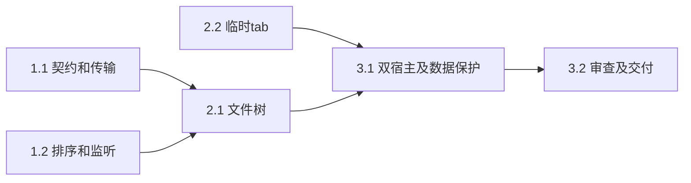

# 执行任务

## 1. 独立项目文件能力

- [x] 1.1 主Agent完成同源传输与导入契约、受保护复制移动、递归合并及回执；用真实项目独立测试核对权限、身份、替换回收、部分完成、取消及重启。
- [x] 1.2 主Agent完成排序版本分页、条目定位与范围监听，接入Manual/broker/client并验证旧分页和订阅释放。

## 2. 文件树与文档打开

- [x] 2.1 主Agent完成Headless Tree、共享菜单、行内操作、多选剪贴板、拖拽系统导入、进度冲突及项目状态；先更新UI设计，移除旧常驻表单；验证真实用户入口与磁盘。
- [x] 2.2 辅助Agent仅负责session/Workbench/TabGroups/tab-state及定向测试，主Agent负责FileEditor和business-session接线；核对活动组、临时替换、编辑固定、草稿和身份重绑定。

## 3. 整合验收与交付

- [x] 3.1 运行相关kernel、browser与Electron真实接线、万行窗口化及P95；运行lint、架构、typecheck和build，修复失败并记录平台边界。
- [x] 3.2 独立审查数据保护与并发关键路径，处理发现，更新开发文档和必要设计；按实际证据完成delivery.md，核对完成判据。

## 续做入口

使用`openspec instructions apply --change add-workspace-file-explorer --json`，任务是唯一进度来源；实际结果和中途接续背景记入同一delivery。
