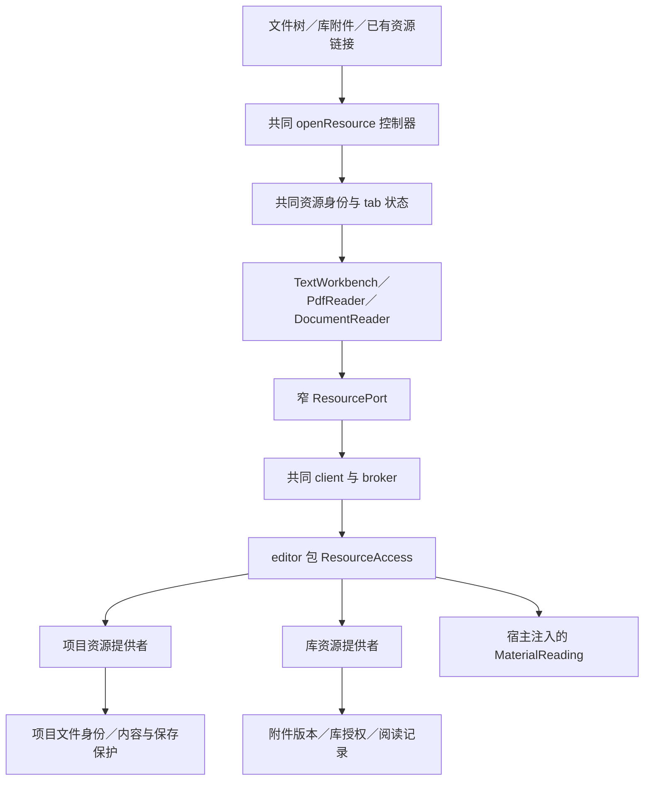
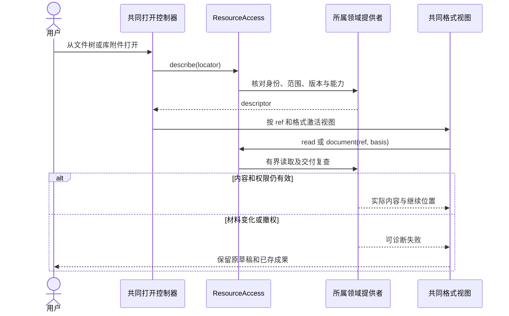

# 实现设计

## 变更总览

依据 [investigation](investigation.md)。新增职责留在现有 editor 包和宿主装配，不增加 workspace 包。共同端口隐藏来源适配、版本核对和读取生命周期；格式视图不再直接依赖 `LibraryAttachment` 或项目存储。

## 方案与接口

### 1. 同源数据契约

新增 `packages/protocol/src/resources.ts`，所有 DTO 从 schema 推导，公共 business 映射及类型继续通过现有生成器引用声明。

| 概念／操作 | 约定 |
| --- | --- |
| `ResourceLocator` | 打开定位：项目来源带 projectId 及 fileId 或项目内 path；库来源带 attachmentId 和 materialVersionId。路径只在解析前定位。 |
| `ResourceRef` | 解析后稳定身份：项目使用 projectId＋fileId，库使用 attachmentId＋materialVersionId。字段用 discriminated schema，拒绝混用来源。 |
| `ResourceDescriptor` | 引用、名称、已支持格式、内容 basis 及 read/write/readingRecords/render 实际能力。没有 nativePath，没有新的资源授权；材料不可读时可保留描述和 unavailableReason，独立读取已存库记录。 |
| `resources.describe` | 解析定位和身份，返回描述；项目文件移动沿原身份解析。 |
| `resources.read` | 按 ref、basis、offset、limit 和 utf8/base64 编码读取，返回实际范围、继续位置及同一内容依据。复用原文本／材料大小限制，字节每次最多 256 KiB。 |
| `resources.document` | 按 ref、basis 及 PDF／文档请求读取页、章节、搜索或允许的资源。复用既有解析请求语义、响应 schema 片段和限制，不维护第二套页／章节数据模型。 |
| `resources.cancel` | 按 requestId 中止调用方拥有的文档读取；视图关闭只取消自己的请求，解析沿现有容量与收尾机制释放。 |
| `resources.save` | 只对描述为可写的正文进入所属保存能力；项目保存复用原 basis 和 expectedFileId 核对，其他资源返回不支持或无权限。 |

窄 `ResourcePort` 提供以上操作以及可选 `ReadingRecordPort` 和已有排版端口。记录端口输入、输出复用现有库声明；库适配把资源引用映射到原记录操作，格式视图不负责库身份转换。项目普通文档当前没有相应记录仓储时不声明该能力。

文本位置沿现有正文接口使用 UTF-16 字符位置，base64 原字节读取使用字节偏移，响应明确位置单位和继续依据；不能将拆开的 UTF-8 字节片段当成独立完整文字解码。文本总量沿原编辑上限，二进制材料沿原材料上限。

正文读写与格式解析共用 ResourceRef。read/save 不接受任意本机路径；描述中的能力用于显示，实际操作仍核对权限及内容依据。

### 2. 提供者与包边界

- `packages/editor/src/resource-access.ts` 保存通用访问编排，不保存领域事实，只接受声明派生的项目／库窄端口及受管解析执行适配。
- 项目模块增加有界 `files.readBytes` 操作与同源 schema：按稳定 fileId 在项目范围内解析，核对 basis，分块前后复查材料；返回字节及依据，不暴露 nativePath。文本仍使用原文件读取和保存规则。
- 库提供者调用已有附件读取、材料版本核对、解析及记录操作。库附件正文在本次保持不可变；源码／可视编辑器可以只读打开 UTF-8 材料，不提供虚假的写回。未来库笔记拥有可写提供者时接入同一端口。
- `ManualApplication` 装配 ResourceAccess，绑定通过 broker 的领域窄端口及 `MaterialReading.run`；同一人工组合可无模型／无会话读取。普通 editor 模块不导入 library 实现或数据库；`architecture.json` 仅扩充实际协议导出和能力消费范围。
- 库内现有公开取文／记录工具仍归库，harness 工具集合本批保持原有范围；共同 UI 入口不改变 Agent 访问权。

### 3. 工作台与格式视图

新增工作台 `resource-controller.ts`：统一描述、打开、定位、格式选择、资源实例及关闭清理。`TabItem` 改存一个 resource 引用和视图模式；删除 fileTarget／readerTarget 两条公共入口，原 FileTarget 仅在项目提供者内转换。迁入现有临时 tab、稳定身份、分屏及脏稿行为，不另写 tab 管理器。

`FileEditor` 迁为消费共同资源描述与端口，继续复用 SourceEditor、VisualEditor、render-output 及 file-document 的正文／恢复行为。首次资源与权限核对期间显示加载状态，避免以未就绪的空只读编辑器接收输入。`PdfReader` 和 `DocumentReader` 接收相同资源描述与内容端口，库记录面板作为能力适配传入；库文本同样接入该记录适配。格式选择依资源格式和能力，不在视图内再区分“库版”和“项目版”。

迁移现有文件树、附件、消息中的项目文件链接和 tab 资源打开回调。库文本首先复用共同只读源码视图；本批不推导无项目的完整工程编译行为。未知格式保持可诊断的不支持状态。

### 4. 身份、草稿与材料核对

- 项目文件按稳定 fileId 重绑定；打开定位时允许 path，解析后取得完整引用。重命名不新建正文草稿，原路径上新文件不得继承旧身份。
- 库资源身份包括具体材料版本，库 tab 跨项目保留。源项目切换仅恢复该项目的文件视图及右栏，不清除库视图或改变其归属。
- 工作台既有缓存／恢复中旧 target/material 记录在读取时转为新引用，保留原项目正文草稿键和恢复资料；无法核对的条目留诊断，不静默清空。没有数据库迁移。
- 资源描述不冻结权限；每次异步读取与交付核对所属授权。项目二进制读取与解析绑定同一 basis，库使用原材料版本及核查机制。解析失败、取消和关闭只收尾本视图所属工作，复用现有进程容量与超时。

## 文件变化

| 操作 | 文件／范围 | 目的 |
| --- | --- | --- |
| 新增 | `packages/protocol/src/resources.ts` | 共同引用、描述及读／存／解析声明；复用原格式 schema。 |
| 修改 | `packages/protocol/src/business.ts`、`index.ts`、`package.json`、生成器涉及的映射 | 注册资源契约与导出，生成类型和提供者签名；不手改生成载荷。 |
| 修改 | `packages/protocol/src/project-contracts.ts`、`projects.ts`、`packages/projects/src/files.ts` | 项目稳定身份字节读取，必要端口派生及独立验证。 |
| 新增／修改 | `packages/editor/src/resource-access.ts`、`node.ts`，宿主 `apps/kernel/src/manual.ts`，`architecture.json` | 共同模块及 broker 实际装配，复用 MaterialReading；本批不新建包。 |
| 新增 | `apps/desktop/src/renderer/src/workbench/resource-controller.ts` | 唯一资源打开和访问控制器。 |
| 修改 | `session.ts`、`tab-state.ts`、`Workbench.tsx`、`business-session.tsx`、tab 渲染消费文件 | 收敛为一套资源入口，迁入原稳定身份和视图模式。 |
| 修改 | `project-ui.tsx` 中的 `FileEditor`、`file-document.ts`、`PdfReader.tsx`、`DocumentReader.tsx`、`ReadingRecordsPanel.tsx` | 共同资源端口、原草稿与可选记录能力。 |
| 修改 | `library/LibraryTab.tsx`、`CatalogItemPane.tsx`、`AttachmentsSection.tsx`、项目文件树与消息打开回调 | 改用共同打开，不保留单独 reader 回调。 |
| 修改／新增 | `tests/kernel/tab-state.spec.ts`、新增 `resource-access.spec.ts`；新增 `tests/ui/resource-opening.spec.ts`，复用已有阅读／文件 UI 测试 | 验证可观察行为和实际接线，不固定内部回调顺序。 |
| 修改 | `docs/ui-design/README.md`、`docs/development.md` | 更新共同入口、可写能力、诊断与验证命令；修正涉及范围的旧分立入口描述。 |

既有业务接口保留其领域含义。移除本批不再需要的重复工作台打开／格式分流代码，不顺带清理其他库功能占位。

## 验证与风险

1. **类型与边界**：`pnpm generate:contracts`、`pnpm typecheck`、`pnpm check:architecture`，核对 Schema／提供者一致性、普通模块依赖及 nativePath 不进入公开结果。
2. **提供者与状态**：`pnpm test:kernel tests/kernel/resource-access.spec.ts tests/kernel/tab-state.spec.ts tests/kernel/manual-application.spec.ts`。项目真实目录与隔离库分别读取 UTF-8、PDF、EPUB／HTML；内容变化、撤权、移动、关闭取消和库只读是关键边界。复用现有 PDF／文档样本及解析失败夹具。
3. **编辑阅读回归**：定向运行现有 editor-source、literature-reading／document-reading 和受影响文件保护用例，验证旧批注及正文草稿仍可用。
4. **产品接线**：`pnpm build` 后，双宿主运行 `resource-opening.spec.ts`、`resource-lifecycle.spec.ts`，并定向复验 `pdf-reading.spec.ts`、`document-reading.spec.ts`、`file-workbench.spec.ts` 和 `writing-editor*.spec.ts`。从真实入口打开两类来源、切项目／会话、分屏与重开，核对真实材料、持久阅读记录、保存、转换恢复及排版结果。取消接线可在传输边界延迟响应，实际解析取消由内核用例核对；文件回归中的 Agent 使用本机受控模型响应，无外部模型调用。
5. UI harness、Electron 或依赖准备如需启动／安装，按执行时已有授权处理；本轮仅规划。Linux 验证不能代替其他平台或安装包验收。

主要风险是现有草稿缓存迁移、旧材料版本误绑定及解析交付期间撤权。各自有上述行为测试，不能用页面成功加载替代。项目原文本上限、库材料上限及解析资源限制继续有效。

## 待办边界

完整文献主界面与 UI 选择工具由[全域计划 B 批](../../../../.scratch/domain-development/library-foundation-plan.md)承接；库笔记的写入能力由 D 批承接。新格式、OCR、库正文修订和无项目的工程编译单独设计。本变更不等待后续批次，但不能宣称已经实现这些能力。
