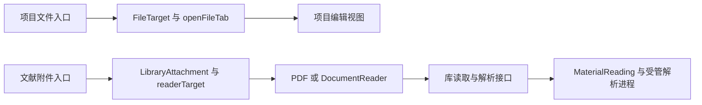

# 调查依据

## 当前事实与复用选择

本轮为 2026-10-20 的静态代码、规格与既有交付记录核对，没有运行应用或测试。

| 事实 | 来源及选择 |
| --- | --- |
| `TabItem` 分别保存 `FileTarget` 和 `LibraryAttachment`，会话来源分别暴露 `renderFile`、`readerTarget/renderReader` | [tab-state](../../../../apps/desktop/src/renderer/src/workbench/tab-state.ts)、[session](../../../../apps/desktop/src/renderer/src/workbench/session.ts)、[business-session](../../../../apps/desktop/src/renderer/src/workbench/business-session.tsx)。需收敛为共同资源引用与一个打开／渲染入口。 |
| 文件 tab 已处理稳定文件身份、路径重绑定、临时标签与脏稿固定 | 复用 `openFileTab` 的行为及 [tab-state 测试](../../../../tests/kernel/tab-state.spec.ts)，迁移其契约而非另写第二个 tab 管理器。 |
| PDF／EPUB／HTML 视图目前直接消费库附件操作 | 复用 [PdfReader](../../../../apps/desktop/src/renderer/src/workbench/PdfReader.tsx)、[DocumentReader](../../../../apps/desktop/src/renderer/src/workbench/DocumentReader.tsx) 和 [reader-material](../../../../apps/desktop/src/renderer/src/workbench/reader-material.ts)；格式视图改为消费共同资源端口，库专属操作留在提供者适配。 |
| `MaterialReading.run(load, request, options)` 已将字节加载与解析分开 | [MaterialReading](../../../../packages/library/src/material-reading.ts) 可复用受管计算、容量、取消、超时及交付复查；宿主注入该执行适配，不把文献实现依赖引入编辑器核心。 |
| 库读取有稳定附件／材料版本、分段字节、解析和阅读记录 | [catalog](../../../../packages/library/src/catalog.ts)、[library protocol](../../../../packages/protocol/src/library.ts)。库提供者保留授权及版本核查，现有 Agent 文献工具不因 UI 收敛而删除。 |
| 项目 `project.material` 返回受控本地定位及 basis；`files.resource` 只读四类图片且最多 1 MiB | [project-contracts](../../../../packages/protocol/src/project-contracts.ts)、[project files](../../../../packages/projects/src/files.ts)。不能把图片入口说成已支持通用文档；需要项目所属的有界字节读取能力，再向工作台提供共同契约。原生路径不进入公开资源响应。 |
| 项目正文保存及源码／可视草稿已经独立实现 | 复用 `file-document.ts`、`project-ui.tsx` 中的 `FileEditor` 和 `editor/`；共同端口接入既有项目保存，不重写编辑器或扩大库附件原字节写入权。 |
| 打开 library tab 只激活内容 tab | [Workbench](../../../../apps/desktop/src/renderer/src/workbench/Workbench.tsx)。保持项目／会话选择与资源打开独立。 |

图中关系均由上述当前源码核对。项目文档共用阅读路径尚未接入；本图不代表目标架构。

## 影响方案的未知项与实验

- 无需用运行实验选择解析框架：现有解析入口接受独立字节加载函数，可在现有宿主和包内组合。
- 项目材料的字节读取和解析结果需要使用同一内容依据，读取前后核查身份及内容变化；复用项目的范围、身份与 basis，不以路径或文件名作为唯一身份。具体运行竞态交给定向集成验证，不从静态阅读宣称通过。
- 库正文当前是版本化材料。本次将其能力明确为只读正文、沿原库记录接口保存批注；项目正文仍可条件保存。库正文修订、独立库笔记编辑和排版上下文在后续功能变更实现，本次不假造保存能力。
- 新资源接口只接线已支持的格式及现有格式限制，不新增 OCR、DRM、固定版式 EPUB、远程资源加载或文件系统目录访问承诺。

## 结论与承接

采用一个共同资源引用、一个工作台打开控制器、一个窄资源端口，实际读取／保存由项目和文献领域提供者承担。复用现有编辑器与阅读组件、解析执行、broker 和 Schema 生成器；不新增 workspace 包或第二个阅读产品。

方案所需的当前代码事实已足够。实施中首先验证共同提供者和项目材料读取，再迁移视图与入口，最后在双宿主真实接线上验证身份、草稿、版本、撤权和生命周期。既有运行结果见 [架构迁移交付](../2026-10-19-migrate-runtime-architecture/delivery.md)、[阅读交付](../2026-10-19-extend-shared-epub-html-reading/delivery.md)及[编辑器交付](../2026-10-20-add-research-writing-editor/delivery.md)，不能替代本次改动后的运行证据。
