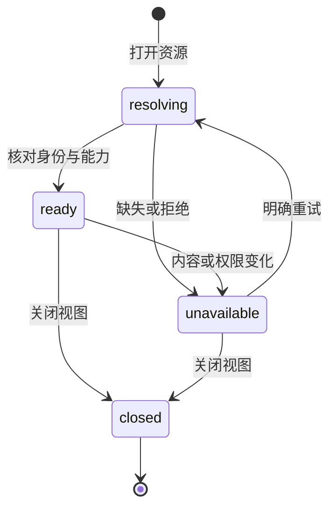

# workbench-resources Specification Delta

## Purpose

为项目文件与共同文献库附件提供同一套资源打开、读取和编辑阅读能力，使用户从任一入口取得适合该格式的视图，并保留资源所属身份、材料版本、权限和草稿。资源导航服务人类交互，不改变 Agent 会话所属项目，也不将库材料复制为项目文件后才允许使用。

## ADDED Requirements

### Requirement: 共同资源引用与视图打开

系统 SHALL 通过共同资源入口打开项目文件和库附件，按格式和实际能力选择文本编辑／阅读或 PDF／EPUB／HTML 阅读视图。资源 SHALL 保留所属领域及稳定身份；库附件还须保留具体材料版本，项目路径只作为定位信息而非唯一身份。同资源重复打开 SHALL 激活或按明确分屏操作增加视图，不因入口不同创建互不关联的正文副本。格式不可用 SHALL 提供可诊断结果。

#### Scenario: 两类来源打开同格式材料
- **WHEN** 用户分别从项目文件树和文献附件列表打开一个支持的 PDF、EPUB 或 HTML
- **THEN** 两者使用共同打开与阅读接口及相应格式视图，保留各自来源身份，库材料不因打开被复制到项目

#### Scenario: 路径变化或重复打开
- **WHEN** 已打开的项目文件重命名后再次打开，或同一库附件从另一入口打开
- **THEN** 系统按稳定身份核对并激活对应资源，保留有效草稿和位置，不误认原路径上的新文件

### Requirement: 所属权限与有界资源访问

共同资源访问 SHALL 由所属领域核对资源范围、身份、内容依据及实际读写能力，公开响应不返回本机原生路径。字节、文本及文档解析请求 SHALL 有界并携带实际内容依据，结果交付前核对有效授权和内容变化。项目人工访问沿项目信任与人工操作现有约定，库取用沿库授权；Agent 材料使用继续遵守工具和模型外发规则。缓存不得绕过撤权或将旧版本结果用于新材料。

#### Scenario: 解析期间内容或授权变化
- **WHEN** 资源已经开始解析，而源内容发生变化或所属读取权限被撤回
- **THEN** 返回对应失败并保留已有记录，不交付伪称基于当前材料的旧结果，也不从其他路径绕过撤权

#### Scenario: 请求越界材料
- **WHEN** 项目资源引用指向项目范围外文件，或传入不匹配的稳定身份与材料版本
- **THEN** 请求在实际读取前被拒绝，不能以资源打开接口取得额外文件访问权

### Requirement: 共同正文与真实保存能力

项目文本与库内支持的 UTF-8 文本 SHALL 通过共同文本视图和能力接口展示。可写项目正文 SHALL 保持既有源码／可视编辑、条件保存、撤销和冲突保护；不具备正文保存能力的资源 SHALL 明确只读，仍可使用其已提供的阅读记录能力。两视图共享同一资源正文草稿并保留各自位置。源文件变化、保存失败或旧回执 SHALL 不覆盖用户后续输入。

#### Scenario: 两视图编辑及保存冲突
- **WHEN** 用户分屏编辑同一项目文件，外部程序随后修改文件或保存回执迟到
- **THEN** 两视图保持共同正文，过期保存被拒绝，冲突及草稿可取回，后续输入不被旧回执覆盖

#### Scenario: 库正文只读与共同编辑视图
- **WHEN** 用户打开没有正文修订能力的库内文本附件
- **THEN** 使用共同文本视图并明确只读，不显示能够持久保存原字节的虚假能力，不改变该材料版本

### Requirement: 资源视图生命周期与执行上下文独立

资源打开、选择、分屏、关闭和项目切换 SHALL 保持所属资源与草稿隔离，库资源视图可跨项目保留。切换文献库或打开附件 SHALL 不切换当前会话、harness 项目工作域、未发送指令或材料授权。关闭视图 SHALL 释放对应临时资源、订阅及所属读取请求，不能以关闭一个视图终止其他视图或无关执行；再次打开可继续读取已保存的阅读成果。

#### Scenario: 阅读库附件时继续原会话
- **WHEN** 用户在项目 A 会话中填写指令，切到文献库并打开附件，再返回会话
- **THEN** 项目、会话与草稿保持原状，附件仍是库资源，不自动附加或外发材料

#### Scenario: 多视图关闭与恢复
- **WHEN** 用户关闭某个阅读视图而其他视图或 Agent 仍在工作，再重新打开同一材料
- **THEN** 只释放被关闭视图拥有的资源，无关工作保留，已保存批注仍可查询；未保存草稿按原保护契约保留

### Requirement: 共同视图中的阅读成果保持所属权威

库材料通过共同视图创建、查询和更正的既有书签、批注及笔记 SHALL 继续保存到同一库记录及材料版本，保留可信作者、修订核对和未知结果查询。共同视图不得为缺少记录提供者的资源伪造持久化能力。原有文献工具 SHALL 仍可按明确库引用读取这些成果，不依赖阅读窗口打开。

#### Scenario: 迁入共同视图后查询旧批注
- **WHEN** 用户通过共同入口重开已有批注的库材料，Agent 随后通过原文献工具查询
- **THEN** 两者取得相同持久记录和材料版本，不产生第二份阅读权威或丢失原修订

#### Scenario: 无可用批注持久化提供者
- **WHEN** 资源只提供正文读取而没有阅读记录保存能力
- **THEN** 视图如实呈现能力，不将临时选区或浏览位置报告为已持久保存的批注
