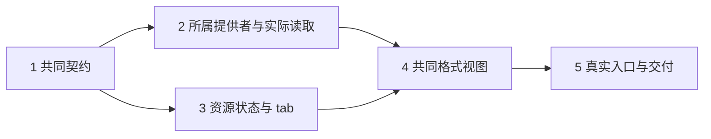

# 执行任务

本文件是本变更实施进度的唯一事实源。A 批实施与验收已完成，实际结果见 [delivery](delivery.md)；公共契约与实际整合由主 Agent 负责。

## 1. 共同契约与架构边界

- [x] 1.1 主 Agent 新增 protocol/resources 的定位、稳定引用、描述及 read/document/save 声明，复用格式 schema 和原等待／错误语义；明确 UTF-8 位置与字节位置单位，生成业务映射并完成声明／提供者类型检查。
- [x] 1.2 明确项目与库提供者、解析及记录窄端口，更新准确导出与 architecture 消费范围；执行架构守卫，证明 editor 核心没有直接依赖 library 实现或领域数据库。

## 2. 所属提供者与实际读取

- [x] 2.1 在 projects 增加稳定身份和 basis 保护的有界字节读取，拒绝范围外文件及旧身份；扩展现有文件／资源内核用例，核对真实移动、内容变化和二进制分块。
- [x] 2.2 在 editor 新增 ResourceAccess，通过窄端口接项目／库读写和宿主注入的 MaterialReading；真实组合验证两类资源、只读库文本、库授权及同一依据解析。无模型的人工宿主应能读取。
- [x] 2.3 ManualApplication 绑定实际提供者并注册公共资源操作；增加 `resource-access.spec.ts` 的必要缺口，复用现有解析故障夹具，验证材料变化、撤权、解析失败和不存在的写入能力，不返回 nativePath。

## 3. 资源状态与 tab

- [x] 3.1 新增共同 resource-controller，迁移 TabItem/session 的文件和附件分立输入为资源引用与单一打开入口；扩展 `tab-state.spec.ts` 核对重复打开、分屏、移动、临时标签和脏稿固定。
- [x] 3.2 迁入旧工作台缓存和草稿，保留原项目草稿键与材料版本；核对项目切换时文件组恢复及库资源保留，无法核对的恢复记录留下诊断而非清空。

2 与 3 在 1 完成后可并行，写入范围分别为提供者／宿主和工作台状态；protocol、architecture 及公共入口由主 Agent 单独统筹，汇合时再次运行类型检查。

## 4. 共同格式视图

- [x] 4.1 FileEditor 与正文状态改接共同资源端口，复用现有源码／可视编辑、撤销、恢复和项目排版；项目仍条件保存，库不可写正文使用共同只读文本视图。复验 editor-source 与受影响文件保护行为。
- [x] 4.2 PdfReader、DocumentReader 及阅读记录面板改接共同内容／记录端口；库旧记录可读写、项目无记录提供者时不伪造保存。用真实隔离材料验证项目和库 PDF／EPUB／HTML 走同一格式实现。
- [x] 4.3 将文件树、库附件、消息中的资源链接和 tab 渲染全部迁到共同打开，删除重复文件／reader 回调及来源分流代码；核对打开资源不改变 projectId、sessionId 或未发送指令。

## 5. 真实入口与交付

- [x] 5.1 执行 `pnpm generate:contracts`、`pnpm typecheck`、`pnpm check:architecture` 及变更文件定向 lint，修复本次引入的问题并区分既有失败。
- [x] 5.2 运行任务 2—4 对应内核检查及 `pnpm build`；不把未运行或失败项记为通过。
- [x] 5.3 双宿主执行新增 `tests/ui/resource-opening.spec.ts`、`resource-lifecycle.spec.ts` 及受影响 `pdf-reading.spec.ts`、`document-reading.spec.ts`、`file-workbench.spec.ts`、`writing-editor*.spec.ts`，从产品入口核对实际文件／附件、旧批注、保存重开、切项目、转换恢复、排版与关闭清理。服务与依赖准备按执行时授权处理。
- [x] 5.4 对共同边界、身份与草稿保护安排独立审查，直接核对规格、改动和运行证据；更新 UI 设计及开发入口，说明实际平台和未覆盖范围。
- [x] 5.5 实际执行后读取 delivery instructions，完成同一变更的 delivery.md，核对 proposal 判据与上述运行结果，再更新此项；规划阶段不创建交付记录。

## 后续入口

本批任务全部完成。用户明确批准的临时 UI 服务已回收，实际验证、失败处理与范围边界见 delivery。本变更已随规格同步归档；后续批次见[完整文献工具计划](../../../../.scratch/domain-development/library-foundation-plan.md)，不将它们塞入本次任务。
