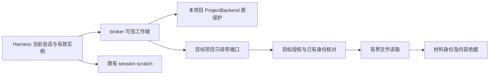
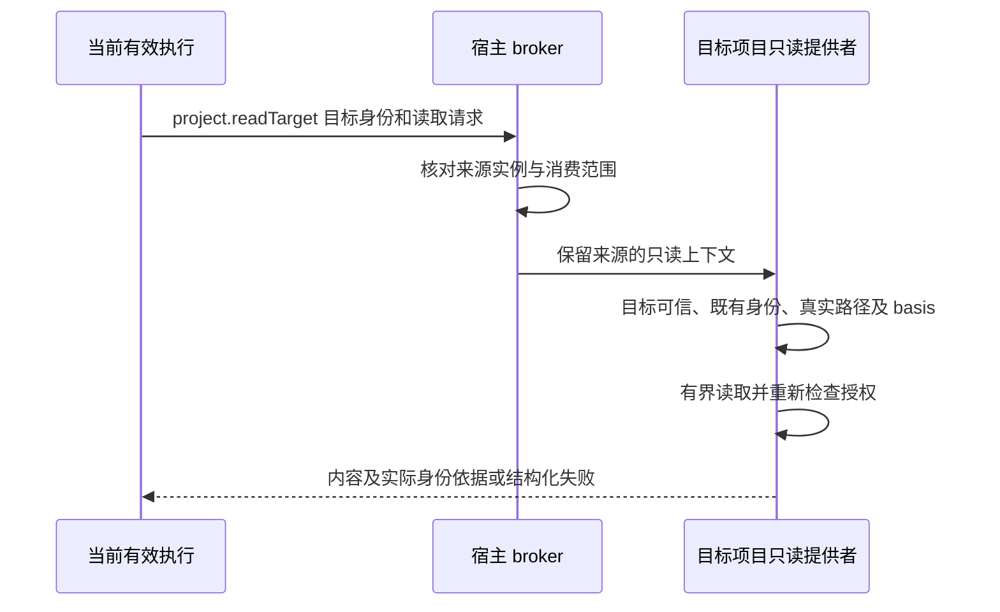

# 实现设计

## 变更总览

依据 [investigation](investigation.md)。本变更的工作域契约先落入 dev，与另外两个 change 的契约组成并行实施基线；三线随后独立实现，真实授权接线等待本变更对应增量验证，不等待整项 change 完成。全部公共基础验收后才启动七域开发，安排及共享文件归属见[公共基础实施规划](../../../../.scratch/domain-development/public-foundation-plan.md)。

## 并行边界

1.1 承接共同契约中的工作域部分，包含 core 中的可信范围、projects 及生成映射；与工作台线的连接来源扩展在契约阶段合并。共同契约齐备后，本线负责 projects 只读范围、宿主注册及 harness 只读工具，不承接图驱动、资源创建或 UI 上下文。

1.2 的 store/files 增量接入 dev 后交给领域交接线扩展创建收据；1.2、1.3、2.1、2.2 的真实授权能力及验证接入后，供领域交接 1.2、2.4、3.3 及工作台资源路径消费。交接可以早于本 change 最终交付，每次记录实际增量和验证；共享装配和 runtime 的同段修改按独立增量依次接入。

## 方案与接口

### 归属与类型

新增 `packages/protocol/src/work-domains.ts`，导出工作域描述及内部目标只读契约，从 protocol 同源派生类型与校验。描述使用 `kind: application|project`、原 `projectId` 和可信 `sessionId`；运行实例继续沿既有 RuntimeIdentity。保留数据库、会话及 `application` 身份，不另造全局项目或新的会话类型。

内部 `project.readTarget` 接收 targetProjectId 和判别请求（list/describe/readText/readBytes），不接受 nativePath 或任意方法名。list 仅分页列出已登记、可读取的文件身份；其他请求按 fileId 及 basis 定位，每片沿既有读取上限。只读结果不包含本机路径。库资源仍沿原库能力，不能通过此入口读库数据库。

共同契约声明位于 `work-domains.ts`，经现有 `core`／`projects` 入口导出。CallContext 增加可选的只读 `workDomain` 与 `targetRead` 元数据；后者只描述目标项目及 `access: read`，来源域仍保留。固定全局域使用原 `application` 项目身份，普通项目分支及目标读取不能以它冒充研究项目。现有 RuntimeIdentity 及 CallContext 的执行身份字段继续使用；元数据的类型和校验本身不构成授权证明，宿主绑定、字段一致性、快照保护及异步嵌套收紧由 1.3 实现。

`projectTargetReadOperations` 独立声明，生成 `project-target-read-types.ts` 并导出 `ProjectTargetReadInputs`、`ProjectTargetReadOutputs`、`ProjectTargetReadPort`。它不进入产品 `businessSchemas`，也不向现有可写文件端口追加必需成员；真实宿主注册在 1.3 接入，声明阶段没有生产提供者。

| 判别请求 | 输入与返回 |
| --- | --- |
| list | offset／limit 分页，单页最多 100；返回已登记文件的 fileId、相对 path、basis、字节 size 及可选 nextOffset |
| describe | 必须提供 fileId／basis，返回核对后的同类文件描述 |
| readText | 必须提供 fileId／basis；字节 offset／limit 沿现有文本读取上限 256 KiB，返回有界 UTF-8 解码正文、当前描述及下一片位置 |
| readBytes | 必须提供 fileId／basis；复用现有二进制读取的范围与 base64 返回字段，单片最多 256 KiB、文件最多 128 MiB |

结果同样由 kind 区分；请求中的目标身份不授予权限，宿主可信来源不得放入请求载荷。文件描述的 basis 用于后续当次核对，不能复用原文本读取中会登记身份或保存内存依据的实现。

宿主从当前有效执行构造来源归属；目标信息是待核对资源而非授权。项目侧显式建立只读访问上下文，保留来源身份及父访问范围；嵌套调用只能收紧。ProjectStore.check 在获宿主认可的目标只读上下文中仅允许 read，write/send 仍要求原来源项目，不通过把 caller.projectId 改成目标来绕过检查。

模型准入在异步授权和排队结束后，通过宿主绑定的同步 `check(targetIds)` 复核来源、全部已使用目标的信任及当前对象、执行实例，再发放模型租约。该检查属于进程内注入端口，不增加产品或跨进程操作。`ModelAccess.execution` 接受可选的同步最终确认函数，拒绝时释放模型名额；即使目标集合为空，仍核对来源。会话使用过的目标身份在自身 harness 记录中保存，后续消息和重启接续继续检查，目标项目不增加记录。这样可防止逐个异步检查多个目标时，前一个目标在后一个检查的等待期间被撤权。

项目只读实现使用已存在的身份映射和受范围约束的文件适配，不复用会隐式登记 fileId、更新目标索引或生成缓存的路径。无法取得现有身份时返回 `unavailable`，附可核查的身份缺项；文件确实缺失用 `notFound`，版本变化用 `contentChanged`，授权失败用 `permissionDenied`。不增加字符串型方法白名单作为权限权威。

### 临时资料及安全边界

继续使用 `sessionScratch()` 和现有 scratch backend；新增工作域查询供工具与后续执行器取得归属说明，临时工具不取得其他会话根路径。application 普通项目文件接口仍拒绝 read/write，临时工具通过 session 专属能力工作。禁止把 `<profile>/application` 当通用可写项目，更不能把整个 profile 暴露为工作目录。

全局会话经现有库工具完成有授权的库操作；没有库成果保存提供者时报告该能力不可用，不把 scratch 文件登记为库科研成果。清理时机沿既有恢复规则，本变更不自动批量清理历史资料。

## 文件变化

| 新增或修改 | 目的 |
| --- | --- |
| 新增 `packages/protocol/src/work-domains.ts`，修改 `core.ts`、`projects.ts` 及项目内部契约／生成映射 | 可信工作域描述及目标只读操作；依照现有生成入口更新，不手维护第二份校验 |
| 新增 `packages/projects/src/readonly-access.ts`，修改 `store.ts`、`files.ts`、`node.ts` | 在领域内部集中实现目标只读，区分来源和目标，复用范围及内容核对；文件读取不产生登记副作用 |
| 修改 `apps/kernel/src/manual.ts`、`application.ts`、根 `architecture.json` | 注册内部提供者、真实实例核对、限定模块消费范围；人工宿主继续可用 |
| 修改 `packages/harness/src/runtime.ts`、`project-backend.ts` 的窄端口接入及 `checkpoint-files.ts` 必要调用方 | 提供工作域和目标读取工具，保留原本项目写入及 scratch 隔离 |
| 修改 `packages/models/src/model-access.ts`，扩展现有模型准入测试 | 在排队与异步授权之后同步确认来源及全部目标，失败释放额度；既有调用方不必提供新增的可选确认函数 |
| 修改 `tests/types/contracts.ts` 与既有项目／harness／scratch 测试；必要时新增 `tests/kernel/work-domains.spec.ts` | 覆盖类型、实际读取、拒写、目标零修改、撤权和异步范围继承 |
| 修改 `docs/development.md`，核对初设执行与科研章节 | 说明实际能力和只读限制，纠正 application 仅 send 的旧现状描述 |

## 验证与风险

先扩展 `project-backend.spec.ts`、`checkpoint-files.spec.ts`、`harness-module.spec.ts`、`sessions.spec.ts` 的现有夹具。只读样本含可信项目、受限项目、已登记文件、未登记文件、私有路径、链接逃逸和两个会话临时文件。对目标的文件清单、字节及领域记录做独立前后核对，证明此次读取没有造成登记或缓存修改。

最小检查：`pnpm generate:contracts`、`pnpm check:architecture`、`pnpm typecheck`，相关 `pnpm test:kernel`；涉及宿主打包时 `pnpm build`。集成使用真实 broker、项目模块和受管执行，模型边界可控；验证新消息恢复时重新核对权限及有效实例。关键权限及并发边界安排独立审查，实际平台范围记录在 delivery。

无新的数据表迁移。旧项目、application、scratch 和 checkpoint 原样保留，新增描述按现有身份计算。只读端口故障只影响相关能力，不临时降低原检查。依赖安装、服务、真实凭据、工作树及 Git 操作在实际实施任务需要时按真实授权处理。
