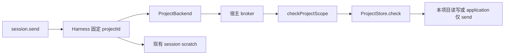

# 调查依据

## 当前事实与复用选择

2026-10-22，只读核对源码、正式规格、锁定依赖及测试定义；scout 提供执行调查，主 Agent 抽查关键分支。没有运行应用、模型、测试或破坏性实验。

| 来源 | 已核实事实与选择 |
| --- | --- |
| `packages/projects/src/store.ts:117,141,174-182,777-811` | application 是固定真实身份，位于配置目录下；只允许 send。异步访问上下文会保留原 Agent projectId，不能通过嵌套 withAccess 改成另一个项目。保留此写入保护，为目标只读另建窄端口。 |
| `apps/kernel/src/manual.ts:239-277,338-351,387-391` | 项目能力经 broker、模块消费范围及 checkProjectScope 双重约束；当前跨项目读取被拒绝。读取授权须在宿主和资源提供者两层落实，不能只增加一个模型工具。 |
| `packages/harness/src/checkpoint-files.ts:21-80`；`runtime.ts:244-263` | session scratch、旧资料导入及私有目录检查已有。复用现有目录，禁止以此次工作域变更扩大到整个 application 根。 |
| `packages/harness/src/project-backend.ts` | 项目文件后端固定单一 projectId；保留它处理本项目读写，不将其转换为任意多项目可写后端。 |
| `tests/kernel/checkpoint-files.spec.ts`、`project-backend.spec.ts`、`harness-module.spec.ts`、`sessions.spec.ts` | 已有 scratch 隔离、窄端口独立组合及会话行为测试，可扩展为工作域和目标只读回归。 |

图为现状，来源为上表。目标只读端口是拟新增，不在现有图中伪装为已实现。

## 影响方案的未知项与实验

全局工作区是否可持久写、能否开放 Shell 已由领域决定明确：临时资料进入 session scratch，长期事实归库或项目，全局不开放无隔离通用程序入口。无需再次询问，也无需为规划启动模型。

目标读取是否会触发身份登记／缓存写入属于实现必须检查的边界：本变更选择不在目标创建文件身份或缓存。只读端口使用已有登记身份，未登记或不可核对时明确返回不可用，不能自行制造持久身份或改用其他对象。该选择保持读取不修改目标，任务覆盖目标目录和数据库的前后核对。

## 结论与承接

复用 application、scratch、broker 和原保存保护；新增由宿主绑定的来源工作域及目标只读访问范围。实现不得依赖客户端自报主体、目标项目路径或通用方法名名单。已有 JSON Schema 语义及窄端口提供可执行约束。

没有需要外部产品调查才能确定的本变更设计阻塞。真实撤权竞态、跨进程取消和目标零写入由任务验证。库知识持久化、主题和插件写入仍由所属领域实施，本变更不修改它们的身份、引用键或保存契约。
