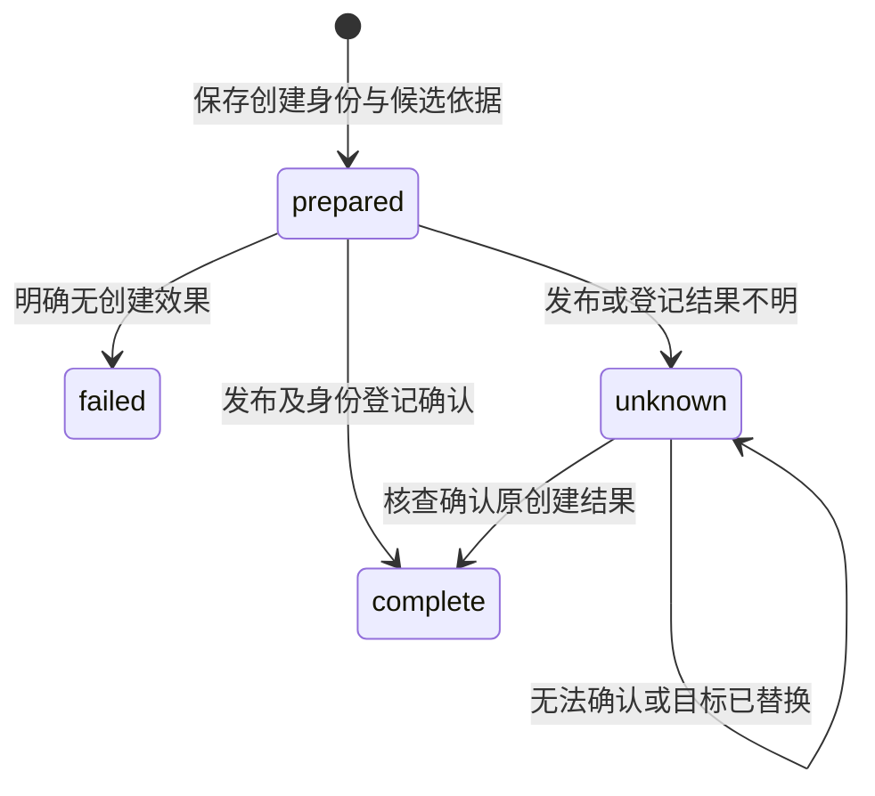

## ADDED Requirements

### Requirement: 项目成果首次新建与未知结果核查

共同资源能力 SHALL 支持在所属可写项目中，以调用方稳定操作身份将内容保存到不存在的路径，复用项目路径、串行保存及禁止覆盖保护。成功 SHALL 返回实际稳定资源身份和内容依据。新建受理及候选、发布、登记的核查依据 SHALL 由项目所有者保存，同身份不同输入拒绝，重复请求先核对原结果。

实际发布可能已完成但确认未知时 SHALL 保留文件、候选及操作依据，允许按原操作核查；不能仅凭同路径同内容认定归属，不能自动重写、覆盖或删除目标。已保存而关联失败 SHALL 仅补关联。该能力不能新建库分析或改变只读附件正文权限。

#### Scenario: 创建回执丢失后重试
- **WHEN** 结果已发布但回执丢失，调用方按原操作身份查询或补交
- **THEN** 返回同一已确认资源或效果未知，不覆盖已有路径，也不创建第二份成果

#### Scenario: 目标已被其他文件替换
- **WHEN** 原创建尚待核查，而同路径已是另一身份的文件
- **THEN** 原操作保留未知或已确认历史，当前文件保持不变，不把它当作原成果
