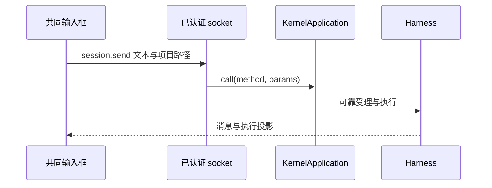

# 调查依据

## 当前事实与复用选择

2026-10-22，主 Agent 静态核对工作台、协议、WebSocket 宿主和相关测试；未启动 UI 或模型。

| 来源 | 事实及选择 |
| --- | --- |
| `apps/desktop/src/renderer/src/workbench/business-session.tsx:35-48,252-265,350-420` | materials 与 materialFileIds 属于会话草稿；onNew 对 session.send 保存 pending、复用 instructionId。扩展此共同路径，不另建批注发送控制器。 |
| `packages/protocol/src/harness.ts:92-104` | session.send 只有 text、项目 materials、可选 materialFileIds；没有库资源或选区载荷。需同源扩展并传至持久指令与实际执行。 |
| `apps/kernel/src/server.ts:114-150,204-240` | socket 有认证和范围订阅，application.call 未携带连接身份。不能让页面载荷声明可信主体或把全局最后活动窗口当作执行来源。 |
| `apps/kernel/src/manual.ts:130-133`；`packages/protocol/src/core.ts:7-16` | 当前 product 为同一 human/local，CallContext 无窗口来源。增加宿主侧连接入口，不改变普通调用 API 以保持 CLI／测试组合。 |
| `packages/protocol/src/resources.ts`；`resource-controller.ts`；`ResourceView.tsx` | 共同资源身份、内容依据及格式视图已交付；作为选择贡献入口，真实读取继续走领域端口。 |
| `tests/ui/fixture.ts`、`tests/ui/resource-lifecycle.spec.ts`、`tests/kernel/sessions.spec.ts` | 已有双宿主、草稿恢复和可靠指令范式，扩展实际消息与资源读取证据，避免仅测页面标签。 |

现状没有窗口快照查询或选区输入；图中不把这些缺失桥接表示为已有能力。

## 影响方案的未知项与实验

多窗口与“当前选择”的含义按已确认决定处理：指令保存来源连接关联，不保存隐含选择；工具调用时再取该来源当前快照。来源断线、执行无工作台来源或窗口已切到不匹配会话时返回明确不可用，不选其他窗口。用户仍可明确发送附加项，Agent 无法确定对象时询问。

图片区域在本次表示资源版本及当次区域坐标，不声称模型已看到像素或具备可编辑元素语义。完整截图、画布命中、报告脚本权限由阅读交互变更实现；本变更用真实文字资源及固定区域提供者验证共同载荷和权限路径。

## 结论与承接

可以从现有连接生命周期、pending 草稿及 ResourceRef 构造完整方案，不需新 UI 框架或依赖。实施验证必须覆盖多窗口、断线、撤权、受理回执丢失、资源版本变化及迟到回复；本轮未声称这些场景通过。具体 schema、大小及身份字段已在 design 固定，不留给不同领域各自猜测。
