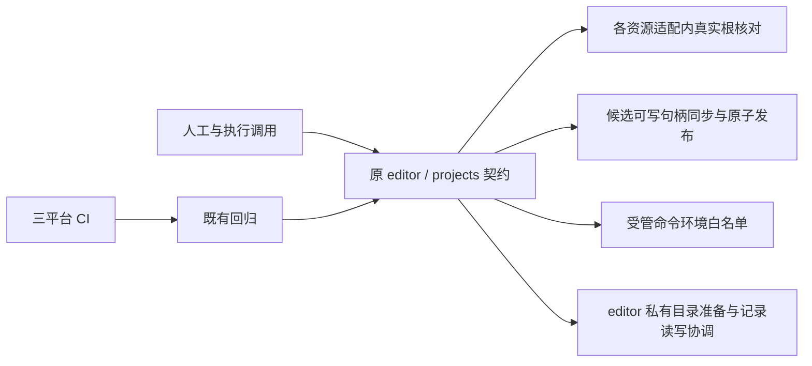
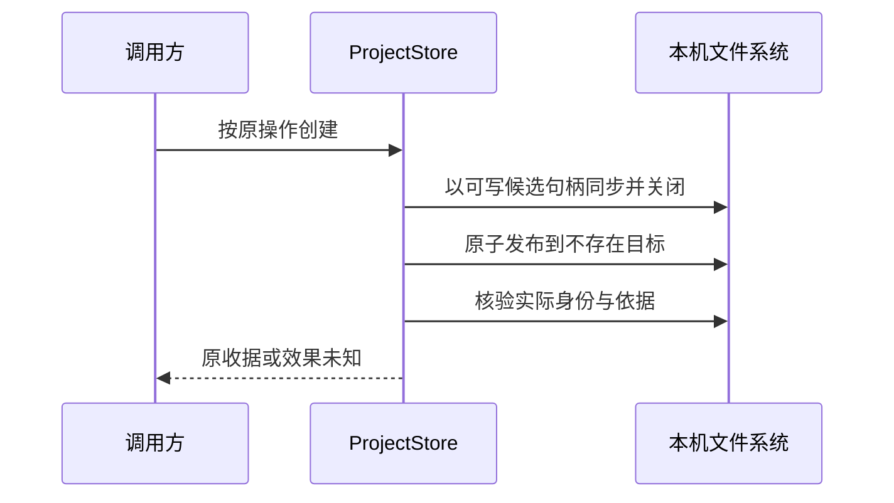

# 实现设计

## 变更总览

## 方案与接口

沿 investigation 已复现结果，不增加公共包装层或路径别名登记。editor.readOutput 每次同时 realpath 根与目标后按原范围规则拒绝越界；DirectoryBrowser 用真实 applicationDirectory 排除私有范围。保留领域授权、普通符号链接条目排除和句柄读取。

projects 打开和创建在落盘前按真实应用根拒绝私有目录；创建候选由 r 改为 r+，不跳过 fsync、不捕获后忽略 EPERM、不改发布顺序。平台 nodeEnvironment 白名单补齐 Windows PATHEXT／COMSPEC 和 Quarto 明确要求的 APPDATA；不继承模型凭据或任意环境。

BibTeX 夹具用双花括号明确保护大小写，精确期望和原书目不变断言保留；不改 locale。监听故障注入改用实际 store.path，与生产 watcher 所用真实目录一致。移动测试在移动前经既有 projectReplacing 钩子释放目标 harness／research，再关闭目标 project 存储；测试子类记录该目标已准备，重开时仅消费一次标记，避免重复调用已关闭仓储。源执行不停止，重开仍检查旧端口拒绝；生产生命周期不变。路径期望用 realpath。子进程 ESM 入口使用 file URL，普通路径参数继续 fileURLToPath。

## 文件变化

- 修改 packages/editor/src/resources.ts、packages/editor/src/runtime.ts、packages/projects/src/directory-browser.ts：真实根范围、实例私有记录生命周期及同路径读写协调；不扩大访问。
- 修改 packages/projects/src/store.ts：项目准入比较真实应用根，候选句柄 r+；其余数据保护不变。
- 修改 packages/platform/src/processes.ts：Windows 系统程序查找必要环境。
- 扩展 tests/kernel/editor-runtime.spec.ts、project-files.spec.ts 的别名回归；调整 editor.spec.ts 的 BibTeX 语义输入、file-watch.spec.ts 与 project-runtime-relocation.spec.ts 的真实路径期望。
- 调整 resource-access.spec.ts 的目标实例替换准备，以及 literature-attachments.spec.ts、literature-integration.spec.ts、research-capabilities.spec.ts、development-execution.spec.ts 等已定位的 ESM 子进程入口；只改夹具，不改原行为断言。
- 调整 tests/smoke/development.spec.ts 隔离测试的自身／其他项目期望为真实路径，保留完整的包含／排除断言；已移除的库授权入口缺口仅记录，不在此补齐。
- docs/development.md 记录真实路径及 Windows 已打开存储的移动限制和验证边界。

## 验证与风险

Windows 后续日志确认每次 atomicRecord 都重设 ACL，每轮渲染 9 次目录准备；缓存测试顺序执行 65／66 轮累积超过原上限，另有最终收据 rename EPERM。editor 内部记录收敛为实例拥有的 EditorRecords：目录首次准备仍走 privateDirectory，后续写入核对目录 dev／ino 及非链接身份，替换或移除时拒绝；临时工作空间释放时清除准备记录。读写按同一记录路径串行，避免内部轮询与替换交叠；不增加重试，不忽略 EPERM。重启新实例重新核对权限，不建立全局“路径已安全”缓存。扩展现有 editor-runtime 测试验证真实记录并发及目录替换拒绝，并保留原缓存轮数和时间上限；失败时附带实际 job 诊断。

先运行别名回归观察旧实现失败；修复后运行 editor、editor-runtime、file-watch、project-files、resource-creation、resource-access、相关 crash/进程回归。全仓 lint／架构／typecheck／build 后推送，三平台实际 CI 结果记录 delivery。Windows fsync、程序查找及打开 SQLite 的 OS 行为不由 Linux 成功替代。外部模型仍使用 loopback 受控响应，文件、SQLite、进程及 broker 真实。远端新增失败依据日志继续核查，不通过放宽超时或跳过消除。
