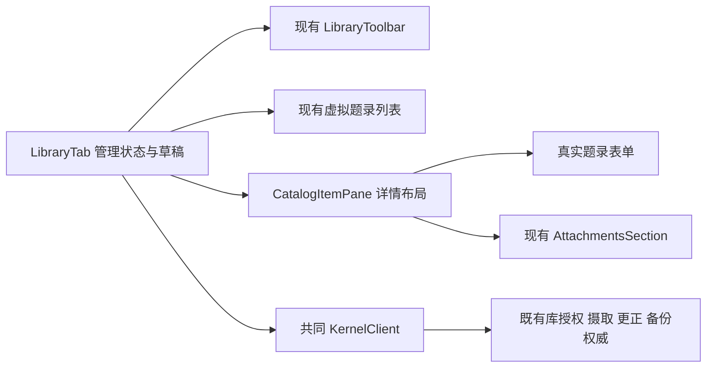
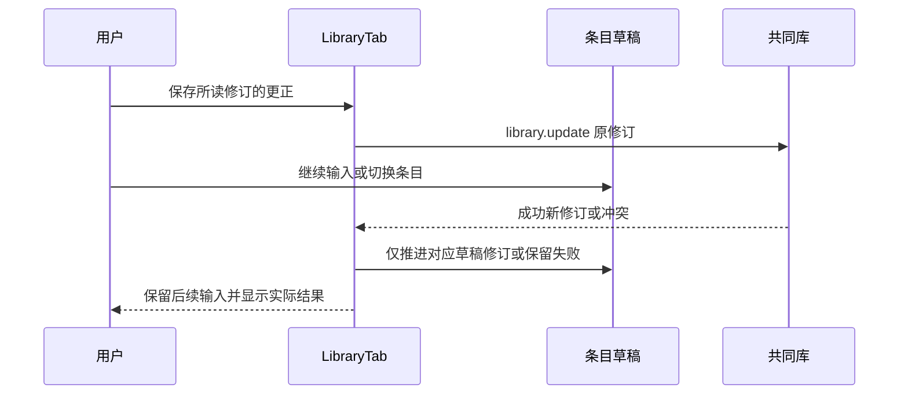

# 实现设计

## 变更总览

## 方案与接口

复用 investigation 所列旧 LibraryPanel 的有界读取、批次状态与草稿实现，接入当前 LibraryTab；不恢复旧列表或另造管理后端。CatalogItemPane 仅保留布局、导航与现有附件模块，接收真实 metadata 表单节点。JSON 编辑、标签、集合和关联版本的同次保存继续由一个修订号保护。

授权由 library.status 决定，编辑中的授权不随通知覆盖；没有读取权限时不展示旧题录缓存。管理表单沿设计中的原生 details、project-controls、btn 和语义 token，放在现有 tab 中可滚动区域；两栏主体保持可用。工具栏的新建动作展开并聚焦同一手动表单，不产生第二条路径。页码与 nextOffset 对应，不伪造总数。

## 文件变化

- `library/LibraryTab.tsx`：复用旧管理接线、草稿、授权和分页，渲染现有列表与详情。
- `library/CatalogItemPane.tsx`：接受真实表单节点，移除未接线的编辑占位调用。
- `library/LibraryToolbar.tsx`：按真实单集合过滤和下一页状态接线，直接使用本页集合，不另外查询。
- 删除无调用的 `MetadataSection.tsx`、`TagsSection.tsx`、`RelatedSection.tsx`、`CollectionFilter.tsx`、`VersionFilter.tsx`；导航锚点随真实字段保留，不呈现后端不支持的版本筛选。
- `library/library.css`、`docs/ui-design/README.md`：补管理区滚动及表单约定，复用现有 token。
- `tests/ui/library.spec.ts`、`attachments.spec.ts`、`tests/smoke/development.spec.ts`：只将旧按钮定位迁入当前 option 语义，保留真实用户操作和原持久化断言。
- `docs/development.md` 和本变更任务／交付：记录真实入口及验证边界。

## 验证与风险

先以现有 library UI 用例确认缺口，之后运行 library／attachments 双宿主及开发模式 smoke。类型、构建、Biome 和架构检查覆盖所有调用方。重点检查未保存元数据、异步保存与切换、范围刷新、撤权、独立恢复不覆盖当前库。复用现有受控模型，不以 UI 通过代表真实科研或 macOS 进程支持。
