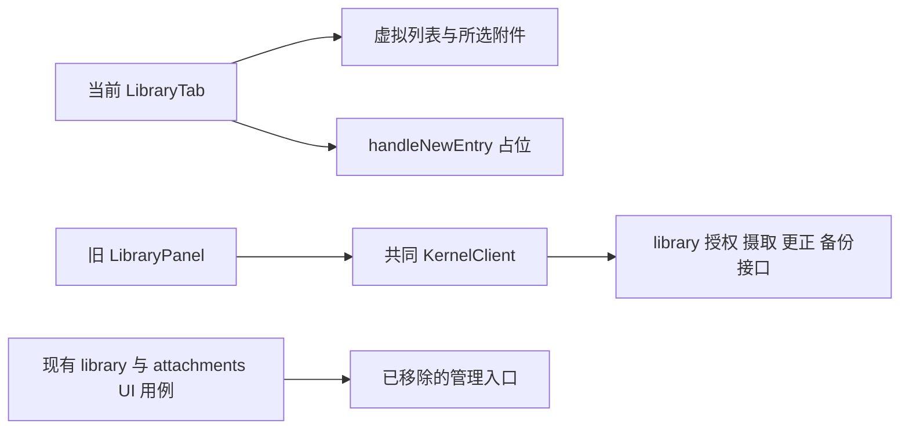

# 调查依据

## 当前事实与复用选择

静态核对 `5c59915` 及重设计提交 `2e43a90` 前的 `LibraryPanel.tsx`：共同库后端及旧人工接线均已存在。当前 `LibraryTab.handleNewEntry` 仅 console.log，`CatalogItemPane` 没有为 `MetadataSection.onUpdate` 提供保存方法；库管理入口已经丢失。旧模块包含批次分页、授权、更正修订及按库／条目保存的草稿和迟到回执保护，可沿共同客户端直接复用，不恢复旧单列布局。

列表 API 只返回当前页和 nextOffset，无总数；当前总页数计算与多集合参数不符合实际接口，应复用旧单集合筛选和 offsets 分页。`tests/ui/library.spec.ts` 核对草稿、冲突和独立恢复；`attachments.spec.ts` 及 smoke 同样需要真实授权和摄取入口。列表交互已采用 option，因此相关用例定位同步迁入该语义，保留操作和持久化断言。

## 影响方案的未知项与实验

现有设计已明确各入口和失败保护，无新产品决定。复用实现不增加依赖、原生访问或后端状态；后续通过现有双宿主用例实际核对接线。Windows 与 macOS 受管执行缺口由原领域 change 承接，不把本 UI 变更当作平台归属验收。

## 结论与承接

将旧题录管理状态与安全写入逻辑接入当前 LibraryTab，现有 CatalogItemPane 保留侧栏／滚动布局并接受真实元数据表单，列表继续复用虚拟化。移除不再使用的占位元数据／标签／关联模块，避免保留第二套未接线编辑逻辑。验收与实际结果进入 tasks／delivery。
