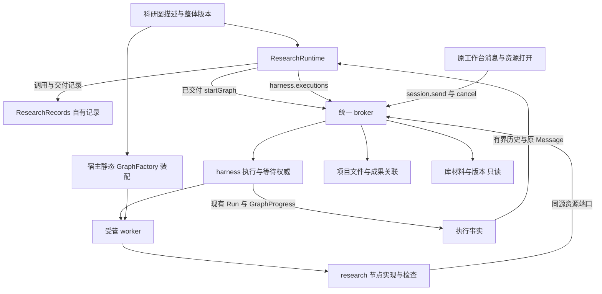
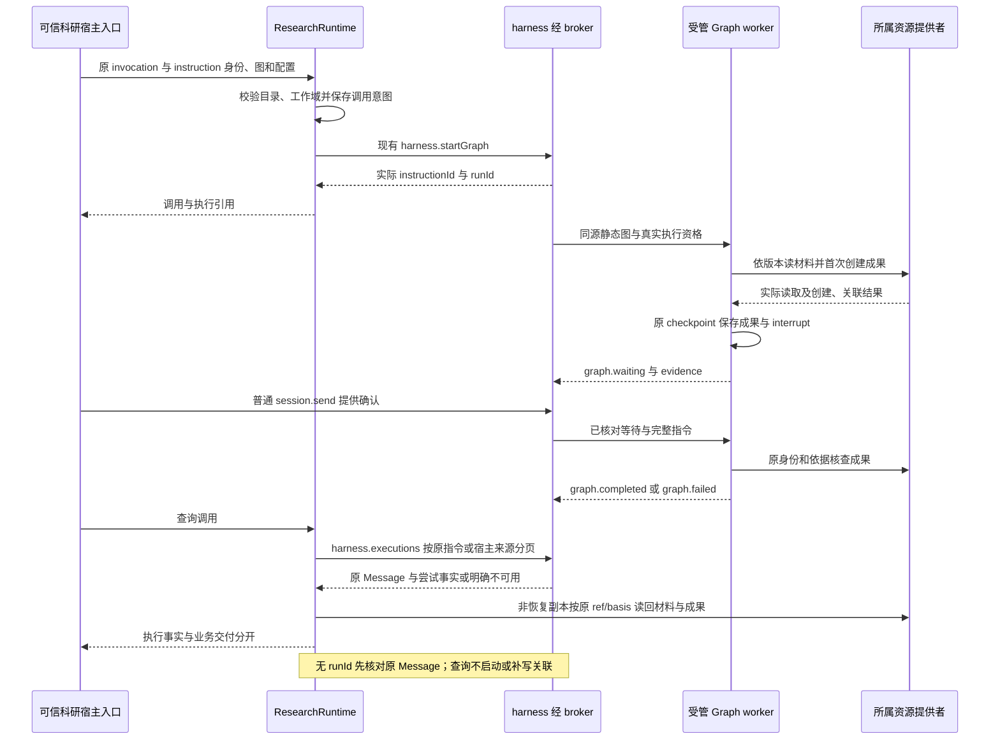

# 实现设计

## 变更总览

状态：本树已同步至281277777f88aa068c948512f084f0d05150776e，0519904（含b838402）为祖先。公共历史消费门已闭合；本轮实现唯一人工请求research.requestGraph及最终准入守卫，实际结果见delivery。任务提供者与任务详情／process材料整合尚未进入本树，I1／I2／I3／I5不据此验收。

复用 `ResearchRuntime`、`ResearchRecords`、共同 broker、`ExecutionGraphs`、`InstructionSaver`、`ExecutionResourcePort`；不新建科研执行调度器、Method 对象、流程 DSL、进程或数据库。图控制流与节点检查各归其职责，旧 Skill 路径独立保留。

## 方案与接口

### 1. 深层模块与源码装配

科研模块对调用方呈现小 Interface：图发现／精确描述、受控宿主启动、按调用查询。其 Implementation 隐藏校验、调用身份、资源交接与交付检查。删除该 Module 后，这些知识会散落到每个调用方，故放在科研域；通用执行、领域保存与模型调度继续复用已有 Module。

外部 seam 使用 protocol schema 派生 DTO 与 broker 窄端口；独立测试在同一 seam 替换执行查询／资源 Adapter，真实验收再使用现有提供者。静态图装配同时有生产空目录与固定测试目录两种实际组合，不为未来自定义图增加插件接口。

- `packages/research/src/graphs.ts` 保存科研图描述、开放配置校验与资源清单。描述包含共同 GraphDefinition，graphId/version/stateFormatVersion/configSchema/waitSchemas/requiresModel 全部引用原 schema，不维护另一份镜像。
- 节点指导与模板以源码字符串／随构建复制的既有 builtin 资源组织；清单只给 `nodeKey/resourceId/source`，不可为本机绝对路径。改变指导、模板或检查逻辑即改变图整体 `version`；`stateFormatVersion` 只用于 checkpoint 兼容性，不能当作内容版本。
- `packages/research/src/graph-runtime.ts` 承载图业务接入，由现有 ResearchRuntime 组合，保留同一个 ResearchRecords 权威。`graph-delivery.ts` 提供共同证据与当前资源读回的纯交付检查。图目录由宿主注入，默认无校准图，不能从项目目录动态装载代码。
- 固定图的描述、节点及 StateGraph／GraphFactory 适配位于 `tests/fixtures/research-graph-worker/`，复用 research 导出的交付检查、完整文本读取检查及稳定操作身份函数；LangGraph 来自 kernel 已声明的依赖，受管接线复用 harness 公共 node 导出，不改 research 依赖。将来真实图使用 `apps/kernel/src/execution-graphs.ts` 同一静态注册入口，本次不定义其业务节点。
- 测试宿主同时注入科研描述及同源 ExecutionGraphs；精确选择必须两侧可解析。描述可发现不代表存在任意可用工厂；实际 worker 继续执行版本与配置校验。

### 2. 提供的科研同源契约

科研操作沿 `research-capabilities`，schema 以 `research-contracts.ts` 与 `research-module-contracts.ts` 为源；公共执行查询直接消费独立 G1 的 `harness.executions`。

| 操作 | 输入／输出及字段语义 | 范围与等待 |
| --- | --- | --- |
| `research.graphs` | offset、limit；返回 descriptions、nextOffset。每项含共同 definition、name、description、source、purpose（科研／校准）、节点资源清单及交付约定 | 只读；默认25、最多100；摘要不含整份节点正文；5秒 |
| `research.graph` | graphId、version；精确返回该描述及开放 config schema | 只读；5秒；不存在 notFound，不启动执行 |
| `research.startGraph`，内部宿主操作 | invocationId、instructionId、projectId/sessionId、graphId/version、config、materials、text；返回 invocationId、instructionId、runId | 写入／reference；5秒受理；仅可信 host/system 装配入口，不能由执行工具或公共客户端借载荷提权 |
| `research.graphCalls` | projectId/sessionId、可选 invocationId、offset/limit、executionOffset；返回 calls、可选 nextOffset；每项含 call、executions、可选 nextExecutionOffset/error，execution 为原 Run 与业务 check | 只读；调用分页默认25、最多100，每调用执行页最多25；executionOffset 仅在指定 invocationId 时有效；整体最多512KiB；5秒 |

`materials` 复用 ResourceEvidence（最多10份，当前固定文本场景至少1份），引用项目 fileId 或库 attachmentId/materialVersionId 及 basis。`config` 必须通过所选 configSchema；不得接收 workerEntry、modulePath、任意代码或超范围资源。固定图仅开放 `outputPath` 与 `goal`（最多4096字符）。成果操作身份由宿主来源 `originInstructionId` 与逻辑成果角色生成，取消后新 run 仍沿同一来源；不把失败模式、operationId 或跳过授权作为用户配置。

节点资源是精确版本下的清单，不开放任意文件读取；首轮不另加资源管理／启用／发布操作。目录发现响应最多512KiB，单描述过大明确 tooLarge，不将全部资源正文挤进发现列表。

### 3. 消费的接口、可信上下文与记录

| 提供者／现有接口 | 本线消费与语义 |
| --- | --- |
| harness：`session.check`、`harness.startGraph` | 查会话归属及可执行状态，启动回执的 runId 是实际 registered 尝试；与旧 invoke 的父 runId 不混用。workDomain 由会话与宿主绑定，不能仅凭输入声明 |
| harness：`harness.executions` 及 Run／GraphProgress／GraphBinding | 精确查询原 run、原指令及稳定来源的尝试；instructionId 命中时含原 Message。执行状态、modelConfig、wait、读取／保存证据沿原 DTO 读取，不复制执行状态、PID、checkpoint 正文或消费事实到科研记录 |
| resources：`describe/read/document/create/creation/save` | 经 broker 及执行资源 Adapter 访问真实提供者；项目创建与条件保存、库只读、版本和撤权均复用原保护。每次读片／交付检查都用当前执行资格 |
| 项目任务端口，正式快照已收到、未合入本树 | 首轮没有任务字段强依赖；TaskRef及四个tasks操作的消费设计见下节，不复制提供者或自建任务模型，不计入I1通过 |
| 阅读交互 ContextItem／session.send | 继续原共同消息接续；本线不定义报告动作、选区保存、DOM 读取或第二输入通道 |

科研持久记录复用 `ResearchGraphCall`：`kind: graph`、id、invocationId、所属 projectId/sessionId、graphId/version、原 instructionId、text、config、materials、选定图描述及 createdAt，可选 runId/error/restoredFromProjectId。逻辑成果操作身份从原 instructionId 与图描述中的角色确定，不另存执行状态副本。无模型图不补造模型信息，有模型图沿真实 Run.modelConfig 投影。科研查询结合持久 GraphProgress 与当前资源读回计算交付，不以历史 evidence.results 自行宣称成果当前可读。

复用 `research_attempts` 的 JSON 存储，以 kind 显式区分图记录与原材料分析记录；`research.attempts` 返回旧类型，`research.graphCalls` 返回图类型，旧初始化／中断处理不改写图的执行状态。无需物理 schema 迁移。恢复副本时仅校正本域 projectId，保存 restoredFromProjectId，保留原 run、材料及成果引用作为待核查依据；查询仍可读取副本中的历史执行事实，但不重读原项目／库材料或成果、不判 usable。原调用的启动重试明确 unavailable，须核查后另发新调用，不自动重启或伪造副本 run 重绑定。

启动前先保存原输入及 instructionId；成功回执后保存真实 run 引用。跨库启动不是事务：显式启动重试沿原身份与 harness 幂等核查回执，再保存本域关联。同 invocation 不同输入拒绝，同输入并发推进复用 SQLite 唯一身份与 harness 幂等。查询不调用 start、不补写 runId：记录无 runId 时，先用 instructionId 只读查询原 Message 和绑定，核对原 text、消息 materials/contextItems 为空、originInstructionId、图身份／版本、config 及启动 materials；不一致报 invalidRequest，未核查到则 outcomeUnknown，再按来源分页查真实尝试。不能仅以同图／同配置推断原输入。

**G1 已实现接口：** 独立公共增量返回 `{runs: Run[], nextOffset?, instruction?: Message}`，projectId/sessionId 必填，runId／instructionId／originInstructionId 恰选一个，offset 默认0，limit 默认25、最多100，整体最多512KiB且包含原 Message。只有 instructionId 命中才返回 instruction，消息缺失明确 unavailable；其他选择器不带该字段。GraphBinding.originInstructionId 由宿主生成，并在 registered 初始化时以宿主字段传给 worker；普通接续沿用，新显式启动另起来源，旧历史不猜测补链。公共与科研消费的运行证据分别见两份delivery。

### 4. 固定图与交付规则

固定校准图不做文献综合判断。图明确组织：读取已声明材料 → 首次保存固定格式结果 → interrupt 等待确认 → 消费新消息并核查已保存成果。结构只在测试源码存在，不成为未来科研流程规范；测试关注可观察效果，节点数及名称不作为外部契约。

- 小样本：一份项目 UTF-8 文本和一份隔离库托管文本，每份显著小于256KiB。完整读取后才记录实际 read；空的越界页不计读取，截断材料不能当作完整输入。超出固定图支持范围明确报告无法完整读取，不静默截断后报告可用。
- 成果 operationId 使用 `graphArtifactOperation(originInstructionId, role)`，即对 `JSON.stringify([originInstructionId, role])` 作 SHA-256，十六进制摘要加 `graph_` 前缀；科研查询用 `call.instructionId` 作同一来源。夹具在副作用前将该身份保存到 checkpoint，先查 `resources.creation`，仅 notFound 时 `resources.create`；取消后的新 run 复用原身份，结果未知则停止相关写入，不改名重生成。
- 所有必要读取证据、创建结果与已保存引用在形成时经原 checkpoint 保存，并随原 GraphProgress 交付；`graph.failed` 仍带已确认 evidence。取消或 worker 失联可能没有最终 GraphProgress，此时科研查询保留已记录的成果操作身份并标明结果待核查，不把缺少完成事件解释成无文件；用户显式核查沿所属 `resources.creation` 处理。
- 图采用真实 `InstructionSaver` 和 interrupt；resume 只接受明确匹配当前等待 schema 的消息并保留完整 InstructionContext。确认等待的固定输入为结构化 `{confirm: true}`；不匹配消息保留未消费。此为机制夹具，不扩产品自然语言理解契约。
- 业务交付检查结合 GraphProgress.evidence.reads/results 与当前 `resources.read`：查询按原 ref/basis 重读必要材料，并按稳定 operationId 找到 complete 的 creation，读回其成果；纯检查核对 results 中同 ref/basis 的保存记录、双方 confirmed 且相同的关联 operationId、当前完整非空文本及真实 completed 状态。历史 results 不替代当前可读性；缺失、变化或撤权明确诊断，等待／取消／失败保留部分成果但不判 usable，科研判断始终 notAssessed。恢复副本跳过这些资源读回。
- `resources.creation` 可核查并补原执行关联，不重新写成果。科研查询只读本域记录、harness 历史及必要资源字节，不调用 start/create/save/creation 或其他补关联路径，不写回查询得出的执行引用；效果未知保留待核查，用户显式核查沿原资源入口处理。库／项目读取异常沿当前结构化错误与行为矩阵，不能 fallback 到其他材料、旧缓存或同名文件。

### 5. 旧入口共存与界面

旧 `ResearchContent.resolve`、Skill、`research.invoke/progress` 的语义不改；新图不通过 `invoke_research_capability` 的同步子执行分支运行。Graph 与旧调用使用不同判别记录及查询，保留旧方法与已有文件。未来真实材料分析迁图需用户确定业务流程，并另行定义能力／Graph 映射，不在本次删除已交付入口。

本次不新增 UI 或图选择按钮，校准图从隔离测试的可信宿主入口启动。已阅读 `docs/ui-design/README.md`：等待沿现有执行状态与共同 composer，成果沿共同资源打开；任何后续呈现调整先更新所属设计分节，再复用 Workbench、StatusBarContext 与浅深语义 token。无本线颜色、间距或布局方案，无需新增组件或样式。

## 文件变化

以下列出已授权实施的文件／符号职责；是否满足验收以父 Agent 的实际运行结果为准，不以文件存在或本次文档整理判定完成。

| 文件／符号 | 实施职责与所有权 |
| --- | --- |
| `packages/research/src/graphs.ts`、`graph-runtime.ts`、`graph-delivery.ts` | 本线：目录校验与描述、科研调用接入、纯业务交付判定；不包含通用 Graph driver |
| `packages/research/src/runtime.ts`、`records.ts`、`schema.ts` | 本线：组合新模块、图业务记录及旧类型筛选／恢复保护；不改变旧调用执行逻辑 |
| `packages/research/src/index.ts`、`node.ts` | 本线：公开 DTO 和宿主／测试所需的最小导出，不暴露私有数据库 |
| `packages/protocol/src/research-contracts.ts`、`research-module-contracts.ts`、`research.ts` | 本线维护新增科研 schema、操作语义及窄端口；原 ResearchMethod/Request/Attempt 保持 |
| protocol 生成映射 `research-module-types.ts`、`business-types.ts`（按生成器实际输出） | 本线随科研契约生成并检查，不手写等价 DTO；无关映射不扩散修改 |
| `apps/kernel/src/application.ts` 的科研装配、research handlers、可信科研宿主入口 | 本线只绑定科研目录／端口与注册；保留原 startGraph 及其权限检查，不改通用 send／执行机制 |
| `apps/kernel/src/execution-graphs.ts`／`execution-worker.ts` | 既有静态装配 seam；本轮固定图不默认入生产集合。若需要共享源码装配 helper，仅绑定注册，不将节点科研规则放宿主 |
| `architecture.json` 的 research 消费与必要 protocol 导入声明 | 本线只补实际资源／执行查询契约边；G1 公共契约沿独立增量；不放宽 harness 具体实现依赖 |
| `tests/kernel/research-module.spec.ts`、`research-capabilities.spec.ts` | 本线扩展独立科研新行为／旧记录与旧入口回归；避免复制公共执行矩阵 |
| `tests/kernel/research-graphs.spec.ts`、`tests/fixtures/research-graph-worker/` | 本线独立真实整合夹具；宿主与 worker 共用校准描述及节点，复用科研检查函数；项目／库／broker／worker／仓储真实 |
| `docs/development.md` 科研段与领域接入表 | 实施时更新实际图入口、旧内容真实路径及诊断；公共位置仅修改本线段落，按实际结果落稿 |

`packages/harness/src/runtime.ts` 及公共查询／来源 DTO 的 G1 改动由 `add-harness-execution-history` 单独承接，不混入科研业务实现；通用 driver、checkpoint 不改。`Workbench.tsx`、`business-session.tsx`、styles、文献字段／修订、项目任务 schema 及阅读报告文件不在本线写入范围。

## 验证与风险

### 最小独立验收

| 验收范围 | 入口与可观察结果 | 依赖替身及边界 |
| --- | --- | --- |
| 目录及纯检查 | 扩现有 research-module：有界发现、精确版本、拒非法配置，缺读取／旧产物／关联 unknown 不判 usable | 独立研究表、资源及执行端口 Adapter；不证明真实进程接线 |
| 科研真实路径 | 新 research-graphs：科研宿主入口 → broker → harness → 真实 worker，读项目与库材料，首次成果真实读回，waiting 后 session.send 完成 | 真实内部提供者；小合成材料，无外部模型即可完成；任务端口缺省，I1未验 |
| 故障及接续 | 参数化覆盖等待撤权、保存已受理取消、关联失败、创建回执未知、重启查询、取消后新 run、较新 run 不污染旧调用、版本／checkpoint 不兼容 | 只在明确的返回边界延迟／丢回执或所属测试仓储触发失败；保留文件和真实归属；消费 G1 已实现接口，科研真实组合已验；跨线整合另行承接 |
| 旧行为 | 原 research-capabilities、research-module、registered-graph、registered-context、resource-creation 定向回归 | 只在外部模型 HTTP 使用原受控服务；测试只覆盖本次触及的边界 |
| 数据保护 | 同物理表旧记录及图记录混合，独立副本恢复后只改本域归属、保留原成果且不执行 | 复用项目备份／restore 测试入口，不自行重写容器迁移；不能伪造副本 run 重绑定 |

测试选择先扩现有测试；新增 research-graphs 仅用于现有测试未覆盖的科研域链路。assert 状态、结构化错误、资源身份／basis、持久记录和真实字节；不锁定提示词、完整文案、内部节点顺序或 HTML。

本树既有依赖已通过用户授权的 `pnpm install --frozen-lockfile` 安装，锁文件未改。根命令以 package.json 为准：契约生成 patch 用内置 apply_patch 应用，运行 typecheck、build、check:architecture 及改动源码 Biome；构建固定后运行 `node node_modules/@playwright/test/cli.js test --config playwright.kernel.config.ts` 加上述定向文件及唯一 output。生成器 self-test 与映射一致性核对随契约变更运行。本次三文档整理不重跑源码构建或业务验收。

每个真实内核用例使用 `/tmp/scholoom-research-graph-<唯一值>/` 的 profile、library、project、output，回环随机端口；测试产物为本线唯一目录，不复用其他树的 dist 或运行状态。只停止夹具持有的 app／worker，不按进程名／端口批量停止。不存在 UI 变更时不新增 UI 套件；若需复验已知旧 UI 基线，先取得服务运行授权并声明例如5680–5689的候选端口范围，实际运行前核对占用。

### 诊断及 CI 基线

复用原结构化错误及日志，按 invocationId → instructionId → 实际 run/instance → resource operationId/ref/basis 定位；分别显示请求未送达、受理未知、准入、worker 启动、实际读取／保存、交付检查、结果刷新。旧调用和新图记录不得用同一个 runId 表示不同含义。

相关旧 CI 输入和追加调查见 investigation；No held RPC 已定位到测试拦截 files.save 而实际调用 resources.save 的错配，材料分析 browser 空报告与 Windows queued/running 仍需阶段依据与 trace，不能统一放宽超时。公共平台子进程计数待 Agent 线诊断，不能删断言或绕过受管机制。G1 六项公共测试通过不代表科研集成、旧 CI 或三平台全绿。

### 数据、权限与兼容风险

- G1 公共接口及科研消费已由真实 broker、worker 与资源端口验证；不能用查询时扫描全部会话、读 harness 表、增科研状态副本或私有回调绕过。补偿路径须核对原 Message、原回执归属及宿主来源，不以同配置猜测。
- 图恢复依赖真实授权与原实例停止确认；当前 macOS 启动前 unavailable，Linux 结果不代表 Windows、三平台签名分发或实际科研质量。
- 原材料只读，项目保存使用条件依据；新图不能因“材料已预检”或只读目标可信而获得写／外发权。只读异常需用户选择的分支保持等待，不能猜测恢复。
- 同表 JSON 扩展仍影响旧结果校验、初始化和恢复，需实际混合记录／副本测试。没有恢复结果时不把原项目执行引用绑定到副本新执行。
- 固定图结果内容只供机制验证。生产真实业务 Graph、模型配置／角色选项及质量规则待用户恢复讨论；本次不承诺已具备节点 Agent 通用子图运行。

## 待办边界

G1 公共实现、科研消费、故障与恢复的本线独立验收已完成，具体结果见两份delivery。本轮主线已正式转交任务接口、阅读两份design和Agent角色源码；已消费的输入与仍未合入的提供者见下节。I1／I3／I5保持开放，不能将设计收到或公共副本通过当作跨域接线完成。

I1 由项目线负责真实任务材料与固定图接入，本线交付图入口、字段语义与独立证据；I2 由科研线在用户明确真实综合节点、顺序、回路及质量要求后另立有界 change。库级科研成果写入、材料批注／交互报告、通用委派、SSH、对外 MCP、macOS 完整执行及用户自定义图不随本次扩张。

## 正式快照消费与I1装配

### 2026-10-26 恢复后的实施决定

用户已确认项目侧组合方案A并授权本轮科研人工适配；前次两案比较及“尚待产品入口定案”属于交接历史，不再作为等待条件。本树HEAD为281277777f88aa068c948512f084f0d05150776e，0519904（含b838402）为祖先，恢复时clean。同步证据为/tmp/scholoom-sync-recovery-wyn13R/{recovery.md,synchronized.json}；后续只从本树正式源码实施，不建立临时组合或重做公共历史。

唯一产品操作确定为 `research.requestGraph`。参数完全复用ResearchGraphStart：projectId、sessionId、invocationId、instructionId、graphId、version、config、materials、text；返回 `{invocationId,instructionId,runId}`。科研GraphStart／GraphCall不增加TaskRef、workItemId、entry basis或sourceLinkIds；这些字段由项目服务端的任务编排核对，得到明确材料后调用本操作，并把真实回执引用写入任务process材料。项目不能另外开放图启动RPC、把host字段交renderer或绕过该适配直接调用底层harness.startGraph。

本线写集：research-contracts.ts的该操作及派生business-types；ResearchGraphRuntime的人工准入及其窄端口；application.ts内科研graph ports与唯一handler、内部source传递；architecture的真实消费；research-graphs测试及科研开发说明。项目线写集：TaskRef/tasks的任务入口basis、workItem/sourceLinkIds核对、任务详情单一动作和process文件／结果链接保存。TaskRef提供者尚未安装到本树，科研单独验收不冒充任务前置已复核，真实I1继续由项目线组合。

人工准入仅接受broker绑定的product/human身份并核对已绑定project/session范围；复制载荷后按图目录、真实session和当前资源核查。应用适配复用instructionResources的宿主私有准入资格，核对origin信任、目标读取及库read/send，逐个describe核对ref/basis和read能力，再由可信宿主调用内部research.startGraph；来源workbenchSource沿内部上下文传入harness，不从参数接受。每次实际worker读写仍落实当前资格。

同会话仅允许一个在受理请求；同输入共享该受理Promise，不同输入明确拒绝，不建队列或执行状态副本。依据真实session状态及原instruction查询，拒绝新请求抢占queued/running/cancelling/waiting；原启动身份的补交交由既有持久科研／harness幂等核查。锁只覆盖受理过程，实际执行／checkpoint仍归harness。失败在受理前不新建科研意图；受理后的未知结果沿原身份查询。

为覆盖预检后的await窗口，依赖独立公共增量 `guard-harness-admission`：Harness.send在原事务中先处理已受理重放，再执行可信宿主同步admit，之后才写指令／run。application用宿主新建AbortSignal与私有WeakMap绑定权限检查及当前session未完成状态检查；signal身份沿内部broker保留，客户端不能通过schema提供检查函数或标记。回执返回后释放该临时标记；不保存执行状态副本，不改变旧host显式选图语义。材料版本由预检describe与实际读取的强basis继续验证；恢复副本先查本域标记，在任何旧资源预检前拒绝。

测试seam已经由本轮任务授权：静态注入description／executionGraphs／worker，经真实产品连接与broker申请、普通消息确认、取消和重启查询；没有新增UI布局、Graph生产注册或角色。复用现有fixture扩充稳定授权与竞态风险，不复制driver矩阵。旧材料分析继续回归。

本轮输入根为 `/tmp/scholoom-phase2-handoff-VZS5mS/`，manifest.json标明各树共同基线 `e3d58fc807827a78493dcd16e38de28c8d02766e`。以下T、R、A分别是该根下 `research-task-workspace/`、`research-interaction/`、`agent-delegation/`，均为主线授权的只读快照，不是实际其他工作树。acceptance.md接收本线独立范围并报告17项定向通过；coordination-plan.md将I1交项目线、真实科研流程留待讨论。本树没有导入这些领域私有实现。

### 任务与材料映射

精确消费来源：T/packages/protocol/src/task-contracts.ts:7–131、T/packages/protocol/src/projects.ts:82、T/packages/projects/src/tasks.ts:30／132／206、T/apps/kernel/src/manual.ts:846、T/packages/harness/src/task-tools.ts:55、T/openspec/changes/establish-file-backed-research-tasks/design.md:89／123，以及该change的tasks.md:49和delivery.md:22。完整前缀按上段展开；不是用户口述候选接口。

| 项目提供字段／操作 | 本线消费与保持的事实源 |
| --- | --- |
| TaskRef `{projectId,taskId,fileId}` | 三个身份一起传递；fileId定位任务入口，正文taskId仍由项目提供者核对。不能把taskId当路径或执行身份 |
| `tasks.list({projectId,offset?,limit?,version?})` | 有界目录候选扫描，默认25、最多100，保留issues及nextOffset／version；不以扫描页条数推断任务总量 |
| `tasks.read({task}) → {task,entry,path,metadata,content}` | entry是任务入口自己的ref/basis；读取任务不等于其来源材料已读取。metadata.workItems的id／dependsOn／planLinkId是计划导航，不是排程或执行状态 |
| `metadata.links[]` | role为source／plan／process／result；workItemId可选。project-file的fileId补TaskRef.projectId成为项目ResourceRef；library-material保留attachmentId及materialVersionId，不变为项目副本 |
| link.basis可选 | 明确选中的source经resources.describe取当前描述，再按ref/basis实际读取。原link有basis则核对，变化不静默接受；缺basis时采用本次真实描述并记录。任一材料错误沿所属诊断处理，不fallback |
| `tasks.create({projectId,operationId,path,content})` | 返回原ResourceCreationResult；未知效果沿原resources.creation核查，不换操作身份。不是先建DB任务再补正文 |
| `tasks.save({task,basis,content})` | basis来自本次重读任务的entry，保存完整候选正文；图完成不自动把任务标completed。结果／过程链接归任务文件，科研只保存自身调用，harness继续掌握实际运行 |

任务入口的links转为本次 `ResearchGraphStart.materials: ResourceEvidence[]`，最多10份且固定图只支持完整小文本；TaskRef／workItemId不能塞进严格的图config。任务所需计划／过程文字先沿项目文件保存，随后用原TaskRef和新entry.basis关联。执行成果的association和任务result链接是两层事实：前者确认不能代替后者成功；后者失败保留已存成果，仅重读任务后补原链接。

### 交给项目线的装配清单

1. 等公共历史补丁经dev验证同步，并使项目的资源schema叶模块抽取、真实tasks提供者及本线科研接入进入同一共同基线。任务快照的task-contracts.ts依赖resource-contracts.ts；本树没有该叶模块／TaskRef，不复制快照源码绕过前置。
2. 在隔离I1 fixture静态导入本线 `tests/fixtures/research-graph-worker/graphs.mjs` 的description／graphs；KernelApplication同时注入 `researchGraphs:[description]`、`executionGraphs:graphs`、对应worker.mjs。三个位置指向同一源码版本；生产 `apps/kernel/src/execution-graphs.ts` 继续为空。GraphFactory接口位于 `packages/harness/src/graph-registry.ts:23`，create消费宿主RegisteredGraphInput、peer、signal及原InstructionSaver，resume仅映射声明的等待输入。
3. 从真实 `tasks.read` 选择来源链接，按上述映射取得项目／库ref与basis。调用 `resources.describe/read` 明确权限及版本后，将证据交 `startResearchGraph` 的可信宿主Adapter。需要模型外发时仍由实际执行再次核对send，任务链接不授权。
4. 用既有 `app.connectProduct()` 保留可信workbenchSource，从该连接发送普通session.send确认、读取research.graphCalls及调用tasks读写；关闭连接会释放source。**该连接目前不能启动科研图**，宿主fixture初次调用startResearchGraph只能验证后半链路，不能充作I1的产品启动验收。renderer不能自报host/system身份。
5. 保持原invocationId／instructionId，接收真实 `{invocationId,instructionId,runId}`。按projectId/sessionId/invocationId查询calls；每个execution是Run＋业务check。真实材料取用见graphProgress.evidence.reads，成果及部分创建结果见results／creations，必要角色由图描述delivery.roles说明。查询错误、等待、notAssessed和缺项都保留；不从run completed推断任务或科研质量完成。
6. 成果fileId与basis取实际complete creation／结果；同项目产物转task result链接，过程材料转process链接。重读任务再条件保存，保存冲突不能重生成成果。新会话从任务文件和process材料取得原调用引用，继续查询真实执行，不依赖旧会话聊天正文。
7. I1由项目线最终从真实产品入口核对启动、取材、首次保存、等待确认、任务关联部分失败和新会话接续。内部broker／worker／仓储必须真实；本线mechanism样例不能替代该整合或真实综合质量验收。

### 前轮候选契约（本轮已确定项目侧组合）

以下保留前轮候选依据；本轮用户已确定方案A，产品操作及实际实现以本节开头的“恢复后的实施决定”为准。原未定案状态不再阻塞可信人工适配。

- 方案A（优先评审）：项目侧组合已有tasks、resources和科研宿主Adapter，TaskRef／workItemId留在任务编排端；原invocation／instruction／run引用保存为任务process材料，图调用schema保持现状。理由是任务归属与任务链接已有文件权威，固定图不依赖任务模型。过程材料只记录来源引用和必要工作依据，不复制harness执行状态。
- 方案B：科研启动／记录增加可选TaskRef与workItemId，引用项目提供者的同源schema；需要新的有界规格及接线验收，适合明确要求按任务反查科研调用时采用。目前没有该查询需求的已确认契约，不能仅为对接而先加字段。

两案都需要确认有限产品请求：至少明确sessionId、原invocationId／instructionId、精确图与config、TaskRef／workItemId及所选sourceLinkIds、文字目标如何交给可信宿主；由服务端读任务并派生materials，不接收客户端自报执行身份、worker入口或权限。操作归属／命名、是否携带任务入口预览basis须由主线与项目线确认。当前公共入口只提供图发现／结果查询；不能将内部research.startGraph直接列入产品白名单。确认前可以准备装配fixture，不宣称已具备端到端I1。

### 阅读线两个change

已读取R/openspec/changes/add-material-annotation-interactions/design.md（提供与消费字段:35、实际失败边界见该change的delivery.md:74）及R/openspec/changes/add-interactive-research-reports/design.md（报告格式:31、动作:56、ready桥:66、续做:109）和对应tasks。它们的职责独立。

材料侧已实现的快照字段在R/packages/protocol/src/workbench-context-contracts.ts:22及workbench-context.ts:25：text.location可选；region.target可指image／pdf页及未旋转尺寸／object；object.contentState可选。共同itemId/ref/basis/comment及16项／64KiB边界保留。科研接续只消费完整InstructionContext（source、contextItems、text、materials、materialFileIds），摘录或坐标不能替代实际资源读取，不能给缺目标的历史region猜坐标基准。位置schema、图片格式与叶schema抽取须先进入共同基线，再在本线公共上下文回归中核对，当前未接入。

交互报告仍为规划：拟议resources.report返回报告入口resource及manifest，resources依赖、sources研究来源和objects分别表达。对象动作拟贡献报告入口ContextItem.object及明确来源资源，用户检查后仍走普通session.send；ready不恢复Graph。resources.report、原子批量append及HTML隔离桥没有实际提供者，不能在本线调用。M1库正文修订、M2可信修改归因、M3排版产物依据和完整I5均未闭合；acceptance.md的U1是阅读线摘录缺陷，未获其修复结果前不把材料摘录当作已验证事实。

### Agent角色、节点资源与版本

消费A/packages/protocol/src/delegation-contracts.ts:26–63、A/packages/harness/src/delegations.ts:27–55、A/apps/kernel/src/application.ts:48–56／114–125以及A/openspec/changes/add-bounded-agent-delegation/design.md:35–62。DelegationRole为id/version/guidance/tools及可选modelProfileId；请求用roleId／roleVersion、workPackage及更窄tools。角色从源码经KernelApplication.options.delegationRoles传入Harness.delegationOptions.roles，默认通用worker/1另加注册；配置校验拒绝重复role.id，不能同时注入同id的多个版本。模型沿实际命名配置解析，不从科研图config猜角色模型。

| 当前已有对象 | 准确版本与指导／资源来源 | 可提供给Agent线的含义 |
| --- | --- | --- |
| scholoom.calibration | version=1、stateFormatVersion=1、requiresModel=false；tests/fixtures/research-graph-worker/graphs.mjs:14起；nodeKey=read／resourceId=fixture，source为该夹具目录 | 源码节点与真实资源／等待校准；没有模型子Agent或科研DelegationRole，不是I3综合／审阅角色 |
| delivery.roles=['report'] | 同一description:45；graphArtifactOperation按原instruction及成果角色派生稳定ID | report是必要成果角色，不可映射成Agent roleId |
| scholoom.material-analysis | 1.0.0；packages/research/src/builtin/material-analysis/{capability.yaml,SKILL.md,SOURCE.md}，由ResearchContent加载 | 旧能力的指导与来源保持；不能把整份Skill改名为DelegationRole或业务Graph |
| 通用worker | Agent快照delegations.ts:27的worker/1及通用工作包guidance | Agent机制提供者，非本线新增科研指导。可校准通用委派；真实科研角色、节点顺序、回路及质量要求尚未设计 |

本树没有delegation契约或角色注册提供者；上述静态注册seam已对齐，不输出虚构的synthesizer／reviewer角色或可编辑角色包，不新增Method实体。真实科研角色待用户恢复流程设计；主线可以继续通用I3机制验收，但不能据通用worker或校准图宣称科研角色业务已交付。
