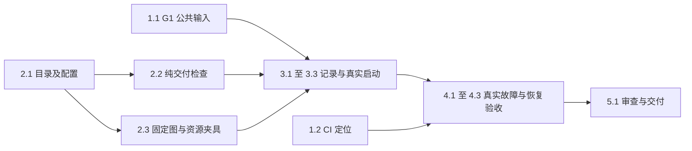

# 执行任务

2026-10-25用户已授权实施并选择G1方案A。公共增量单独落入add-harness-execution-history，实际接口验证通过后供第3组消费；既有依赖按明确授权以锁文件安装。公共文件与符号所有权见design，任务进度只在本文件维护。

G3任务／阅读交互输入不在固定图依赖图中；其真实整合由所属 I1／I5另行验收，不为本 change 添加虚假整合任务。

## 1. 明确公共前置与相关基线

- [x] 1.1 用户已选择方案A；独立公共增量 `add-harness-execution-history` 实现并验证 `harness.executions`、原Message、宿主来源、授权及有界分页，本树科研消费走真实broker。公共文件／符号归该change，未操作dev或其他树，接入由用户后续安排。
- [x] 1.2 已核对固定55d020c日志和实际调用链，定位No held RPC为既有文件保存的gate method错配，材料分析空串及Windows末态超时保留缺少trace／阶段证据的结论；详见investigation追加调查。不修改生产时限，不将未知根因写成超时不足；未授权启动UI开发服务，后续真实平台／UI基线由实际责任线承接。
- [x] 1.3 交付前核对项目任务及阅读交互两份设计是否实际进入本树；有输入时记录文件／版本并核对来源引用、可选关联、ContextItem及普通消息接续，没有输入时明确记录尚未验收I1／I5的交接边界。完成依据是如实界定本次独立交付，不以本任务要求替提供者定案或等待其整项完成。

## 2. 首批独立成果：科研目录、交付判断与固定图

- [x] 2.1 在科研同源契约与 `packages/research` 完成内建图描述、分页发现、精确版本与开放配置校验；复用 GraphDefinition，节点资源随整体版本，静态目录注入。只注册只读发现／描述入口，测试目录可包含校准图，默认产品不发布夹具。扩现有 research-module验证发现不执行、未知／非法配置明确拒绝；随本任务核对生成映射、架构及类型。
- [x] 2.2 在科研模块完成最小业务交付判断：输入实际读取与产物／关联证据分别处理，旧文件、截断／空越界页、缺产物、关联unknown或等待未完成均不判usable；保留notAssessed。扩展research-module代表性用例，2项目录／纯检查及原仓储测试已通过；最终整合回归随4.3记录。
- [x] 2.3 在本线测试夹具完成源码固定图及科研节点实现：真实资源读取、首次保存、稳定成果操作身份、真实 interrupt及 `{confirm:true}` 输入映射；工厂复用原 driver、InstructionSaver与IPC，不给用户配置失败开关。通过已有注册／资源组合入口验证实际 worker运行与缺失输出首次创建，明确此时尚未完成第3组科研调用整合；不把夹具装入生产综合能力。

2.2与2.3可在2.1契约明确后分别进行；父 Agent 负责接口决定和最终整合，避免并行写同一research文件。辅助实现如后续授权委派，2.3只拥有测试夹具及明确节点文件，不修改harness或公共schema；辅助实现使用职责有界的原生子Agent，不创建协调Agent／DAG。

## 3. 科研调用接线

- [x] 3.1 **依赖1.1、2.1–2.2。** 在原ResearchRecords中加入判别明确的图业务记录及独立查询；旧attempts/list/initialize/restore只处理原记录。按已确认公共查询契约关联真实run/modelConfig，不复制执行状态或checkpoint。扩混合旧新记录、分页与独立副本恢复用例；旧调用不出现伪造图字段，图查询不取最新run代替历史。
- [x] 3.2 **依赖1.1、3.1。** 注册可信科研宿主启动入口，经真实broker使用现有harness.startGraph；持久原invocation/instruction输入，核对同身份异参、并发补交及回执未知。实际启动回执与历史查询准确关联；非法执行工具／产品载荷不能借宿主身份启动。生产节点依赖、路径或worker入口不得来自请求。
- [x] 3.3 **依赖3.2、2.3。** 新research-graphs真实组合接入ResearchRuntime、项目／库、broker、worker及SQLite；小合成混合材料首次保存到不存在路径，查询到waiting与部分成果，经原session.send确认后完成。断言实际read依据、fileId/basis、关联与notAssessed，任务端口省略或明确替换，不声称任务整合通过。同步开发说明本线段落与旧builtin路径漂移。

## 4. 独立验收与诊断

- [x] 4.1 **依赖3.3。** 沿同一真实科研组合参数化覆盖等待后撤权、已受理保存期间取消、关联失败及创建结果未知；核查既有字节／身份、停止事实、原操作与缺项，明确查询不触发补关联或重新生成。只延迟／丢失真实返回或注入所属测试仓储失败，不以成功替身替代内部权威。
- [x] 4.2 **依赖3.3。** 核对重启查询不执行、同等待接续、取消后新真实尝试、较新run开始后查询旧调用、版本／checkpoint不兼容及启动回执丢失；旧记录与成果保留，后继尝试关联来自1.1的实际提供者。不匹配输入保持未消费；晚到结果不复活旧推进。复用registered-context等公共证据，不重写恢复driver。
- [x] 4.3 运行本次改动必要检查：生成器self-test及映射一致性、根typecheck／build、architecture、改动源码Biome；构建固定后运行research-module、research-capabilities、新research-graphs以及受影响registered-graph／registered-context／resource-creation定向用例。配置／项目／库／输出各例唯一、端口明确且仅收尾本轮归属；缺依赖或必要验证失败保持未完成；本次仅依用户明确授权按锁文件安装既有依赖，不放宽权限或新增依赖。Linux／Windows与macOS不可用边界分别记录，旧CI失败与本次结果分开。

## 5. 整合与交付

- [x] 5.1 父 Agent核对proposal完成判据与实际结果，并安排必要独立审查：真实执行身份、并发／回执未知、资源授权、部分失败及混合记录／恢复保护。关闭已确认问题或明确保留阻塞；核对图文、诊断入口、无跨模块表访问和无冗余状态权威。交付本线独立证据与I1消费说明，未到达的任务／阅读设计只记录边界。
- [x] 5.2 仅在实际执行后取得delivery instructions并填写delivery.md，记录命令、环境、样本、结果／失败、替身、平台及待输入项，再按真实完成依据更新本项。没有执行结果不得创建delivery；CLI ready不表示科研质量、公共输入或整合已完成。

## 续做入口

本树已同步共同源码4b13183，科研可信人工请求、公共历史与M2可信执行来源均已进入当前源码；主线已接收I1机械切片。本轮仅修正第8组独立模块测试夹具，实际科研质量、生产综合图与科研角色继续后置，不重新实施项目入口或归档。

## 6. 主线转交后的消费核对

- [x] 6.1 阅读正式项目TaskRef／tasks实际接口与两份阅读design，记录精确快照路径、字段语义、本线消费映射与提供者未合入边界；修正旧“尚未收到设计”的待办依据。
- [x] 6.2 提供项目线可执行的I1装配清单：同源GraphFactory／科研目录、可信产品连接、实际材料ref/basis、启动回执及调用结果、任务文件条件保存；明确现成seam与仍需确认的产品启动／关联契约，不实现新产品范围。
- [x] 6.3 对照Agent角色schema，准确列出本线已有图版本、节点资源、指导来源与源码注册seam；区分成果角色和Agent角色，未设计的综合／审阅角色继续待输入。
- [x] 6.4 记录主线17项独立复验、公共切片独立验证和本树边界；更新原delivery／design，完成OpenSpec及diff检查，停在补丁与对接结果。

## 7. 已同步基线上的可信人工请求

- [x] 7.1 更新本轮契约和设计：唯一产品操作research.requestGraph复用原启动输入／回执，不加任务字段；项目侧负责TaskRef/workItemId、入口basis及sourceLinkIds核对，科研侧校验可信人工调用、会话与图／材料并经内部host-only入口启动。记录同步事实及双方符号写集。
- [x] 7.2 实现科研人工准入及宿主装配，复用原instructionResources校验read/send、身份及basis；串行受理同会话并保留同身份补交，忙碌／等待会话的新调用不抢占。保留原内部入口及可信来源，不修改公共harness历史或生产图目录。
- [x] 7.3 沿现有research-graphs夹具，经真实connectProduct→broker→科研→harness→worker验证项目／库材料、首次成果、等待确认、取消和重启查询；扩充身份伪造、图／配置／材料变化、撤权及受理竞态的必要回归，旧能力定向回归保持。
- [x] 7.4 先构建再定向验证，核对派生映射、架构、类型、格式与OpenSpec；独立审查准入及授权，生成相对2812777的完整可审查补丁并更新delivery。只交科研适配及组合契约，不自动实施项目UI／任务过程关联或宣称完整I1／I2完成。

## 8. 可信来源接入后的旧能力模块夹具修正

本组为用户明确授权的轻量测试修正，不新增业务行为、生产Graph或科研角色。CI输入为6b22d60／40315429083；旧有已勾选任务与本组完成均不构成归档依据。

- [x] 8.1 先构建后复现research-capabilities原整组，保留六项共有失败；核对合成执行上下文与M2可信来源冲突，不放宽生产权限或伪装host。
- [x] 8.2 将独立ResearchRuntime及ProjectBackend夹具连接到显式可替换窄端口，实际读写仍委托真实ProjectStore；保留身份、修订、并发替换、进展、部分成果与取消／重启断言，同组真实harness测试继续走生产接线。
- [x] 8.3 复验原整组、research-module及research-graphs关键回归，运行相关类型／架构／格式及OpenSpec检查，更新同一delivery记录首次失败、最终命令和替身边界；Windows无目标实跑继续待平台验收，不将Linux结果写成跨平台关闭。
