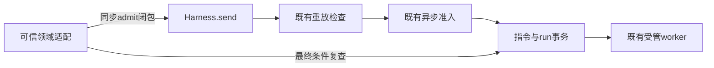
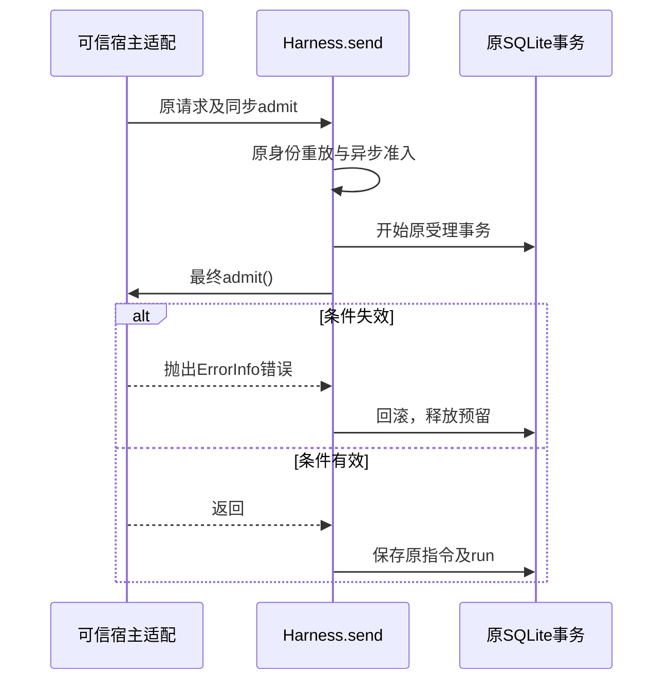

# 实现设计

## 变更总览

## 方案与接口

复用原Harness深层Module：send第四个可选参数 `admit?: () => void`，只可同步核对条件或抛错，不能异步、执行副作用或自行写harness表。事务中先检查原指令重放，然后调用admit，之后沿原contextItems、会话、指令及run保存。没有额外await窗口。失败仍走原reservation释放与事务回滚。broker、worker、客户端schema不携带此函数。

## 文件与消费归属

公共补丁仅修改packages/harness/src/runtime.ts的send签名及事务调用，并新增tests/kernel/harness-admission.spec.ts。科研application私有WeakMap将宿主生成AbortSignal关联到同步闭包，内部broker仅凭保留的signal身份取回检查；其注册、权限和空闲语义随科研补丁，不进入公共harness。

## 验证与边界

独立公共测试复用现有domain-execution-worker，检查拒绝无消息／run／成果、原身份重放不重开工；真实科研两项异步反例验证实际消费。构建后运行history、注册图和旧能力回归；不安装依赖、不改迁移、生产图或进程归属。公共补丁先于科研补丁应用，不代表项目I1或真实科研质量完成。
