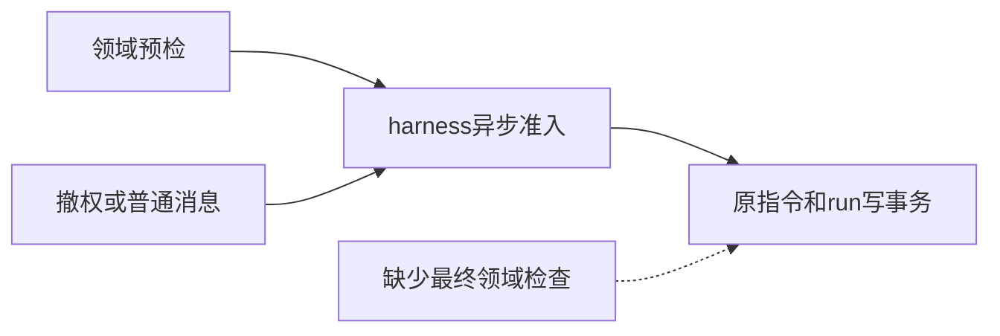

# 调查依据

源码：packages/harness/src/runtime.ts的send在project.check、authorizeContextItems及可能的runConfig之后才写入instructions／runs；事务已复查原指令、会话及显式contextItems，但不会重跑科研人工准入条件。公共历史的活跃检查已经存在，不应重复建设。

独立只读复核提出两项P2；tests/kernel/research-graphs.spec.ts中参数化final admission探针使用真实资源／broker／worker，仅暂停实际project.check的返回：撤销库send，或并发普通消息产生waiting。`/tmp/scholoom-research-admission-red.log` 两项均实际失败，因为请求返回了成功run引用；没有放宽等待时限。最初恢复副本错误另归科研入口，不混入本公共补丁。

现有SQLite事务、重放和reservation finally足以承载同步检查；不引入锁服务、持久状态或新表。具体新科研授权由消费侧提供，通用harness不理解TaskRef、库权限或科研交付。已足以确定方案，其余回归归tasks。
