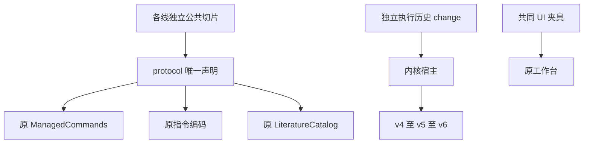
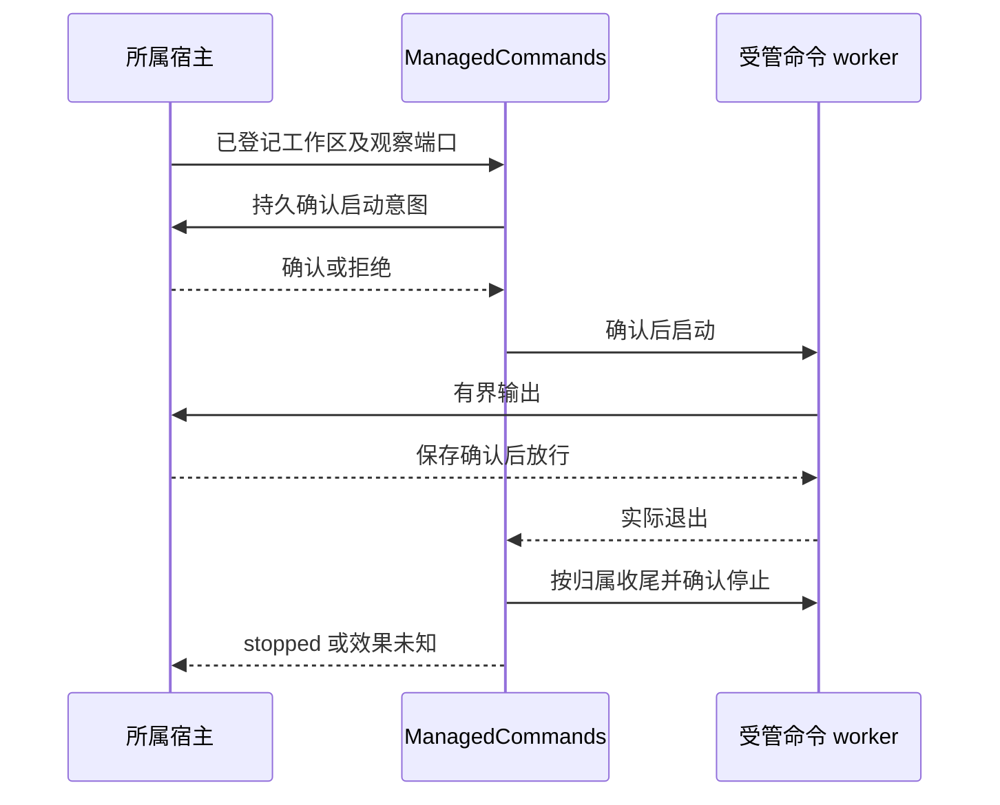

# 实现设计

## 变更总览

## 方案与接口

直接组合提供者已验证的实现，不增加协调服务、通用迁移框架或另一套运行记录。ResourceRef 及保存结果抽为叶声明，原 resources 入口重导出同一对象。材料位置只扩展 ContextItem 载荷，权限和持久指令沿原端口。集合父范围在 SQL 分页前过滤；CSL 编辑声明是 UI 能力目录，不成为拒绝未知 metadata 的封闭模型。

命令沿原受管进程和共享容量，宿主登记可执行文件、目录及动态授权。新增程序观察使用显式启动／输出确认和最终 stopped 收据；输出每片有界并有确认背压，日志成功不能代替退出或完整停止。时限使用单调累计时间分段，null 无总期限；继续保留原 editor 命令失败语义。

数据库 v5 唯一定义为委派表及两个索引，v6 再增加程序运行表。各步先保护源库，再在事务内推进版本；失败保持旧版本和保护副本。旧未发布 program-only v5 不自动转换，现场保留。此处只接物理迁移，领域 restore 钩子等实际领域提供者合入后组合，不导入私有 programs 或委派实现。

## 文件变化

- `protocol/src/resource-contracts.ts`、`resources.ts`：叶声明与原导出。
- `tests/ui/fixture.ts`：组合项目身份定位及真实双窗口，不改产品布局。
- `kernel/src/commands.ts`、`platform/src/{command,command-worker,command-deadline,node}.ts`、`protocol/src/platform.ts`：共同命令观察及计时；扩展现有命令测试，复用新观察夹具。
- `kernel/src/storage/project-container.ts`、原容器／恢复测试及迁移链夹具：统一版本与数据保护。
- `protocol/src/workbench-context*`、`harness/src/instruction-context.ts`及原契约测试：选择依据保真。
- `protocol/src/library-metadata.ts`、`library.ts`、`library/src/catalog.ts`及原 catalog 测试：编辑能力声明和直接父范围。
- 执行历史相关九份源码／测试／文档及其 OpenSpec 沿独立 change 接收；生成映射从最终 schema 产生。
- 开发说明及并行计划记录实际接入范围，领域 tasks／delivery 不因公共接入改成整项完成。

## 验证与风险

先在隔离基线组合构建，运行 history／registered／旧 capability、command／editor、迁移／恢复、resource、ContextItem 和 catalog 定向回归。主线再构建并运行同一相关集合；UI 夹具用两宿主实际核对。Agent 兼容探针只在临时组合加入已修复委派切片，明确它不是主线已发布委派 UI。

不安装新依赖，不在测试期间重建产物。Linux 内部真实接线可使用受控模型边界；Windows、macOS、分发包和真实科研质量另验。图片格式必须随真实视图／消费者接线，不能只接枚举；本批保留原 unsupported 行为。
