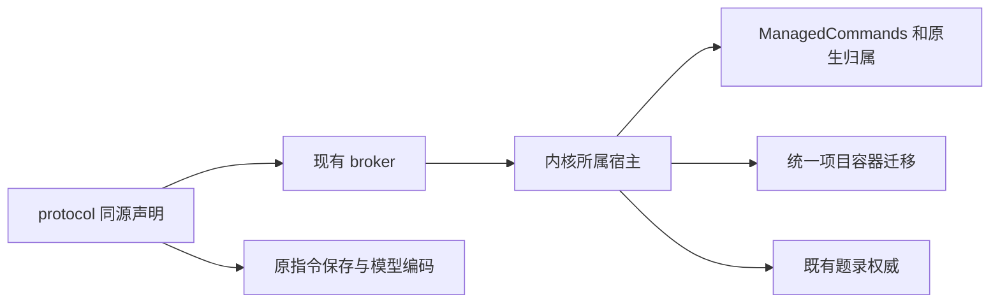

# 调查依据

## 当前事实与复用选择

源码基线 e3d58fc；领域交付为七树未提交改动。逐项核对公共补丁内容、README 与相应 design／delivery，未将整树复制到共同基线。资源叶抽取、双窗口／项目身份夹具来自项目线；命令观察和 v5／v6 迁移来自计算线；材料位置来自阅读线；集合父范围及 CSL 声明来自文献线。各领域继续拥有存储及授权，宿主掌握迁移、命令登记和生命周期。

上述关系依据候选公共切片及当前实际调用；图片视图、题录快照和长驻生态宿主不在图中。

## 影响方案的未知项与实验

上一轮真实 SQLite 样本证明两份独立 v5 会跳过另一域建表。当前候选明确 v5 为 delegations、v6 为 program_runs，旧未发布 program-only v5 拒绝并保留现场，不按表存在猜版本来源。通过故障注入核对保护副本与事务重试，后续组合验收进入任务。

问题是这些公共切片能否共存，不再重做领域选型。隔离副本从 git archive e3d58fc 产生，顺序应用十份公共补丁；没有 programs 私有包、科研 Graph 业务或委派实现。现有锁定外部依赖只读复用，全部 workspace 依赖指向该副本。第一次构建前检查发现 vendor editor 别名仍指原树，修正临时链接后共享构建通过；首次失败保留，不是业务缺陷或安装动作。

## 结论与承接

公共范围没有待决产品语义，使用各线已有实现。来源副本身份、键比较、新题录选择、精确修改归因、产物引用和生态监督是后续分支，不因本轮公共接入自动批准。构建、回归、Agent 兼容性、实际主线结果与目标平台限制由 tasks／delivery 记录。
