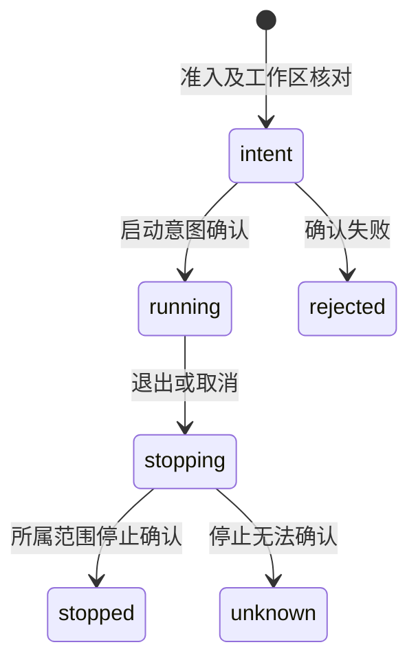

## ADDED Requirements

### Requirement: 受管命令有界观察与停止确认

宿主 SHALL 为已登记工作区提供有界启动和输出观察。新增 `ManagedCommands.start` 观察模式 SHALL 在启动意图确认后执行程序，将输出分片并在确认后继续放行，观察失败保留未确认归属。所有受管命令的程序退出、等待结束和完整停止 SHALL 分开表达；只有所属进程及后代停止确认后才释放原容量。有限期限 SHALL 按实际累计时间判断，不因底层单次计时器上限提前到期；null 表示无总期限。

#### Scenario: 启动确认失败
- **WHEN** `ManagedCommands.start` 观察模式的宿主不能持久确认启动意图
- **THEN** 不启动程序，原拒绝或未知原因可诊断

#### Scenario: 长期限与停止
- **WHEN** 有限期限超过底层单次计时器容量，或调用方取消正在运行的程序
- **THEN** 长期限不会被压为即时到期；取消沿完整归属收尾，未确认停止时保留容量及未知状态

#### Scenario: 输出确认失败
- **WHEN** `ManagedCommands.start` 观察模式的输出保存确认失败或观察端口失联
- **THEN** 不报告完整成功或提前释放容量，保留已确认输出和收尾核查依据
