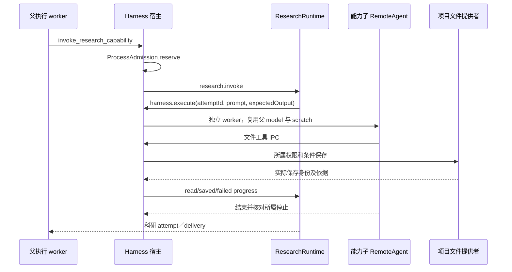

# 调查依据

## 当前事实与复用选择

初始规划调查时，当前树 HEAD 为共同起点 `e3d58fc807827a78493dcd16e38de28c8d02766e`，工作区干净，无 `.codegraph/`。以下现状表及原CI输入保留规划时的基线，不表示实施后仍缺这些能力。用户随后明确要求“实现该change”；实际实施补充见文末及delivery。Experience查询无匹配，不用记忆替代源码。

### 现状与差距

下列路径均相对仓库根；行号用于本基线导航，符号为主要定位依据。

| 事实源 | 已核实事实 | 本次处理 |
| --- | --- | --- |
| `packages/harness/src/runtime.ts:99`、`execution-driver.ts:30` | 两端关闭 generalPurposeSubagent，排除 task／execute／delete；实际 worker 经 createDeepAgent 和宿主代理工具执行 | 保留静态 worker 和共同 SDK，新增宿主工具，不直接启用 SDK 默认委派 |
| `runtime.ts:306` executeCapability、`:2046` capabilityExecutors、`:2320` invoke_research_capability | 父先 reserve，再调用 research.invoke → harness.execute → RemoteAgent；要求当前父上下文与 reservation，拒绝 registered/resume 子入口 | 复用准入和生命周期。科研 expectedOutput、attemptId、researchProgress 是专用语义，不能扩充成通用委派 DTO |
| `runtime.ts:2108` 附近 capability RemoteAgent | 子输入仅一个 prompt，独立进程；复用父 model、父 session scratch、research progress 和保存回调，无通用结果持久记录 | 补独立 scratch、明确角色／模型／工具／工作包和结构化完成报告；不声称当前已具备通用协作 |
| `runtime.ts:252` checkExecutionContext、`:1996` instanceLifecycle、`:2754` childrenUnsettled；`schema.ts:30` RunInstance | 宿主核对最新 run、host、整条父实例链；父停止撤销子资格，未确认子退出阻止根完成；子实例仍属于同一根 run | 沿现有 run/instance 身份，另存 delegationId 与 childInstanceId，不新建永久子会话树 |
| `remote-agent.ts` RemoteAgent、`execution-driver.ts` startExecutionWorker；`apps/kernel/src/execution-worker.ts` | 模型 SDK 与图在实际受管 worker，工具／模型租约及退出经同源 IPC；宿主注入静态入口 | 原入口无需客户端可选路径；通用委派经动态工具的原 execution.custom 通道，结果也用校验 schema |
| `packages/platform/src/admission.ts` ProcessAdmission；`protocol/src/core.ts` limits | 活动执行默认4，等待8／30秒；子 reserve() 不排队，根可排队；retainUntil 保留停止未知占用 | 父等待仍占进程容量；子不足立即 resourceLimit，不另造委派队列／加容量 |
| `packages/models/src/model-access.ts:70` execution | 单例全局并发1；requests=0 位于每次 execution() 闭包，32次计数。当前子通过复用父 model 才共享预算 | 不同子模型不能简单再调用 execution() 得到新32次；须把根预算作为宿主私有共享对象传入，不把计数交 worker |
| `models/src/config-store.ts`、`protocol/src/models.ts` | 仅有应用默认和会话覆盖，配置私有原子文件；当前仅 MiniMax 中国区模型目录，无命名配置／角色存储 | 在当前供应商范围增加命名配置，复用配置验证、私有保存与执行钉入，不增供应商或凭据面 |
| `harness/src/records.ts`、`schema.ts`，`apps/kernel/src/storage/project-container.ts` | harness 只有 sessions/messages/instructions/runs/run_instances/meta；容器当前user_version=4，由宿主建立，恢复副本会改项目归属 | 委派记录归 harness，新增所属表及宿主迁移，备份／独立副本核查必须一起设计，不私自读科研表 |
| `harness/src/project-backend.ts`、`checkpoint-files.ts` sessionScratch | 项目工具和临时目录封装已存在，但当前能力子执行能使用父 scratch | 按 delegationId 分隔子 scratch；不把父 history／checkpoint 挂给子；文件 Backend 的隐含默认工具也必须收紧 |
| `apps/kernel/src/execution-resources.ts` executionResources、`protocol/src/resources.ts` | 已有资源证据、真实 read/save/create/creation，保存与 association 分开；库正文只读，跨项目只读不登记身份 | 直接消费 ResourceRef／ResourceEvidence、实际保存回执；权限范围在这些端口之前收紧，领域仍做最终检查 |
| `harness/src/instruction-context.ts`、`workbench-context*` 契约 | 可信指令来源和显式项已持久化，当前快照只按所属指令来源查询，附加不等于实际读取 | 子只收到父明确选出的材料及来源事实；不复制全部父消息或为子伪造窗口来源 |
| `workbench/shell/ToolCall.tsx`、`AgentDock.tsx`、`AgentOverlay.tsx`、`business-session.tsx` | 工具预览和分页消息已呈现，dock 只最新 tool，overlay 详情可展开；资源共用打开控制器 | 委派详情挂既有工具记录；按展开对象读取，不能把所有子日志塞进 snapshot 或另建工作台 |

此图描述当前专用路径。通用工作包／角色／委派报告不存在，不从图中的进程隔离推定它们已交付。

### 已归档基础与上游复用边界

- [scoped-execution-foundation 交付](../2026-10-23-establish-scoped-execution-foundation/delivery.md)：固定工作域、可信父子实例、目标只读、scratch 和模型排队后的最终授权已有实际证据，不重做。
- [domain-execution-handoffs 交付](../2026-10-24-establish-domain-execution-handoffs/delivery.md)：最终24/24；资源真实创建、部分关联、静态图 driver、持久等待、受管命令和原生归属已交付。生产图集合仍为空；macOS明确不可用，Linux／Windows全组 CI 并未全绿。采用文件顶部最终范围，不把中间轮次的待办重新开工。
- [workbench-context-bridge 交付](../2026-10-24-establish-workbench-context-bridge/delivery.md)：可信来源、显式项、完整指令消费和大更新分帧已有实跑，不复制一套委派 composer 或来源协议。
- `packages/harness/package.json` 固定 deepagents **1.15.0**、LangGraph **1.5.0**、langchain **1.5.16**；现有 AGPL 项目已经消费这些依赖。直接复用已封装的 RemoteAgent／startExecutionWorker，未读到或运行 SDK 内部的能力不作保证，不增加依赖。
- [协作初设上游调查](../../../../.scratch/scholoom-foundations/issues/46-multi-agent-interaction.md#调查依据)固定 deepagentsjs `9f3bfd5…`；异步 subagent 依赖远端 thread/run，不能当作本地受管停止与持久收件的现成实现。它是较早静态参考，不是已安装1.15.0的实跑证据。
- 当前正式 `agent-harness`、`model-access`、`execution-work-domains`、`domain-execution-handoffs`、`workbench-agent-context`、`workbench-resources` 已核对。初设 R-08 提供独立初审要求，科研质量仍由科研域判断；本 change 不迁入 R-09／R-10。

## 影响方案的未知项与实验

### 既有 CI 输入

来源为[并行计划 CI 基线](../../../../.scratch/domain-development/parallel-development-plan.md#当前-ci-基线的处理)及本机 `/tmp/scholoom-next-parallel-baseline-failures.log`，对应 `55d020c` [Checks 40100596838](https://github.com/leike0813/Scholoom/actions/runs/40100596838)。Linux UI 101通过／9失败／2跳过，Windows完整内核374通过／15失败／12跳过，macOS job成功。辅助调查核对相关源码从该头到当前起点无差异。本轮未下载 CI artifacts、重跑或修复。

| 失败证据 | 可确认事实 | 还缺什么／承接 |
| --- | --- | --- |
| 日志4726，`tests/ui/harness.spec.ts:40` | browser 的 analysis.md 轮询为空；测试 catch 吞掉读文件错误；同次 Electron 对应场景通过 | 区分未创建／读失败／空文件，取得最后模型与工具轮次、资源创建收据；不能判科研能力整体损坏 |
| 日志4755、4877，`tests/ui/harness.spec.ts:118`，No held RPC | 断言前 arm `files.save`；`project-ui.tsx` 既有文件经 `port.save` → `resource-controller.ts:78` → `resources.save`，rpc-gate 精确匹配方法。失败尚未到 Agent 指令 | 已闭合“测试等待了错误路径”；实施获授权后沿实际 RPC 校正夹具并验迟到草稿，不能去掉 gate 或换 .first() |
| 日志6705–6850，`harness-recovery.spec.ts:134/193/274/341/382`、`harness.spec.ts:189` | 5000ms检查仍 running；多项在第一次完成检查就失败，尚未进入故障／重启阶段 | 复用 `tests/execution-diagnostics.ts` expectExecutionCompleted，记录模型次数、工具、run_instances、实际停止阶段，先定位启动／执行／收尾，不能据用例名断言恢复损坏或只加超时 |
| 日志6879，`tests/kernel/lifecycle.spec.ts:41` | stop 后再次并发四路 start，并非子进程数量断言；至少一个返回值非 running | 保存四个 BootstrapResult.error、endpoint、锁和 kernel.log；区别配置仍占用与重启实际失败 |
| 日志6994，`platform-availability.spec.ts:147`，0 vs 9 | 订阅在 initialize 前，覆盖人工项目／库操作；Windows `privateDirectory` 用 powershell.exe 设置 ACL；总量不能等同执行 worker | 按阶段／executable／PID区分辅助程序与执行；不能证明9次全是ACL，也不能删除“无未受管执行”保证。全组污染仍待Windows证据 |

现有诊断 workflow `.github/workflows/windows-execution.yml` 只筛其他两个场景，不能替代上述六项失败证据。生产时限和健康期限不随本轮未诊断失败修改。后续公共修复若无本线业务依赖，应提取独立公共增量，由 dev 接入者验证；本规划没有修复授权。

### 跨线输入与未决项

| 输入／状态 | 可独立进行的设计 | 受阻内容与选项 |
| --- | --- | --- |
| 本树没有 `add-material-annotation-interactions`、`add-interactive-research-reports`，`openspec list` 初始为空 | 读取并行计划第6线、现有 UI 设计和正式上下文／资源规格；委派只回传 ResourceEvidence，不定义批注、页面运行、报告更新或关闭行为 | **等待阅读交互线两份 design 同步到本树。** 到时分别核对资源版本／差异和报告动作／刷新，不能宣称已审阅其他树结论；现有资源闭环不等它们 |
| 科研实际角色指导与注册端口未收到 | harness 定义 RoleDefinition 的通用字段、静态注入 seam，用通用执行角色和测试初审指导验证隔离 | **等待科研线角色 ID／版本／指导及原材料与标准约定。** 选项A：科研在宿主组合时提供源码角色，首批推荐；B：另立可编辑角色包／管理器，涉及产品配置与维护，当前不扩展。两者均不把科研流程放进 harness |
| 项目任务／工作项引用尚无已交付提供者 | 通用工作包依赖目标、明确资源、输出和检查要求，不强制任务；可测试可替换关联 adapter | **等待项目线稳定引用及关联结果语义。** 选项A：已有共同资源引用直接覆盖当前可用任务材料；B：未来提供者确需独立 taskRef 时再追加 schema，先跨线核对，不能预造 taskId 或复制进展 |
| 科研线可能补公共执行 DTO，当前无结论 | 首批委派用独立 delegation-contracts，不修改 graph execution.kind 或 harness.execute 的科研语义 | 共享 `harness-module-contracts.ts`／kernel注册符号在实施前交换具体增量；没有交换依据不得声称双方定案 |

这些等待阻止相应真实整合或科研角色交付，不阻止本线通用机制的可审查规划。原材料是否足以独立审阅及意见是否仍适用是负责 Agent／科研 Graph 的判断；harness 只能保证输入来源、范围和实际取用，不用关键词筛查假装证明“无引导”。

规划时未另做实验：进程隔离、资源创建和授权 seam 已有源码与归档依据。取得实施授权后，按下节执行，不把静态检查当成目标Windows阶段证据。

## 实施补充依据

本线已新增通用委派模块、同源schema、v5容器迁移、命名模型及根预算共享，并接现有会话。复用决策保持不变：实际子执行仍为RemoteAgent／静态worker，资源和关联权威仍沿原端口，科研attempt及Graph语义未扩展成通用DTO。当前安装工具为Node24.12.0、OpenSpec1.15.0；schema文档中的1.14.1为既有验证基线，本轮另按当前CLI取得apply／delivery指引并校验。

- 两个真实受管PID／实例、隔离输入、实际保存与父读回已验证；命名配置钉入及移除后保留原解析值、权限交集、容量即时拒绝、材料变化、取消／父退出／重启和控制器丢失均有定向证据，详见delivery。外部HTTP模型及未交付科研角色／关联语义是明确替身，不是科研I3完成。
- 独立审查发现兄弟创建收据串用、未知二次保存被旧回执掩盖、异会话在途受理合并。分别以宿主领域操作身份映射、写入前持久意图及同ref在途拒绝、可信会话／父实例检查修复；真实发布后未知与明确旧版本拒绝分开验证，未猜错误码对应副作用。
- 原双宿主安全编辑用例的gate确实应等`resources.save`。修正后进一步暴露“扣住session.create，却先等待createSession helper完成”的自锁，已改先发起、核对禁用、放回执后再等待完成。原测试双宿主通过，迟到保存与草稿断言保留。
- 原analysis.md空串在双宿主可复现；附阶段材料的浏览器运行仍保留原5秒失败判定。deadline时实际文件是ENOENT，根run及两个实例running，科研invoke工具streaming，attempt尚未取材。继续只读观察10秒后，文件包含独立样本42、实际read_file及write_file完成，attempt usable/notAssessed，父子实例均exited，根run completed。证明本机样本失败发生在完整父子冷启动／执行尚未结束，不能据空串判保存丢失。证据在`test-results/delegation-research-diagnostics/.../trace.zip`的`research-execution-stages`附件；诊断中两份modelRequests数组未快照，不能用于比较阶段请求数，结论取自独立SQLite样本及实际文件。
- 据该证据，科研UI用例先沿用户可见执行状态等待完成（20秒，与既有内核执行检查同量级），再直接readFile核对42；移除把所有读错吞为空串的断言。浏览器／Electron均通过。产品模型／健康／RPC期限、科研流程和Windows原失败均未改。

测试夹具曾在release后重新设hold，造成父继续等待；现只设置一次。旧版恢复样本从当前库降为v2时遗漏删除新增delegations表，现修正样本；另用真实v4迁移索引冲突验证事务回滚和受保护源不被重写。测试仅用隔离配置、合成库／项目与已存在依赖，无真实用户库、真实模型或开发服务器。跨线输入及Windows阶段日志仍未收到，5.1／6.1／6.2与4.2／4.3不闭合。

## 结论与承接

可闭合：复用受管 worker／IPC／准入／资源保存；委派记录归 harness；命名模型归 models；父子共享根预算；一层工作包和独立 scratch；权限在宿主工具及领域两层收紧；结果与科研验收分离；会话内有界观察。

保留：阅读交互两份设计缺失、科研实际角色和项目关联接口未收到，以及Windows失败阶段未定。设计对这些提供者留实际 seam 和阻塞任务，不以“工件齐备”宣称全线可实施或 CI 已绿色。首批可独立任务为协议／仓储、当前供应商命名配置及预算、通用受管子执行与真实资源回读；后续 UI 和跨线整合按 design／tasks 的明确前置推进。

### 本轮规划核对

独立只读核对取得原职责决议、并行范围、规划工件及当前源码，未预先提供其他审阅结论；未发现阻塞或P2问题。此结论不包含业务实跑、迁移、目标平台或跨线就绪证明。

`openspec validate add-bounded-agent-delegation --strict`、`openspec schema validate scholoom-dev`通过；新增7文件（含CLI生成的元数据）的diff空白检查、本地链接目标存在性及代码块闭合核对通过，未检查链接锚点或实际渲染Mermaid。沙箱内Node派生Git被EPERM拒绝，获工具权限后同一只读检查通过，没有写业务文件。apply instructions确认所需5类工件齐备、18项任务0完成；delivery指引要求实际执行后创建，本轮保持不存在。
