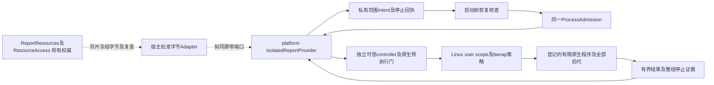
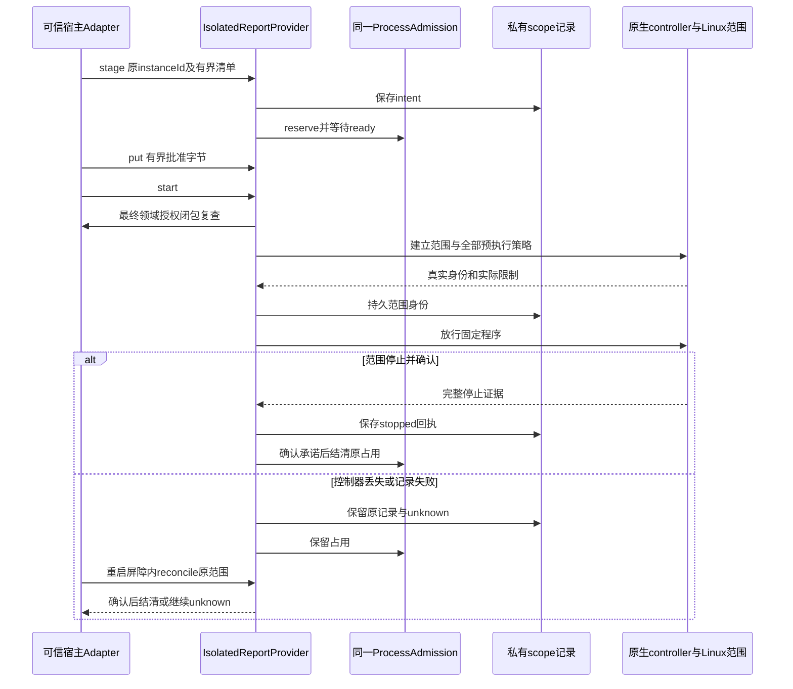

# 实现设计

## 变更总览

第22轮续做仅补原records的恢复完整性：已持writer锁、验证index后，在pinned根通过流式目录枚举核对固定元数据成员及index的storageId目录，读取上限由原maxInstances加固定成员约束；未知、未索引、残留临时对象或枚举失败保留现场并拒绝本provider初始化。原目录句柄、receipt／scope验证及create预算先验保持，不自动修复、删除、迁移、另发身份或新建台账。写集为`isolated-report-records.ts`及原`isolated-report-records.spec.ts`，复用实际磁盘／native锁夹具，覆盖崩溃孤儿与未知对象拒绝、正常恢复和预算拒绝不改变原index。tasks 4.1另行验收；该局部失败不声称为宿主其他模块的全局准入屏障。跨身份C-writer方案由[报告design第22轮](../../add-interactive-research-reports/design.md#第22轮接收与下一片)统筹，不在此修复中迁写IO／新service route。

已定方向是独立Linux platform提供者。1.1／1.2已接收；本次`cb5f7ed3`起点授权实施2.1–3.3，限定同源叶、独立provider、原生controller／构建、唯一准入恢复结清与真实broker/native测试。普通权限条件不足即unavailable，不安装／改委托。原报告2.1b／I5及活动页保持开放，不选择画面流、浏览器分发、Windows或Mac实现。

### 本次启动门与持久化细化

六个操作维持原签名，未注册到全局operations／harness／工作台。可信程序以宿主登记的固定静态ELF字节、固定参数和版本绑定首个`linux-x64-static-v1`策略；预算由登记提供，无产品默认预算。`stage`只有有界清单，同一reservation取得后才创建私有字节文件；每次实际写入将普通文件的dev／ino／size／mtime／ctime见证与offset一起持久保存，跨调用替换或原inode内容变化在封存前拒绝。程序、gate及素材封存后按原见证复制为sealed memfd，再由bwrap复制到私有视图并整体只读重挂；这些物理见证不替代领域basis。

本机`--ro-bind-data`承载静态ELF执行返回ENOENT，`--ro-bind-fd`不能解析deleted memfd；固定字节转私有`--file`再`--remount-ro /`已在真实native链证明可执行与只读。保留bwrap可信reaper；试验`--as-pid-1`留下控制器失联后的存活程序，已弃用，不能以容量仍占用掩盖这一保证失败。controller在门前只从自己的可信后代中核唯一`/gate`、取得pidfd，跟踪根退出后仍收尾全部后代；没有PID消失即释放的分支。

主线在本dispatch明确采纳可信controller的真实exec事件校准：G前对唯一等待gate使用`PTRACE_SEIZE`与`TRACEEXEC | EXITKILL`，只有内核exec-stop可确认`gateReleased`，继续同一被跟踪生命周期且不detach。CLOEXEC状态管道仅作gate准备／失败通知，EOF不再充当执行证明。该前置失败时不发送G；目标seccomp仍默认拒绝ptrace及所有迟到能力，未增加目标权限或依赖。门前取消、快速退出、controller／宿主丢失和停止／容量均需真实回归，未取得前不声明此新增保证已交付。

私有记录目录及实例目录用保持打开的目录FD固定，原路径替换即拒绝，原子写包含文件sync、rename、目录sync；配置ID绑定根目录dev／ino，复制目录不能重绑定原scope。原生flock持有者实现单writer，锁丢失阻断新增交付。记录索引上限4096条，达到上限明确resourceLimit，不扫全文件系统。scope intent先于spawn，boot／InvocationID／cgroup物理身份和controller出生见证先于G，停止回执持久化先于可见stopConfirmed和原admission结清。unknown仍保留lease；停止记录失败也要尝试停止已知范围。恢复停止通过已核原cgroup目录FD的`cgroup.kill`及原对象`cgroup.events`核查，避免按同名unit或旧PID发送信号；恢复副本、身份失配不控制原范围。



虚线为尚未接线的调用；实线表达本change拟实现职责，不将图示当交付结果。模块集中处理字节封存、预执行、范围及恢复，调用方不学习bwrap argv或cgroup路径。平台不导入editor／library／harness，也不解释报告对象／来源；人工宿主可独立装配。

## 方案与接口

### 1. 权威与最小公共签名

第十五轮主线接口审查决定：采用下列六个窄操作、唯一instanceId和分片封存；仅可信宿主装配使用，首片不加入产品业务／harness／CLI白名单。新protocol叶模块及platform提供者由阅读交互线负责，`admission.ts`的恢复结清亦由该线在1.2证明后实施，计算线本轮不写这些符号。宿主生产初始化屏障及报告冻结字节Adapter继续由主线组织后续接入，本片只在独立真实broker夹具验收。

首个策略限定已核架构的固定原生程序，采用Linux seccomp默认拒绝、仅开放该样本必要系统调用的白名单，不增加依赖。固定程序和必要运行库均须由可信登记给出；未知架构或无法加载策略即unavailable。浏览器、动态可选策略和通用程序入口不属于该校准。1.2必须先证明独立停止及持久身份可核查，再进入2.x；不先增加`settleRecovered`后补证明。

ReportResources仍核清单、ref／basis和来源授权；冻结字节Adapter必须从原`ResourcePort.read`按原basis重新取得全部字节、核path-ref及前后授权。其实现不在本change业务写集；模块独立测试可用固定批准字节和撤权回调替代。平台只接字节、视图内相对位置和宿主登记策略，不接领域ref、原生路径、任意argv／env或文件系统代理。域内读写、外发与模型queue／final／restart权威均保持原路径。

`packages/protocol/src/platform-isolation.ts`为唯一同源schema与`FromSchema`类型来源，叶导出`@scholoom/protocol/isolation`；以下只说明形状，实际类型从该源派生。操作前缀为`platform.reportIsolation`，仅授予可信宿主Adapter，不能放进harness工具或全局工作台／CLI白名单。

```ts
// 建议形状；字段最终从同源schema派生，不能独立维护此DTO。
type Asset = { path: string; byteLength: number };
type StageInput = {
  instanceId: string; programId: string; policyId: string;
  entryPath: string; assets: readonly Asset[];
};
type Status = {
  instanceId: string;
  phase: 'queued' | 'preparing' | 'starting' | 'running' | 'stopping' | 'stopped' | 'unknown';
  gateReleased: boolean; stopConfirmed: boolean;
  next?: { path: string; offset: number };
  failure?: ErrorInfo; // 复用core，不新建错误码体系
};
check({programId, policyId}): Promise<{available: boolean; reason?: ErrorInfo}>;
stage(input: StageInput): Promise<Status>;
put({instanceId, path, offset, base64}): Promise<Status>;
start({instanceId}): Promise<Status>;
get({instanceId}): Promise<Status>;
stop({instanceId}): Promise<Status>;
```

六个窄操作的必要性：`check`区别独立隔离能力与managedExecution；`stage/put`避免32MiB加载集突破现有2MiB单帧，`start`提供完整封存／最终授权边界，`get/stop`区分只读核查与停止。只用原instanceId关联一次执行准备，不另发uploadId／reportId或长期字节仓库。`entryPath/assets.path`只指私有视图内规范化相对位置，拒绝绝对路径、URL、`..`、反斜线／NUL、重复位置及祖先文件冲突；不解释为宿主路径。

同源操作语义建议：check／get为read＋result，put为write＋result；stage／start／stop为write＋reference，均沿现有requestMs窗口有界返回。stage可返回queued、start可返回starting、stop可返回stopping，后续查询不会推进执行；不能用返回引用宣称目标已运行／已停止。ProcessAdmission原waitMs、宿主原lifecycleMs及完整停止期限不变，长时核查由所属实例继续记录，超期未知不自动重放。

数量／大小引用现有`reportLimits`：最多入口＋32依赖，入口256KiB、依赖8MiB、总32MiB。`put`建议原始字节单片≤256KiB并校严格base64，含JSON封装仍须≤`limits.frameBytes`；顺序offset无缺口／覆盖，出错查`get.next`，不自动重传未知分片。队列仅保存有界manifest；取得ProcessReservation.ready后才接受字节，准备实例占同一槽位，避免无界暂存。未完成／撤销的准备实例有明确关闭责任及沿原等待／生命周期的有界收尾，不新增延长生产期限。

宿主构造器注入`{admission, privateRoot, programs, policies, authorize, records}`：前四项可信宿主绑定，`authorize(instanceId)`为执行端闭包，在stage、排队后、封存及最终gate前复核当前领域批准状态，不能来自payload自报。跨模块调用仍经同一broker；闭包仅在宿主装配内部，不跨IPC传函数／原生句柄。本change先提供模块及独立真实broker夹具，不改现有生产操作白名单；宿主生产注册由主线在后续接入片处理。

每实例同时绑定宿主原取消／撤权信号；运行后撤权由宿主停止新增交付并请求完整stop，输出／结果交付前仍核当前授权。get仅返回安全状态，不返回原字节；已进入进程的字节不能被“撤回”，其收尾按同一范围及unknown规则处理。页面不拥有信号或重授权能力，不以平台check通过替代持续领域授权。

**恢复容量的最小增量建议：** `ProcessAdmission.settleRecovered(instanceId: string, stopped: Promise<void>): void`。该方法只对已有recovered条目绑定确认，Promise resolve后幂等删除该条目并按原队列规则唤醒；reject不删除，不改变active／owners。证明来自平台已核完整范围且停止回执已持久保存，调用者不能从客户端提供resolved promise来释放。已有live租约仍用`retainUntil`，本模块的内部stopped承诺在unknown时保持pending，后续核查确认才resolve；stop操作可以报告outcomeUnknown而不结清该承诺。既有ManagedNode拒绝stopped的行为不改。重启先`retainUnknown`再核查并绑定结清，不能live／recovered重复计数；新API及其守卫由主线／计算线审后实施，不顺带改旧ProgramRuns回调。

### 2. OS策略与可信执行面

选择已有普通user systemd scope＋显式bwrap namespace及受控C启动门；不把临时gate-launcher或Node bootstrap复制成提供者。新原生适配封装在platform，复用现有监督语义／构建工具和错误类型；保留原process-scope.c路径及Windows分支，不改普通ManagedCommands权限。

`programId/policyId`来自宿主固定登记，声明可执行对象及全部可信运行库、所需syscall策略、预执行控制通道、资源上限、输出／等待界限和目标架构。客户端不能传真实executable、PATH／HOME／profile、任意mount或seccomp指令。注册不是验证通过；任何保证未知返回unavailable。首个独立验收使用固定原生读／受限子孙样本；浏览器策略未登记为可用，不能从开发Playwright缓存推定可分发运行时。

必要保证与下一校准：

| 保证 | 计划实现及真实校准要求 |
| --- | --- |
| 预执行 | 可信controller先取得共享租约、持久intent，再建立scope及策略；目标代码停在原生门，scope身份、CPU/memory/swap/pids实际文件、namespace及FD／syscall全部核实后才放行。先spawn业务再补限制不允许 |
| 字节只读 | 从私有0700准备目录持有已核普通文件FD，顺序写完后封存、只读映射或ro-bind-data；绑定实际复制的字节，不再次按原路径读。拒绝目录、socket、FIFO、设备／symlink，核物理身份及替换；dev／ino不替代领域basis。payload不见准备目录、记录、宿主原文件或控制写FD |
| 继承／迟到能力 | 全部非白名单FD先关，内部数据／过滤FD必须在exec前消耗或关闭；stdio逐项核真实类型／身份／方向／对端，数据通道不得变通用代理。真实校准高FD、SCM、只读socket、重新开namespace／mount、ptrace／pidfd_getfd、文件句柄与io_uring等可能旁路；未知必要项阻断该策略 |
| 网络及syscall | 净空netns防宿主路由，另由受限架构的同源策略封闭新socket／FD转移／namespace和迁移能力；首个native策略建议无socket接收面、仅有限pipe。不能只依赖当前主机nested EPERM；精确syscall清单及seccomp加载／继承语义须先审及校准，未知架构不放行。浏览器需要的内部IPC由后续真实策略另证，不能削弱无外发保证 |
| 全进程范围 | 所有被执行后代，包括detached／再exec均受同scope／策略；不提供cgroup mount、迁移FD／宿主代理或可转移句柄。将来browser、renderer、network、GPU、utility、crash等全部包含，任何组外服务使其组合不可用；不把“仅renderer受限”视作完成 |
| 资源及独立停止 | kernel实际cpu.max／memory.max／swap.max／pids.max逐次读回，政策值显式登记；20%／64MiB／0／16仅旧样本／未来测试配置，不是新产品预算。独立控制路径不能依赖payload事件循环，正常退出／取消／控制器失联都按完整范围核查。scope已空仍需排除迁移／组外工作及身份不匹配 |

完整syscall／网络与失联停止机制未由旧样本证明。不得先声明report策略available再补策略；tasks将这些列为启动门前置。若本机普通权限无法覆盖，应输出精确缺证／部署条件并停止对应分支，不引入安装特权服务、全局cgroup调整或容器／VM。

### 3. 生命周期、持久范围及恢复

公共状态图以本capability规格为准。每个instanceId串行处理stage／put／start／stop，get只投影有界当前状态；旧实例／owner范围核对沿可信调用上下文，迟到数据不能覆盖已停止／替换实例。重复stage只允许核查同一准备意图，不把未知start当成再次执行。preparing之前／取消且已证没有scope可结清；任何可能已创建范围的失败走完整停止或unknown。

平台私有scope receipt是OS执行归属记录，不是第二容量或领域材料权威。最少字段：schemaVersion、原instanceId、所属配置／owner绑定、policy/program版本、phase、gateReleased、OS bootId、唯一unit名及InvocationID、实际cgroup身份、可信controller活身份见证、stopConfirmed和安全failure；不保存模型凭据／完整报告正文／任意argv。unit名与instanceId映射由宿主生成，不从字符串拼任意文件路径。

intent在创建scope前落盘，unit身份在gate前落盘，完整停止回执在释放前落盘。复用private-files的受保护写入模式，但需补本模块目录身份与目录项同步保证，不能把已有file.sync＋rename直接称作抗崩溃事务。写失败前不启动；可能创建后写失败保留unknown／租约，不删记录掩盖范围。字节暂存与操作回执均不自动变成项目文件／科研成果。

宿主正常close先禁新数据及启动，再收尾所有本模块实例；控制器消失时由被测独立原生／scope监督触发收尾。`bwrap --die-with-parent`或原scope根退出本身不是完整证明。新启动先枚举本配置自己的有界receipt页并恢复所有未确认占用，再开放准入；枚举／记录损坏使完整占用无法建立时，宿主恢复屏障拒绝新受管执行，保留人工资源能力，不能只跳过坏页。

`reconcile()`仅宿主启动／显式内部核查调用，不是面向页面的接管API：依据原配置、boot、unit InvocationID／cgroup和controller见证核查；匹配且确有活动范围可停止，不匹配不得杀同名unit或旧PID。原范围不存在不足以单独证明未逃逸，必须结合预执行门和经验证的不可迁移／组外策略；无法建立证明保持unknown。确认停止但回执写失败仍保留占用；保存成功后才resolve live stopped或settleRecovered。恢复副本不控制原配置执行，不重放报告或自动接续。



### 4. 诊断及可替换依赖

安全诊断字段只保留instanceId、策略版本、stage、既有ErrorInfo.code、errno／exit／signal、是否进入gate、限制读回及stop／receipt核查标志，长度沿frame上限进一步有界；不输出报告正文、HOME、token、完整环境或外部连接。诊断失败不能覆盖首个异常。check只报告支持／未验条件，不以配置文件存在返回已兑现；start仍逐次核查。

原运行后撤权场景补验只扩现有`isolated-report-provider.spec.ts`：使用原detached程序及真实默认provider／scope，宿主信号沿原options.signal绑定；观察实际running和同范围后代后再abort，核原instance的完整停止、持久收据及唯一准入释放。排队／gate撤权不能替代此运行后代表。测试本地夹具可增加最小可信信号接点，不新增生产API、策略或等待期限；其他缺证分支按实际范围保留，不重跑已绿全矩阵。

真正前置是Linux目标环境的user manager、现成bwrap、必要namespace／syscall机制与实际cpu／memory／pids委托、已校准策略及可持久记录目录。领域批准字节、库／项目、时钟和授权可在模块测试替换；OS、controller、scope／网络／FD实际行为及恢复准入不能用成功替身关闭。人工提供者可完全不装harness；没有模型或工作台前置。

## 文件变化

本次按下列归属实施独立模块。宿主产品注册、领域冻结字节及浏览器相关行继续后置；共享符号只改本片明确部分，不与计算线并行写原监督逻辑。

| 文件／符号 | 归属及目的 |
| --- | --- |
| 新`packages/protocol/src/platform-isolation.ts`；`package.json`叶导出 | platform契约负责人：唯一schema／派生输入输出及安全状态，程序策略版本与字节限制从该源引用 |
| 新`packages/platform/src/isolated-reports.ts`、`isolated-report-records.ts` | 提供者深模块与私有范围记录，start/get/stop/reconcile，不依赖领域仓储 |
| 新`packages/platform/src/isolated-report-controller.ts`、`native/isolated-report-scope.c` | 独立响应、预执行门／句柄／namespace／限额及安全范围证据；根据已有监督职责抽取共享部分，避免复制旧native文件或改变Windows行为 |
| `packages/platform/src/admission.ts::settleRecovered`、`node.ts`导出、`build-process-scope.mjs` | 主线／计算线先审最小恢复结清、原生构建及公开入口；retainUnknown／reserve原行为及唯一对象不回退 |
| `apps/kernel/src/manual.ts`未来仅this.processes注入、initialize恢复屏障、close收尾；`architecture.json`平台适配声明 | 宿主生命周期接缝，生产注册由后续接入片确认；不动TaskPort／FileEdit、programs／harness工具、全局资源枚举或其他构造参数 |
| `packages/protocol/src/operations.ts`、`business-types.ts`及`packages/protocol/scripts/contract-types.mjs`（仅若注册获批） | 由最终schema组合并用既有生成器核对；不手改生成映射，不增加第二DTO／操作名单。未获注册授权则只叶模块独立导出 |
| 新`tests/kernel/isolated-report-provider.spec.ts`及必要`tests/fixtures/isolated-report-native`；扩`process-admission.spec.ts` | 固定独立oracle／原生反例、恢复／容量；复用原ManagedCommands／HostConnection基准，不复制整套UI |
| `docs/development.md`平台隔离分节；原报告design/tasks | 实际实现后才登记可用入口；原报告只链接真正提供者前置，不再写临时策略待审为永久阻塞 |

领域冻结字节Adapter、ReportView／CSP／Bridge及浏览器runtime不属于本change业务写集。没有迁移统一v6或领域库数据；新私有receipt遇未知版本拒绝接管，保留原文件／占用，不借“迁移”控制其他配置。

## 验证与风险

### 1.2本轮固定校准范围（7aff2c76）

本轮仅cache调查，根为`/home/joshua/.cache/scholoom-linux-isolation-calibration-r16-RqczuM/`，TMPDIR同根；仓库不改production。已核x86_64、现成cc／bwrap／用户manager，并以每个自有scope实际20%CPU／64MiB／swap0／16tasks读回为门。无动态运行库的固定native程序只读本轮合成字节／访问自有loopback／socket，策略默认拒绝且仅允许其必要syscall；原CPU／OOM绿负载未重跑。真实结果及两次失败由investigation首节维护。

对照包含无filter危险控制、带filter但故意保留接收口的单层策略对照、filter＋关闭非白名单句柄的组合；接收FD在payload ready后、动作G前由可信控制器queue，核进入后的SCM及read旁路，不声称已测G后到达。最终补入可信bwrap reaper必要的wait4，未改默认拒绝。实际网络创建、namespace／mount／句柄／io_uring等调用返回EACCES，后续未执行动作单列。FD槽位过滤必须与私有挂载视图／真实类型及清理组合，不是独立资源授权。

同策略的固定三代／setsid程序已分别完成controller与独立宿主SIGKILL：完整登记范围收尾、13个已知出生身份及八unit的追加只读核查通过；活动期持久身份匹配，失配／事后仅只读返回unknown。观察器未区分空事件和目录消失的原始分支，结论仅用组合证据。本轮临时gateReleased字段表示放行意图，实际发送／执行确认及崩溃窗口留2.4，不能照搬字段或由reader释放容量。1.2仅固定native本机校准，不接生产admission或2.x；报告继续unavailable。

按影响先build共享包及platform原生适配，再冻结产物跑最小测试；使用已有依赖、独立cache/TMPDIR／配置／所有unit，仅收尾自己实例。首次失败、实际修正、被拒启动／动作未执行、模块替身及未验分别留原delivery。不重复既有CPU／OOM负载或无本片UI变化的产品UI。

1. **模块／契约：** 固定独立字节、分片offset／超界／重复、封存后写拒绝、排队后撤权、同inode内容变化由领域Adapter拒绝；所有phase、错误结果和broker权限从最终schema验证。领域Adapter可替换，不算生产库授权通过。
2. **真实Linux策略：** 复用三cache原生源码作为独立预期，抽取最少固定输入到正式fixture；用新provider真实内部链核高FD／stdio／SCM、socket／特殊文件／namespace／syscall旁路、固定只读字节。已有CPU/OOM绿例不机械重跑，适配实现改变边界时只选必要代表，真实限制读回必须每次发生。
3. **真实故障／归属：** 启动门前及后、正常退出留detached后代、payload忙循环、kill自有controller／宿主、重启reconcile、InvocationID不符、停止持久化失败；通过原scope及所有登记范围、实际后代／外部心跳、持久回执和同一admission核停止。不能只断言根PID死／unit卸载。所有identity反例只针对自有对象。
4. **准入回归：** 扩既有process-admission的恢复结清；复用managed-commands的controller丢失、HostConnection满额恢复／停止落盘失败代表例，确认未改旧保证及未重复计数。ProgramRuns旧回调差距单独报主线，不夹带业务修复。
5. **公共检查：** protocol／platform及必要kernel/tools类型、architecture、contract-types自检／最终映射核对，相关现有原生ownership代表例。只提供模块未接UI，不跑假报告页面或以Browser浏览通过代替机制验证。

网络校准只针对自有loopback／DNS／HTTP／UDP观测器与已审策略；如外部DNS／目标网络的拒绝语义仍不能证明，明确未验并保持对应策略unavailable，不能以零计数掩盖未执行。实现阶段若需额外目标或安装权限，交主线安排。Linux结果不能关闭Windows／Mac、浏览器完整图、文本／无障碍、运行时分发或科研质量。

## 待办边界

本次实施2.x／3.x独立提供者，具体完成依据由tasks及实际delivery维护；先前1.2的失败与窄结论继续保留。报告注册、领域冻结字节Adapter与呈现不在本片，提供者完成也不开放活动报告。策略保证不足仍阻断，不扩权限。

浏览器的全部进程／运行库、分发维护、共同呈现／原生文本与可访问性、预算及Windows／Mac属于后续明确范围；本模块不能预设像素流来消除这些要求。原报告冻结字节消费者另片实施，并继续逐次核read/send与模型最终准入，不把临时私有字节准备当项目成果权威。
