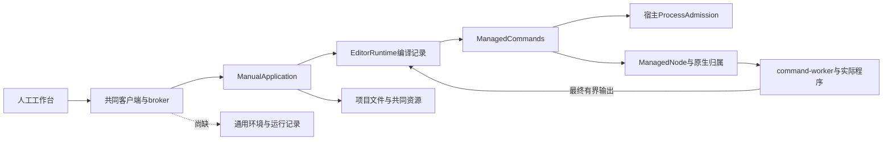

# 调查依据

## f976b67目标对照及最小构造器候选

2026-10-29核run40723824443／job122941607666／artifact12833206296，head精确f976b6754df5a9846eb2485670783e0a2a678ae1。完成job日志、artifact及重建脚本保存于`/home/joshua/.cache/scholoom-finish-active/project-execution/windows-f976b67/`，`report.md`及`facts.json`为同次来源索引，没有混用完整Checks回执。

真实isolated首次启动仍失败在spec:34：runtime17.347秒、import2.307秒、library观察23.336秒后父清理，重启路径未到。ACL四样本全部实际DACL正确、12次命令close0；新／重复／只读核查各约11.870–12.915秒，两种受限环境及正反顺序未消除此成本。SystemRoot／PATH存在，APPDATA仅布尔不同；两环境共同缺LOCALAPPDATA／PSModulePath，不能由绿色断言排除共同环境因素。同run完整CLI的runtime约0.3秒、library约0.4秒，是“Windows所有PS固有12秒”推断的反证；不是严格环境因果对照。

同源启动至少八个串行privateDirectory位置，测量尺度可解释耗尽原期限，但原内核没有逐条PS回执，不能把所有初始化时间直接归为这些命令。主线选择先去除唯一ACL脚本的两个New-Object依赖，以同类型.NET直接构造及同一显式枚举验证候选，保留所有授权／权限及期限；原生ACL草稿未进入实现，作为未编译调查工件保存在cache。

专项Agent三条实际3/3、HostConnection24、owner2和Electron入口重复3通过分别保留，不代表整个Windows稳定性。构造候选独立审查0确证发现，PowerShell5.1与.NET重载／枚举依据见`/home/joshua/.cache/scholoom-finish-active/windows-acl-constructor-review.md`；当前只有本机类型／静态及Linux分支证据，尚需新Windows真实权限与首启／重启回执，不关闭5.2／6.2。

## 当前续做：1c84937 Windows目标及ACL对照决定

2026-10-28从干净共同cb5f7ed续做，用户要求完成既有change；旧“本轮不再派发”不再是等待条件。一次查询Checks40701191661，head精确为1c84937346effef407ed01378f35873338790294：查询时整run仍运行，但Windows job122861144463已failure、artifact12827896108可下载。已完成job原日志表明kernel700通过／63失败／44跳过，后续smoke／UI均跳过；不是旧7aff2c7的唯一kernel失败清单。标准run日志接口拒绝进行中run，后改用完成job的REST logs取得；CLI首次拒绝输出escape序列后用明确flag保存原文件，没有触发重跑或轮询。原job日志、artifact、解压的目标文件及可重建摘要均保存在`/home/joshua/.cache/scholoom-finish-active/project-execution/`，入口`extract-target-facts.mjs`与`target-facts.json`。

- 真实isolated失败在spec:34首次启动，PID5712：preparing-runtime→runtime-prepared相隔29664ms；loading→initializing-application为3878ms，最后到initializing-library。readyTimeout清理前没有ready、exit或close；父SIGKILL后才有退出，不能称自然提前退出。runtime区间包含canonicalDirectory／mkdir／lstat／真实Windows ACL，不足以把全部29.664s归给PowerShell。
- 同run并发首批PID1048的父preparationMs=546、子runtime准备525ms、应用加载3989ms，采样末到initializing-program-environments；四个请求均unknown，发起者ready-timeout，跟随者availability／held。同run占锁释放两例通过。CLI发生更晚，冷暖顺序不同，不是环境差异的因果对照，也不能与旧restart样本拼时间线。
- CI使用Node v24.22.1（原log:137）。官方同版[libuv源码](https://github.com/nodejs/node/blob/v24.22.1/deps/uv/src/win/process.c#L50)的required_vars及make_program_env会为env:{}补PATH、SYSTEMROOT、TEMP、USERPROFILE等；本机v24.12也相同。源码只读保存在cache，不能因JS传空对象就宣称子进程缺这些变量。APPDATA等差异仍需真实目标验证。

主线在ask msg_521379247eb9回复采用最小真实ACL冷／热／环境对照，由本线先交可信夹具、直接spec和既有专项后置步骤，再由主线接入推送取得Windows事实；先不改生产ACL或以nodeEnvironment替换原isolated环境来声称修复。对照复用privateDirectory与nodeEnvironment，交换两种环境先后顺序，分别记录每个新Node内首次／同目录再次调用及真实目录／文件权限；不清OS缓存，不把新Node第一次调用称为机器冷启动。两环境共同使用隔离TEMP／TMP／TMPDIR，明确不是原env:{}逐字重放。原isolated四场景在专项和完整kernel发现顺序均先运行，不以预热制造通过。目标Windows未跑时5.2／6.2保持开放。

## 当前事实与复用选择

规划调查日期 2026-10-25，源码基线 `e3d58fc807827a78493dcd16e38de28c8d02766e`，开始时工作区干净且无.codegraph。下文“当前事实／本轮规划检查”为实施前快照；用户后续授权实施，实施发现见末节，实际运行与验证以delivery为准。原生辅助调查、实现及独立审查保持gpt-6.1-sol／high。

已读取根 AGENTS、开发说明、基础决策地图、七线计划的共同范围／文件归属／独立验收／CI及计算线完整小节，职责 #06、基础 #40、运行架构 #01/#02/#03、共同分工 #09/#10、UI 设计和 `scholoom-dev`。规划技能、codebase-design 从用户指定的源项目技能目录只读复用，未安装技能或依赖。

### 已有能力和具体差距

| 源码或当前规格 | 核实事实 | 本次处理 |
| --- | --- | --- |
| `apps/kernel/src/commands.ts`，`ManagedCommands.execute` | 工作空间绑定 ownerModuleId／directory／projectId／executables；校验真实 Agent 归属，准入前后重新授权；只返回最终 code／stdout／stderr | 复用授权和准入；增加受管长程序所需观察适配，不复制执行器 |
| `packages/platform/src/command.ts`、`command-worker.ts` | `runCommand` 在结束前不交付日志；timeoutMs 必填；stdout 超1MiB失败、stderr留前64KiB；finally等待 worker.stop | 原短命令语义供 editor 保持；程序模式需要有界分片、截断指示和可选程序期限 |
| `packages/platform/src/processes.ts`，`ManagedNode` | Linux／Windows可用；macOS拒绝；instanceId绑定活动句柄；stopped区分完整停止与controller退出；没有可供重启后重新取得原生范围控制权的公开接口 | 使用完整停止确认；重启不能把 processMayBeAlive=false当作安全证明，不承诺重接 |
| `packages/platform/src/admission.ts`，`ProcessAdmission` | 宿主统一容量；`retainUntil(stopped)`拒绝时继续保留名额；等待队列有界 | 所有运行和环境准备共用同一个宿主对象；启动前恢复未知占用，不另建计算计数器 |
| `apps/kernel/src/manual.ts`，构造器、commandWorkspace、registerProjectHandlers | 人工宿主不依赖harness；生产工作空间只登记editor的quarto／latexmk；测试可覆写登记Node | 新增计算域独立装配和私有登记；不能把测试覆写误称生产程序已开放 |
| `packages/editor/src/runtime.ts`，`EditorRuntime` | 私有JSON回执、编译工作空间、排版缓存、最后成功产物及独立取消 | 不迁移、不复用为通用运行状态；共同机制变化必须回归editor |
| `packages/projects/src/store.ts`，material／path／backup／restore；`files.ts`，reference／resolve | material取得实际basis和fileId；文件身份、内容保护、实际文件和备份归项目；运行程序可直接在项目工作，不必复制全工程 | 以窄端口取用；输出登记不再次写入字节，不调用resources.create伪装程序自己生成的文件 |
| `apps/kernel/src/storage/project-container.ts` | 物理容器v4；harness_meta／research_attempts／run_instances分属原领域 | 新增program_runs自有表及v5升级保护，不写harness/research表 |
| `packages/protocol/src/resources.ts`、正式 `workbench-resources` | ResourceRef、ResourceEvidence、分片读取、稳定fileId和共同视图已交付 | 消费原契约；通用输出仍用真实项目资源，不新增另一种文件权威 |
| `packages/protocol/src/operations.ts`、`packages/client/src/index.ts` | 同源声明、生成映射、泛型client.call和范围watch已存在 | 增加领域声明及精确刷新范围，不能省略生成映射 |
| `Workbench.tsx`、`tab-state.ts`、`shell/TabGroups.tsx`、`business-session.tsx`、`resource-controller.ts` | 两宿主共用tab、session、事件及结果打开路径；UI设计尚未细化普通程序失败呈现 | 新增项目运行tab和专属组件；UI设计仅在实施时先补对应分节，不另建工作台 |

现状图的实线均已由上述源码确认；虚线为缺失业务能力，非已注册入口。

### 适用正式契约

`openspec list --specs`列出19项，尚无项目程序运行capability。已完整核对 `domain-execution-handoffs`、`platform-access`、`module-runtime`、`execution-work-domains`、`workbench-resources`：分别保留宿主登记与全局禁止、完整归属、领域权威、只读不授予执行、实际资源打开。这些契约不需要重写；本次新增 `project-program-runs`。

初设 `docs/initial-spec/execution.md` 的E-05/E-06与 #40 保持产品方向，但不是现有通用运行实现。架构／接口草稿中的ManagedExecution、旧源码路径和“尚未迁包”描述不当作现状；以本表源码和正式规格为准。交付时只更新开发说明对应入口并将初设相关段落链接到正式运行规格，当前不修改这些文档。

### 可支持环境及准备方式

本机只读版本命令取得 Node v24.12.0、uv 0.9.17；`uv sync --help`确认支持 `--locked`、`--no-dev`、`--no-install-project`、`--no-install-workspace`、`--no-python-downloads`。这只证明本机CLI选项存在，不证明Python／Conda、离线缓存、项目lock或环境准备成功。当前树无本地 `node_modules/@playwright/test/cli.js`，没有尝试触发pnpm自动安装。

补充只读搜索未发现已声明TOML解析依赖；`uv export --help`列出cyclonedx1.5格式及frozen／offline／no-build选项。因此design选用现有uv解析后输出JSON，不为锁文件手写解析器。尚未实际export样本，字段完整性与离线／不写原文件的行为由tasks 3.1明确验收，不能从CLI帮助推导实际准备已可用。

- Node：登记内核实际Node可执行文件，支持显式JS／MJS入口；TS和自定义加载器不自动启用。
- 已有Python／Conda：用户在可信本机设置登记解释器；执行使用其绝对可执行文件，不猜测Conda名称、不自动activate／修改base，不继承整个宿主环境。依赖能否import由明确检查／实际运行报告。
- uv：首批仅支持已有uv＋显式已有Python＋项目pyproject.toml/uv.lock；受管环境及cache在应用私有计算目录，以环境身份隔离，不写项目`.venv`。准备使用锁定同步和禁用自动Python下载，完整计划须包含声明中会执行的安装／构建、联网及本地依赖范围。声明缺失／不支持／越权则不启动，不降为未锁安装；包索引凭据不进入普通运行记录。
- uv/解释器缺失报告unavailable；首次提供工具本体、自动下载Python、TinyTeX和外部软件安装留后续change。首个change仍必须实现并验收授权内uv环境准备，不能只留一个未来按钮。

## 影响方案的未知项与实验

### 当前CI基线（2026-10-27）

第十二轮起点ba29ee6，正式输入 `/home/joshua/.cache/scholoom-round12-acceptance-NagGbw/`。最新已完成29cd728／Checks40591705520：Linux内核750通过26跳过、UI126通过32失败6跳过；Windows内核723通过11失败42跳过；macOS人工UI13通过1失败，降级4及入口4通过。原isolated-kernel失败仍不能按较少失败数关闭，安全stderr候选A已由主线明确授权本轮实施。ba29ee6相较已验e3c815b只有共同计划及交付两份Markdown变化，实际git差异与构建产物存在已核，测试改动复用既有构建。未重新查询或等待新CI，本轮实现尚无Windows目标结果。

本轮事实为Linux Node24.12.0、既有真实fork／IPC及原44s等待：ready前exit1记录closedBeforeReady、清理前close=true/code1、kill=false；未发ready进程44.0s后记录readyTimeout、清理前close=false/exit未知、kill=true，最终真实close收据单列。约512KiB无换行及非法JSON被排空丢弃，合法阶段保留但私有额外字段丢弃；分片UTF-8、64条／32KiB记录及旧kernel.log不混入均通过。两个进程反例最终安全文件分别686／692字节；这是诊断行为校准，不解释历史Windows根因。原真实配置／进程替换32.1s及原文件尾投影2.4s通过，没有改生产源码或预算。详细命令／首次格式失败及结果沿本轮delivery和 `/home/joshua/.cache/scholoom-project-execution-round12-TjguNl/`。

### 第十一轮CI消费（历史）

第十一轮起点29cd728，正式输入 `/tmp/scholoom-round11-acceptance-Jx5Oez/`。已完成Checks40540362614／938c33f：Linux内核748通过26跳过、UI125通过33失败6跳过；Windows内核677通过55失败42跳过；macOS job成功。本轮Windows artifact12754788905显示**并发首批**四入口均unknown，持锁PID3188的父prepare541ms、spawn相对本批+3.729s，子准备+7.018s／完成+7.584s、loading+7.589s、initializing+11.471s；启动者回执+13.204s，采样+13.340s。其余PID7040／7056／5244实际busy；没有ready、退出或更细提供者回执，只知该次采样缺失，不能称死锁／永久阻塞。旧head尚无提供者标记，与上轮8c2重启失败分别保留。

同run的isolated-kernel首次start（spec:34）在ready-ipc失败，清理后“owned child closed”；实际PID、清理前是否已close、退出code／signal、原始原因和最后阶段均缺失。trace只有测试错误和上下文，保留profile不在上传artifact内。源码确认helper忽略stderr，子入口直接serveKernel也不创建kernel.log；裸catch丢弃超时／提前退出／IPC／非ready状态的区别。因此确证的是公共fixture诊断丢失，非实际启动根因。本线仅交design内最小候选与反例，不改tests/isolated-kernel.ts或其归属策略。

本轮对新源码CI各仅查询一次：diagnosis40591705558／29cd728已完成，availability6项通过，artifact12775017470实际保留来源和两种占锁释放后的安全JSON；Checks40591705520查询时Linux／Windows仍在内核步骤、macOS job失败（该新失败阶段未调查，不沿用旧run成功）。新通过样本PID6348／5876各有完整提供者开始完成；library分别569／688ms、projects873／871ms、program-environments282／294ms、harness279／290ms，不能据此归因旧失败。旧负例与新正例不拼时间线。新增来源附件实际给出source正例、unresolved同名负例和当前run的初始化7／人工准备2／保存1条真实exit0；不重查或反填历史10条。

本轮证据位于 `/home/joshua/.cache/scholoom-project-execution-round11-dVkuM9/`，下载／解压及TMPDIR均在本轮自有cache根，不清理旧目录。没有生产／测试源码变化、构建或产品测试；只核对已获目标artifact与源码。缺本轮完整Windows组同一失败run／子PID的提供者时点即停止，不后台轮询。公共fixture诊断候选须主线接入验证，原5.2／6.2开放。

### 第十轮CI消费（历史）

本轮938c33f正式输入为 `/tmp/scholoom-round10-acceptance-j1MosP/`，最新已完成Checks为8c2fd24／40479176954：Linux内核746通过26跳过、UI126通过32失败4跳过；Windows内核688通过42失败42跳过；macOS job成功。本轮只读下载Windows artifact12726536151，实际lifecycle反例发生在重启批次：首批4入口均running同实例PID832；旧实例server-closed／lock-released后，新PID1412到loading（本批+7.018s）、initializing（+11.863s），启动者ready-timeout回执+13.003s，最后采样+13.428s。跟随者最后观察旧发现PID832死亡且锁held，不表示旧进程仍持锁或新进程归属不明。缺少父prepare／spawn及初始化各提供者时点，不能倒推耗时根因。

同源码938c33f Windows诊断40540362546已完成，head精确匹配，artifact12751410950已只读核对：availability六例全通过，含Windows原生privateDirectory来源正负校准、两种占锁、真实RPC与不可用入口零派发。断言严格保留来源／阶段／进程／真实exit0；窄来源校准关闭，不把历史10条未归因事件补造为ACL。成功步骤未显式落盘的JSON不在artifact内，具体origin枚举及准备耗时仍无原始附件值；本片将既有安全附件显式保留。Agent三例失败均在首模型／产物观察边界，归Agent线，不作为生命周期根因。Checks40540362614查询截点Linux／Windows仍在内核步骤、macOS成功；不轮询或触发重跑。

Application.initialize真实等待入口为ManualApplication内library.initialize、projects.initialize、programEnvironments.initialize，以及KernelApplication内harness.initialize；另有登记核查／programs恢复及research同步初始化。只在这些既有装配调用前后增加固定安全标记，具体域内部提供者尚无目标时点证据，不改harness或HostConnection。下一输入须为同run／新子PID的父preparationMs／spawnedAt、子准备／loading／initializing及提供者开始／完成，不能拼接下列历史样本。

### 第九轮CI消费（历史）

本轮指定基线为caf9025／[40455958976](https://github.com/leike0813/Scholoom/actions/runs/40455958976)：Linux743通过1失败26跳过；Windows687通过41失败42跳过；macOS人工UI13通过1失败、fallback2及入口4通过。原日志与精确并发摘录在 `/tmp/scholoom-round9-acceptance-IER31D/`，不沿用旧4失败清单或按用例总数推因果。Windows artifact 12715580670已只读下载至 `/tmp/scholoom-project-execution-round9-RRtTUQ/windows-checks-caf9025.zip`。首批4入口实际2个running同实例、2个unknown／availability／held／无discovery；第一个unknown调用回执在发现发布前6ms，另一个在发布后87ms返回，回执仍是最后一次held／无discovery观察，最后检查的确切时刻未记录。不是已连接实例回退，也不是旧occupied的PID判断。

同源码4312262的[Windows诊断40476577132](https://github.com/leike0813/Scholoom/actions/runs/40476577132)已完成，artifact 12721785916与主线原始windows-diagnosis.log／failures.log均消费。锁／availability组3通过2失败：无发现占锁、RPC声明、Node观察器通过；活发现前段归属通过，释放后三入口为两个unknown／held／无discovery和一个ready-timeout／handshake none，最后采样仅到新PID4436的应用初始化；不能声称该内核永不就绪或锁失效。unavailable的10个事件实际相位7／2／1、退出0，但来源false，依旧未放行；没有由名称／相位推定来源。Agent步骤三个失败归所属线，本线不改推进／来源。

4312262完整[Checks40476577071](https://github.com/leike0813/Scholoom/actions/runs/40476577071)也已完成：Windows727通过3失败42跳过；同配置并发34.6s、两种占锁31.5s／22.0s均通过，unavailable仍失败且10个事件来源全false。原log与artifact12724656293保留本轮目录，macOS job成功、Linux job失败，未扩成其他线的全仓分析。完整组正样本与独立诊断释放后失败并存，不能用一次通过关闭启动稳定性。

真实privateDirectory安全拒绝路径在Playwright worker下证明函数帧被映射为platform/src/private-files.ts，stack limit200，旧dist-only条件失配。另一个隔离调查沿真实privateDirectory Windows分支／Node子进程通道，仅将外部ACL程序替为固定成功夹具，得到17帧、函数位于7、source=true／compiled=false；不构成Windows ACL或目标观察通过。最小修正精确识别同一实现两种帧，未知来源仍拒绝；目标10条历史记录不反填已确认来源。原kernel诊断只补准备／busy及父准备／spawn时点，等待新目标对相应耗时与origin采样，生产预算与判据不变。

### 第八轮CI消费（历史）

此前完整基线为b2f3b50／[40447074031](https://github.com/leike0813/Scholoom/actions/runs/40447074031)：Linux734通过1失败23跳过；Windows715通过4失败39跳过；macOS人工UI13通过1失败且入口步骤通过。输入为 `/tmp/scholoom-round8-acceptance-UrXA7y/{ci-baseline-failures.log,ci-baseline-summary.json}`。只读下载Windows artifact 12710309824至 `/tmp/scholoom-project-execution-round8-MP5HIK/windows-b2f3b50.zip`，安全摘要同目录。

占锁artifact只保留旧初次结果：发现PID8328、lock=held、processAlive=false；后来start失败差异为processAlive=true／unreachable／connect。没有holder PID或同时刻进程身份，不能定为PID复用、tasklist错误或holder归属。真实反例证明夹具不能保证已退出PID在整个期限内保持不存活；本片将未知等待与明确活PID不可达拆为两个可控输入，保留原生产分支。platform-availability artifact只有总计10，没有逐进程数据。源码可逐项解释initialize7／人工准备2／保存1次privateDirectory，Windows该函数每次execFile PowerShell设置ACL；五个被拒绝入口均先requireAvailable，无静态探测派发。该10项解释仍待Windows逐事件回执，不因数目相同假装已认定身份。

0b78815的Checks [40454653610](https://github.com/leike0813/Scholoom/actions/runs/40454653610)实际查询到macOS job 122025046737成功：不可用校准2、入口4（关闭重开20.5s）、人工UI14项通过，日志macos-0b78815.log；上一轮app.process观察修正已有真实目标回执。受管执行仍不可用，不能把人工入口成功扩为计算可用。查询截点Linux／Windows仍在内核阶段，无新Windows artifact。Windows execution diagnosis [40454653566](https://github.com/leike0813/Scholoom/actions/runs/40454653566)已成功，但其范围不含本片两个剩余例，不替代目标验证。

### 第七轮CI消费（历史）

上一完整基线为39be889／[40432749785](https://github.com/leike0813/Scholoom/actions/runs/40432749785)：Linux709通过9失败23跳过；Windows641通过54失败39跳过7未运行；macOS不可用校准2通过、人工入口3通过1失败。输入为 `/tmp/scholoom-round7-acceptance-SdxHy8/{ci-baseline-failures.log,ci-baseline-summary.json}`。Windows只有首批并发入口unknown，本轮占锁释放竞争已通过；Windows artifact 12706101417的失败trace仅有断言，无stage附件。macOS artifact 12702877587显示两次均连接，最终30s场景预算耗尽，不能沿用更早“第一次连接失败”的描述。

共同8a2f0ce新增CI已实际查询：Windows execution diagnosis [40445841861](https://github.com/leike0813/Scholoom/actions/runs/40445841861)完成成功（artifact 12708068789）；实际范围为重复执行10项、原生／命令16项、开发所有权2项、初次Electron3项，不包含lifecycle并发两例。Checks [40445842005](https://github.com/leike0813/Scholoom/actions/runs/40445842005)查询截点Linux／Windows仍在内核阶段，尚无Windows新artifact，不把运行中计通过。macOS job已完成失败，artifact 12708646055在 `/tmp/scholoom-project-execution-round7-A5Plk8/macos-8a2f0ce.zip`；两次连接及同实例断言成功，首轮关窗后running；第二次关窗后新增诊断再次调用app.process()，Playwright映射已释放而抛 `_object` TypeError。现有安全附件在首个实际失败之前已记录首轮WS认证／状态／退出；第二轮关闭附件被该异常阻断，不能补写不存在的退出收据。

已安装Playwright1.63.0的coreBundle中process()调用toImpl读取GUID对应对象，关闭dispatcher会删除该映射；缓存原始ChildProcess引用可继续读Node更新的退出字段。只修测试观察边界，保持真实关闭／退出等待；不改内核机制或生产预算。Windows采样只需入口时间与断言前有界附件。后续修正与实际红／绿结果见design及delivery第七轮，未目标复验保持开放。上述artifact、原日志及安全摘要保留于本轮证据目录，未执行artifact内容或输出连接凭据。

### 上一轮CI阶段（历史）

上一轮依据为6b22d602046baa7c1349bf66059c61d79c07ae40的[40315429083](https://github.com/leike0813/Scholoom/actions/runs/40315429083)：Linux内核689通过9失败16跳过；Windows628通过49失败30跳过；macOS入口3通过1失败。原始日志和平台清单来自 `/tmp/scholoom-round6-acceptance-dXuzCA/{ci-baseline-failures.log,ci-baseline-summary.json}`，不以旧374项基线或原生专项绿色代替。

本线只读下载同仓库artifact：Windows 12650865090（diagnostics-windows-latest）、macOS 12646907624（diagnostics-macos-latest），均未过期，原zip保留在 `/tmp/scholoom-project-execution-round6-7zLloB/{windows.zip,macos.zip}`。只解包两份lifecycle及指定entrypoints失败；没有执行artifact内容、读取其他树或输出token／连接资料。Mac安全时间线见该目录entrypoints-safe-diagnostic.json。

- Windows `lifecycle.spec.ts:20` 首批四个并发start返回后断言running，实际unknown；`:78` 在占用释放后发现三个返回不全running。测试trace只含断言，未保存CLI错误对象／锁／发现和内核日志；断言前约13.5s／释放阶段约12.5s不是足以归因CPU／超时的证据。
- macOS `entrypoints.spec.ts:110` 实际仅执行一次electron.launch：约2.997s返回，3.604s取得窗口，3.606–16.637s等待连接失败，随后finally关窗／退出；没有走到第一次kernel status查询，也没有第二次launch。因此不能按用例标题称“重开失败”。UI connecting同时用于bootstrap及WS阶段，artifact不含二者的实际事件或kernel初始化记录。
- 当前UI断言13s、bootstrap子进程允许17s，随后WS／认证／状态等待另有预算；这里只说明断言可能先于底层诊断结束，不认定该次启动慢或统一延长时限。macOS受管执行不可用与人工连接应可用分别表达。

本轮选择先补原错误上下文、既有kernel.log安全阶段以及直接失败附件，保留停止／未知／容量／PID判断／时限／重试；只有后续目标平台证据或跨平台真实反例闭合因果才修改机制。旧记录保留如下，均不作为本轮最新CI结论。

### 旧CI记录（历史）

来源为[七线计划](../../../../.scratch/domain-development/parallel-development-plan.md#当前-ci-基线的处理)固定 `55d020c` 的 [40100596838](https://github.com/leike0813/Scholoom/actions/runs/40100596838)，原始日志本轮可读于 `/tmp/scholoom-next-parallel-baseline-failures.log`。Linux UI 101通过／9失败／2跳过，Windows kernel 374通过／15失败／12跳过；macOS成功为降级验证，非全功能。

| 证据位置 | 已知 | 尚不能认定／实施时承接 |
| --- | --- | --- |
| 原日志4779、4901行，`writing-editor-pdf.spec.ts:43` | browser与Electron均在60s找不到“排版PDF”region；未抵达后续完成／导出断言 | 不能区分编译失败、产物读取或预览刷新；沿editor.job、实际PDF字节和UI阶段诊断，阅读交互线承接，本线触及共同命令时参与 |
| 原日志6994行，`platform-availability.spec.ts:147` | Expected0／Received9；测试第56行订阅整个child_process通道 | 尚无9个子进程的身份，可能含系统适配或干扰；Agent线承接公共诊断，本线不删除零未受管执行保证 |
| 原日志6879行，`lifecycle.spec.ts:41`；6676起执行状态 | 重启回执至少一个非running；13项执行等待5s未到completed，部分queued／running | 无阶段分解证据；不得从名称推定停止故障或统一延长时限；Agent线提供实际诊断 |
| 原日志4195、6359附近 | 两平台真实排版内核用例通过；原生专项Linux17通过、Windows16通过1跳过 | 不能替代同次UI／全内核失败；也不能据归档的窄成功认定全仓绿色 |

日志在/tmp非永久证据；后续接手者可按固定CI URL取得原结果，当前规划已记录相关断言、阶段与不确定性。本轮未下载trace或复跑。

### 已归档公共基础的证据边界

- [领域交接delivery](../2026-10-24-establish-domain-execution-handoffs/delivery.md)最终“macOS显式不可用与人工降级收尾”：Linux原生／命令／降级19/19；macOS真实内核2/2、双宿主4/4，证明不可用分支。早期进行中记录已由最终记录覆盖，不能重开已归档基础。
- [写作delivery](../2026-10-20-add-research-writing-editor/delivery.md)：Linux真实Quarto／Pandoc／TeX产物和分批双宿主PDF2项通过。这是历史实跑，不是当前CI失败的修复证据。
- [跨平台delivery](../2026-10-24-fix-cross-platform-file-and-writing-behavior/delivery.md)：Windows CI40081004866原两路径10/10、原生命令16通过1跳过；先有约6.4s完成证据再调整那两条整合等待，不能推广至当前13项未诊断失败。
- [工作域delivery](../2026-10-23-establish-scoped-execution-foundation/delivery.md)：真实授权、只读、scratch、仓储及broker已交付；不重新实现工作域或以只读目标授权启动程序。

### 待输入与未承诺部分

| 输入／问题 | 状态和证据 | 影响与选择 |
| --- | --- | --- |
| 阅读交互 `add-material-annotation-interactions/design.md` 和 `add-interactive-research-reports/design.md` | 当前树初始 `openspec list` 无活动change，路径不存在；只读到并行计划中两份设计的职责，未收到其他树结论 | 待用户同步到本树后逐份核对。现有资源打开可独立实施；涉及新增报告动作／批注版本的适配保持受阻，不替对方设计或发送跨树消息 |
| 项目任务／工作项引用 | 项目线尚无本树交付 | 首批不加入taskId字段；程序不强制任务。后续引用只消费项目正式契约，独立验收不需任务替身 |
| 重启后重接任意原生程序 | 当前ManagedNode只持有活动句柄，无可重新取得归属的接口 | 选择保守核查：有停止收据则interrupted；确认丢失则unknown并保留占用与冲突保护。不选新增常驻守护进程或用PID消失推断安全 |
| 任意依赖完整发现 | #06明确不承诺；程序可自行读取更多文件 | 记录声明与可确认版本，dependencyCoverage固定declaredOnly；缺依赖沿显式检查或实际错误，不猜测安装 |
| 环境工具可分发性与目标平台 | 本机help/版本不能证明目标机器可用 | 已有工具就地诊断；Linux/Windows实际运行、macOS拒绝分开验收，缺工具不冒充成功 |

没有需要业务实验才能选择本轮方案的未知项，因此未做执行实验。若后续要求重启自动消除未知归属、完整Conda发现或新报告格式作为首批必需，将改变当前范围：优先保留保守方案，新增机制／体验应带实际提供者另审，不能在实施中悄悄扩大。

## 结论与承接

核心规划已具备依据，后续用户明确授权实施及隔离安装／测试，已进入apply。阅读交互两份design及相关CI提供者诊断仍待输入；既有资源打开和计算核心独立实施，未把本机结果宣称为跨线核对或跨平台验收。

### 本轮规划检查

- `openspec validate add-project-program-runs --strict`、`openspec schema validate scholoom-dev`通过；apply.requires及递归依赖五项齐备，CLI apply状态ready，17项实施任务全部未完成。
- `git diff --check`通过；新增文件尚未跟踪，另逐文件执行 `git diff --no-index --check /dev/null <file>`，并检查本change内Markdown本地文件链接和代码围栏，未发现问题。检查不验证链接锚点；Mermaid仅人工核对图文／语法，未渲染。
- 修改范围仅本change的`.openspec.yaml`、proposal、investigation、specs、design和tasks；没有delivery、业务／正式规格改动、安装、服务、提交推送或PR。以上属于规划工件验证，不是业务交付结果。

## 实施中取得的依据

- 用户已授权业务实施、锁定版本依赖链接、隔离uv准备及双宿主临时服务；另明确采用人工逐次“移交后台”，不假定有通用任务授权提供者。未授权真实用户库、其他树操作、提交推送、PR或归档。
- uv 0.9.17的CycloneDX不足以表达锁定来源和hash；改用已登记Python 3.11+的标准库tomllib及应用固定脚本，不安装解析依赖。已有旧Python仍可直接运行。真实非空本地wheel已在独立EnvironmentPorts组合和完整ManualApplication内分别完成安装、import42及复用，不能从空环境成功推导依赖安装成功。公网下载未实跑。
- `/tmp/scholoom-uv-workspace-proof-ubzXbN` 的隔离dry-run使用locked/offline/no-config/显式project及已有Python，uv明确先发现child项目再使用parent workspace，因parent缺lock失败。修复为只接受项目根声明，计划与sync前均拒绝父workspace；before-plan／before-sync真实回归通过。临时样本保留供诊断，无真实库操作。
- 大量日志结束后原程序退出0却缺stopped：隔离监听确认controller在host持久化完成前自动disconnect。程序模式改为结果后等待host显式stop；固定Unicode流及2.7MB日志回归通过，未放宽生产时限。普通editor短命令保持原断开及输出限制。
- 独立审查发现preflight取消、父执行遗漏持久unknown、入口路径替换、输出核查覆盖原basis、小日志滞留、观察失败原名额释放竞态及uv workspace错位，均按所属机制修复。观察失败在finally释放前保留原lease；取消只释放尚未attempted的排队名额。实际取消／未取消两种持久失败回归均证明后续命令仍排队。
- 父信号取消先于父执行收尾曾使已停止程序显示failed；停止事件同时核对父信号并保存parentStopped，真实Agent两条路径验证未移交随父取消、移交后继续且人工可停。外部模型为受控HTTP，内部工具、进程、broker和运行仓储真实。
- 本线本机PDF／共同资源双宿主回归通过，属于当前树本机证据；没有历史失败trace的阶段分解及Windows身份诊断，不能据此声称原CI失败已修。阅读交互两份design当前树仍不存在。
