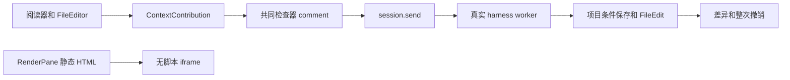

# 调查依据

## 当前事实与复用选择

基线 60614af，工作区原本干净。已逐项核对 ResourceView、各真实阅读器、FileEditor、ContextContribution、InstructionComposer、business-session、MaterialChangeView 及 editor/runtime。

- 已有 ContextItem.comment、appendContextItems 原子返回、会话隔离草稿及可靠 session.send。检查器能更正批注，但材料旁没有输入入口。business-session 要求非空 text，发送按钮也依赖 composer.canSend。
- HTML 普通阅读器提供规范化文字；RenderPane 的完整 HTML 在无脚本 iframe 中，未贡献选区。render 资源提供者仅接受 PDF，ResourceView 将 render 固定当作 PDF。
- MarkdownPreview 已有保留段落、表格和公式边界的有界摘录，可提取复用；frame 的 DOM 类型必须按所属 document 处理。
- 真实项目历史、来源、Evidence 和整次撤销已存在；库正文及排版产物只读。Office 明确 unsupported，DOCX 导出不等于原生预览。

## 实验及结论

本机 Linux 浏览器／Electron 静态产品 harness：material-interactions 的文字批注闭环和可视／Markdown 草稿选择，各两宿主共 4/4 通过。配置、输出位于 ~/.cache/scholoom-finish-active/annotation-audit-*，模型仅在外部 HTTP 边界受控。图片／对象原有用例停在草稿，不能据此声称完整发送验收。

合成 Chromium 实验确认 sandbox allow-same-origin 且禁用脚本时，父宿主可读取 frame 的真实 Range，页面脚本没有运行。该实验仅回答可行性；清理、CSP、导航、撤权及 Electron 由实施后的正式测试承接。不需要独立浏览器服务才能完成静态选择。没有会改变本方案的未决项。

实施中的真实 HTML 排版在 ~/.cache 内失败。直接调用同一 snapshot／Quarto 1.9.37 复现：项目配置存在，但 Quarto 的隐路径扫描得到空 input，随后报 --output-dir 仅用于项目。生成的受管配置明确 project.render=[本次input] 后，同目录真实编译成功。该修复只指定当前快照稿件，既不改变用户项目配置也不启用工程执行，纳入本次排版路径。
