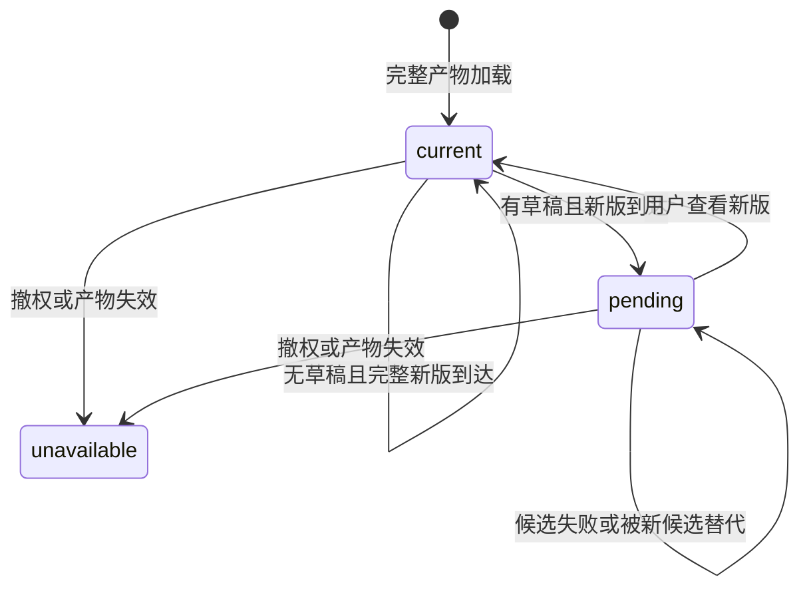

# Spec Delta

## ADDED Requirements

### Requirement: HTML 排版产物的真实只读选择

系统 SHALL 沿既有 render 引用提供 HTML 产物描述、字节与解析，保留实际 outputId、产物 basis、生产 job 和原输入；仅支持只读。静态排版视图 SHALL 保持原布局并取得本 frame 内真实文字选区，按原产物附加到共同指令，不以源码版本冒充。页面脚本不能执行，外网资源及任意宿主访问不因选择功能取得权限。缺生产依据、缓存淘汰、身份变化或撤权时明确不可用。

#### Scenario: HTML 选区进入真实执行
- **WHEN** 用户在排版 HTML 中选字、就地批注并发送
- **THEN** 实际执行可沿同一产物引用读取原 HTML 字节及文档，摘录和版本保真，不伪造源码或规范化位置

#### Scenario: 静态页面带主动内容
- **WHEN** HTML 含脚本、事件属性、嵌入页面、表单或外网依赖
- **THEN** 不能借预览执行脚本、读取宿主或取得网络能力，合法静态正文与选择仍可使用

### Requirement: 排版候选更新保护批注草稿

排版视图 SHALL 仅在完整候选可用后更换显示；当前有相关批注或正文编辑草稿时保留原产物并提示新版，用户明确查看新版后切换，原显式项不重绑。失败、迟到读取和撤权 SHALL 保护后续输入；撤权优先停止受保护内容展示。

#### Scenario: 批注时源稿更新
- **WHEN** 旧产物已附批注，而源稿修改产生新产物
- **THEN** 旧页与草稿保留并提示新版本，明确切换后仍保留旧项的原产物依据

#### Scenario: 新编译失败或读取迟到
- **WHEN** 新编译失败，或旧候选在较新候选之后返回
- **THEN** 不替换成不完整或过时页面，不丢失当前批注和后续编辑
