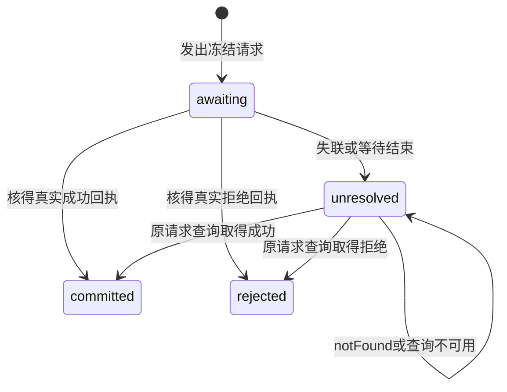
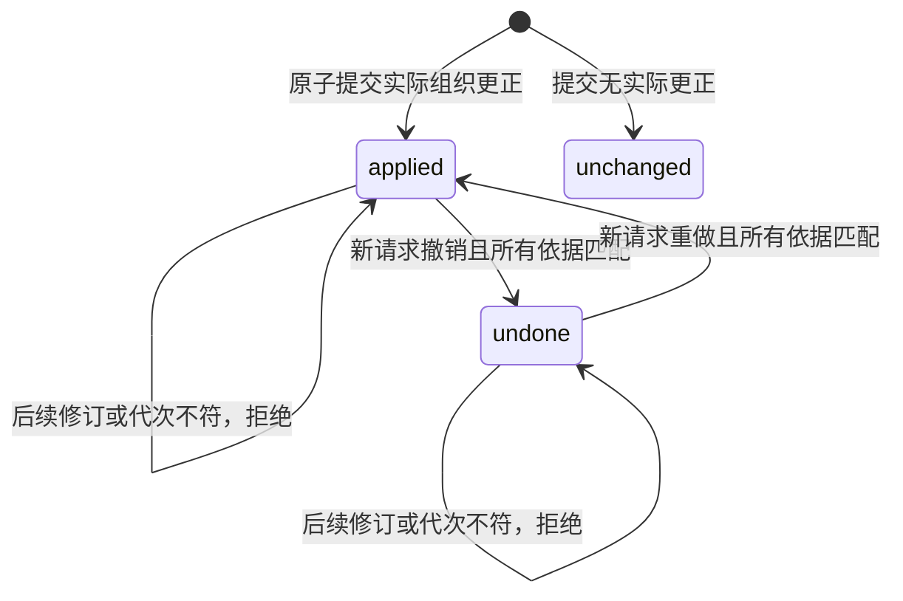

## ADDED Requirements

### Requirement: 有界原子组织更正

系统 SHALL 提供对既有题录集合成员及标签的窄组织提交，输入明确库身份、稳定请求身份及1—100个唯一条目身份／观测修订；每项至少明确一个组织字段，字段省略表示不改，空数组表示明确清空，值不重复。集合成员及标签按集合语义比较，仅排列不同 SHALL 保留原值并报告未变；标签按现有非空／长度约束及精确字符串比较，不自动改大小写或归一化。

系统 SHALL 在全部变更前核对有效读取／写入授权、当前库身份、所有观测修订、目标集合存在性、字段限制和预算。请求JSON及捕获的before/after组织参与集投影 SHALL 分别不超过262144个UTF-8字节；超限不得自动拆分。已受理结构有效的一组更正 SHALL 整组原子，任一失败不修改任何条目的组织字段、历史或修订。请求可以产生实际失败回执记录，但不能把它称为部分应用。

#### Scenario: 多条跨集合整理

- **WHEN** 调用方基于同一库中多条题录的有效修订，更正它们的集合成员并添加或移除标签
- **THEN** 同一事务应用全部实际更正，只有实际改变项递增修订并保存旧值，未请求字段及其他身份／材料保持，结果可逐项核对

#### Scenario: 后一项过期不污染前一项

- **WHEN** 结构有效的请求包含一个过期修订，其他条目仍有效
- **THEN** 整组rejected，过期项标为blocked并给出错误码，其他项标为notApplied；条目、历史及组织可逆依据没有部分提交

#### Scenario: 小请求需要过大的旧值依据

- **WHEN** 清空操作的请求在预算内，但捕获的现有组织字段及新值投影超过依据预算
- **THEN** 返回resourceLimit且整组不应用，调用方可明确缩小范围，不自动降为逐条成功或丢弃撤销依据

### Requirement: 组织更正保留同一材料身份

跨集合仅改变同一条目成员，系统 SHALL 保留sourceId、CSL及未知值、原值／来源／正式键／固定状态、版本关联、附件身份、父关系和材料版本；不创建第二条题录或复制／移动文件。人和未来Agent消费者 SHALL 共用该领域操作，权限／模型外发沿现有授权；本片不因端口存在自动开放root工具或新GUI。

#### Scenario: 跨集合不复制题录与附件

- **WHEN** 题录已有原值、固定键、未知嵌套CSL及已登记的附件，并从集合甲整理到集合乙
- **THEN** 仅明确请求的组织字段及修订改变，同一sourceId及原材料身份可继续读取，未指定字段完整保持

### Requirement: 组织请求的持久逐项结果与未知核查

组织提交及其撤销／重做 SHALL 使用共同持久请求回执权威，区分操作种类；同请求身份、同操作种类及同原输入只返回原结果，不重新执行，同身份不同输入或不同种类拒绝。现有原值／正式键提交及查询的旧DTO、成功／拒绝结果 SHALL 保持；不能将新组织请求解释为原值写入。

组织结果 SHALL 逐项表达applied、unchanged或blocked、notApplied。成功回执与源更正及可逆依据同事务提交；拒绝回执不污染条目。结构／授权／身份在受理前被拒绝可以直接返回错误，不伪造已受理记录。数据库不能确认持久化时不得伪造最终成功或拒绝。

结果查询 SHALL 检查当前库读取授权及库身份，返回原库身份与原持久结果或notFound；权限拒绝、错库、读取异常不能伪装notFound。断线、客户端取消等待或超时只表示调用方未知，不回滚已经提交的操作，也不自动重放。notFound仍保持待核查，不能据此自动重试。

#### Scenario: 提交后丢失回执

- **WHEN** 真实组织提交已经持久化，但调用方丢失回执并在重启后查询原请求身份
- **THEN** 查询返回原完整结果，不产生第二次更正或修订；有效授权仍在查询时核对

#### Scenario: 重复提交不是重做

- **WHEN** 调用方在组织操作已被撤销后再次发送其原提交请求
- **THEN** 只取得原提交回执，不使组织字段重新应用；重做必须是明确的新动作及请求身份

#### Scenario: 未送达及撤权

- **WHEN** 请求未送达时查询，或调用方在已确认提交后失去读取授权
- **THEN** 前者返回notFound且不自动重放，后者返回权限拒绝；两种情况不互相替代

### Requirement: 撤销重做保护后续成果

每次成功组织操作 SHALL 保留不可变的原库身份、实际改变字段的before/after及参与条目，并维护当前组织记录代次、应用位置和预期条目修订。组织明细 SHALL 按有界成员差异查询，不返回整份题录／原值；明细分页绑定观测的记录代次，代次变化不得静默混页。查询中的资格仅是诊断，不是执行租约。

撤销／重做 SHALL 使用新的请求身份，明确原组织记录、期望记录代次和方向；实际提交时再次核对当前权限、库身份、位置、全部实际变更参与项的整条题录修订及恢复目标集合存在性。即使后来改动只在其他字段或又改回相同值，也 SHALL 因修订变化整组拒绝，保护后续成果，不强制合并。成功只反向应用本次组织字段，修订单调递增、原历史保留，绝不重置旧修订或回滚数据库。未变项不被撤销；无实际改变的原操作可查询，但不可撤销。

#### Scenario: 后续题名更正阻止旧撤销

- **WHEN** 组织操作成功后，另一个客户端通过现有接口更正了其中一条题录的题名或版本关联
- **THEN** 基于原组织记录的撤销整组拒绝并指出依据失效项，所有新成果及其他条目的组织值保持

#### Scenario: 连续撤销和重做

- **WHEN** 调用方明确撤销，再读取新代次及修订后明确重做，期间没有其他写入
- **THEN** 仅本次组织字段在before／after间转换，每次成功产生新修订及稳定动作回执；旧动作重复查询或重复相同请求不再改变数据

### Requirement: 组织历史的迁移与副本语义

新增组织依据及回执种类 SHALL 随library自己的迁移纳入数据库备份，升级前保留旧库副本；不得从旧题录历史或原值记录猜造可逆组织操作。旧来源、正式键、元数据、关系及原回执含义保持，不扩大读取／写入／外发授权；不兼容版本或迁移失败停止受影响写入并保留现场。

正常重启 SHALL 保留原库身份、组织记录代次和稳定回执，不自动撤销、重做或接续未知请求。恢复仍创建新库身份的独立副本，保留源对象身份及历史，写入／外发重新授权；原组织记录可审计，但其originLibraryId与副本不符时 SHALL 拒绝撤销、重做或重绑定，即使对象ID和修订碰巧相同。新的副本更正必须基于副本现状明确创建新请求。

#### Scenario: v4库升级

- **WHEN** 现有库含原值、固定键、组织字段及旧authority回执并升级
- **THEN** 迁移前副本可核查，旧回执保持原操作种类及内容，旧题录历史不成为可撤销记录；新操作可单独验收

#### Scenario: 恢复早于后续更正的组织备份

- **WHEN** 用户恢复含组织操作的旧备份到新配置，原库已有后续编辑
- **THEN** 原库和后续编辑保持，副本只读保留原组织历史并显示原库身份；直接撤销原操作被拒绝，不复制／移动材料或自动修改项目引用
