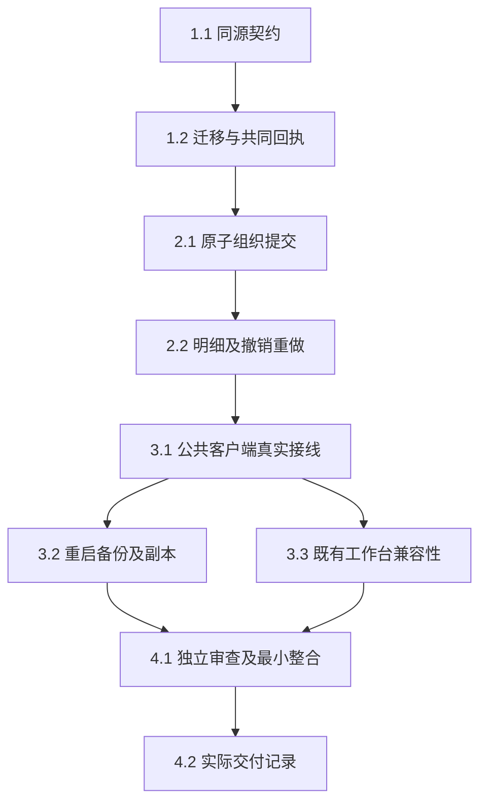

# 执行任务

主线已完成共同接线及必要整合验收；Windows恢复附件状态失败经platform权限幂等修正后，2b55465目标12项权限及原恢复RPC1项实际通过，重开的3.2已完成，C1有界任务9/9。真实重启／恢复、双宿主兼容性、首次失败及独立审查见[delivery](delivery.md)。不因CLI all_done自动归档或宣称完整C及B的平台／独审任务完成。后续附件／关系方向仍按design另片实施。

## 1. 同源契约与持久化基础

- [x] 1.1 文献线在`protocol/library-organization.ts`及现有library具名导出中定义四端口、OrganizationChange／Receipt／明细分页和operation语义，先供领域提供者独立测试；公共操作聚合与business／client注册留3.1随真实handler完成。按design落实字段意图、身份／safe-integer修订、100项、精确标签／集合语义、输入及依据预算、read／write权限和错误分类；不改旧RecordReceipt或root工具名单。完成依据：同源schema及生成器自检／类型守卫通过，代表契约测试覆盖省略与清空、重复身份、无组织字段、超限及新旧回执区分；不以未注册叶声明称实际接线。
- [x] 1.2 依赖1.1，在library v4→v5增加`record_operations.kind`和`organization_edits`，提取最小私有RecordReceipts复用原查找／冻结输入／持久结果；不搬原authority业务，不另存结果权威。完成依据：真实v4独立夹具升级前备份、旧行默认authority、旧请求及旧JSON结果原样保留；同ID跨kind拒绝、旧commitResult不返回新回执，原值／正式键／固定状态及history回归通过。复用现有迁移故障测试，仅扩展版本及数据保留样本；迁移编号实施前核当前journal，不覆盖其他已合入迁移。

## 2. 真实领域提供者

- [x] 2.1 依赖1.2，在library私有OrganizationEditor及catalog窄组合处实现`organize`，经同一store seam复用现有权限、source验证／历史、集合检查、revision／dirty／通知。在同一SQLite事务预检全组、写所有实际更正及唯一成功回执；可确认的拒绝持久逐项blocked／notApplied，全局预算失败不伪造单项应用。完成依据：真实库多集合／标签更正不复制身份，CSL未知嵌套／原值／来源／键／附件及阅读记录保持；末项过期和事务写失败不污染前项，无变化／纯重排不增修订。独立合成输入覆盖100项、多字节、请求很小而旧值依据超限；预期来自规格和输入，不能由新实现自产。
- [x] 2.2 依赖2.1，实现`organizationResult`、`organizationEdit`及`revertOrganization`，记录实际改变项before／after、originLibraryId、预期整条source修订及组织代次；查询差异有界分页，不返回整份metadata。完成依据：真实库连续undo／redo修订单调递增，后续metadata／关系更正及改回同值均阻止整组撤销；no-op不参与，过期代次／错误方向／跨namespace拒绝，重复原提交不隐式redo。两个客户端竞争同代次最多一次成功；分页跨代次拒绝混页，权限及源当前状态在执行时复查，明细资格不是租约。复用原权限／冲突样本，必要故障注入仅在事务或回执写入边界。

## 3. 独立调用与恢复验收

- [x] 3.1 依赖2.2，在`ManualApplication::foundationHandlers`完整注册四方法，生成受影响business／client／module映射，保留全部原handler、根工具、构造参数及恢复接线。文献线负责这些符号增量和真实KernelClient→JSON-RPC／broker→library的整合；公共hook若超出已定符号交主线，不另造server／provider。完成依据：隔离真实内核／SQLite经客户端完成读取现状、organize、差异查询、undo／redo；缺授权／撤权／错库不能误作notFound，不可自报actor提升权限，旧authority接口及现有工具可继续使用。外部模型无需参与，不以注入工具结果或假仓储代替。
- [x] 3.2 依赖3.1，复用现有可信隔离进程／锁／备份／restore夹具验收真实重启及副本。完成依据：已提交丢回执在同库重启后查得原结果且不重放；未送达notFound仍待核查；新表随SQLite备份，恢复新libraryId及read=true／write=false／send=false，原库后续成果保持。副本原记录可审计，originLibraryId不符以instanceMismatch诊断，重新授予write后仍拒绝旧origin撤销；副本新请求基于当前状态独立成功。保留原材料版本／阅读记录；不声称现有ResourceRef已解决恢复副本库绑定，不扩标准CLI持久配置。 Windows恢复失败及修正后的实际新回执见delivery最新节；原Linux证据保留。
- [x] 3.3 依赖3.1，可与3.2并行但不共写配置／产物：只扩原`tests/ui/library.spec.ts`一个代表草稿／选择场景，领域组织更正从真实公共客户端发起，UI仍用真实单一状态。完成依据：双宿主有界刷新保留source身份、主选和dirty CSL草稿，旧revision保存发生冲突后草稿不丢失／不自动rebase，重读行为沿B；没有新C GUI／第二草稿／跨DOM读取。保留主线既有诊断catch、空观察及save参数有界副本；不改fixture／rpc-gate／model-kernel，不重复全部B／BBT绿色组。GUI结构无变化时不新增视觉事实源。

## 4. 整合与交付

- [x] 4.1 依赖3.2、3.3，文献主Agent按影响先构建再冻结产物运行最小必要类型、生成、架构及上述定向验证；关键数据保护／namespace兼容／原子回执／撤销并发由独立只读审查核对契约、源码与实际结果，主Agent处理发现并最小复验。复用已有依赖及隔离cache目录，不安装／开发服务器／真实库。完成依据：逐项记录首次失败、实际修正及最终结果；未运行或失败任务保持未完成，未实跑平台／科研质量不计通过；必要操作说明随实际入口写入开发文献分节。
- [x] 4.2 实际执行后取当前delivery instructions，根据proposal完成判据和实际结果填写同change `delivery.md`，说明真实接线／替身、文件／符号、独立审查、公共补丁依赖及未完项，再更新本项。规划工件齐备不完成本项、不创建delivery；GUI／root工具、后续C及D／E依赖继续独立记录，不假称整个C已完成。

## 续做入口

C1已达到本轮有界完成判据，交回独立增量及Git／cache证据后停止等待主线整合验收。具体命令、配置和重建入口见[delivery](delivery.md)最新节；不应用旧累计patch，不依赖当前/tmp，不自动归档或展开C2–I。
