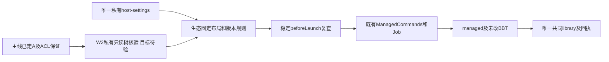
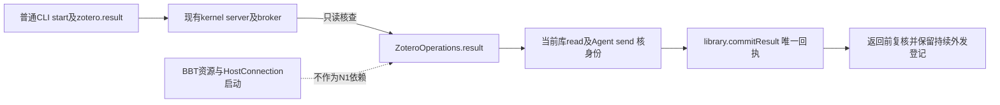
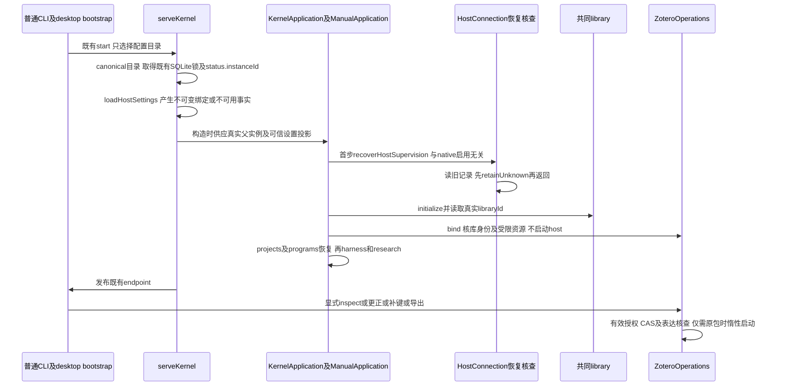
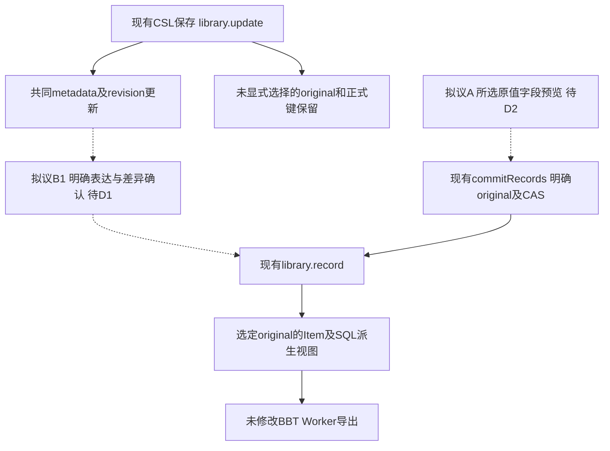
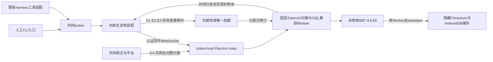
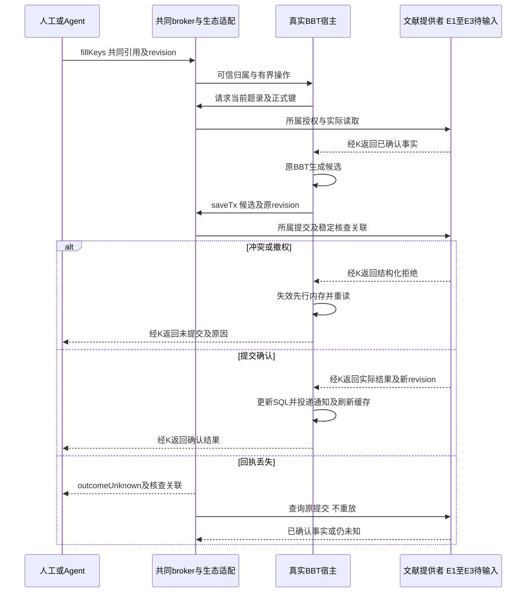

# 实现设计

## 本阶段验收范围（2026-10-30）

按用户已批准的Linux阶段收口，本阶段核对Linux Browser＋真实Electron、普通CLI／bootstrap冷启动、无测试配置注入的重启及真实原包首批I6；2.3／4.2／5.1／5.2已按delivery完成最终签收。复用已有实跑及独审，先核最终源码／构建与目标证据的对应，缺项才安排必要补验；静态核查不计实跑。Windows普通布局尚未启用，W2／W2.2／W3／W4及Windows生命周期／分发转[tasks后续责任](tasks.md#后续责任不计本阶段复选框)，下文Windows设计保留为恢复依据，不承诺本阶段交付。macOS保留人工能力并明确受管执行不可用。Linux安全、共同身份／授权、正式键、事务／CAS、unknown不重放及pluginClosed与scopeStopped分开核查均不变；真实用户库仍禁用。

## 第18轮验收决定：区分数据读取与固定入口执行

W2代码保全合入，主线已补node导出及architecture受控适配登记，架构通过；Windows编译／实跑仍未发生。独审确证所有普通资源额外要求FILE_EXECUTE会误拒仅有FR的合法数据成员，W2.1重开，不能接为无缺陷实现。

下一片保留通用只读平台职责，`inspectPrivateResourceTree`新增必填的单个`executableRelativePath`，由可信宿主固定布局供应，使用原相对路径校验；不从文件扩展名猜执行身份。完整树内普通成员只要求读，声明入口必须存在、为已核同一普通对象，再在其句柄上检查execute；verify／read复查保持相同绑定。设置文件读取仍只要求read。该私有接缝只供固定可信宿主使用，不新增业务选择任意程序入口或command能力。当前尚无产品消费者，既有调用均为本片测试，生态树可独占修改TS／native及测试与本change工件。

验收先保留FR数据成员正例及声明入口FR无execute负例，另核缺失／越界入口拒绝和调用者修改绑定不能重定向。复用现有ACL用例，不复制全部安全矩阵；目标环境不足时交回代码及准确未验项，不安装SDK或触发CI。W2.2／W2／W3／W4、普通Windows布局和2.3继续开放；Linux不能证明此修复目标通过。

### 本轮局部实现与验证计划（e4c4e4）

TS入口新增必填`executableRelativePath: string`，复用原相对路径校验，和目录／资源范围／条目上限一起在首次异步核验前按值捕获。每次native扫描及后续read／verify都从该绑定供应相同入口；设置文件模式不供应执行入口。没有产品消费者，只有原测试helper及三处直接调用须同步，不改node导出、architecture、host-settings／resolver或构建策略。

原生全树初扫一律read，目录继续要求遍历；完整树构建后在其中找声明入口，要求已核普通文件，复用security及AccessCheck在同一持有句柄上加execute，核查到的安全描述符必须仍等于该对象原见证。复扫也做同样入口检查，再比较整树；不打开新的路径对象冒充同一入口，不把新权限重新采纳为基线。抽取现read_file的已核成员查找供读和入口共用，所有临时权限缓冲均释放，设置单文件读取保持read。

沿原fixture新增一份不带扩展名的合成入口（只做权限核验，不启动），以FR数据成员正例／FR入口负例保护P2；缺失、目录、越界、必填及外部输入修改代表例补当前窄缺口。Windows缺SDK时仅定义目标例、明确skip及未编译；本机实际检查平台构建／类型、非目标拒绝／输入校验、原Linux保护与架构。改生产后先构建再固定产物测试，静态权限推导不替代Windows红绿结果；源码整改是否接收由主线复核。

## Windows普通布局：已接收W1与W2只读Module实施

### 第17轮主线选择与W2实施边界

主线接收W1，并选择方案A：可信操作者离线准备私有资源，平台只读核验、保留原见证并在启动前复查；不增加跨command的持续lease，不承诺对同权限可信操作者在检查结束到loader之间替换的原子阻止。已观察的替换、未知／不安全权限和重定向仍须拒绝。该选择沿当前Linux信任边界，不将Windows mode或单根ACL当保证。

资源根、设置文件及全部资源后代要求owner为当前用户SID；允许修改／删除／改DACL及owner的可信主体仅当前用户、LocalSystem（S-1-5-18）和Builtin Administrators（S-1-5-32-544）。系统祖先的owner／相关管理权限另允许本机解析核定的Windows Modules Installer（TrustedInstaller）服务SID，不允许用显示名或“管理员可能需要”扩大到其他主体。祖先核查针对足以改写、删除或替换这条已核路径／对象的权利，包括目标DELETE、父DELETE_CHILD及WRITE_DAC／WRITE_OWNER；仅能创建无关同级目录不能直接等同于替换既有路径。owner与当前token能否读／执行分别核查，不要求系统祖先都归当前用户。

允许标准可解释ACE及明确继承标记；NULL／缺失DACL、条件／callback或不能解释的ACE、未知reparse及非本地NTFS拒绝。实际继承和OWNER RIGHTS须结合所属对象及owner解释，不能简单丢掉继承项；非可信主体的只读／遍历本身不授予修改能力。验证只读，不修复ACL、改owner或复制资源。实际文件／目录身份及成员集合、同对象有界读取、verifyUnchanged和幂等close采用W1窄Interface；设置文件与资源树共用内部原语。

W2委派生态树实现平台原生只读Module、Windows native适配及目标测试定义；本轮不改host-settings叶schema／resolver或启用Windows支持。主线保留共享`platform/src/node.ts`导出及`architecture.json`登记的最终整合；本树可提供具体补丁建议，不能与其他线并写。native构建登记由生态树独占，计算树不修改。没有Windows真实环境时交回代码与准确未验项，W2父任务仍开放；不能以Linux测试、模拟ACL或未执行的skip宣称目标保证成立，CI仍按用户要求后置。

#### W2局部实现及测试计划（add1c49）

只读`platform/src/private-resource-tree.ts`消费固定`dist/private-resource-tree.exe`，每次有界调用原生exe完成扫描／同对象读取；snapshot仅保存初次二进制见证，verify／read必须与其一致，不重新采纳。无需常驻helper或跨command lease；close拒绝新调用、等待自有在途核查并幂等释放内存。每snapshot串行核验、在途加等待最多8项，超限明确resourceLimit，不建立无限Promise队列；此限制只针对私有元数据查询，不替代共同ProcessAdmission。共用`readPrivateResourceFile`承接设置文件核验，不修改privateDirectory准备语义。所有路径只由可信宿主提供，无业务路径端口；helper固定入口、shell=false、5秒／16MiB输出上限，复用nodeEnvironment白名单，不继承全部环境或凭据，单次读最多256KiB，树最多4096项。

Windows native用当前token与本机核定TrustedInstaller SID，按已定规则只读安全描述符／File ID／本地NTFS属性；以目录句柄为RootDirectory逐段打开及枚举，拒绝全部reparse和普通文件多链接。扫描保持目录／文件句柄，完整复扫原路径与成员后才返回；读取从初次扫描持有的同一文件对象进行，再复查树。见证含对象身份、权限描述符、文件修改信息和完整成员集合，祖先忽略无关目录mtime变化；元数据／成员差异返回contentChanged。祖先只创建无关同级文件／目录的权限不视为替换权；有效deny按顺序、INHERIT_ONLY及OWNER RIGHTS映射均明确处理，未知／条件ACE拒绝。目录须当前token可读／遍历，普通文件只核read，显式声明的唯一入口另在其已核句柄上核execute，设置读取仅需read；owner条件不代替访问检查。A的检查结束至loader残余窗口保持，不改command。

8MiB限制针对每份序列化见证及每次扫描的相应路径／安全描述符字段，不是整个helper的RSS上限；复查期间同时存在两次Scan和两份见证，另有Entry／目录名及系统分配。输出容量也按该单见证上限收束；总内存与5秒目标耗时尚未在Windows测量，不声明8MiB进程内存或运行性能通过。

新增native文件及构建登记沿已有Visual C++定位／编译方式；非Windows不编译Windows适配，Module明确不可用。真实Windows测试沿既有自有临时目录／ACL夹具，覆盖有界读取、后代可写、祖先DELETE_CHILD与单纯创建同级的区别、链接、原见证／权限／成员变化及关闭／失败收尾。Linux只检查非目标明确拒绝和现资源保护；没有SDK／目标时保留准确编译／执行缺证，不以模拟或skip计通过。第18轮公共导出／architecture已由主线接入，不再提交重复登记补丁，W2父项仍待目标结果。

本节补2.3普通持久资源的独立缺口。Linux N2已接收，Windows可信注入原包及fd0也有实跑；百条例停机EPERM由主线公共lifecycle承接，不从ACL快照推唯一原因。8d8f339调查发现的原生缺口已由add1c49授权实施W2；私有Module／native及构建登记已有代码，Windows编译及目标实跑仍待证。不改设置schema、resolver或公共登记，不放宽Linux保护。以下W1比较以顶部第17轮选择及W2局部实现为当前依据，不再等待原A/B决策。



### 固定布局与同源声明

推荐首片仍是可信操作者离线供应完整runtime＋已构建host，不增加安装器或renderer设置。根固定`<canonical dataDirectory>/native-resources/zotero-journals-v1/`，注册ID不构成路径。Windows路径用实际node:path派生；拟增`windows-x64-electron-managed-v1`是**待审名称，当前schema不接受**。

| 同一叶schema／resolver的规则 | Linux当前实现 | Windows候选 |
| --- | --- | --- |
| layout及实际平台 | `linux-x64-electron-managed-v1`，linux／x64 | 待提供者接收后新增`windows-x64-electron-managed-v1`，仅win32／x64；平台或原生核验不符拒绝，不猜替代 |
| runtime | `electron/electron`及完整目录 | `electron/electron.exe`和完整官方`electron-v44.5.1-win32-x64.zip`发行目录；不以开发机node_modules、缓存或产品改名exe作为运行来源 |
| host／BBT | `host/out/main/managed.cjs`及全部chunks／preload／renderer、host/resources、bbt | 同相对布局，复用已修fd0及认证。9.0.68原XPI完整解包不改成员，不能替换算法、禁缓存或简化Worker |
| 版本／核查界限 | 唯一package.json／versions.json；4096成员，版本文件64KiB | 复用Electron44.5.1／Zotero10.0.5／BBT9.0.68同一事实源和有界值，不添可覆盖版本表。标记文本不证明exe正确，同次ready核实际运行版本 |
| 环境 | 可信DISPLAY／XAUTHORITY及操作私有TMPDIR | 不要求DISPLAY，沿现受管Windows系统环境白名单；如实际还需TEMP／TMP等，先交主线具体调用差异，不引入任意env继承 |
| 文件系统及保护 | 私有owner／mode、无链接全树及精确系统helper例外 | 推荐首片本机NTFS、普通目录／单链接文件；Windows原生ACL、File ID及reparse逐对象核查，无Windows系统helper链接例外。UNC／网络卷或不能验证的文件系统拒绝 |
| 支持声明 | 当前叶schema const与resolver共同生效 | 提供者及策略明确后才将host-settings layout const改为两值enum，resolver消费派生类型；不另建公共DTO／字符串支持表。asar／正式安装器未交付，不因本配方开放 |

操作仍只有原DTO中的libraryId／sourceId／revision／稳定操作ID／表达选择，不接受root、exec、argv、env或凭据。`host-settings.json`本身也须只读核私有ACL／路径身份和同句柄有界读；不能只验证资源树而沿用Windows跳过mode／uid作为充分保护。设置、库身份、授权和原回执不新增权威，缺失／disabled／invalid仍先恢复旧scope，N1独立。

### 平台最小接口及已选保证

只读树核验Module集中Windows原生实现，对齐Linux“扫描对象绑定＋启动前变化拒绝”，明确不承诺对同权限可信操作者的原子执行绑定。下面Interface已在私有叶实现并由platform/node导出，尚无产品消费者；参数仅由可信kernel供应，不进业务协议：

```ts
type PrivateTreeSnapshot = {
  readFile(relativePath: string, maxBytes: number): Promise<Uint8Array>;
  verifyUnchanged(): Promise<void>;
  close(): Promise<void>;
};
function inspectPrivateResourceTree(input: {
  configurationDirectory: string;
  resourceRelativePath: string;
  executableRelativePath: string;
  maxEntries: number;
}): Promise<PrivateTreeSnapshot>;
```

W3消费者将传固定资源相对路径及4096上限，用snapshot.readFile读版本文件／核必需成员，稳定beforeLaunch调用verifyUnchanged；snapshot只保存内存见证，不持久化句柄／SID或新增资源账本。设置文件共享叶实际命名为`readPrivateResourceFile({ configurationDirectory, relativePath, maxBytes }): Promise<Uint8Array>`，复用同一native同句柄核验；未来消费者固定传host-settings.json／16KiB，不在叶模块复制ACL算法。readFile有界并核原对象，verifyUnchanged保留原见证，变化拒绝而非重新采纳。

原生提供者须证明：

- 逐层取得本地卷／File ID、reparse属性／tag及安全描述符，在已核目录对象上枚举；核配置目录以上到可信卷／用户目录的祖先和全部资源后代，尤其父目录替换／删除子对象的能力。拒绝junction、symlink及未知重定向，不能只核根ACL或realpath仍在范围。不能要求系统祖先owner都等于当前用户，也不能因此省略祖先核查。
- 写／删除／改变DACL或owner的权限包含继承、受保护ACL及父目录DELETE_CHILD；缺失／NULL／无法解释的DACL、条件／未知ACE保守拒绝。owner相符与当前token可访问分开判断；可信主体／owner规则已由顶部第17轮选择确定，Windows原生代码按该规则实现，不忽略Everyone修改权。
- 核硬链接数量、完整成员集合和身份／ctime等变化见证；版本读取绑定同一已核句柄。exe须能由当前token执行且为相符Windows x64文件，不能用POSIX执行位断言；实际加载／版本仍须同次Electron ready。扫描／权限检查只读，不修复或复制现场，不调用privateDirectory掩盖拒绝。

**主线已选择方案A**：beforeLaunch经异步IPC后按路径spawn，Linux扫描返回也关闭fd。W2维持扫描前后对象及授权检查，以只读ACL拒绝非可信主体修改；明确不保证同权限可信操作者在检查结束到loader之间替换时的原子绑定。产品启用仍需目标反例核验。原比较中的B持续lease不进入本轮，不改command／worker／native进程scope，不能借现beforeLaunch的void结果声称已有持续绑定。

W1的架构等待条件已闭合，本轮按A推进W2代码与目标测试定义；没有Windows SDK／OS时只对本机实际检查记结果，W2父项和后续普通布局不提前勾选，不扩大到权限修复或宽松fallback。

### 最小切片、所有权及真实验收入口

| 顺序及负责人 | 精确写集／完成依据 |
| --- | --- |
| W1 本线已调查 | 原investigation／design／delta／tasks／delivery，记录当前来源、三个反例、Linux25/25及停点；不作Windows实现成果 |
| W2 本轮生态整改，目标待验 | `platform/src/private-resource-tree.ts`、`native/private-resource-tree.c`及`tests/kernel/private-resource-tree.spec.ts`；不改privateDirectory。node.ts公共导出及architecture单叶登记已由主线整合，本轮不再修改或重交；真实Windows原生／ACL／句柄验收仍未完成 |
| W3 本线前置获准后实施 | `host-settings.ts`叶schema／私有读取；`zotero-resources.ts::resolveZoteroResource`共用版本／成员规则，按平台匹配路径及核验Adapter。TrustedZoteroLaunch／beforeLaunch若需生命周期变化先交主线，不改manual、lifecycle、harness。原Linuxhelper与资源拒绝行为不放宽 |
| W4 本线目标检查、主线整合 | 窄资源测试及原cli-runtime／zotero-host普通持久用例。当前原包cold夹具硬编码Linux executable／layout并限制Linux，须按获准同源规则派生Windows路径、保持真实内部接线，不能把测试传win32或内存ACL当目标结果。公共endpoint EPERM单独待主线修复，夹具不吞停机失败 |

Windows资源组最小反例：安全根但后代可写ACE；同配置junction／未知reparse；同名exe或后代DLL／BBT成员替换而version不变；设置不私有／库身份错；在核查完成与派发之间的可观察阶段替换。按A/B实际获选保证断言，不用sleep、全错unknown或重试造绿。核验拒绝时无host／无共同新revision；已经可能派发时沿原unknown／完整停止处理。

真实普通入口：在Windows自有cache配置离线放置固定runtime、构建host及未改原XPI／解包成员；真实library准备合成schema44期刊和固定键后关闭准备实例，写唯一私有设置，再普通CLI start及共用desktop bootstrap冷启动，不供应IsolatedZotero。核同次kernel／host／command实例、fd0、原包ready、一次补缺键共同事务、两格式及稳定回执；完整关闭后start再核键／CSL／原值／原ID，notFound不重放。原包成员与原XPI逐字节对照，manifest不能代替；资源合成文件只验布局／拒绝，不冒充原包。GUI代表在普通backend真实通过后接，不用CLI替代双宿主UI。

W2／W3落地后，Windows独立测试入口沿已装Playwright，无CI依赖：将现`zotero-resources.spec.ts`文件级Linux skip收进Linux describe，Windows组以`Windows fixed resource`命名，命令为`node node_modules/@playwright/test/cli.js test --config playwright.kernel.config.ts --workers=1 tests/kernel/zotero-resources.spec.ts --grep "Windows fixed resource" --output <自有cache>/resources-results`；普通持久例沿`tests/kernel/zotero-host.spec.ts --grep "ordinary persistent host settings"`，显式`SCHOOLOOM_ZOTERO_NATIVE_COLD=1`及操作者离线原XPI路径。profile／TMPDIR／output全部自有，先构建再冻结测试；当前skip和硬编码尚未改，此处是待实施入口，当前在Windows执行会跳过，不能计通过。正负原生例必须真实目标运行，GUI后续入口仍沿原双宿主zotero-original消费者，不扩大本片UI写集。

本机Linux25/25只保护既有实现，未跑Windows原生／普通冷启动、asar分发或产品GUI。2.3／4.2及5.x、完整E4／I6与真实用户库仍开放。

## Windows原包验收接线

Windows GUI的process.stdin由固定Electron原生初始化替换为EOF模拟流，详见[一手源码报告](../../../../.scratch/scholoom-foundations/research/electron-windows-private-stdin.md)。宿主统一通过公开fs有界读取继承fd 0：不新增第二传输，原launchInput、同一Job、实例／token认证及期限保持。输入按字节限额收齐后一次UTF8解析，非法JSON不回显载荷；控制台变量不作为修复。Windows同源合成负／正对照与真实共同库原包须分别通过，不能以Node fixed-host或普通smoke代替。

现有Linux原包结果不替代Windows。复用同一JournalCatalog、真实library／broker／受管Electron用例与既有宿主smoke；测试display helper在Windows直接返回Electron可执行文件，不经Xvfb、不加Linux参数。两个测试消费者通过同一archive helper使用系统.NET读取固定可信原XPI，字节对照仍读取原成员，不改包内容；Linux继续原unzip路径。普通持久布局的cold用例仍限已登记的Linux布局，不冒充Windows产品装配。

windows-execution增加独立zotero-original job，沿原锁文件、Node24和Electron构建，在runner临时目录下载官方固定BBT9.0.68并显式供应；原manifest版本／ID检查继续生效。先运行共同事务及原包补键／冲突，再运行真实Electron正常关闭、初始化中断、忙操作及失联smoke，原每项期限及unknown保护不变。仅外部安装／下载为CI准备，业务库均为合成；本机不能给Windows通过结论，须消费实际目标回执。写集限上述测试helper／两个消费者、原workflow和本change记录，不新增产品配置或绕过受管监督。

## 共同原值creator写入的独立模块切片

茉莉花固定1.1.39原菜单的姓名拆分消费getCreators／setCreators／saveTx，事实及许可见[一手来源调查](../../../../.scratch/scholoom-foundations/research/jasminum-common-authority.md)。这片先补已有JournalCatalog，不把单独模块测试当原包接入；普通期刊范围、原值与CSL分离、正式键和来源身份不变。后续仍须实际原包入口／未await行为／完整关闭及共同权威任务2.3验收。

Module的Interface增加editCreators(operation, commit, read)，与原fill共用一个私有提交实现。操作中setCreators只保存经共同snapshot schema、期刊映射及原值字节限额核查的草稿；setField仍只在补键意图内可用，creator动作不能写键／Extra／CSL。saveTx仅登记原操作事务的保存意图，最终成功以唯一共同commitRecords及稳定receipt为准；独立SQL只是已提交投影，不新增持久权威。creators列与Item.getCreators共用同一SQLite投影，保存保留完整数组顺序及原角色／字段形态；不复制Zotero姓名拆分算法。

操作归属经私有AsyncLocalStorage身份与当前可写阶段同时核对；operation返回后即转committing，直到通知结束仍占有本操作，旧异步回调不能借用后续事务。插件SQL经SQLite authorizer保护共同投影表／视图及大小写不同的临时同名对象，内部refresh独占更新；缓存表的合法SQL仍沿原路径。通知阶段不能向正在投递的批次追加事件，拒绝须可诊断，不能静默接受后丢弃。

共同提交拒绝或操作失败不刷新SQL／发通知，草稿在finally清除；提交后读回／通知失败保留committed receipt并分别诊断。通知阶段关闭写入且继续占有本次模块操作，回调不能追加已提交事务写入或并发覆盖其清理。原值容量复用protocol/library-records的唯一recordLimits，经zotero叶重导出；无新领域DTO或公共命令。独立测试沿已有Playwright TS加载方式调用真实导出类，真实library／broker覆盖成功、CAS拒绝、只读意图保护和提交后通知失败；实际原包继续消费原host构建，其他平台验收另记。

写集为journal-catalog、protocol/zotero的同源限额重导出、journal-creators合成输入、独立kernel测试和本change事实源。实现后先构建，再核独立模块及既有真实BBT原包路径，避免为测试暴露宿主环境或私有执行钩子。

## 固定原包Worker的缓存删除等待

普通真实原包在cache reset-reopen阶段偶发失败。补回原Worker debug／dump诊断后，三次独立样本一通过两失败，两失败均观察到IndexedDB delete blocked；原9.0.68在该通知立即reject字符串，导致主侧只见unspecified。原包未修改。blocked表示删除仍在等待连接释放，不能当成删除成功；宿主必须等待同一native request的success／error，永久阻塞仍由原30秒启动期限失败并沿原unknown收尾。

兼容处理只在自有worker-bridge：deleteDatabase原函数调用一次，返回同一request；仅固定BetterBibTeXCache的blocked通知留诊断且不交原包的立即拒绝监听器，其他数据库不变，success／error不拦截、不伪造、不重试。单条dump先限512字符，debug沿原2MiB消息边界和32条有界diagnostic；不放宽文件、网络、实例、停止及容量。测试以EventTarget替身核真实完成事件前不成功／错误可见及其他库不变，另以未修改原包在真实Electron／受管范围／普通CLI和桌面共用bootstrap重复核启动、两格式、回执和完整停止。结果与未完成任务见delivery。

## N2.4普通宿主的受控系统sandbox helper（2026-10-29）

普通窗口两次实际校准已取得renderer sandbox正证据，见investigation当前节。主线选用已有系统helper的窄依赖：固定资源树内仅`electron/chrome-sandbox`可为当前操作者拥有的符号链接，目标必须精确为`/opt/google/chrome/chrome-sandbox`，不接受业务路径、环境变量、相对目标或其他链接。系统helper须普通可执行文件、root:root、4755；目标及每层祖先不得为链接，目录须root拥有且组／其他人不可写。只读取和使用已安装文件，不安装、chmod、提权、复制root文件或关闭sandbox。

变化集中在`apps/kernel/src/zotero-resources.ts`既有有界扫描：该单槽位核链接本身、固定目标、祖先及打开句柄，见证纳入原资源集合；扫描末及原beforeLaunch重新核对同一身份、权限和目标，系统升级／链接替换使原启动拒绝。其他成员仍沿原私有所有权及无链接要求，整个根目录／入口／BBT不可扩大例外。普通Electron自身校验helper协议并在真实ready核版本；不另起未记槽的探测进程，不改变ProcessAdmission或停止归属。不存在安全系统helper时保留原拒绝或原生userns失败，不用普通spawn兜底。

写集仅上述资源模块、原`tests/kernel/zotero-resources.spec.ts`、普通原包配方的既有fixture及本change事实源。先核原21项不退化，再检查唯一允许槽位的实际已安装helper、错误目标及解析后替换拒绝；正例依赖实际目标条件，未满足须明确不可用。冻结影响构建后才运行同次原BBT ready／完整停止，随后才进入普通CLI／desktop重启整合，独立安全审查完成前不关闭N2.4／5。截图错误不作为普通宿主ready的替代证明；报告全浏览器隔离、正式分发及Windows不随本片扩大。

## 普通入口结果核查与原包装配分片

本轮基线7aff2c7，N1.2及两个消费者已由第十五轮主线实际接收，原红例及限定验收见delivery。D14-1／2／3均已选A，本轮只细化下述N2精确规划，不同时扩产品分发。原调查及五类身份／授权区别保留在investigation，当前核查见其N2续做节。已绿原包／显示／UI不重做；普通持久原包装配及完整E4／I6保持开放。

### 已接收N1：普通CLI重启后只读共同回执

N1已独立交付，不要求BBT、显示、宿主安装或新配置仓储。同源`zotero.result`直接复用library.commitResult schema和普通CLI转发；原`check`将共同查询与原包启动绑定的缺口已修复。以下保留已实施设计；其他四方法继续保持隔离门。

Interface保持`zotero.result({libraryId,requestId})`及现有committed／rejected／notFound输出、原5秒read语义，不增加params／token／第二套operationId。通过真实普通`CLI start --data-dir <隔离合成配置>`→ensureKernel→serve启动，无IsolatedZotero／测试私有IPC。查询只消费原数据目录的library；不按路径、SourceInstance、DOI或键自动找库。

实现边界：将当前共同库授权／身份核查与native-isolation要求清楚分开，只有result走前者；不能给check增加含义混杂的force／skipAuth开关。先核read，Agent还核send／活动执行；核library.status.id与请求一致，调用实际commitResult，再复核返回前授权。不存在原包配置、资源、DISPLAY或旧host无法重启不阻塞此只读查询；其余inspect／replaceTitle／fillKeys／export四项保持当前隔离门及全部权限，不从N1推定允许普通用户库操作。

N1.2局部设计：原`check`保留native门，再复用抽出的`checkLibrary`做原授权／身份核查；`result`只走`checkLibrary`，查询前后均调用。Agent的有效执行复用kernel已消费的`harness.executionFacts`（必须verified），不新增DTO或宿主回调；原handler入口核查继续保留。返回前最后核执行事实及signal，避免查询期间资格撤回后交付。测试只注入提交后观察故障和读取后撤权的时序，实际回执仍由真实library产生；普通CLI例无私有IPC／native配置，P1例仅替换外部模型HTTP。

committed／rejected只说明原共同事务的稳定结果；results中的revision／键属于原提交，不用当前record重算覆盖。同requestId不表示当前新输入已执行，不要求插件正常关闭才能查。notFound只表示当前提供者无可查回执，不能证明未知效果不存在，不自动重放、更换requestId、重生成键、启动host或清除host-supervision.json。原宿主unknown／容量／恢复门照旧，export及unchanged等无共同回执的情况不伪造查询结论。Agent成功结果继续原rememberLibrary→rememberCatalog链，后续模型请求及重启复核read/send。



| 精确写集／已有符号 | N1获选后的变化或复用 |
| --- | --- |
| `apps/kernel/src/zotero.ts::check/result` | 局部区分共同查询权限／身份与native配置门；其他四方法不放宽，不改宿主生命周期或在未知时重放 |
| `tests/kernel/cli-runtime.spec.ts` | 加独立只读接续用例，不重跑其原有科研路径：真实library创建合成回执→关闭准备实例→普通CLI start／zotero.result→stop／重新start再查；复用runKernel、真实RPC/client及已有受控模型入口做必要权限回归 |
| 本change delta／design／tasks／delivery及`docs/development.md`生态小节 | 批准后说明只读例外、仍禁用的native操作、普通CLI实际命令与限界；不把N1称为持久原包配置 |
| 不需新增或改动 | protocol/zotero与business映射已有该schema；CLI现有switch、manual handler、architecture消费声明、harness工具及library provider复用。无native factory、bootstrap参数、library schema／存储迁移、HostCatalog／UI或安装资源改动 |

最小独立验收边界（实际结果及未跑消费者见delivery）：

1. 用真实共同commitRecords准备成功／拒绝回执；普通CLI首次start及stop/start后按原libraryId／requestId查到同一结果，原值／键／revision不变。不得先通过测试IPC重注入configuration；没配置native的其他四方法仍拒绝。全过程不要求XPI或DISPLAY，证明的是共同查询接续。
2. 真实提交已成功而观察故障返回未知时，关闭准备实例后用普通CLI查原requestId；只有一次共同修订，不重做写入。notFound／错库／撤read明确返回现有状态／错误，不猜成回滚或自动grant。
3. Agent查询成功后仍受send撤权及下一轮／重启准入保护；CLI接续例不运行模型，P1子例可沿现有可信模型测试组合只控制外部HTTP，单列该模型装配边界，不冒称普通CLI模型配置已交付。broker、library、进程、文件及查询回执真实，不将合成host响应当作该查询的提供者。
4. 保留首次失败与最终结果，改生产后先build再定向测试；类型／架构／生成一致性按实际影响核对。N1不读写原监督文件，不改变任何未知scope；不据普通CLI查询通过宣称原包／平台／E6已验。

### 原包装配N2：精确实施规划（7aff2c7）

2026-10-29，N2.1–5已按本节接入并由主线验收；系统helper、原包缓存等待及真实产品静态承载入口的实施／原失败／最终结果见delivery。当前API签名与设计一致；资源解析另用受限HostLaunchEnvironment类型派生实际返回，不接受业务env。新动作／启动前检查settings未变化；已受理操作的回调、提交及交付只复核实际library身份和实时授权，设置不是撤权通道。Windows原包、正式分发、真实用户库及完整E4／I6仍按原任务开放。

主线批准的唯一独立对照在全新配置及复制的host诊断入口中仅选择`--disable-setuid-sandbox`，采集renderer process.sandboxed与/proc namespace／Seccomp；实际在renderer创建前报No usable sandbox，未取得sandbox证明。生产资源配方仍无该flag或no-sandbox；未以提权、安装、改旧profile或放宽scope保证处理。只可由主线依据后续目标事实决定配方，不凭官方开关描述、ready或缺少renderer证据宣布安全可用。

已实施的接缝方向：复用唯一ProcessAdmission，recoverHostSupervision独立于设置／资源，在Manual初始化首步先完成旧scope记账；库初始化后再绑定，KernelApplication沿super.initialize后再恢复harness。serve的真实status.instanceId仅向可信构造链供应；HostConnection只透传DISPLAY／XAUTHORITY／操作TMPDIR和稳定beforeLaunch。配置目录绑定、冷启动快照、无效配置仍恢复及scope已停不占原生槽沿下文；相应delta和真实验证已随N2.1–5接收。

本节落实已定D14-2／3=A，下面的配置／恢复接口对应当前实现，适用增量见本change delta，实际验收见delivery；正式规格同步与归档另行核对，不由CLI ready代替。

#### 唯一持久文件与受限登记

建议首片固定`<canonical kernel dataDirectory>/host-settings.json`为唯一宿主设置文件；首版只含生态leaf，不做通用settings框架／插件配置机制。库身份、原值／正式键／回执继续唯一归library，设置只引用它们，不在libraryMeta、endpoint、日志、模型配置、renderer localStorage或另一个生态文件保存镜像。JSON schema源拟放`apps/kernel/src/host-settings.ts`，用现有schema编译机制生成该Module内部类型，无需公共DTO或renderer写入端口。

启用分支的完整例子（只供可信操作者离线准备隔离合成配置，不是产品请求）：

```json
{
  "version": 1,
  "kernelDirectory": "/absolute/isolated-kernel-profile",
  "zotero": {
    "enabled": true,
    "scope": "isolated-library-journals",
    "libraryId": "<actual-common-library-uuid>",
    "resourceId": "journals-local-v1",
    "resources": [
      {
        "id": "journals-local-v1",
        "layout": "linux-x64-electron-managed-v1"
      }
    ]
  }
}
```

字段规则：

| 字段／文件规则 | 首版精确语义 |
| --- | --- |
| version／kernelDirectory | version只接受1，未知版本不迁移／覆盖。kernelDirectory必须等于serve已持锁的canonical路径；文件拷到另一配置或目录迁移时失效，可信操作者离线显式重绑，不能凭同库UUID自动激活。它是运行配置约束，不改变库或Zotero来源身份 |
| zotero.enabled | 缺文件或`{enabled:false}`表示禁用；false也可携带完整有效绑定以保留离线资料。true必须具备全结构。只有ENOENT可当缺失，错误JSON、未知字段、读取／权限失败不能降格成默认有效配置；只阻止生态绑定，不阻断人工库和N1 |
| scope／libraryId | scope仅isolated-library-journals；libraryId为当前实际库UUID，非SourceInstance／locator。缺值不自动填当前库；不按DOI／引用键查替代。设置存在或enabled不执行grant，不改变默认read/write/send，不证明真实用户库保护齐备 |
| resourceId／resources | ID沿既有id约束；首版最多登记一个资源，启用时恰有一个且ID必须匹配。登记与选择同在此文件，无独立可写resources.json／安装台账；禁用可无资源。resourceId只作逻辑查找，不插入文件路径、argv或shell，既非授权凭据也非库来源身份 |
| layout／派生目录 | layout只接受上述固定Linux x64配方，唯一资源根固定派生为`<canonical dataDirectory>/native-resources/zotero-journals-v1/`；schema不接受root、URL或路径覆盖。启用配置整个文件最多16KiB，kernelDirectory限4096字符；所有对象拒绝未声明字段。操作者离线将资源供应到这个私有目录，不新增任意目录信任规则 |
| 本机保护 | 从已canonical配置根读固定文件，核非符号链接、普通文件、有界字节、当前操作者所有且POSIX无组／他人访问。派生资源根及固定成员逐层lstat／realpath，拒绝链接逸出派生资源根（包括指向同配置其他私有文件）或非可信写入；不通过chmod修复未知来源文件。复用privateDirectory／atomicPrivateFile供应可信离线写入及现有读取检查做法，不另写通用文件库。当前`ProjectStore.path`对整个applicationDirectory拒绝，`DirectoryBrowser`也隐藏配置；新资源留在该保护内，不把外置目录误称已受此保护。Windows ACL未经验收前该layout不可用 |

首片没有公共settings.save／CLI设置命令／GUI安装器。可信本机操作者在**内核已确认停止**时按此schema准备文件和资源，写入复用原子私有文件流程；renderer／Agent没有选择资源目录或写宿主设置的端口。数据目录仅用于明确授权的可重建合成种子库；设置本身不能证明内容是合成的，不凭scope字符串、文件名或UUID推断真实库可用，任意生产库的启用流程仍未提供。同一OS操作者提供的执行代码属于可信部署输入，schema／manifest匹配不证明恶意代码安全或来源可信；离线交接须保留原XPI来源、构建源码点和资源准备证据。

#### 固定资源配方与显示前置

`linux-x64-electron-managed-v1`将上述唯一派生根映射到`electron/electron`、`host/out/main/managed.cjs`、`host/out/preload/index.cjs`、`host/out/renderer/{index,worker}.html`、`host/resources/`及`bbt/`原包解包目录。保留Electron完整离线目录及host完整构建输出（含chunks），不是仅复制一个脚本。配方派生固定argv `[managedEntry, operationSnapshot]`；后者为kernel本次新建的私有快照。请求仍只含既有库／sourceId／revision／表达／稳定操作ID，不能带executable、args、env、packageDirectory、root或入口脚本。

版本预期从既有`package.json/pnpm-lock.yaml`的Electron44.5.1及`zotero-host/resources/versions.json`的Zotero10.0.5／BBT9.0.68组合取得，不在settings再声明一组可覆盖版本。解析核固定成员、原包manifest ID／版本及host已有资源；实际ready后核实际Electron／插件版本。manifest只是兼容性检查，原包成员不得改动；可信操作者应离线供应已核来源的原发布包，不自动下载／解包未知档案或升级。正式electron-builder产物main=index，不能作为这个layout假装已经支持；安装包入口／分发另片。

首片使用**已有且可验证的本机显示**；不在产品中启动Xvfb，也不调用测试display helper。仅从启动kernel的可信宿主环境取DISPLAY及必要XAUTHORITY；缺失明确不可用，有值也不等于显示有效。业务派发之前，由同次实际受管Electron初始化／ready核实显示，失败须完整收尾且不得执行共同写入；验收启动图形动作前另用xdpyinfo预检。TMPDIR派生为kernel自有操作目录，目录由当前操作保护。候选公共hook只允许这三个环境变量，不复制process.env、测试`/usr/bin/env`包装、NODE_OPTIONS或凭据。beforeLaunch不能额外启动未记槽的probe，不用普通spawn兜底或新增system access。

固定配方默认不添加测试中的`--no-sandbox`。嵌套受管环境能否以此完成Electron启动／显示访问，留给N2.4的目标校准；若实际需要新的sandbox／socket访问承诺，带原错误和最小能力差异交主线，不在实施时悄悄改参数或保证。本轮没有运行显示／原包，既有测试绿色不作为该新配方已通过的证据。

#### 初始化、绑定与失效顺序



bootstrap、普通CLI start／serve和desktop预加载不分别读设置，不增加renderer启动字段；接入共用serve持锁路径。load失败返回可诊断的invalid绑定，不回退旧值或试其他目录；实例可继续人工库与N1。首次及每次native操作按真实libraryId／read/write/send和可信执行核查，库ID变化立即instanceMismatch；绑定不能让没有E6的真实库获得支持。

设置读取为一次冷启动快照，修改按显式stop→离线原子替换→start生效，首片没有热更新／自动restart。新native操作及容量等待后的beforeLaunch有界复核设置仍等于启动快照、资源固定成员仍有效；变化返回unavailable并要求重启，不静默换root。设置不是撤权通道：已经受理的操作仍按原归属及实时库授权收尾，不因文件被改而丢弃callback／清unknown。资源缺失、版本错、显示失败仅阻断依赖原包的动作；N1始终按当前库查原结果，不需资源或插件正常shutdown。

#### 先于执行恢复的监督屏障

共同进程准入实例必须是`ManualApplication.processes`，不增加第二计数器。拟从现有HostConnection私有恢复块抽出下述公共函数；启动前和HostConnection.start共用一次事实读取／规则，避免两份恢复判断。它不需要配置、资源、listener、commands或插件契约，不创建目录／改权限，不启动、连接或杀死旧进程，不写回原记录。

```ts
type HostRecovery =
  | { state: 'clear'; previous?: HostRecord }
  | {
      state: 'blocked'; previous?: HostRecord;
      nativeScope: 'stopped' | 'unknown'; retainedId?: string;
      error: ErrorInfo;
    };
export function recoverHostSupervision(options: {
  directory: string;
  admission: Pick<ProcessAdmission, 'retainUnknown'>;
}): Promise<HostRecovery>;
```

| 旧记录事实 | 返回与准入效果 |
| --- | --- |
| 确认没有监督目录／文件 | clear；不创建文件、不占槽。链接损坏或父目录不可读不能作为确认不存在 |
| scopeStopped、pluginClosed均true且unresolved为空 | clear，保留previous；不自动重放历史操作 |
| scopeStopped=false | blocked，nativeScope=unknown；**返回前**以原commandInstanceId调用retainUnknown，not-started采用原`host:<canonical zotero directory>`哨兵。不以新kernel实例替换旧关联；同实例重复检查不双计，满容量照样记入 |
| scopeStopped=true但插件或领域结果仍未知 | blocked，nativeScope=stopped；只保护生态profile和启动门，不虚占原生槽。库回执查询不清此门，不伪称旧callback逐项已完成 |
| 目录／记录不可读、不安全、无效JSON／schema或超64KiB | blocked、unknown，以同目录哨兵保守计入一个旧host scope；单记录、单宿主模型保持原限制，不扫描全目录或推测更多实例。原字节／权限／路径及未决事实保留，不能cleanup覆盖 |

`ManualApplication.initialize`第一步await `ZoteroOperations.recover()`，其内部调用上述函数并在该应用实例内复用同一个初始化Promise；library初始化后再调用host-only `bind(binding, actualLibraryId)`。disabled／invalid设置、无资源、错库均不得跳过recover。blocked不会令整个内核挂起：正确计入scope后其他领域依剩余共同容量运行，生态四动作明确outcomeUnknown；N1和人工库继续可用。若连保守retainUnknown都无法建立，则初始化失败且不发布可受理执行的endpoint；不以超时跳过屏障。首片不做运行中修复监督文件再刷新恢复的流程，避免把哨兵与后来可读的旧ID作为两个scope计入或借修文件解除原占用。

该“屏障”指**完成原scope记账后才准入**，不新设全局禁止或填满所有槽。原生已停只剩领域未知时不影响其他执行。首片没有安全结清旧scope的公共提供者，亦无retainUnknown释放API；保留未知到有明确核查／恢复变更，不能拿持锁、PID消失、notFound或新设置替代解除依据。旧HostRecord无callback快照，首片不造字段声称可重建未结束callback；活跃内核沿已验E1跟踪和关闭保证。

#### 精确公共hook、Module及文件所有权

所有签名是**交主线审查的窄增量**，不是已经接入的公共API。生态新Module只做本线叶设置／资源解析，库授权／原子事务、进程归属／容量、broker、JournalCatalog均复用。

| 拟新增／修改符号 | Interface与消费者 |
| --- | --- |
| `apps/kernel/src/host-settings.ts`（新增私有叶Module） | `loadHostSettings(directory: string): Promise<HostSettingsRead>`；HostSettingsRead为disabled／invalid(error)／loaded(settings)判别联合，settings使用上文schema生成类型。只由serve持锁后调用，不提供网络写端口；同Module的`checkUnchanged(snapshot): Promise<void>`供动作及beforeLaunch，最多重读同一16KiB文件 |
| `apps/kernel/src/zotero-resources.ts`（新增生态私有Module） | `resolveZoteroResource(registration, kernelDirectory): Promise<TrustedZoteroLaunch>`；只接受已校验settings资源项，返回固定executable／固定args前缀／packageDirectory及稳定beforeLaunch回调。无泛型resource factory／可执行路径DTO，版本校验继续用现有事实源 |
| `lifecycle.ts::serveKernel`、`application.ts`构造options及`manual.ts`构造末尾可选参数 | 新宿主私有`zoteroRuntime?: { kernelInstanceId: string; settings: HostSettingsRead }`，serve在已有options末尾供应status.instanceId。保留全部原options／taskPort／executionResources／delegationOptions／programs，不改programs私有hostInstanceId。测试IsolatedZotero注入可保留；同时供应两套有效native绑定明确拒绝，不以优先级隐藏第二权威 |
| `zotero.ts::ZoteroOperations` | `recover(): Promise<HostRecovery>`在初始化首步完成记账；`bind(settings: HostSettingsRead, actualLibraryId: string): Promise<void>`在library就绪后生成disabled／invalid／bound私有状态，不启动host。bound仅表示设置结构、资源登记引用和库绑定，不检查插件ready；实际资源成员及显示在run确需原包时惰性解析。因此资源文件缺失不应让已绑定且本不启动原包的inspect／独立replaceTitle依赖显示。原四方法走绑定及原授权，result不走native门；run使用真实父kernel ID，不再另造同名randomUUID |
| `host-connection.ts::recoverHostSupervision/initialize` | 采用上述共享恢复函数；无新listener／重放逻辑，已有close／callback／稳定关联不改。`start`复核旧事实，不能依据startup缓存覆盖新产生的unknown |
| `host-connection.ts::Options/workspace` | 候选增加`launchEnvironment?: HostLaunchEnvironment`及`beforeLaunch?: () => Promise<void>`；传给已有CommandWorkspace.env／beforeLaunch。二者只由可信资源解析供应，函数引用保持稳定以满足现有workspace确认；不扩大runCommand默认环境、普通Shell或system access。无模型凭据或短期token |
| bootstrap.ts／cli.ts／desktop main／server／protocol | 首片无需新增转发、请求字段或设置路由。若普通入口验收显示必须改动，先列具体差异交主线，不拷贝测试IPC。public endpoint现有instanceId由serve唯一供应；token、host监听地址、command handle仍只本次私有stdin，禁止写settings |
| `architecture.json::modules[kernel].systemAdapters` | 后续仅登记`src/host-settings.ts`的fs/promises及`src/zotero-resources.ts`的fs/promises／process.env受控适配；仅支持本表固定文件及三个白名单环境变量。新增登记须随N2.1主线审查，不扩child_process、普通模块环境继承或其他既有adapter规则，本轮不修改清单 |
| `tests/kernel/host-connection.spec.ts`、`cli-runtime.spec.ts`、`isolated-kernel.spec.ts`，必要`tests/ui/zotero-original.spec.ts`；`docs/development.md`生态入口 | 复用现有真实fixed-host、普通CLI、隔离profile及原值场景补本片差异；旧可信IPC测试可以保留，但不能充当普通设置加载验收。UI仅替换代表例的启动供应为真实普通入口，不另写产品表单／launcher。开发说明仅在实际装配通过后更新支持范围 |

候选窄环境类型如下，不进入业务DTO：

```ts
type HostLaunchEnvironment = Readonly<
  Partial<Record<'DISPLAY' | 'XAUTHORITY' | 'TMPDIR', string>>
>;
type TrustedZoteroLaunch = Readonly<{
  executable: string;
  args: readonly string[]; // fixed managed entry prefix, never request-supplied
  packageDirectory: string;
  displayEnvironment: Pick<HostLaunchEnvironment, 'DISPLAY' | 'XAUTHORITY'>;
  beforeLaunch: () => Promise<void>;
}>;
```

displayEnvironment仅资源Module读取宿主白名单所得，ZoteroOperations.run另从本次profile派生TMPDIR并创建所需目录，再构造HostConnection；资源解析不得接受任意environment参数或把设置JSON混入环境。beforeLaunch由稳定引用组合settings未变化及资源仍有效两项复核，沿现有ManagedCommands容量等待后授权执行。

manual仅拥有新recover／bind两处调用及生态构造投影；不写计算线programs恢复回调、Agent生命周期或文献表单。复用初始化report及原kernel.log记录有界阶段／原因（设置禁用、设置无效、库不符、资源不可用、监督未决、scope是否保留），不记录原settings、凭据或环境全文，不新增公共状态端口／独立诊断账本。四动作分别保持unavailable／instanceMismatch／outcomeUnknown及原permissionDenied，N1不受native可用性影响。资源Module不改BBT成员、正式键／来源表、harness P1或读取／写入授权。N2.2最小公共切片独立于settings／BBT／文献／programs私有实现，只消费既有ProcessAdmission接口；主线接入验证后消费者沿共同基线接入，不跨树私发补丁。

#### 最小实施顺序与真实验收

先交**N2.2独立监督恢复切片**：公共函数＋Manual初始化顺序＋真实固定host遗留记录回归；不需要资源／显示或启动BBT。已有关闭／容量测试只扩初始化前记账的未覆盖边界，保留满槽、释放无关槽、重复恢复、配置disabled／invalid仍恢复、scope已停不占槽及原文件不变的代表例；不能重跑24项凑证据。N2.3实现叶文件校验／冷启动投影，之后N2.4接固定资源及窄hook，最后N2.5整合普通入口。N2.1先闭合delta及主线公共签名审查；本轮止于规划，以上任务均未执行。

| 验收入口／最小代表 | 要核的真实结果与边界 |
| --- | --- |
| 既有fixed-host／host-connection回归扩冷启动屏障 | 用真实受管fixed host生成旧unknown；关闭准备kernel后新KernelApplication.initialize先记原scope，其他执行再按剩余容量准入。持久损坏／不可读样本仅文件故障注入，计数／broker／初始化真实；不以合成记录冒充真实退出。缺安全核查提供者时保持unknown，不增加解除接口 |
| 既有cli-runtime／isolated-kernel扩设置冷启动 | 离线准备全新合成profile、真实libraryId及单一settings，关闭准备实例；普通start不经私有IPC，读同一绑定且不启动host。缺文件、无效／过大／链接、错库／错配置目录、未知resourceId／版本明确不可用，不grant；无设置仍能N1查询。有限文件错误表驱动，不重复完整权限矩阵 |
| 普通CLI／bootstrap→实际原包 | 显式用户操作经真实library／broker／认证WS／受管Electron／原BBT：最多100条现有普通期刊、独立题名／表达、一次共同补键事务及两格式，stop/start不注入配置且实际键／修订／原结果一致。CLI接续无模型替身；如加Agent只控外部HTTP，不绕P1 |
| desktop普通bootstrap及失败接续 | 使用同一schema／资源文件，构建产品静态承载或真实desktop启动只走既有bootstrap；Browser若复用静态测试bootstrap代理，须标明仅外壳代理受控、内核设置加载真实，不能声称已验浏览器产品部署。冷启动一次／重启一次，核原未知ID不重放、错库／撤权／资源缺失、设置更改需重启及停止真实确认 |

成功原生验收必须先有可信离线资源、可用显示和公共hook接入；当前绿色BBT/UI没有这些普通持久入口证明。原包首次失败、配置读取、发送／受理／领域提交／刷新及scope／plugin关闭分别留证，不加timeout／sleep／retry。生产改动按影响build再test，测试期间冻结产物；只测新增路径及直接受影响代表，不重跑TeX／全仓CI。

仍需主线审查的架构项是上述**一个恢复函数、两处初始化调用、真实父实例供应、受限环境／beforeLaunch透传**及路径绑定的冷启动语义；建议按此采用，不再问D14选项。本轮没有新产品凭据／默认权限决定。Linux新配方的sandbox／显示实测、Windows资源／ACL／原包、正式分发以及安全结清遗留unknown不具备新通过结论，相关分支保持开放；E6和真实用户库仍禁止。需要扩平台访问或产品安装时另交方案，不默认为N2被批准。

### 已定选择与实施边界

2026-10-28，用户明确委托主线选择最合适的方案，主线决定如下：

- D14-1选A：先实施普通`zotero.result`的只读例外。它沿当前库授权查询唯一共同回执，不启动host，不因notFound自动重放，也不解除原unknown。
- D14-2选A：未来native启用绑定归共同kernel数据目录的宿主设置。生态只消费受限投影，库／UI不保存配置镜像，短期凭据不持久化；本轮不提前实现通用设置框架。
- D14-3选A：首个有界原生片使用可信本机操作者离线准备的固定原包／已构建宿主，经受限资源登记解析。产品自动下载、正式资源分发和升级回退另行交付；资源路径不授予库权限，真实用户库仍不可用。

以下选项表保留调查时的比较依据；选择以上述决定为准。N2的具体schema、加载与恢复接点仍须实施前核对，不把方向已定写成提供者已实现。

| 决策 | 选项及依据 |
| --- | --- |
| D14-1，是否先采纳N1只读例外 | **推荐A**：无native配置也可按既有库授权查询zotero.result，其他四操作继续隔离；可独立验普通CLI接续，不新增存储／凭据。B：继续让所有生态方法受隔离门约束，普通客户端仅用既有library.commitResult（CLI目前无该命令），将普通生态CLI与N2一并评审。A改变当前隔离范围，必须明确选定后再更新delta／实施 |
| D14-2，未来native启用绑定的唯一权威 | **推荐候选A**：共同kernel数据目录的宿主设置，由主线统一schema／加载器，生态只消费投影。B：只读部署manifest由运营侧管理，普通入口消费它，库／UI不另存镜像。当前两者均未实现；只能选一个作为权威，不同时新增ecosystem.json、libraryMeta及CLI覆盖三套配置。缺选择时N2配置恢复受阻，不以配置路径推授予库权限 |
| D14-3，固定原包／宿主资源如何交付 | 首个有界N2可选A：由可信本机操作者离线准备指定原包／已构建宿主，并由受限资源登记引用；B：由产品分发提供版本化宿主／原包资源与升级回退。安装／许可／平台资源归属及信任核对随所选方案确定；URL或manifest匹配不等于已完成这些保证。此轮不决定自动下载，也不新增安装或凭据流程 |

N1及其消费者已接收，N2的宿主设置及离线资源方向已定，精确装配按上文规划交主线审查及后续授权；没有“默认批准真实库、默认全授权或持久凭据”的隐含选项。

### R14输入与/tmp迁移（历史）

本轮独立根为`/home/joshua/.cache/scholoom-zotero-r14-To16RE/`，TMPDIR为其中tmp。全部新payload／日志／独立规划补丁只在该根；研究依据由本Git原工件和当前源码提供，未从旧/tmp运行或复制脚本。主线保全输入固定为`/home/joshua/.cache/scholoom-round13-acceptance/preserved-tmp/zotero-better-bibtex-9.0.68.xpi`、`preserved-tmp/static-ui.mjs`和`create-ui-config.mjs`。未来实际UI验收在本树cwd用该generator生成新cache绝对.mts配置，独立UI_PORT／UI_DATA_DIR／TMPDIR，先xdpyinfo核当前DISPLAY；不假定:99在迁移后继续有效。

N1不需要这些图形／原包输入；N2若用才显式设置保全XPI，不读取旧probe默认/tmp路径。不重复绿色组或启用真实用户库；N1只读查询通过也不勾选N2普通原包装配、2.3／3.1或完整I6。

## 已接收：真实原包的测试显示前置（ba29ee6）

原同步失败的trace注解定位到round12的sync-tmp/scholoom-library-bbt-vZkRMr；只读operation.json为固定键JRNL0002的revision3导出快照，监督记录scopeStopped=true、pluginClosed=false、unresolved=[]，没有该次Xvfb stderr或插件ready证据。现场保留，不初始化该配置、不重放或清锁。其他Xvfb补验有/tmp锁写入失败，而:99可读；这些不能反推原同次超时的唯一根因。当前实际缺口是四个测试强制新Xvfb且没有显示预检。

按codebase-design复用现有runCommand／HostConnection seam，不新增生产launcher或环境权限。唯一tests/fixtures/zotero-host/display.ts提供异步electronTestCommand(entry,tail,environment=process.env)：有DISPLAY时用xdpyinfo实际预检，失败即明确测试环境缺证；仅缺DISPLAY时用原xvfb-run -a运行xdpyinfo预检能否创建，stderr保留。预检走现有受管runCommand及完整原生收尾，有限5秒预算只适用于测试环境诊断，不改生产期限。可用后返回现有/usr/bin/env的命令参数，显式传递所选DISPLAY／必要XAUTHORITY及TMPDIR，再直接执行Electron或原xvfb-run；不向生产DTO增env，也不放开白名单。参数尾部原样保留，kernel仍追加operation.json。

四消费者仅替换构造命令：zotero-host、zotero-host-supervision、zotero-host-scope、ui/zotero-original。scope仍运行真实Browser／renderer／忙Worker，取消后核全部metrics PID退出；已有共享DISPLAY再用xdpyinfo核其仍可用，不把显示服务纳入自有执行。缺显示的新Xvfb属于原受管命令树，不能以仅主PID消失代替完整停止。

只改测试／fixture及本change。复用已验构建，不重建生产产物。最小验证为原显式选择／独立题名真实library/broker/原BBT两格式代表例，原包正常／shutdown-error监督，scope完整归属和两个前置拒绝输入；UI仅复验对应双宿主单条原值场景，沿静态已构建产品和现有可信进程夹具。工件/TMPDIR均在独立cache根；不重跑24项或整个BBT历史，不以这些结果关闭完整E4／I6、CLI持久配置或跨平台原包。

## 当前收敛：断联写入夹具的实际送达阶段（0b78815）

本轮仅承接E4 Windows host-connection:159。源码中call先同步加入record.unresolved，再等待save，最后才peer.request；drop为读请求，不等待该save。因此内存未决标记是保守意图，不是持久化或送达证明。原Windows trace仅证明该轮询通过及拒绝码unavailable，缺RPC／host.invoke／原错误来源事件；不能宣称已经定位Windows运行时顺序。Linux真实固定host的单次save调度gate已校准同一允许顺序，错误为RPC连接已关闭；诊断gate不进入生产或长期回归。

无新增公共行为／DTO或Module。复用HostConnection及既有固定host／sample.read回调：wait进入宿主invoke后先回调报到，再维持未完成；测试仅在实际回调到达后主动drop，同时核对监督文件稳定关联。派发前非ready调用仍明确unavailable且不增加未决；已经送达的写请求失联仍outcomeUnknown，关闭保留unknown／稳定关联，重启拒绝而不重放。不将所有错误改unknown，不清未决、不增加延迟／期限或生产钩子。

写集仅tests/kernel/host-connection.spec.ts、其既有tests/fixtures/zotero-host/fixed-host.mjs及本change的design/tasks/delivery；HostConnection、RPC、kernel生命周期、协议、原值API与文献UI不改。验证先构建再跑原用例校准／报到断言红例／修正后最小监督矩阵，复用现有回调收尾、正常关闭及容量回归；不重跑BBT／TeX。当前Windows CI无修正后的目标结果，保留待验。

## 已批准的内核／Agent切片（8a2f0ce）

用户D1–D3及本轮直接授权已闭合，无需再等同步／产品选择：仅已有唯一schema44 journalArticle原值的准确题名；普通CSL保存不双写；差异或不能比较时须明确采用原值，Agent按用户明示指令选择，不确定先询问。复用当前真实library权威、原包及监督，不新增确认token／来源表，不改元数据表单。本节具体契约替代下文候选／逐次人工确认的历史措辞。

- `zotero.inspect({libraryId,sources:[{sourceId,revision}]})`：最多100条，读取真实`library.get`与`record`，两次读取的共同revision及请求revision必须一致，否则contentChanged，不循环重读。唯一identity、schema44期刊、原title准确字符串缺失时unavailable。结果复用共同CSL／OriginalRecord／citationKey schema，带sourceId/revision、完整所选原值及identity、CSL、题名`equal/different`、其余字段`notComparable`。不声称题名相同代表全条目一致，结果编码总预算256KiB，超限明确拒绝。
- `zotero.export`的每个source增加可选`expression: {kind:'zotero-original',identity:{instanceId,libraryLocator,objectKey}}`。缺少选择返回`state:'selectionRequired'`及上述可核查结果，不生成文本／不启动宿主；错identity或过期revision返回contentChanged。由于其余字段仍notComparable，本片每个选中对象都需要明确expression。选择齐备后按既有原包路径导出，返回`state:'exported'`、format/text及真实sourceId/revision/key/pinned/expression依据，完整关闭后再查共同CSL／record依据和read/send。
- expression是受授权工具调用的**操作选择**，不是人类确认凭据。工具描述要求先核查、仅按用户明示采用原值，不能确定时询问；kernel不解析自然语言、不声称知道用户意图，也不接受`confirmed:true`替代实际identity/revision。不新建无法证明身份的确认token或审批仓储。既有broker可信调用上下文、库授权和P1持续外发登记继续生效，包括selectionRequired等含库内容的成功返回。
- `zotero.replaceTitle({libraryId,requestId,sourceId,revision,identity,title})`：独立动作，准确字符串1–4096字符，不trim／规范化。先查原requestId，已有回执仅返回queried，不重放新的题名；首次从真实同revision读回唯一原值，核identity后完整保留对象，只替换fields.title，调用一次`commitRecords`，省略metadata/key，CSL／日期／creator全序／Extra／来源／正式键均不变。返回committed/rejected及真实receipt，发送后未获可验证回执返回outcomeUnknown，只按原requestId用`zotero.result`核查。没有原值级第二仓储／历史／修订。
- GUI本轮只消费同源契约：现有选择提供sourceId/revision；inspect展示CSL与所选原值、题名差异及其余不可比较；明确采用原值才传expression，独立题名动作提交准确字符串及identity。文献下一轮在单一草稿／详情接入，不改CatalogItemForm或另建CSL草稿。

实现所有权：`protocol/zotero.ts`及business生成映射提供DTO；`ZoteroOperations`集中读取／核对／选择及题名事务，kernel architecture仅增`library.get`及新生态操作；manual/CLI薄装配；`zoteroTools`新增核对／题名工具并保留rememberCatalog成功登记。host只适配导出结果tag／expression依据，JournalCatalog仍只投影共同original。library存储、原包、FileEdit、TaskResearchPort、报告授权、所有其他工具／恢复／标签不变。

验证扩原`zotero-host.spec.ts`：旧代码先失败于未选择仍导出；新增真实共同库/原BBT反例涵盖CSL-only保留、selectionRequired无文本、明确选择两格式、题名更正保留其他值、CAS与错identity、缺值／多来源、未知回执原查询及实际Agent工具选择。原only-export撤权／重启P1和受影响监督保留代表回归。先build再test，测试期间不重建。Linux本机不关闭Windows／macOS、E6或整体I6。

## 历史调查：CSL更正与原值导出差异方案（4b13183）

**D1–D3已由用户确认。** 采用A＋B1：差异或无法比较时，导出前明确选择采用原值；Agent可依用户明确指令选择，不确定时询问。原值通过独立动作更正，首片仅已有唯一期刊原值的题名。决策事实源见[领域决定](../../../../.scratch/domain-development/issues/08-zotero-ecosystem-constraints.md#csl-更正与原值导出的明确选择)。本节待决／未实施措辞记录4b13183调查时点的备选与依赖；当前实现以顶部具体DTO及delivery为准，不将推荐解释为每次必须人工点击。

本轮交回的是调查与规划，尚无上述新行为的生产实现。当前基线`4b13183`已接收真实普通期刊切片及持续外发授权P1。当前差异、四阶段实跑和固定资源依据集中在[investigation当前节](investigation.md#当前调查csl更正与原值导出的差异4b13183)和[隔离证据](evidence/csl-original-4b13183/README.md)。本轮调查未修改library、zotero协议／host、harness或表单，也未重做监督方案。

### 问题及不能越过的契约

`library.update`更正CSL后，source与record的共同revision都递增；原值和正式键按既定契约保持。当前BBT投影只取原值，且每次操作有新profile，因此新revision配旧原值文本是可重复的表达差异，不是缓存假保存。现有“更正标题后刷新”用例明确更正的是original，不证明CSL表单自动同步。不得为了让两份文本一致而在普通CSL保存后偷偷写原值、猜类型、重建日期／creator顺序或把CSL note写入Extra。

同样不能通过字面比较导出文本来判“陈旧”：BBT进行title case、日期／角色排版、Extra解释。后续差异提示应比较**共同保存的两种表达及明确字段语义**，将不能比较的值保持待核查；source revision只作CAS／读取依据，不当一致性标记。

### 三条路线及真实接口影响

| 路线 | 用户可观察行为（均待确认） | 可复用接口／新增影响 | 代价与风险 |
| --- | --- | --- | --- |
| A．共同库显式更正所选原值 | 普通CSL保存仍只改CSL。另一个明确动作选择来源原值、字段及准确替换值，预览未选内容保留，再提交；导出随后采用所选原值 | 已有`library.record`＋`library.get`读取；`commitRecords({requestId,libraryId,changes:[{sourceId,revision,original}]})`一次提交；省略metadata/key时不改它们。首片只更正已有、唯一、受支持原值，可不新增持久provider | 最小、符合现契约。必须完整读取目标原值后保留未选字段；不是从CSL恢复历史来源。当前无产品原值编辑入口、也无单对象历史恢复动作 |
| B1．导出明确选择原值表达／处理差异 | 明确说明原BBT导出的是哪一份原值；与CSL存在可比较差异时，由用户确认仍采用该原值，或转A更正后再导出。是否强制确认／阻止默认导出是D1 | 生态`zotero.export`需候选expression选择／结果依据；kernel通过broker读CSL和record且核对同一revision；原包和共同存储不变。既有HostConnection及P1登记保持 | 能避免“新revision代表新CSL已导出”的误解，但必须承认差异不必然表示原值错误；不能增加隐式全库对账或新的库来源表 |
| B2．新增CSL表达导出 | 用户选择“按当前CSL导出”，输出必须确实采用该表达，并明确不能表达的值 | 现有Item只消费original，不能把CSL直接传进去即称支持。需要文献域确认的有界映射／缺口契约、生态临时投影及新的返回依据；不持久写原值 | 题名覆盖不等于完整CSL导出。日期、跨角色顺序、机构名、粒子／suffix及Extra指令须逐项决定；混用未选原值补空会产生未声明的第三种表达。本轮不推荐先做 |
| C1．显式一次共同更正两个表达 | 用户在同一确认中逐项选择CSL和特定原值的具体改动，原子提交两个明确对象；普通CSL保存不变 | 现有`commitRecords`可显式携带metadata＋original；共同source revision、100条／256KiB及稳定requestId复用，无需另建库。调用方需保存选定字段意图与预览，不把“输入含CSL”解释为双写授权 | 原子能力已存在，但不提供字段意义的一致性证明。与A相比确认界面／草稿更复杂，须文献域单一草稿消费，不能生态另存一份CSL草稿 |
| C2．来源修订自动联动／同步 | 后续来源更新与共同更正按基线、来源版本和冲突决议联动 | 目前原值只有共同revision，没有上游对象修订、每字段基线或三方合并契约；需文献共同schema／provider新增来源版本、明确冲突和恢复，生态只消费 | 最大范围，容易覆盖后续更正。`source.version`是发表版本，不能充当外部来源修订；不得在本change偷偷引入自动双写或来源重绑定 |

**推荐先A＋B1**，从已有唯一schema44期刊原值的**显式题名更正**做下一片；DOI／URL等字符串可列为后续可验证子范围，不因字段名对应就宣布已支持。D1／D2确定之前不实施新行为。B2和C2保留为可选后续方向，不能把它们写成已经拒绝或已经批准；C1若用户更重视一次显式共同更正，可替代A的交互形态，复用同一事务。



### D1–D3：需要用户确定的选择

1. **D1，CSL更正后原BBT导出的默认处理。** 推荐：存在已确定字段差异或不能比较的字段时，要求显式确认采用所选原值，或先更正原值；没有确认时不产生该次新导出。替代：保持原值导出并清楚标明表达、但不强制确认；或一律阻止差异条目，直到显式更正。若目标是默认跟随CSL，应明确选择B2，并另定其映射范围，不能由实现者推定。是否允许用户确认原值后继续导出，直接影响“阻止陈旧”的定义。
2. **D2，更正意图由哪个动作表达。** 推荐A：独立的“更正所选原值”，普通CSL保存保持现状。替代C1：一次明确确认中分别勾选两个表达的改动，同一共同事务提交。两者都不授权普通CSL保存自动双写，不把用户只改题名解释为允许改日期／作者／Extra。
3. **D3，下一片字段及来源选择范围。** 推荐仅“已有唯一schema44期刊原值＋题名准确字符串”，日期／作者歧义交用户给准确原字符串／完整目标creator位置或另选来源，多原值继续unavailable。若要纳入日期／作者或多来源，须先批准具体形态与选择规则及真实往返验收，不能默认首个原值或从角色组重建全局顺序。

这些是产品选择，本文给推荐而不替用户定案。既有来源副本默认新实例、正式键保护及E6生产限制没有新选择。

### 候选Interface及模块职责（未实施）

深层Module应隐藏“有界读取→选定表达／字段→CAS提交或导出→结果核查”的细节，复用共同库权威；不再加同步仓储、后台对账进程或持久来源反向表。

- **读取及差异依据：** 对选中最多100条，经broker读取`library.get`和`library.record`，两者revision必须相同；遇竞争返回contentChanged并保留草稿，不能无限重读。原值仅取实际identity选中的有界页，发现多值／nextOffset时按已定范围拒绝或进入未来明确选择，不扫描整库。差异只展示已知字段的原值与CSL值；日期／角色等不可唯一比较者显示待核查，不能格式化后假称相等。
- **候选导出字段：** 在`zotero.export.sources[]`讨论增加`expression: {kind: 'zotero-original', identity: {instanceId, libraryLocator, objectKey}, schemaVersion: '44'}`，并在结果sources中回传同一表达及共同revision/key/pinned；D1若选择强制确认，再定义基于该revision和所选表达的一次性用户确认，不用一个无版本的`force: true`跳过核对。此字段仅是候选DTO，当前公开schema没有该字段，本轮不改它。B2需另一明确kind及文献提供的映射契约，不能冒充original。
- **确认身份的实际前置：** 当前没有“差异导出用户确认”provider。D1若要求人工确认，候选窄入口由可信product调用身份登记libraryId、sourceId/revision、original identity、format及所选表达，Agent只消费该选择引用，不能以`confirmed: true`自报人类意图；重启或依据改变后重新确认，不把它做成库来源表。D1还需明确Agent是否可依据用户已明确的指令选择表达，还是每次必须独立人工确认。具体人工入口与harness承接由主线确认，未到位时相应分支不可实施，不能假称已有通用审批可复用。
- **显式原值更正：** 使用当前完整OriginalRecord和准确新字符串构造同identity的新对象，省略未选metadata/key；不从CSL全对象重建原值。A首片可直接复用commitRecords的显式original语义；若要结构化记录“改了哪些字段、谁确认、采用哪个来源”，由文献域评审共同字段意图／审计增量，不能藏在生态私有台账。
- **事务及冲突：** source revision同时保护CSL／原值／键，一次有界请求共同提交，任一CAS、来源绑定、权限或键冲突全部拒绝。原值按identity整体upsert，不是字段patch；调用方必须保留完整未选内容。C1提交两个表达时也只调用一次共同事务，不以连续update＋commitRecords模拟原子性。正式键／pinned继续省略并保持，不让原包重新命名。
- **未知与通知：** 仍用原requestId查commitResult，不因最新值“看起来一样”就判提交或重放。共同提交确认后才重建SQL／Item和BBT缓存；通知／刷新失败保留committed及原因，禁止用旧缓存报告新表达已导出。当前通知不是持久逐对象投递接口；不为新界面假定已有细粒度事件或断线补发。
- **恢复：** 旧原值可从recordHistory核查，但没有独立原值版本／原子历史回退／删除原值接口，首次添加旧值可能为null，历史条目也不单列操作者、requestId或目标identity。首片已有原值的补偿更正可先展示明确旧对象，再以**当前**revision新建一次显式commit；不能回放旧requestId、回滚数据库或把独立副本备份恢复当作单条undo。若产品要求原子“恢复之前原值”及审计，应先由文献提供精确恢复契约，E6不因此完成。
- **授权与装配：** 人工仍按read/write，导出按read/send，Agent保持可信执行上下文和持续库外发登记。新的比较／导出成功结果若含库内容，继续经既有rememberCatalog，不造ResourceRef或来源表；主线P1不可回退。完整读取和最终交付前再核同一身份、revision、read/send及所选表达。
- **UI约束：** 若批准界面，沿`docs/ui-design/README.md:124/180`的当前文献详情、单一草稿及辅助页签，选择来自当前LibraryTab状态，保存沿同一共同接口。字段差异与确认贴近所选条目，沿语义token；不另建工作台或第二份CSL草稿，不通过DOM或全库投影取值。本轮不设计／实现新布局。

### 所有权与依赖顺序

| 责任方／文件符号 | 后续可能增量，须D1–D3后授权 |
| --- | --- |
| 文献：`protocol/library-records.ts`、`LiteratureCatalog.record/commitRecords/recordHistory`及其共同表单草稿 | 共同原值／字段意图／审计与恢复权威；确认现有完整original提交是否足够，必要时先提供有界公共增量。不由生态改库表或再建映射权威 |
| 生态：`protocol/zotero.ts`、`ZoteroOperations.run`、`JournalCatalog`、`managed.ts` | 显式表达DTO、差异的私有消费及目标原值投影；使用真实library端口，不复制provider。首片仍唯一原值，保持原包及生命周期不变 |
| 共同装配的生态符号：`manual.ts`、`application.ts`、`architecture.json`、business生成映射、`zoteroTools` | 只登记所需`library.get`等消费及薄入口，保留全部根工具、构造参数、恢复和P1持续授权；根据最终schema生成，不整文件覆盖 |
| 文献／工作台所有者 | 经主线授权后接详情的明确选择／预览及单一草稿；生态只交消费者需求，不改本轮元数据表单 |

依赖为：用户选择D1–D3 → 文献核对现有provider及必要公共字段意图／恢复契约 → 有界公共增量独立验证并按主线同步 → 生态私有投影／入口 → 真实共同库／原包联合验收。A的现有原值提交并不需要等待新存储实现；需要等待的是用户意图／导出政策和界面归属确认。B2/C2额外的映射／来源修订provider未交付，不能假装已接入。

### 最小后续验收及诊断

优先扩展现有`tests/kernel/zotero-host.spec.ts`，以本轮probe的两个样本为独立预期：CSL-only更正保留原值及固定键；D1所选策略在人工和真实harness一致；明确original题名后两格式采用新值，未选日期／creator顺序／Extra／身份保持；日期范围／机构名／多原值不给隐式选择。再各保留一个CAS冲突、受理后撤权、共同提交回执未知及通知失败代表例，读取实际库回执／revision／文本，复用既有监督及P1回归，不复制整套H1矩阵。

若新增原值编辑UI才补对应双宿主人工入口，内部broker／仓储／worker／文件真实，外部模型可控；若选B2，必须另验所选表达实际字段，不能只检查导出不为空。诊断区分CSL保存、显式原值提交、用户未选择表达、权限拒绝、原包执行和结果刷新，不用延时或格式化文本消除差异。本轮没有这些新实现或新增生产通过结论。

## 第四轮回调收尾修复

主线验收`/tmp/scholoom-round4-acceptance-JCUBNw/acceptance.md`的E1是回调收尾缺陷，非文献来源E1。外层RPC结束只决定调用者等待结果，不能证明已受理callback结束。旧call finally删除inflight，stop快照只剩未结束的外层work，故只读请求300ms超时后，回调仍挂起也可错误closed。

修复复用原inflight结构：返回给调用者的work仍按原预算成功／失败；entry.work改为其完成后继续等待全部已受理callback的drained。finally只关闭该handle的受理闸门，drained真正结束才删除entry，保留原64操作容量。Promise.allSettled只核对生命周期结束，不改调用者拒绝或清空写入unknown。status新增pendingCallbacks诊断实际未结束回调，complete closed另要求inflight为空。

stop仍在原有界预算内等待entry.work；超时保持unknown、原未决关联及profile保护，scopeStopped可独立为true，不能替代callback完成。已受理回调结束后释放内部容量；没有其他未知效果且正常shutdown可确认时仍能正常closed。若关闭已超时并切断宿主，不因随后callback完成就抹去原unknown。本轮不改平台command、原包或生产时限，不新增生命周期Module，不接文献provider／生产装配。

## 第三轮实施范围与同步事实

2026-10-26，用户明确恢复；HEAD `eaf38be1ac2d350120805859175fc82cf9c36927`已包含`0519904`／`b838402`，恢复时clean。公共ManagedCommands观察／长时限、统一v5→v6、资源叶schema及共享来源／历史直接从本树消费，本轮不复制临时公共基线。主线同步证据见delivery；下文“第二阶段候选”保留当时调查，当前已采用独立认证host listener与私有stdin供应。

本轮可独立实施Interface是`HostConnection.start/status/call/close/cancel`、`workspace()`可信登记与`connectHost` main客户端。公共实现为kernel的`host-connection.ts`、client的`host.ts`、protocol的`host.ts`及子路径导出；不依赖programs、BBT或library，内部host操作不进入产品businessSchemas，不新增CLI／Agent业务入口。生命周期schema及FromSchema类型同源，既有业务生成映射保持由生成器核对，不手写重复映射。

`CommandWorkspace.launchInput`在宿主登记，ManagedCommands.start把供应函数绑定实际commandInstanceId；runCommand在准入／授权后一次取值、8KiB限额并再次授权后送既有stdin。普通execute及command观察行为不改。独立listener只绑定`127.0.0.1:0`，一次性凭据绑定kernel／host／command实例和protocolVersion，不能走connectProduct或取得human权限。main客户端不向renderer交凭据。

每次操作由声明校验并绑定冻结的原CallContext、参数副本和唯一handle。写入必须同步保留稳定关联，拒绝重复ID；回调另经提供者的authorize核对操作、方法和对象范围，读操作不能升级为写回调。所有已受理回调参与原结果及关闭等待；原包结果到达即关该handle的回调闸门，落盘等待期间也不再接受迟到写入。原操作、回调及RPC等待使用同一预算，不在跨进程等待中持有库事务。

监督记录`host-supervision.json`只保存三类实例、原生停止／插件关闭和最多64个未知关联，读写同为64KiB上限，不含token、候选题录或正式键。调用方持有kernel配置锁；同一配置只有一位装配者。恢复前不依据PID推定退出，坏文件原样保留，未知写入不重放。OS已确认停止而插件未知只保护profile，不占原生名额；OS scope未知或监督记录不可读时计入共同准入。原reserve在满容量时无法恢复未知占用且普通队列会过期，因此最小增加`ProcessAdmission.retainUnknown(instanceId)`：按原command身份与已有reservation／恢复占用去重，记录不可读时以配置标记保守阻塞。现有释放不能启动越额等待者，不提供凭PID遗忘未知的接口，不修改原生归属／停止后端。

真实装配先在固定Node host验证，随后在`tests/fixtures/zotero-host/managed-bbt.cjs`中组合真实Electron／原BBT／原Worker和明确合成catalog；该文件是校准调用方，非生产提供者。`tests/kernel/zotero-host-supervision.spec.ts`经真正ManagedCommands／stdin／认证WS／双向回调验证两种导出和正常／错误收尾。产品默认入口仍未绑定共同文献，生产不可用。

原包兼容只补实际缺口：Electron没有Gecko profiler会话，明确inactive，不支持profiling操作；固定9.0.68日志信封提供phase/task，宿主把shutdown任务错误结构化、脱敏并保留unknown，而非匹配具体错误文案或把Promise resolve当成功。保留原发布成员字节不变；固定信封适配的版本限制随升级复验。

文献政策已定：恢复／复制默认新来源实例，显式确认才重绑定；同库正式键大小写不敏感冲突，不改名或覆盖固定键；采用**有界多对象原子提交及稳定结果查询**。不再用两线相反的A/B编号。实际来源／原值／正式键／提交提供者仍待交付，当前公共开放CSL和集合分页不等于这些权威。本轮不落实共同库Adapter，不关闭I6、E5材料写回或E6生产保护；Windows／macOS未跑。

## 变更总览

设计基于[调查](investigation.md)，使用 codebase-design 的 deep module 检查：调用方只了解共同对象、操作及结果，宿主内部集中处理固定版本对象／SQL、原包环境、通知、Worker和生命周期。复用原生 Chromium、既有 broker、RPC 和领域保存；不另建插件市场、文献数据库或通用事件框架。

用户已授权实施。独立H1使用合成Adapter；当前隔离普通期刊路径已实际连接共同library、broker、HostConnection和受管Electron／原Worker。下图核对该真实分层，E1–E3只在现有普通期刊有界范围成立，E4已在Linux校准；复杂映射、E5/E6、跨平台和生产启用仍开放。



## 方案与接口

### Module、Interface 与可替换依赖

在 `apps/zotero-host` 内实现 `ZoteroHost` Module，外部 Interface 只承担 `status`、`fillKeys`、`export` 和宿主私有 `start/close`；Item、DB、Notifier、加载器、资源映射及Worker属于内部实现。内核由 `ZoteroOperations` 经broker注册，原包执行复用 `HostConnection`。没有独立消费者前不预先新建生态 workspace 包。

H1的实际Interface见 `src/main/host.ts`：构造参数是可信资源目录、独立profile和 `HostCatalog` 注入端口，不是产品业务载荷；测试Adapter的整数ID及SQL留在fixture。`status`标明 `injected-adapter` 和生产缺失能力，`closed/localResourcesClosed`只表示局部资源释放，不替代OS进程归属确认。真实隔离路径由JournalCatalog投影共同record，公共监督分别核对插件关闭、原生归属及已受理回调；不能把H1替身结果计为共同接线通过。

真实变化处的 seam 只有两类：共同领域消费端口，以及宿主的原生资源／进程端口。测试可在这些位置换 Adapter；不为每个Zotero函数再加一层可替换包装。前者已有真实 `library.get/update/...` 与测试替身，后者使用已有Electron／platform实现及失联夹具。原包执行本身不能被替换后声称兼容通过。

原型中的 bootstrap／Worker映射、IndexedDB、实际转换资源和通知反例可按职责抽取，保留来源与许可；不把整个临时 `literature.sqlite`、固定ID、空关系与占位服务搬入产品。Zotero原始源码按固定版本复用纯逻辑及初始化，系统依赖留在宿主适配。原包不修改；任何原包无法调用的必需服务明确失败并收束支持范围。

### 拥有与消费的契约

当前五个生态操作及回调由`packages/protocol/src/zotero.ts`同源声明，领域载荷引用library-records，业务与内部传输复用它们；实际DTO、结果及等待策略以该声明为准。以下表保留更广接口设计，未注册的`zotero.status`仍是候选，不据此宣称已实现新端口；既有操作的接线与未完验收见tasks。

| 提供给谁／操作 | 请求字段及语义 | 结果及错误 |
| --- | --- | --- |
| 人与Agent：`zotero.status`（候选，未注册） | 宿主由配置／可信连接确定，不允许传可执行路径或原包路径 | host实例、生命周期状态、Zotero／BBT／资源版本、可用操作、受阻前置、失败阶段及有界错误；不含token、本机凭据或完整路径 |
| 人与Agent：`zotero.fillKeys` | `libraryId` 是共同库身份；`sources` 明确列 `sourceId` 与所读 `revision`；每次1–100条。`operationId`只作为所属领域提交核查的稳定关联，不能把RPC id当它。只补缺键，无replace参数 | operationId、committed／rejected／unchanged／queried状态、实际共同receipt及notification；unchanged无新提交。未知抛outcomeUnknown，按原ID查询唯一共同回执，不另设生态台账 |
| 人与Agent：`zotero.export` | 同样的库与条目依据、`format=bibtex/biblatex`；来源数据不由调用方整份上传；无输出本机路径 | 原包实际文本、格式、所用共同对象和修订；UTF-8结果最多256KiB，超限`tooLarge`，不静默截断。不可核对版本返回`contentChanged`，无正式键提供者`unavailable` |
| 宿主生命周期：`start/close` | 仅宿主装配调用，可信实例资格、已登记私有配置与固定资源清单 | 返回受管状态及退出确认；不是普通产品／插件可用的任意进程控制方法。准确平台接入受E4阻塞 |

共同的 `permissionDenied/contentChanged/targetAmbiguous/outcomeUnknown/unavailable/resourceLimit/tooLarge` 沿 protocol/core 错误分类，不新增另一套可重试推断。填键的稳定关联和核查结果只关联文献提交，不另存可独立决定成功与否的生态记录。

| 消费的提供者 | 当前可用与字段语义 | 需要的增量／等待 |
| --- | --- | --- |
| 文献：`library.status/get/list/update/history` | `id`是共同库／条目身份，`revision`为CAS，`version`为发表版本；read/write/send分别授权；普通update整份metadata及tags/collectionIds/relatedIds不能被插件局部缓存覆盖 | E1的原类型／未知原字段／来源映射，E2正式键与固定状态，E3批量原子提交及未知查询，E6删除恢复。具体新方法名／字段不由本线定案 |
| 文献：批次与附件端口 | 摄取有batchId和逐项结果；附件有attachmentId/materialVersionId，分段最多256KiB | 不把摄取JSON套为任意插件保存事务。本次不读PDF字节，不需要Reader／material修订提供者 |
| broker及RPC | 声明生成类型、schema校验、有范围consumer；默认64普通等待、8控制预留、2MiB帧；损失按副作用语义报告 | 新增受认证host角色及反向调用注册，不能复用human `connectProduct()`。等待中仍处理callback，不占住对方回调所需锁或DB事务 |
| platform／共同宿主 | 私有目录、资源范围、进程准入／停止确认及现有原生归属实现 | E4必须先证实支持独立Electron及Chromium后代，不能直接将ManagedNode的Node启动器改成任意可执行器 |
| harness、CLI | 复用现有可信身份、库外发检查与工具schema适配 | `zotero.*`工具只包装同源操作，不增加模型或会话机制。人工CLI不要求harness或模型；Agent请求及后台回调保留原有效身份，不能以插件system身份升级 |

首批使用专属的隔离样本库，最多100条、仅已核对的普通期刊输入；全范围键集合用于冲突判断，不能只载入所选条目而忽略同库已有键。超出声明样本范围整项不可用，不悄悄裁剪。这个限制用于首个闭环，不是给生产大库定容量；全库分页投影、复杂类型及关系随后续范围另验。

### SQL、Item、正式键和通知

兼容层拥有的只是共同事实的派生视图：兼容libraryID/itemID/key由稳定映射解析；类型／字段目录来自固定Zotero资源；SQL通过实际SQLite语义执行，禁止按完整查询文本返回固定答案。只读投影包含原包真实需要的表／视图和删除／feed／类型过滤。数值ID初始化先按固定上游逻辑核对，不采用原型四个类型编号。

SQLite的具体宿主driver／原生ABI接入在E4明确执行位置后选择既有受控实现，不增加依赖；若现有Node／Electron ABI或资源接口不能支持，保持阻塞并返回可选方案，不为本轮规划安装。

Item同步属性和对象身份留在宿主内；跨进程传schema数据／范围引用，不把所有Item方法改为RPC代理，也不跨进程传数据库或原生句柄。插件 `setField()` 暂存候选，`save/saveTx` 才进入共同领域。候选必须在当前权限、revision、正式键与固定状态检查后提交，`skipDateModifiedUpdate` 不能跳过revision或审计。

SQL事务与远端保存的原子边界尚受E3阻塞：选A时需要共同有界mutation提交和实际结果，再更新派生SQL；选B时仅允许经原包路径验证不要求多对象事务的范围。两者都不能把当前多个 `library.update` 冒充一个 `executeTransaction`。不在网络等待期间持有共同数据库事务；领域批量操作必须在提供者本地完成。

已确认共同提交 → 更新兼容视图 → 按原包期待投递通知 → 确认缓存可用于导出。插件在save前已改的key map或IndexedDB缓存不得用作提交依据。保存被拒绝／回滚则失效受影响Item和缓存，并重读共同事实；通知失败则保存依然成功、导出暂不可用，诊断分别记录。不通过手工删缓存掩盖Notifier缺陷。

导出对共同领域声明为读取；本地插件缓存写入不授予题录修改权限。缺键时不隐式补键，先明确调用fillKeys。异步导出返回前重新核对库read及Agent适用send／执行资格、所选条目revision；变化则拒绝旧结果，不把原包读到过旧值当作当前授权或成功依据。

正式键及固定状态只保存在文献权威；BBT只读 shadow key是插件状态，首批不作为正式键接入。`resetKeyOnChange` 即使触发，也必须经过领域最终保护；首批默认禁用自动重设，且有反例验证最终保护确实生效。aliases／原Extra未知行与正式键分别处理，不能经整份CSL替换丢失。明确重生成及项目引用映射不在本次开放接口。



上述领域提交消息刻意不命名尚未提供的新方法；E3未闭合前禁止据此造一个“总是成功”的端口完成真实整合。

### 装载、资源与生命周期

复用Electron隐藏页面、原生DOM／Worker／IndexedDB承接BBT；固定XPI及执行成员在只读资源范围，插件状态和缓存写入本轮独立profile。可复用原型资源映射方式，但不能保留绝对临时路径、读取用户Zotero profile或加载动态下载代码。保留原包版本、来源、许可与实际成员记录；原包字节核对用于原包不修改这一明确契约，不再引入无关hash门禁。

Electron main承接固定可信插件所需Node宿主能力；renderer保持sandbox/contextIsolation、nodeIntegration=false，以窄preload／MessagePort取原Worker资源及有范围能力。加载原包的JS作用域不能被描述为第三方代码安全隔离；支持范围只包含已验证固定插件。不开放任意插件、任意路径、任意Shell或网络代理。

宿主与内核使用原 `RpcPeer` 双向机制。启动资格、token与instance绑定由宿主装配，连接仅能消费已登记生态／文献能力。token不进renderer、命令行或日志；插件不能发起 `library.grant`。入站操作沿原调用主体保留到异步回调；后台插件行为只在已授予范围内运行，无权限时不可写。

`starting` 只表示已创建，`ready`需原启动任务、Worker、所需提供者与样本范围都可用。首批不自动启用旧导出任务／旧库迁移／startup autofill；任何实际必经的多对象写入仍按E3阻塞，不通过裁剪原包启动图伪造ready。显式补键由产品操作触发。

H1全新profile使用原包已有偏好 `fillKeyAfter=0`、`autoPinMigrated=true`、`resetKeyOnChange=false`：第二项避免原偏好迁移将0重新解释为自动补键；这不是迁入已有用户设置的规则。原包完整启动任务未裁剪，正式保存入口仍未接线。

`close`停止新受理，收尾已受理领域提交，调用原包shutdown、flush插件状态、关闭Worker／页面／连接，最终沿共同进程归属确认。失联／卡死需要独立控制路径；不能把 `BrowserWindow.close()` 或PID消失当完整确认。E4未闭合时只能在测试拥有的隔离Electron夹具验证装载，不宣称产品监督完成。当前macOS保持不可用，Linux首个验收与Windows实际接线分开记录。

H1将纯导出等待与可能写入的补键／启动／shutdown分别跟踪：Worker失联可结束只读等待并销毁局部窗口，未确认写入继续保留归属。等待保存超时后，保存实际结束可再次close；shutdown或flush本身未确认则保留unknown，同实例不能凭一次空清理改报closed。窗口销毁使用主进程控制路径，不等待卡住的renderer执行JS。

E4复用核对已发现 `platform.runCommand` 经受管Node再启动外部程序的现有路径，Linux固定Electron／忙Worker取消实跑通过；它只有有界命令结果，尚不提供长驻host的ready、可信实例、反向WS或正常插件关闭。未来从此seam扩展，不把ManagedNode直接改为任意可执行入口；准确保证及其他平台结果仍需前置验证。

### 第二阶段E4长驻监督公共候选

本节消费主线正式快照，精确来源及原包反例见[investigation](investigation.md#第二阶段正式交接与消费者核对)。**这是待主线／提供者确认的公共设计，不是新增契约已获批准或已实现。** 本轮到此交回，不改平台、kernel或插件业务源码。E1–E3未交付不阻塞本节设计与固定样本监督校准，但阻塞实际共同库读写。

#### 复用事实与缺口

| 已有符号／事实 | 能证明什么 | 仍缺什么 |
| --- | --- | --- |
| 本树`platform.runCommand` → `ManagedNode` → `command-worker`；H1 Linux实际Electron／忙Worker取消 | 外部固定程序及其后代可留在已有原生归属；取消返回经过`worker.stop()`，不是仅观察根PID | 只有最终有界结果，无ready／认证／正常插件关停；不证明Windows或整个长驻生命周期 |
| 计算快照`CommandRequest.timeoutMs: number|null`、`CommandEvent`、`runCommand.options.instanceId/env/observe` | null表示没有程序总期限；每段输出等observer后ack；stopped在`ManagedNode.stop`确认后发出，observer失败影响释放 | command.ts的started在发送实际执行请求之前，只代表控制进程ready。快照C3的长整数timer溢出仍须计算修复；不用任意超长timeout模拟长驻 |
| 计算`ManagedCommands.prepare/start/cancel/close`、`CommandWorkspace` | 现有ProcessAdmission、固定可执行登记、排队后复核、commandInstanceId、异步观察、取消信号及失败保留占用可复用 | start返回是受理不是Electron或原包ready；cancel回ok不是停止确认。没有暂停受理／优雅关闭钩子或宿主身份。当前公共program操作注册在manual中回调`programs.commandEvent`，不能直接拿来当生态事件 |
| 本树`EntryRole.host`、`Broker.consumer/register`、`RpcPeer` | host角色已存在；可信context由宿主冻结，双向等待不阻塞反向接收；64普通等待／8控制预留／2MiB帧已有限制 | product WS认证直接`connectProduct()`绑定human/local。没有给插件颁发作用域凭据、按操作保留原调用身份或拒绝旧宿主实例的接线 |
| H1`ZoteroHost.start/status/close` | 原包与Worker可实际运行，局部资源可关闭；可能写入仍保留原Promise | shutdown可以被原包吞错而局部closed，已有实验中的profiler错误未修；不能直接把该返回用作监督层pluginShutdown确认 |

保持deep Module：拟在kernel新增一个`ZoteroHostConnection`，Interface只暴露可信装配的`start/status/close`及按同源操作转发。它集中凭据、实例、WS、ready、正常关闭和未知保护，内部接受command与领域端口。领域可用替身；固定原包及OS归属在验收时保持真实。不把所有Item方法远程化，也不把program运行记录变成第二个宿主／文献权威。

#### 连接和凭据选项

**推荐A：内核持有独立的host专用回环listener。** `ZoteroHostConnection`使用现有ws依赖和RpcPeer，在`127.0.0.1:0`接收一个受管实例。原`server.ts`的product认证及工作台订阅无需改变；host listener只分派生态内部生命周期和反向领域请求，不能调用product认证、kernel shutdown或library.grant。仍是共同JSON-RPC机制，不另造消息相关／重试系统。

**B：在现product server增加独立凭据种类及分派。** 可共用一个listener，但要同时改`server.ts`认证、连接持有者和业务分派，回归product／调试宿主资格，误绑定human的风险更高。没有确定的第二个消费者前优先A，不能只在现authenticate参数加`role:'host'`并信任客户端。

启动资格由内核建立，插件载荷不能颁发权限。最小候选绑定：`kernelInstanceId`对应本次内核、`hostInstanceId`对应本次兼容宿主、`commandInstanceId`对应受管命令，三者不可互换。OS pid只用于本轮诊断，不作为重连／停止权威。

凭据拟用**一次性stdin启动封套**：复用`CommandRequest.input`和command-worker现有stdin写入；在kernel私有`CommandWorkspace`增加`launchInput?(commandInstanceId)`供应函数，仅宿主登记可提供，prepare保留并复核其配置。`runCommand`内部拟增加同名供应选项，放在现authorize之后、worker.send之前调用一次，再填入既有input；不与调用方input同时使用。这样准入、beforeLaunch及再次授权完成前不消耗凭据，也不靠异步修改请求对象。有界封套只包含上述实例、host listener URL和单次token／协议版本及可信固定资源指针；现programStart不新增可由Agent传入token的字段。现`ManagedCommands.start`没有转发此私有input，须作为独立公共增量提出，不能声称已经可用。

Electron main在装载插件／创建renderer前一次性读取并校验封套；token只留main与内核内存，不放argv、环境变量、文件、日志或preload。现worker在program模式也会结束stdin，适合一次性供应，不用于持续控制。Linux／Windows真实Electron是否可按此方式读取必须各实测；若失败，返回受限pipe或私有文件方案及代价，不自动将凭据塞环境。固定可执行、入口、资源／profile目录来自宿主登记，产品／Agent不能传任意路径或args替换它们。

host认证候选载荷为token＋三个实例＋protocolVersion，服务端绑定预登记实例且token仅使用一次；启动deadline／首次连接／close使资格过期，不自动重连复用。重复／旧实例、不同协议、未登记scope、超帧或错误角色拒绝并关闭；一次失败不能取得product资格。未认证连接受现有生命周期等待上限和数量上限约束；不广播状态、接受Origin自报授权或允许无限连接重试。

#### 双向操作、ready与正常shutdown

| 候选内部消息／状态 | 字段语义及处理 |
| --- | --- |
| 认证后的host ready | 三个已绑定实例、固定版本组合、`scope: injected-adapter/common-library`、实际插件阶段／能力；版本和所需能力与内核登记相符，原包完整启动及Worker成功才进入对应ready。H1 ready不能满足common-library所需E1–E3 |
| 内核→宿主原操作 | 同源生态操作＋内核生成的本次调用handle；handle在内核映射原可信CallContext、所选库／对象／revision及允许回调种类。handle是临时关联，不是文献稳定提交id，插件不能自报principal或批准标记 |
| 宿主→内核领域回调 | 只带当前handle和已声明参数；内核核对host实例、handle寿命、对象集合、原授权，再用原broker消费端口调用实际提供者。结果继续沿同源schema；不能以host/system绕过原Agent send或库write。脱离调用的后台写入首批关闭 |
| 控制status／shutdown | 与业务等待分开使用现RpcPeer控制预留；shutdown先关新受理闸门，再让已受理保存回调和结果核查完成。不能先撤销token／关闭peer再声称没有在途保存 |
| 状态读取 | 分别记录`pluginState`、`scopeState`及文献提交是否可核查；当前失败阶段／受阻提供者和有界原因可诊断。started、socket已连接、页面ready、插件ready、原生stopped分别表达，不合并成一个success |

不在跨WS等待中持有共同DB事务或一个会挡住回调的全局互斥锁。宿主当前业务串行仍可复用，但shutdown不得等待自己占住的普通队列；反向库读取也不能因原调用仍等待而被阻止。普通队列满时控制仍有预留，写请求失联沿`outcomeUnknown`；只读等待可失败退出，不重放写入。控制响应不代表文献结果已知。

正常关闭候选顺序：关新受理 → 等待／核查已受理提交 → 原包shutdown及flush → 关闭Worker／窗口 → 返回可核对的局部收尾结果 → 主进程quit → 等command观察的原生stopped及其记录成功。主进程须保证关闭响应发完才退出。H1当前吞错缺口需先修并验证，不能只因原shutdown Promise resolve就置`pluginState=closed`。

ready沿现启动30秒预算，局部关停沿现5秒预算作为校准起点，不加长生产时限。超过等待只改变已知程度，不能推定无效果。WS／renderer／主进程失联、原包flush失败或控制忙时，独立受管cancel用于最终收尾；它复用现原生控制，不由插件运行普通spawn／kill树。异常退出即使scope已停，也必须分别报告插件未确认／文献结果未知，不能报告完整正常shutdown。

#### 重启与占用保护

拟复用command observer的intent／stopped确认点，在kernel配置目录保存一份有界的单host监督记录：三个实例、登记profile范围、最后阶段／原生scope确认和文献已受理稳定关联，**不保存候选题录或另建提交结果权威**。文件放置／恢复策略需主线确认；候选为`zotero-host-supervision.json`，不进入项目program_runs或delegations迁移。

启动intent记录失败则不启动；已启动后状态落盘失败保留unknown和占用。重启先核查此记录，旧非终态不自动开同profile的新实例；现平台没有跨重启重附任意PID的接口，不能按PID不存在清掉unknown。复用ProcessAdmission.reserve/retainUntil保护不明归属，恢复核查必须在新host准入前执行；若无法恢复可信停止依据，保守保持不可用并交回明确原因，不新增“强制忘记”产品动作。

进程容量、profile安全和领域提交分别处理：只有原生scope确认且观察可靠后才释放对应进程占用；已有scope停止但文献结果仍未知，仍不得重放／复用不明写入的profile。只有局部窗口已销毁时两者都不能假释。此设计还需要实际平台恢复能力／主线确认，不把program的项目重启扫描复制成生态实现。

#### 公共文件、依赖顺序和独立验收

下面是候选源码补丁的精确写集；**本轮没有生成或应用公共源码patch**，因为新增启动供应／监督持久化契约尚未确认。不要从临时快照整文件覆盖本树，也不要把未来文件列成已存在。

| 顺序／拟增量 | 文件／符号所有权及依赖 | 独立完成依据 |
| --- | --- | --- |
| P0 计算公共command观察 | 由计算线拆出`packages/platform/src/command.ts`／`command-worker.ts`、`apps/kernel/src/commands.ts`的start/cancel/observe、`protocol/platform.ts`相应声明和既有测试；不含programs包、project迁移或UI | 先修C3并验证null／合法大期限；旧execute与editor保持行为，日志ack／观察失败／原生停止成立。dev接入验证后由用户同步，本树当前没有这份增量 |
| P1 启动供应与监督候选 | `apps/kernel/src/commands.ts`的CommandWorkspace／prepare／start及`packages/platform/src/command.ts`增加宿主私有launchInput供应；新`packages/protocol/src/zotero-host.ts`集中内部认证／生命周期形状及窄导出；新`apps/kernel/src/zotero-host.ts`的ZoteroHostConnection和上述单host记录。生态提出，计算／宿主提供者核对公共符号；不改ManagedNode启动器／原生保证，不改program业务回调 | P0先同步；P1的输入供应、listener和恢复策略先确认，再按下一行校准。整个公共补丁不依赖programs或本树BBT私有实现 |
| P1 独立校准 | 新`tests/kernel/zotero-host-supervision.spec.ts`及固定进程夹具，扩展既有managed-commands／rpc必要缺口；不依赖BBT、library、programs、harness私有源码 | 可信stdin、错／旧实例、无ready、双向调用／队列满时shutdown、正常退出／控制丢失、intent／stopped落盘失败及重启unknown。领域端替身可用，不能算I6；实际Electron的stdin／后代关闭分别核对 |
| P2 生态私有接入 | `apps/zotero-host/src/main/index.ts`加可信启动模式、`host.ts`的生命周期状态与原包吞错处理、私有WS Adapter；kernel manual仅注册生态消费／close的窄装配块；必要architecture／构建导出 | P0／P1被确认接入后，真实原BBT＋原Worker＋显式样本Adapter核对ready、正常shutdown无被吞错误、失联、旧实例及后代退出。E1–E3缺失时只能报告injected-adapter，生产仍false |
| P3 真实共同接线 | 原任务2.1／2.2解除，沿本design的文献schema／生态操作、CLI／工具和I6；E6另外保护生产 | 提供者实接后才运行共同库提交、正式键和恢复验收；P1／P2样本通过不能勾选3组／4.1 |

P1实现前需确认：A／B listener选择、宿主私有stdin供应的Interface、监督记录归属／重启unknown处置。P1/P2可先用明确替身校准而不等待文献，但公共行为未定前只交方案。Linux与Windows分开验收，macOS继续明确不可用；本轮不扩展平台保证、自动导出、外部JSON-RPC、迁入或茉莉花路径。

### UI与可诊断入口

本次不新增产品界面布局。计划通过既有CLI与Agent工具机制提供首个有界操作入口；生态命令和工具仍需任务3.1新增。状态与逐项结果由同源操作查询，区分发送／受理／原包执行／领域提交／缓存刷新／导出。日志只保留关联实例、操作、共同引用、版本和失败阶段，不记录token或整库内容。

已读 `docs/ui-design/README.md`。后续可视配置接入已有Settings或library贡献，并复用StatusBarContext及共同composer、语义token；本次不修改 `Workbench.tsx`、文献表格、阅读器、差异或报告布局，不抢占阅读线两份change的所有权。

## 文件变化

**当前实施写集**为 `apps/zotero-host` 的host／环境／Worker／preload／renderer、固定资源及构建打包配置；`architecture.json`仅登记受控main的vm和preload的electron使用；新fixture／smoke／Linux有界归属用例及开发说明。实际结果进入delivery，未改文献／harness业务实现或正式规格。

以下表格仍划分整体目标写集；未完成项只有在E1–E4解除后才落实，当前进度以tasks为准：

| 文件／符号 | 所有者与用途 | 前置 |
| --- | --- | --- |
| `apps/zotero-host/src/main/index.ts`，新增 `host.ts` 的ZoteroHost、`compatibility/` 下实际需要的Item／SQL／Notifier／资源适配，必要preload／renderer资源入口 | 生态独占；集中原包装载、兼容对象与诊断，复用现外壳；不创建空通用插件框架 | 私有装载可独立；领域Adapter受E1–E3 |
| `apps/zotero-host/resources/` 固定版本清单与来源许可 | 生态独占；声明XPI／Zotero资源来源、版本及已验收范围；是否随仓内置按现有分发规则核对，不默认提交二进制 | 实施及必要资产准备授权 |
| 新增 `packages/protocol/src/zotero.ts`，其导出及现有生成器映射 | 生态拥有zotero操作；引用文献schema，不改其事实源；映射由既有生成入口生成 | E1–E3涉及的载荷暂不落实 |
| 新增 `apps/kernel/src/zotero-host.ts` 的ZoteroHostConnection；`manual.ts`注册块、`cli.ts`中生态子命令、所属server入口的host角色分派 | 本线提出的公共装配增量；仅生态注册、身份和监督接线，不重写product连接或其他领域装配 | E4；共享文件符号在实施前核对 |
| `packages/harness/src/tools/` 的生态工具注册片段 | 生态工具薄适配，Agent线拥有通用工具／执行机制；只按现有注册方式消费同源操作 | E1–E3；与Agent线核对实际插入符号 |
| `architecture.json` 的zotero-host／kernel消费声明，协议package导出／构建资源和现有打包配置必要片段 | 随提供者一起验证的公共增量，不在各线复制能力名单；不扩大任意原生访问 | 必要接口确定后 |
| `tests/fixtures/zotero-host/`、新增 `tests/kernel/zotero-host.spec.ts`、`tests/smoke/zotero-host.spec.ts`，必要调整entrypoints中宿主外壳用例 | 生态拥有固定样本、版本来源、可替换领域Adapter及真实原包／外壳组合；沿现Playwright配置，不新增测试框架 | 分层验收，见下表 |
| `docs/development.md`生态独立入口／诊断段，`docs/initial-spec/ecosystem.md`对应已转正式部分的链接 | 实际交付后更新运行入口与已实现范围，不提前宣称支持；当前“尚未接线”是正确事实，无需本轮改 | 实际结果后 |

文献线拥有 `packages/library` 与 `protocol/library.ts` 的来源、字段、正式键、材料修订和删除恢复；本线不修改其业务实现。阅读线拥有共同选择／批注／报告；项目线拥有项目引用映射。E4若需要改平台可执行目标或原生监督契约，先形成不依赖生态私有实现的公共增量规划，由其提供者及dev接入者核对；不顺手混入宿主私有补丁。

不删除历史原型／证据。本次没有可直接删除的生产冗余；复用时只抽取被首个链路消费的部分，避免并存新旧两套保存权威。

## 验证与风险

先复用已读的 `broker.spec.ts`、`rpc.spec.ts`、库题录／附件／阅读测试及现宿主entrypoints；新增用例只补原包装载、正式键保护与事务缓存、Electron所属停止这些可观察缺口，不静态断言规划文字／内部调用顺序。

| 层次 | 真实对象／允许替换 | 最小判据 |
| --- | --- | --- |
| 本轮规划 | CLI结构及已取上游schema；不启动应用 | OpenSpec strict／schema校验、JSON目录与来源摘取一致、相对链接／diff检查；不写业务测试 |
| H1 独立装载 | 真实Electron＋固定BBT原包＋原Worker；领域端可用显式私有合成Adapter，无共同契约已交付的暗示 | 原包完整ready、实际BibTeX/BibLaTeX、失败阶段和shutdown；不启动Zotero，不改XPI，不靠占位成功 |
| H2 保存一致性 | E1–E3确认后按正式schema替换领域端；SQLite／Item／Notifier及BBT缓存真实 | 已有键、更正不改键、相同候选冲突、CAS／撤权、回滚／写后通知失败、save前改内存失败、回执丢失，核对实际正式结果及下一次导出 |
| H3 I6真实整合 | 真实kernel／broker／回环WS／library／原包／宿主；人工CLI及实际harness工具；模型仅外部受控HTTP | 两个调用方同库读写，两格式与重启读回；未知提交不重放，双向回调不死锁；不能拿H1替代 |
| H4 归属与平台 | 真实Electron及Worker、受管归属控制；失联只在传输／控制边界注入 | 正常关闭、初始化失败、忙Worker／主进程失联，实际所属退出或保留unknown；Linux与Windows分别记录；macOS明确不可用 |

未来定向命令沿根 `package.json`，完成构建后通过已有Playwright CLI运行对应测试；直接用 `node node_modules/@playwright/test/cli.js` 避免根UI／smoke脚本附带安装。改动范围内运行typecheck、架构守卫及必要构建，不因为本轮规划重跑全仓。固定宿主测试若需要图形环境，使用已存在Xvfb／Electron，不安装。

每轮新目录保存数据、缓存、输出和证据；宿主WS使用绑定 `127.0.0.1:0` 后记录的实际端口，避免占用官方Connector／BBT端口。首个无UI结果不占UI端口；如后续借现UI夹具，显式使用本线预留5801–5809且运行前查占用。关闭仅处理本轮归属，不操作其他工作树或真实用户库。

静态检查后真实兼容、跨模块授权、并发及数据保护安排独立审查，审查者直接看契约、原包依据、实现和运行结果；结果与失败写delivery。CI基线按调查保留，不调生产时限、不靠`.first()`或更长timeout掩盖失败。未诊断的跨线失败只阻塞其实际消费路径。

最大风险是把派生SQL当第二份正式库、把分开RPC当同一事务、把插件候选键当提交或用缓存掩盖失败。相应保护集中在领域最终提交和宿主缓存失效处，接口未定就保留受阻。首个固定样本通过不授权生产写入，也不证明大库、自动导出、真实外部服务或目标平台分发。

## 待办边界

E1–E4是本change真实接线的**阻塞前置**，不是可安全后置事项；详见investigation的选项、责任方及解除证据。用户已授权按本方案实施；独立H1成果不解除这些前置。

E5由后续茉莉花及阅读材料修订设计承接；E6在生产写入前必须完成。自动导出／文件保护、外部JSON-RPC／pull export按后续BBT能力change从真实入口验收；茉莉花、Connector、单向迁入各自另立change，继续共用本宿主。完整macOS受管后端、SSH、对外MCP和签名分发不在本change。
## 共同领域接入后的期刊切片（1026796）

本轮按用户直接授权消费本树 `library-records.ts`／`LiteratureCatalog`，同步门已关闭。2.1/2.2 在本片仅指已有题录的来源实例、schema 44 原值、正式键及原子提交；删除恢复、材料写回不因此完成。复制源库由 `createSourceInstance` 新建实例，显式重绑定界面不在本片。

新增 `protocol/zotero` 的 fillKeys/export/result；人工 broker 与 harness 薄工具同源。宿主路径、固定原包目录及隔离 libraryId 由内核构造时注入，产品请求不能开启或更改它们；默认不可用，真实用户库仍禁用。kernel 私有 ZoteroOperations 掌握串行准入、真实 library broker 端口与 HostConnection；不增加正式键仓储。每次操作使用新的私有 profile 和实际受管 Electron，完整关闭后才放行下一次，未知归属继续沿原监督记录阻塞。

请求选择 1–100 个 sourceId/revision，fillKeys 必须携带稳定 operationId。投影读取 `library.record` 的唯一 schemaVersion=44、journalArticle 原值；不从 CSL 反推。多原值歧义、复杂类型／关系和不支持的字段形态明确 unavailable。实例/locator/objectKey 保留共同身份，宿主数字 ID 仅为本次派生 SQL 连接身份，不宣称为 Zotero 源库数字 ID。已有键与 pinned 取共同 record，覆盖原值中的历史 citationKey；不允许插件改已有正式键。

私有 JournalCatalog 使用 Node/Electron 已有 SQLite 执行真实 SQL，Item 与 SQL 均为可丢弃派生投影。外层适配事务包住原包 KeyManager.fill 的所有 saveTx；只收集缺键候选及原包必需的 Extra 别名清理，最后一次共同 commitRecords（最多100条/256KiB）。同库大小写不敏感冲突由共同权威检查全库，不自动更名或覆盖。确认提交后通过一个生态私有 `zotero.readCommitted` 回调，在kernel复查共同committed回执并按原选择顺序读取最多100条records（累计512KiB），再更新派生SQL、依次通知；不放宽公共每操作64次回调上限。通知／回读失败与提交成功分开返回，附有界原因，关闭本次宿主防止错误缓存复用。提交拒绝或未知不得写派生SQL；未知查询同operationId，notFound不授权重放。已存在回执的fillKeys只返回`state: queried`与原共同回执，`notification: notRun`只描述本次查询，不声称执行了新的选择或恢复了原通知历史；不新增持久通知台账。

导出仅 bibtex/biblatex，原包字节不改。输入 snapshot 及最终输出前核对 read/send、所选 revision、正式键与固定状态；输出最大256KiB，宿主仅返回文本，调用方负责明确保存。模型以外的内部路径必须真实。新增文件覆盖 protocol/zotero、host 私有 catalog/managed 入口、kernel zotero handler、harness 薄工具；共享装配只增对应 import、constructor option、broker handler、workspace、close 与架构符号，保留其他领域工具和恢复路径。

验证使用隔离真实 KernelApplication/library/broker/HostConnection/WS/受管 Electron/9.0.68 原包和合成期刊原值。已覆盖100条中99条一次补缺键、固定键、两格式文本、未选中键冲突、受理后撤权、revision冲突、未知查询、CLI停止重开和harness工具；模型以外内部模块真实。更正缓存验证使用共同original字段修订，不据此宣称已实现CSL编辑向Zotero原值的全部同步映射或resetKeyOnChange事件矩阵；3.2完整条件仍开放。真实库及Windows/macOS本轮不验，未完成的更广3.x/4.x/I6维持开放。
