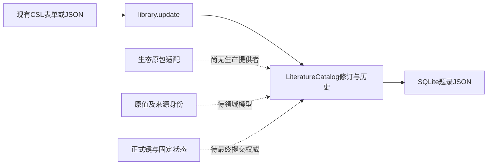

# 调查依据

## 2026-10-26 决议及同步更新

用户明确两项政策，来源分别为域票08 Q2（恢复／复制默认新来源实例，显式确认才可重绑定）、02“正式引用键冲突”（同库大小写不敏感，不自动改名／覆盖固定键）；本轮另选有界多对象原子提交，首片保留完整事务目标。具体schema／比较／限额见当前design和protocol，不再以早期三个选项为阻塞。主线已同步70be8bf，0519904祖先，恢复前clean；证据`/tmp/scholoom-sync-recovery-wyn13R/{recovery.md,synchronized.json}`，本轮后续只使用本树正式源码。原E1静态版本与有损事实仍有效；尚无生态真实消费者的回传，不声称插件已经接入。

## 当前事实与复用选择

本轮只规划。用户正式转交 `/tmp/scholoom-phase2-handoff-VZS5mS/` 快照，manifest 的共同基线为 `e3d58fc807827a78493dcd16e38de28c8d02766e`。精确消费：

- `zotero-ecosystem/openspec/changes/connect-zotero-host-bbt/investigation.md`
- 同目录 `evidence/zotero-10.0.5-mapping.json`、`design.md`、`delivery.md`

固定 Zotero10.0.5 commit `ca61760225d25191d0c65acbfd0c4f12a172d263`，schema44 commit `70c3aa98627413d6a30dca955886eafbde085ce9`，blob `71e8898a7c22c8c3d165945aba76c723c0573eb5`；utilities `1dd38e27edf81e9d9c4161c957b7efb7f5681ac3`。这是上游静态调查和生态实跑报告的消费，未在本树复跑原包或连接真实用户库。

映射包含40原类型、121字段、37创建者角色，转为32个CSL类型键。多个原类型汇入broadcast、motion_picture、document、personal_communication；CSL不能反推原类型。原创建者包含firstName/lastName/fieldMode、creatorType/orderIndex；分角色CSL数组丢失跨角色顺序，姓名粒子处理也可能有损。日期解析不能保存所有原格式、时区和季节。Extra→note包含别名、未知行、CNKICite／Status，不能逆推出原文。故原值必须独立保存，不能把调查JSON直接当产品schema。

BBT resetKeyOnChange可能改变键，缓存先于save更新；默认补齐稳定不等于固定键保护。SQL、saveTx、通知与多对象提交需共同库真实提供者。生态HostCatalog目前是注入夹具，Electron／SQLite实跑不证明共同library生产接入。

本树复用 `packages/library/src/catalog.ts` 的 `LiteratureCatalog`、`validateMetadata`、`update`、`ingest`、history与原事务。当前来源是`origins: string[]`和批次origin；`LibrarySource`的UUID与revision、开放CSL和历史已可用。`update`按所读revision核对并保存完整metadata；摄取按DOI／明确版本复用。不存在来源命名空间／原值／正式键／固定状态的专有schema或插件原子提交端口。`metadata['citation-key']`即使存在也不因此获得正式键权威。保留现有协议、client和broker，不创建第二存储。

## 影响方案的未知项与实验

现有证据足以决定与B批CSL表单分离，不需要为规划安装依赖或操作库。以下政策会改变身份或事务模型，不能用技术默认值代替产品决定：

| 决策 | 选项及依据 | 阻塞任务 |
| --- | --- | --- |
| 来源副本身份 | A：源实例命名空间由明确登记／重绑定产生，恢复和复制默认新实例；B：可信同源恢复可延续映射，复制必须显式重绑定。源itemID不是身份，locator＋objectKey还需实例命名空间；现有共同库独立恢复生成新libraryId，倾向A，迁入重绑定另明确。 | 来源重复／恢复模型、迁移 |
| 正式键冲突 | A：每库区分大小写唯一；B：每库不区分大小写唯一。BBT兼容约束尚未构成Scholoom键比较政策；需生态核对原包查找和用户既有键样本后主线决定。不能自动改固定键或选胜者。 | 键索引及冲突处理 |
| 原子范围 | A：首批只开放单条题录及其原值／键原子保存，多对象请求拒绝；B：开放有上限的多对象事务，需定义数量／字节上限、跨集合／关系范围、通知与回执。原插件saveTx／SQL需求支持B的必要性，尚不足以决定首批范围。 | 插件SQL／saveTx端口、回执及迁移设计 |

来源重复政策不得改变Scholoom材料删除再入库／回收恢复的既有身份规则。缺少政策时禁止生产写入，而非落到任意metadata键。

## 结论与承接

可闭合：E1调查已收到；CSL投影不等于无损原值；正式键唯一权威在文献，插件只提交候选；现有B批能继续直接CSL局部编辑且保留未知值。本change只定义保护不变量及候选模型，任务在三项政策及真实提供者明确后才能实施。迁移、回滚、隔离故障、真实BBT／茉莉花验收留后续授权执行；未创建delivery。
