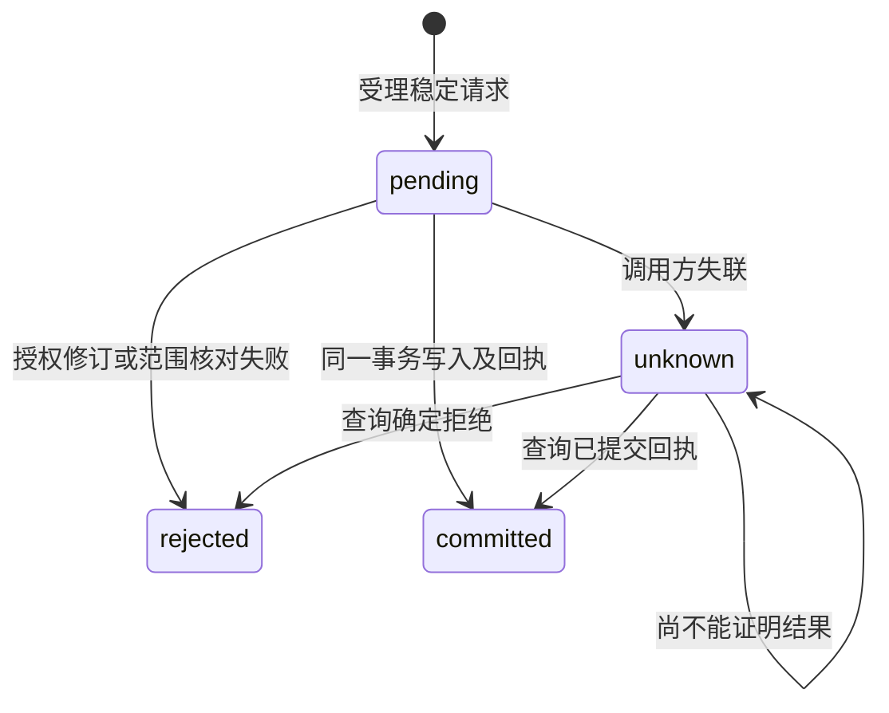

## ADDED Requirements

### Requirement: 来源原值与题录投影分离

共同文献权威 SHALL 将外部来源对象身份及原始题录与CSL投影分别保存和读取。原类型、字段、创建者姓名形态／角色及完整顺序、日期和Extra原文不得通过CSL反向猜测；仅更正CSL SHALL 不覆盖未明确修改的原值。来源身份 SHALL 区分来源实例、库定位及对象键，不能用本机数字itemID、路径、DOI或正式引用键替代。恢复或复制Zotero源库 SHALL 默认登记新来源实例；仅用户显式确认才允许重绑定，未提供确认路径时拒绝自动重绑定。

#### Scenario: 多对一类型和跨角色创建者

- **WHEN** 不同外部类型映射到同一CSL类型，且创建者跨角色交错排列，随后用户只更正CSL题名
- **THEN** 可分别读回更正后的CSL及原类型、姓名、角色、顺序、日期和Extra原文，来源关联不改变

#### Scenario: 相同数字ID来自不同来源实例

- **WHEN** 两个来源实例提交相同本机数字itemID或同名库／对象键
- **THEN** 不因这些局部值自动合并，未确定实例身份时拒绝接入并保留原库

### Requirement: 正式引用键由领域最终提交保护

共同文献权威 SHALL 单独保存正式引用键及固定状态，并在最终提交时核对已读修订、有效写入授权和固定键。同库正式键 SHALL 在Unicode NFC及默认Unicode小写比较后唯一，显示保留原拼写。插件生成结果、缓存与CSL扩展字段只作为候选，不获得覆盖既有正式键或改变固定状态的权力。键或固定状态变更必须有显式意图及有效修订；冲突 SHALL 拒绝并可诊断，不自动改名、挑选胜者或覆盖固定键。

#### Scenario: 插件重算命中固定键

- **WHEN** BBT重算生成不同候选，而领域记录的正式键为固定状态
- **THEN** 普通题录保存不改正式键，调用方能区分已保存题录与未采纳候选，缓存不被当作提交成功依据

#### Scenario: 并发解除固定后写入

- **WHEN** 调用方基于过期修订请求解除固定并修改正式键
- **THEN** 整个请求被拒绝，原键、固定状态、原值和题录均保持，调用方重读后重新决定

#### Scenario: 大小写冲突及候选固定状态

- **WHEN** 已有Smith2024，另一条目请求smith2024；或插件候选请求新建固定键
- **THEN** 冲突请求整体拒绝；无冲突的新候选可以填补缺键但不取得固定状态，已有正式键保持，只有显式意图可改变固定状态

### Requirement: 提交结果可核查且通知不先于提交

涉及同一已授权事务范围的题录、原值、来源关联、正式键及历史 SHALL 一起提交或一起保持原状。首片支持同库最多100条已有题录、编码请求256KiB及单份原值64KiB；尚未开放的对象创建、附件／集合写入、任意SQL或跨库范围 SHALL 明确拒绝，不拆成逐条成功。稳定请求身份可查询已接受的提交或拒绝结果，同身份不同内容拒绝。提交前核对授权及所有修订，提交后才发布一次变化。调用方未获回执 SHALL 标为结果未知并查询，不推断回滚或立即重跑。

#### Scenario: 提交后回执丢失

- **WHEN** 库事务已提交后连接断开，调用方用相同请求身份重试或查询
- **THEN** 返回原提交结果，原值、键、历史和关系不重复写入，不发送重复业务变化

#### Scenario: 已有题录的多对象原子保存

- **WHEN** 调用方提交范围及限额内的多个已有题录，其中一个修订、来源关联或正式键发生冲突
- **THEN** 所有题录、原值、键和历史保持原状，仅记录可查询拒绝结果；无冲突时一起提交并发布一次变化

#### Scenario: 提交前撤权

- **WHEN** 请求受理后、最终事务前写库授权被撤销
- **THEN** 不写题录、原值、键或回执成功状态，不发送成功通知，已有记录可继续核查
