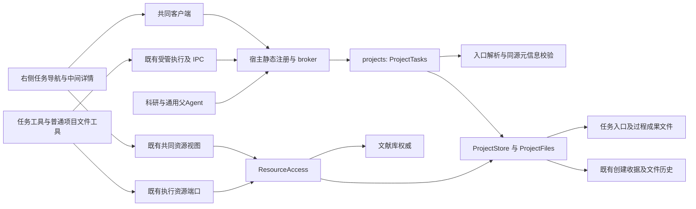
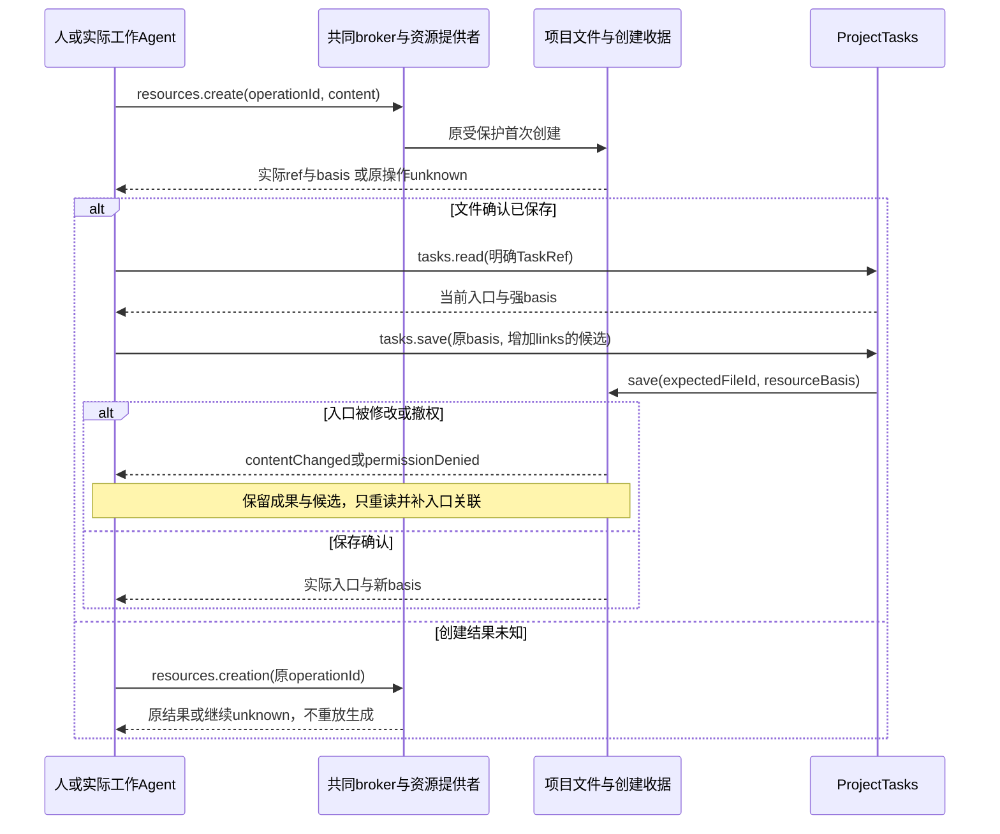

# 实现设计

## 变更总览

本文件记录文件任务核心及公共对接设计，实际结果见[delivery](delivery.md)。当前共同源码cb5f7ed已包含I1及父TaskPort→子资源→父任务关联机械闭环；第7节保留历史快照证据。4.1按proposal的项目文件／库附件首批消费验收，当前方案见第12节；W1完整删除／恢复和主题知识提供者仍开放，原值来源身份已有提供者。projects内部的深层Module `ProjectTasks`把格式核对、发现、身份、保存和诊断集中在小Interface后，复用原文件机制，不另建包、进程、任务数据库、调度器或关系事务。



## 方案与接口

### 1. 文件契约与身份

首批入口范围为项目公开 `tasks/` 目录的直接子文件 `*.task.md`，默认新建 `tasks/<taskId>.task.md`；过程、稿件和成果可放任意合法项目路径，例如 `tasks/materials/`。入口目录不存在表示尚无任务，查询不创建目录；创建时沿既有 mkdir 操作确认目录，已有同名普通文件或不安全目录明确拒绝。不预建无用文件夹，不扫描整个项目或库。应用内将入口移出发现范围后，已知稳定文件引用仍可打开；列表明确说明发现范围，重新纳入须放回范围或显式打开该入口，不能悄悄搜索全盘。

入口是 Markdown，开头 `---` 包围一个标准 JSON 对象，后接普通 Markdown 正文。JSON是YAML可表示的受限元信息，选择它是为直接用 `JSON.parse` 和项目已装的协议校验能力，不给 projects 添加 YAML 依赖、不手写通用 YAML 解析器。文件明确说明格式；普通 YAML 元信息不是此版本合法输入，错误保留原文件。UTF-8／换行处理接受 BOM、LF、CRLF，读取保留实际字节对应的完整正文；只在明确创建或保存时写入调用方提供的完整候选。

示例（用于设计审查，不是正式任务夹具）：

````markdown
---
{"kind":"research-task","formatVersion":1,"id":"task-a","title":"比较两种测量方案","status":"active","workItems":[{"id":"compare","title":"核对误差条件","dependsOn":[]}],"links":[{"id":"plan","role":"plan","target":{"kind":"project-file","fileId":"plan-file"}},{"id":"analysis","role":"process","target":{"kind":"project-file","fileId":"analysis-file"},"workItemId":"compare","note":"方法A适用条件与放弃理由"}]}
---

# 比较两种测量方案

当前目标是判断在已确认样本条件下采用哪种方案。完成依据见计划文件。

当前安排、障碍和下一步在此维护；完整比较在 analysis 引用的文件维护。
````

`taskMetadataSchema` 的唯一可执行声明放 `packages/protocol/src/task-contracts.ts`，类型及校验从其派生；validator 按 protocol 的 `isResearchMethod` 模式放在 `projects.ts` 导出，使用 protocol 已有 Ajv，不给 projects 增加依赖。结构如下：

| 字段／对象 | 语义与约束 |
| --- | --- |
| kind、formatVersion | 固定 `research-task`、`1`；未知版本诊断 unavailable，不自动降级／重写 |
| id、title、status | id是调用前分配并保存的稳定不透明ID，默认UI生成UUID；title按JSON Schema最长256个Unicode字符；status为active／waiting／completed。名称／状态都以文件为准，不复制会话状态。入口创建默认active，更新必须保留id |
| 正文 | 目标、当前完成条件、约束、当前进展、障碍及下一步使用开放Markdown；提供编辑提示，不用固定标题／章节完整匹配作门禁，也不自动判定科研充分性。拆分计划后入口只保留导航和当前概览，不镜像完整计划 |
| workItems | 可选，最多100项；每项 `{id,title,dependsOn?,planLinkId?}`。id在任务内稳定且唯一；dependsOn仅引用同任务已存在工作项，禁止自引用／环；planLinkId须对应同入口role=plan的链接，workItemId也须对应已有工作项。允许独立分支并行。详细目标、进展与下一步留在所属计划正文，不再加一套工作项状态机。计划项被引用后删除／改id须调用方明确调整引用，不悄悄重定向 |
| links | 可选，最多100项；每项 `{id,role,target,workItemId?,basis?,note?}`；role为source／plan／process／result，id在任务内唯一，note按JSON Schema最长4096个Unicode字符，保存用途、采用语境或重定向理由。计划拆分的引用通过role=plan及工作项planLinkId定位，不另存完整正文 |
| target | 首批两支：`{kind:'project-file',fileId}` 表示**所属项目内部**文件；`{kind:'library-material',attachmentId,materialVersionId}` 复用当前库ResourceRef字段。项目链接不持久化当前projectId，以便独立恢复副本仍在副本中解析；读时补当前项目身份。不得以历史path补找丢失fileId，不嵌库正文或任意nativePath |
| basis | 可选，表示该引用最近实际读取／保存时取得的所属内容依据；没读过就缺省，不伪造。不是读取凭证；取材时重新describe并与采用条件核对，变化不能把新版本冒充原依据 |
| TaskRef | `{projectId,taskId,fileId}`；fileId明确指向入口，taskId必须与当前内容一致。跨域可带可选workItemId，但不增加sessionId/runId作为任务所有者，也不接受仅taskId就任意查找第一个入口 |

入口仍受现有256 KiB **UTF-8字节**编辑上限，超限返回tooLarge。长过程拆文件，无需提高文本保存或RPC帧上限。已有文件由共同编辑器编辑；普通编辑器可写入尚未通过任务校验的内容，发现／read如实诊断，不能回退到缓存元信息。任务 save 先校验候选，再在原保存临界区用原依据保护；不把校验成功当作完成声明。

任务逻辑身份是projectId＋taskId，fileId是明确入口定位及冲突保护。应用内重命名保留fileId，合法入口在范围内改名仍可发现；元信息身份变更使旧TaskRef失败。外部移动无法保证保留fileId，发现可显示原taskId的候选及新定位，但旧引用不能自动认领；由调用者核对后更新明确引用。复制任务须明确分配新taskId，普通文件复制不会自动改写正文。重复ID诊断限于已扫描／已加载候选，不宣称已检查未读页；所有读写仍要求明确fileId并核对taskId，不做taskId-only的全项目“唯一”推断。

### 2. 小 Interface 与有界发现

公共操作均来自 `taskOperations`，在现有 projects 契约入口重导出并合入业务声明。提供者和工具输入从相同schema推导，生成的映射继续引用原声明。

| 操作 | 输入 | 输出及语义 |
| --- | --- | --- |
| `tasks.list` | `{projectId,offset?,limit?,version?}`，默认25，最大100 | `{tasks,issues,offset,version?,nextOffset?}`。limit是**原目录候选扫描数**，不保证填满合法任务数；只解析该页匹配后缀的文件。summary含TaskRef、title、status、path、实际basis及正文首段最多512单元的派生摘要，不带全部links或过程正文。目录不存在为tasks=[]、issues=[]且无version；有续页时按原目录offset推进 |
| `tasks.read` | `{task:TaskRef}` | `{task,entry:ResourceEvidence,path,metadata,content}`；entry.ref为当前项目入口，basis为强文件依据。以fileId解析当前位置、实际读取、核对taskId、版本及语法。不会自动读取链接目标或启动模型 |
| `tasks.create` | `{projectId,operationId,path,content}` | 复用 `ResourceCreationResult`；path必须在入口范围，内容含稳定taskId。同操作同输入核查原结果，不新建同名替身；不同输入拒绝。返回complete时带实际入口ref／basis；未知时保留原operationId，无TaskRef也不得猜fileId |
| `tasks.save` | `{task:TaskRef,basis,content}` | 实际保存后的TaskRead；完整候选须保留taskId，使用原入口fileId及强basis。错误沿公共ErrorInfo，不发明另一套revision或吞掉outcomeUnknown |

创建结果查询复用已有 `resources.creation`；不增加任务专用creation方法。当前普通Agent尚无该查询工具，因此在任务工具安装处增加一个使用原schema／资源端口的 `read_task_creation` 薄工具；UI及CLI直接调用原操作。tasks.create使用与resources.create相同的宿主creationOwner可信主体及原收据投影，不允许客户端指定owner，ProjectTasks不依赖editor实现。非创建保存结果未知时，以旧TaskRef重读实际文件及原保存历史核查，不能按“文字恰好一样”把未知实体认成原对象。首次创建TaskRef由返回resource与请求taskId组合并经read核对。

目录准备和任务创建各自有原操作身份。目录注册失败保留其真实operationId和错误；任务创建收据尚未产生时返回failed，不能虚构一个可查询的任务unknown收据。已有任务创建收据时继续返回原创建投影。

`tasks.list`复用ProjectStore.list的目录枚举与分页；在返回前后核对原目录版本，读取候选使用ProjectFiles.readBytes的resourceBasis。目录版本仅防目录项变化，页内正文版本各自表达；新一轮刷新丢弃旧页，旧请求按projectId与查询代次丢弃。只监听tasks目录、当前入口和当前打开文件；列表失效重读当前页，详情失效重读当前入口，不监听所有任务后代或投影全库。目录原有名称枚举成本为O(目录条目数)，页内正文读取／解析至多limit个且每份256 KiB，RPC只返回摘要；性能若暴露目录排序瓶颈，应在原文件模块按证据处理，不先建索引服务。

`issues`每候选至多一项，包含path、可用的fileId、ErrorInfo，不把全部错误正文塞入列表。使用现有invalidRequest（格式／引用结构错误）、tooLarge、contentChanged、targetAmbiguous、notFound、permissionDenied、unavailable和outcomeUnknown；不精确依赖错误文案。坏文件不会阻塞其他合法候选，超限不截断成合法任务。

### 3. 保存、关联与恢复

`ProjectTasks`在projects内部组合ProjectStore／ProjectFiles／ProjectCreations；依赖只取所需方法，独立测试可直接组合真实projects与容器初始化。强读取使用现有readBytes返回的resourceBasis和有限文本解码；save先按调用方原basis强读取当前内容，失效直接拒绝，不能换用新basis替用户重读。随后将这份已核对原内容和原resourceBasis、expectedFileId送入原save临界区，复用已有expected内容核对，不另加写锁。调用方提供的元信息只经过同源schema及任务内关系规则校验；实体版本校验在实际发布时完成。

任务关系就是入口links，不增加 `tasks.link`、多文件提交器或另一份关系表。具体工作先经resources.create/save逐份保存，取得真实ref／basis；再由人或Agent构造入口候选，经tasks.save关联。UI提供关联现有文件的操作，并只在当前入口候选中增加引用，明确保存后才报告已关联。执行关联ResourceSaveResult.association属于原session/run产物回执，与任务入口关联是两件事；harness现有pending收据继续保存前者，不擅自扩展为任务关系权威。



不宣称两份文件原子保存，也不自动回滚成果。取消／关闭只停止后续动作，在途保存按实际结果核查。没有自动关联日志；关联表单只保存材料路径、用途和说明，重启后重读任务并生成候选，不另存正文。创建表单在发出前保存完整原请求及operationId，未知结果经原操作查询，不自动重建；后台不自动“补成功”。本线测试必须覆盖重启后按原操作查询创建及重读入口，不用新造收据替代已有机制。

无DB schema迁移，不批量将普通笔记改成任务。创建首个任务之前项目保持原样。任务内的项目文件引用为local fileId，恢复沿原文件身份重绑定；任务身份以新projectId区分原项目与副本。备份的256 KiB／二进制包含边界沿现有契约，超限材料缺失如实标记，不能承诺长材料已全部备份或从原项目回填。

### 4. 来源取用与跨线 Interface

projects只保存任务自己的引用与采用理由，不直接调用库、科研、harness仓储。任务视图／Agent实际取材通过已有ResourcePort／ExecutionResourcePort，将本地file target加当前projectId或将库target转换为现有ResourceRef。工具实际读后才记录basis；列表不预读库。没有库正文保存能力时维持只读。

| 提供／消费方 | 本线交接 | 当前依赖与替身范围 |
| --- | --- | --- |
| 本线向科研／Agent／计算 | TaskRef、可选workItemId、入口ResourceEvidence、入口metadata.links及按需文件读取。工作项只提供计划导航，不承诺排队／运行状态 | 科研I1及通用父Agent的真实TaskPort消费已验证；子只收材料Evidence，父负责条件关联。程序首批可不关联任务，科研角色及质量仍归所属方 |
| 文献与生态 → 本线 | 当前attachmentId／materialVersionId与实际附件读取；未知删除事实不自行补造 | 独立测试可替换所属资源失败边界，模拟明确删除须标明“契约替身”。完整删除记录／主题知识／恢复真实验收受W1阻塞 |
| 阅读交互 ↔ 本线 | 现有资源打开、ContextItem和共同composer；任务提供入口或现有链接ref／basis | W2两份设计已通过正式快照分别复核，未在当前树接入其新实现。批注、差异、报告和写回保持各自change，本线不增加私有消息通道 |
| 宿主／harness → 本线 | CallContext绑定项目、主体及有效执行；人工与Agent经同一ProjectTasks，Agent模型外发和取消仍复用既有检查 | 人工组合不需要harness。任务工具只操作当前项目；全局／其他项目任务可沿现有read_target_project按已登记文件读取，不通过tasks.list在目标登记fileId |

首批库取用异常：保留原ErrorInfo、所指ref、已有storage/availability；未知删除分类显示“删除记录查询不可用”，不返回伪造deleted/noHistory。任务工具指导沿材料行为矩阵：暂停依赖工作，询问用户并等下一条明确消息；不自动重试／忽略。受控Agent用例核对失败后确实提出选择且无后续依赖写入，收到用户选择后才继续；不新增独立等待引擎。固定Graph的interrupt／等待由科研线在自身图中落实；既有I1机械组合不替代本节来源异常暂停验收。

### 5. 工作台与UI方案

沿 `docs/ui-design/README.md` 右区任务导航、中间详情、三区骨架及dock/overlay，不新建应用。先把以下任务细节补入该文档，再实施组件：

- 右栏TaskList用键盘可达的选择按钮，显示名称、研究状态、派生摘要；active／waiting／completed分别显示进行中／待处理／已完成，waiting不冒充执行审批。默认25个候选的显式续页／重读，错误文件显示可核查入口，新增任务在同面板打开表单。现有文件描述没有可靠修改时间时省略时间，不为时间显示增加第二份任务事实。
- 中间TaskDetail tab显示文件事实、关联用途与工作项导航，提供“编辑入口”“关联现有材料”“附加到指令”动作。完整正文复用ResourceView／FilePane，任务详情不再建另一份正文编辑器；同一文件的草稿继续按projectId／fileId保存。TaskPanel的关联表单仅保存引用字段，通过tasks.save原basis保护写回；共同编辑器存在未保存正文时拒绝关联，防止覆盖草稿。新建表单及关联字段复用drafts存储，分别按配置／项目及入口fileId隔离，存储不可用时沿原内存退路，不保证跨刷新恢复。
- Task tab key含projectId／taskId／fileId，按项目文件组切换；普通点击只改变任务视图，不改变Agent接收会话。显式附加用既有resource或object ContextItem，实际ref／basis来自入口，workItemId仅作对象语义，未保存内容用既有draft text项标明。
- 任务详情经 `useContextContribution` 发布有界当前入口线索；`Workbench`补activeView接点。关联资源沿 `resource-controller` 打开，共同库tab仍跨项目保留；关闭TaskDetail释放它自己的请求。use-tasks复用useFileWatch，公开list确认目录存在后注册tasks范围监听，合并文件revision及范围事件触发刷新，不随模型流反复重读。
- 错误区分发现／读取、保存、入口关联和来源取用；行及状态有文字、aria名和焦点，复用StatusBar贡献显示操作通知。仅用现有语义token和既有VirtualList／列表模式；不从全工作台DOM寻找任务或跨库投影。

### 6. 文件／符号所有权与最小接线

下表是本线实施范围。公共接点按符号限制，不顺带占用他线功能。

| 新增／修改／删除 | 文件或符号 | 所有权及目的 |
| --- | --- | --- |
| 新增 | `packages/protocol/src/task-contracts.ts` | 项目线：taskMetadataSchema、TaskRef及四个操作的唯一声明；不改library/research/委派字段 |
| 修改 | `packages/protocol/src/projects.ts`、`operations.ts`、`business-types.ts`；新增`resource-contracts.ts`、修改`resources.ts` | 聚合与导出任务契约、validator及生成映射；原资源schema不变地抽到叶模块并原路重导出，避免资源／项目／任务相互引用。project-contracts.ts无需修改；不手写重复DTO或增加新package export |
| 新增 | `packages/projects/src/tasks.ts` | ProjectTasks及内部codec，组合当前store／files／creations；不拆短小pass-through模块，不引入原生fs权限 |
| 修改 | `packages/projects/src/node.ts`；必要的`store.ts`所属构造／委托 | 受控导出和生命周期接入；复用原save/readBytes，不修改既有锁／保存语义，不改schema.ts物理表 |
| 修改 | `apps/kernel/src/manual.ts` 的注册、ProjectTasks构造和任务窄端口；`application.ts` 的Harness端口注入 | 公共文件仅提供者装配和实际CallContext绑定。无harness组合注册人工操作，完整组合装配工具。`architecture.json`仅projects提供和harness消费四任务方法、必要契约依赖 |
| 新增／修改 | `packages/harness/src/task-tools.ts`、`runtime.ts`工具数组及所需端口类型 | 本线任务工具薄适配，优先复用既有ToolRecord／失败路径。四任务工具对应tasks.list/read/create/save，另用read_task_creation暴露已有resources.creation查询，无新公共操作。新文件不取得fs／DB或改worker驱动；与Agent线runtime.ts改动仅限任务工具安装点 |
| 新增 | `workbench/tasks/TaskList.tsx`、`TaskDetail.tsx`、`TaskPanel.tsx`、`use-tasks.ts`及必要任务样式（路径前缀为`apps/desktop/src/renderer/src/`）；修改`workbench/useFileWatch.ts`的client可空类型 | 任务专属UI及按项目、请求代次的有界状态；正文与草稿复用共同资源逻辑，监听沿原hook，不重复实现业务保存 |
| 修改 | `workbench/shell/AuxiliaryPane.tsx`任务分支、`shell/TabGroups.tsx`内容分派、`tab-state.ts`任务tab；`Workbench.tsx`任务挂载／activeView、`business-session.tsx`任务端口／事件接点、`session.ts`的TaskSummary／TaskStatus | 精确公共触点，不改会话选择规则、composer传输或阅读资源实现；任务类型引用新schema派生summary，去掉旧展示状态枚举的重复定义，现有demo样例随编译影响更新，生产不回退到demo任务 |
| 修改 | `docs/ui-design/README.md`仅右区任务与详情小节；`docs/development.md`仅任务操作与诊断入口；必要`docs/initial-spec/research.md`相关任务正文改为正式规格链接 | 设计先于UI，正式规格归档后再替换对应初设段落，避免两份行为权威。全局架构过时链接只在实际触及相关段落时修正 |
| 新增／扩展 | `tests/kernel/research-tasks.spec.ts`、`research-task-agent.spec.ts`、`task-tools.spec.ts`及`tests/ui/research-tasks.spec.ts` | 新文件只覆盖任务稳定行为缺口，数据夹具含合法、损坏、重复及长过程。复用实际项目／文件／broker和既有模型server；Agent任务场景单独存放，不改原work-materials用例 |
| 修改 | `tests/ui/fixture.ts`的createSession及受影响调用；`tests/ui/file-workbench.spec.ts`门控场景 | 本线相关CI基线：按projectId定位，分离发送与完成等待；独立公共测试增量，不改生产时限。调用方按符号搜索调整，不全仓机械重写 |
| 删除 | 无独立文件 | 移除AuxiliaryPane内旧只读任务行渲染，交给TaskList；删除被真实接线替代的生产占位路径，demo夹具按新契约保留，不删无关内容 |

项目线拥有上述任务schema和领域规则；共享Workbench／runtime安装点与他线交接时列具体符号。AGENTS.md仅补任务文件权威及保护约束。本轮没有跨树消息。尚未存在的消费方接线不写成既成实施文件清单。

## 验证与风险

### 必要验证与独立验收

只验证新增行为与影响到的旧契约，不创建匹配Skill／文案的静态测试。下列是验证范围，实际命令／结果以delivery为准。用户已明确允许锁定依赖安装及隔离Browser／Electron临时服务；构建与UI严格分开，不在UI运行期间重建。

1. `node packages/protocol/scripts/contract-types.mjs --self-test`及根`generate:contracts`对应的同一脚本`--patch`：生成输出用内置编辑工具审查接入；`node scripts/check-architecture.ts`、项目声明的typecheck与build核对schema传播、broker映射、所有调用者和UI props。不调用会自动安装缺失依赖的入口。
2. `node node_modules/@playwright/test/cli.js test --config playwright.kernel.config.ts tests/kernel/research-tasks.spec.ts tests/kernel/project-files.spec.ts tests/kernel/resource-identity.spec.ts tests/kernel/resource-creation.spec.ts tests/kernel/manual-application.spec.ts tests/kernel/tab-state.spec.ts`：真实临时文件／SQLite／项目模块，覆盖创建查询重启、分页坏文件、改名与外部修改、同内容替换、受限人工／拒绝Agent、工作项依赖、结果已存而关联失败、恢复副本和缺材料。复用既有文件竞态测试，任务新增只测身份传递到原临界区，避免复制原测试矩阵。
3. 定向运行`tests/kernel/task-tools.spec.ts`与`research-task-agent.spec.ts`：受控HTTP模型经真实产品harness、工具、worker和broker，先创建／更新任务并保存过程／成果，再用新会话发现入口，读目标、限制、原比较理由和下一步，处理人工补充后保存后续文件；读取依据和实际结果从工具／文件核查。来源失败后必须等待用户选择，无删除提供者只验证明确不可用，不宣称恢复通过。模型只控制外部响应，不能用外部Agent代写成果。
4. 用`SCHOOLOOM_UI_PORT=5721`及独立profile/output运行既有CLI的`--config playwright.ui.config.ts`，选择`tests/ui/research-tasks.spec.ts`、`file-workbench.spec.ts`、`resource-opening.spec.ts`、`context-bridge.spec.ts`受影响用例。浏览器／真实Electron检查任务创建、详情、共同编辑及文件持久化、同名项目、迟到回执、刷新与草稿、附加入口、键盘。运行前查实际占用，结束仅收尾本轮进程；实际结果见delivery。
5. 大目录合成样本核对一次list只读取规定页候选／摘要、详情只读当前入口及明确展开链接、列表只渲染已加载页，不以Agent总耗时设门槛。沿既有文件树性能政策，未暴露性能问题时不新建benchmark框架。
6. 本线负责I1：W1／W3提供者交付后，真实文献材料＋项目任务＋科研域固定Graph＋broker／worker／仓储，用户入口保存过程／成果，注入关联局部失败并查询实际部分结果，再由新会话从已保存材料找到下一步。Graph及库内部不能换成功替身；外部模型可受控。I1保持独立未完成任务，不阻塞核心Module局部交付，也不能用普通材料分析通过代替。
7. 关键接口、条件写入、跨项目权限及部分保存安排独立审查，直接核对本delta、实际改动和运行证据。最终运行change strict、diff检查，实际执行后获取delivery instructions并记录结果；未验收项不能勾选。

### 诊断、平台和材料保护

诊断复用操作名、projectId／taskId／fileId、原operationId、实际basis、ErrorInfo及ToolRecord；事件只是失效提示，失败分别定位发送、受理、保存／取用与刷新。列表无正文、日志不输出库全文或nativePath。来源失败时保留任务材料和研究状态，不把waiting显示成worker已取消。

Linux／Windows受管执行沿现有能力，macOS可独立验证人工任务文件，Agent端口必须尊重managedExecution不可用，不回退到无隔离执行。本机通过不代表三平台分发或真实科研充分性。备份不承诺跨文件瞬时一致，读取当前文件才能判断部分关联；外部编辑的跨文件一致性不能由内部锁保证。

## 待办边界

- W1调查及原值来源身份提供者已收到；完整库引用分类、主题／分析知识及恢复仍等实际提供者／验收。本线不另建库身份、引用键或删除历史字段，任务材料仍沿附件／材料版本指针。
- W2两份design已分别复核，保持两change独立；不认定报告、材料写回或M2已接通。
- W3／W4源码已在共同树，I1及项目侧通用委派消费分别见第8–9节；实际科研角色／标准／质量仍归其所属change，不恢复后置综合Graph讨论。
- 自定义入口目录、任意深度全盘发现、自动抽取研究决定／证据图、任务自动排程和跨项目写入没有本次需求，不增加选项或预留抽象。

实施授权来自用户本轮“实现该change”及后续锁定依赖／隔离验收许可；不包含真实用户库、提交／推送／PR或归档。

## 7. 历史：主线第二阶段正式输入与公共补丁

本节依据用户提供的`/tmp/scholoom-phase2-handoff-VZS5mS/manifest.json`、`acceptance.md`及`coordination-plan.md:180–199`，各源基线均为e3d58fc；只读快照，不进入manifest中的真实source工作树。本轮源代码不变，公共候选在`/tmp/scholoom-research-task-phase2-iF4ywR/`准备。

### 已消费路径与证据边界

以下路径均在上述正式交接根下，路径拼接即精确消费位置：

| 快照相对路径 | 本线结论 |
| --- | --- |
| `research-task-workspace/packages/protocol/src/task-contracts.ts`及`projects.ts` | 向科研／Agent／计算正式交接四操作、TaskRef三元组、可选workItemId、TaskRead.entry及links语义；文件和类型声明继续只有本线一份权威 |
| `research-graph-runtime/packages/protocol/src/research-contracts.ts:116、182–245`及`openspec/changes/connect-research-graph-runtime/design.md:64` | graphs／graph／graphCalls已有源码；启动材料为ResourceEvidence[]，尚无TaskRef／workItemId。入口证据可以作为材料，不能取代taskId核对 |
| `agent-delegation/packages/protocol/src/delegation-contracts.ts:46`及`openspec/changes/add-bounded-agent-delegation/design.md:62–74` | workPackage已有objective／requirements／materials／outputs，没有任务字段。需关联时由消费方审查可选task＋workItem形状；本线不在其载荷塞额外字段或绑定会话 |
| `project-execution/packages/protocol/src/programs.ts:72`及`openspec/changes/add-project-program-runs/design.md:194` | programStart没有任务字段，首批明确不要求任务；输入／输出证据可使用已保存材料，不能声称运行已写任务links |
| `research-graph-runtime/packages/research/src/graph-delivery.ts:47`、`agent-delegation/packages/harness/src/delegations.ts:299` | 资源association是session/run成果登记。任务入口links需另按tasks.save条件保存；文件确认、edit、执行关联和任务关联分别核查 |
| `zotero-ecosystem/openspec/changes/connect-zotero-host-bbt/investigation.md:24–75、121–130`及`evidence/zotero-10.0.5-mapping.json` | Zotero10.0.5固定字段／关系及插件保存／SQL／通知调查已收到。itemID为局部整数、key仅在库内唯一；源实例／对象种类／恢复、固定键最终保护、多对象提交、主题知识及题录／附件删除恢复仍缺正式提供者 |
| `research-interaction/openspec/changes/add-material-annotation-interactions/design.md:35–81、119` | 位置及草稿ContextItem、原资源保存、FileEdit差异与整次undo边界已核对；M2归因仍待本线方案。阅读UI及U1修改归阅读线 |
| `research-interaction/openspec/changes/add-interactive-research-reports/design.md:29–81` | HTML入口fileId／basis、清单依赖和声明来源分开；页面仅形成共同草稿。resources.report、HTML写入及批量附加均是候选，不能当真实能力消费 |
| `literature-workbench/tests/ui/fixture.ts:95–129` | openWorkbenchWindow按原desktop映射、preload和安全选项创建窗口；与本线稳定projectId创建会话互补 |

生态调查进一步确认：BBT fill可保留已有键，但replace／reset分支仍可能改键；插件缓存可能先于提交且无通知时导出旧值。茉莉花多次saveTx及附件重绑不证明整个任务原子，不能授予删除来源文件权限。Reader书签sidecar不改PDF字节。原调查引用而快照未包含的历史资料只读本树`.scratch/scholoom-foundations/research/zotero-host-{minimal,mutation,metadata,reader}-results.md`及`zotero-storage-and-plugin-authority.md`；旧main静态资料不冒充固定10.0.5运行结论。

### 精确交接语义

TaskRef必须完整携带`{projectId,taskId,fileId}`；workItemId是可选的任务内计划身份，不是另一个任务所有者。消费者先tasks.read取得当前入口及metadata，再核对所需工作项；不只按taskId找第一个文件。入口`ResourceEvidence={ref,basis,role?}`可以进入现有materials，但没有taskId，不证明任务或工作项身份。

过程／成果先各自保存，任务links再以入口原basis提交；冲突／unknown保留实际文件及原创建operationId，只补未完成关联。科研、委派、程序的实际执行权威各自保留，不复制一份进展，不把一次方法调用自动建任务。消费方字段最终选择及实际装配仍未交付，4.4仅拆出已证明的静态交接部分。

### 公共补丁及依赖顺序

1. `001-resource-schema-leaf.patch`仅包含新增`protocol/src/resource-contracts.ts`及原`resources.ts`重导出；无task文件、schema字段或操作变化，也不含image。独立基线protocol构建和三种入口导入顺序、原schema／操作深比较、Ajv样本及对象重导出身份通过。
2. 阅读线image增量随后把descriptor格式枚举加到**同一叶模块**，原`resourceFormatForName`留在resources.ts更新；不能再在resources.ts复制ResourceRef。该图片补丁由阅读线负责，不在本候选中实施。
3. `002-ui-fixture-combined.patch`相对共同基线，仅合并openWorkbenchWindow及本线createSession(projectId)修复、必要join导入；目录选择、下载、desktop映射及其他原能力不删。临时组合用例在真实Browser／Electron验证第二窗口、其目录选择、同名项目及各窗口会话／指令不串扰。
4. 以上候选先交主线在dev应用并验证，再由用户同步消费者；当前仅有git apply --check及本树／隔离验证，没有dev接入证据。其他共享runtime／kernel／Workbench增量须按符号组合，不复制七树私有实现。

M2独立规划为[establish-trusted-file-edit-origins](../2026-10-30-establish-trusted-file-edit-origins/design.md)，有明确D1–D3待审。它不是本change已提供的新运行能力，也不新增普通保存事务状态机。

## 8. I1用户入口与真实组合验收方案

### 1026796共同实现后的本轮切片

用户本轮授权真实I1机械组合。当前HEAD为1026796d854b8f568c3e819f13268a9638980bc1，工作区clean；主线共同接入／同步证据为`/tmp/scholoom-round5-acceptance-WBreMJ/{acceptance.md,synchronized.json}`。旧77cd078补丁只作历史证据，不再应用；科研、库、固定worker及任务实现均在本树，不再等待源码交接。

默认装配只新增ManualApplication受保护的TaskResearchPort获取hook，显式注入优先，人工独立组合保持不可用默认值。KernelApplication默认经所属projects消费端口调用`research.graphs`并投影description的name／definition／nextOffset，start原样转交`research.requestGraph`。保留原human/product、project/session、workbenchSource及signal；human→host、信任／read/send、配置与空闲会话、去重均由现有科研适配负责。architecture仅新增这两个真实消费，不改Graph schema、FileEdit来源hook、harness.executionFacts、委派或programs。

测试接点沿既有tasks.runGraph及任务详情用户动作，科研校准图仅通过构造参数注册。复用真实库导入、资源提供者、broker、受管worker和过程创建／任务保存；替身仅限外部模型和明确的故障／并发门控。已登记项目与profile保存在用例结果目录，配置退役前不删除。先build再test，双宿主复用已构建静态承载，不在运行期间重建。

首个实际运行复现入口版本交错：process链接已写入任务，固定worker随后按旧入口basis读取，graph.failed/contentChanged且reads为空，证据`/tmp/scholoom-i1-round6/first-real-worker.log`。用户明确选择独立调用输入快照，拒绝放宽版本检查或去掉入口依据。

TaskGraphs核对入口和来源后，通过已有resources.create保存`tasks/<processOperationId>.graph-input.md`，稳定操作身份由同源helper派生为`<processOperationId>_input`（原ID上限96，派生仍在原创建限额内）。snapshot JSON由项目唯一schema描述：kind／formatVersion、原TaskRef、入口ResourceEvidence、可选workItemId、目标session及原invocation/instruction、所选source的linkId及Evidence、原入口完整content。它是本次调用历史输入，不能作为可更新的任务权威；库材料只留指针，不复制正文。快照不被本模块后续改写，仍按普通资源强basis核验，外部改动照常拒绝。

快照创建完整确认且原入口重读仍匹配后才启动科研，Graph材料首项改为快照的真实Evidence（role=task-input），后接所选来源，容量仍为实际research的1–10项。原可变入口保留在快照中的来源依据，不作为需要再次读取的旧版本live材料。任务text仍来自原已核对正文。快照创建unknown保留原派生操作且不启动；科研拒绝／unknown时保留快照及原请求，不回滚或另起调用。快照保存不是科研已受理的证明。

成功／部分保存结果增加可选`inputSnapshot`，只表示已完整确认的原资源创建结果；旧结果无此字段仍有效。实际process JSON继续保留原call五元组，并增加快照Evidence，让新会话沿任务process链接读回本次输入。任务仍只增加一条process链接，不新建反向表或状态副本。UI分别提供调用记录与历史输入打开入口，核对快照操作身份／项目；unknown、冲突、部分成功及原invocation/instruction/processOperation身份保留，不重跑补关联。Graph schema、科研模块和来源hook不变。

独立审查后补强：任务入口自己不能另选为live source，在任何快照准备／启动前拒绝，UI不重复列出。历史输入经任务UI现有client的resources.read按回执ref/basis及256KiB界限读取，在详情只读呈现并核对完整性；不经重新describe的当前版本替代，也不扩共享ResourceTarget或阅读Module。请求代次保护迟到读取及清空，快照被外部改写时显示原错误，不缓存另一版本。容量回归使用各自独立三种请求身份，并以九来源加快照实际受理、十来源加快照实际拒绝证明没有被重放保护提前截断。

### 历史：77cd078局部切片（当前默认装配及快照以本节首段为准）

本轮用户明确选择任务详情单一“运行科研图”动作，取代下文历史D-I1待审分支。恢复HEAD为77cd078，0519904及b838402均已为祖先；资源叶schema、执行历史和Graph来源、v6迁移、双窗口fixture及图片枚举已在本树正式源码，证据为`/tmp/scholoom-sync-recovery-wyn13R/recovery.md`。旧公共补丁无需重新起草或复制。恢复验证只证明已有切片，不证明I1。

项目拥有`task-graph-contracts.ts`中的`tasks.graphs`及`tasks.runGraph`、`projects/TaskGraphs`和任务详情薄挂载。请求携带完整TaskRef、入口basis、可选workItemId、所选sourceLinkIds、图版本／开放config、用户当前会话及稳定invocationId／instructionId／processOperationId。服务端重读入口、核对任务与工作项身份，只允许source用途且适用当前工作项的链接；经所属资源端口派生实际ResourceEvidence，核对已有链接basis，再重读入口。客户端不能提供材料版本或执行权限。

科研线提供注入`TaskResearchPort`：分页目录和`start`。它在原human/product身份下负责会话归属、空闲、项目信任、配置、材料／模型外发授权、原调用身份去重及human→host窄适配；项目不复制第二套启动，不向科研schema增加TaskRef。未注入时目录为空并有不可用原因，run明确unavailable，校准图只在隔离测试注入。正式源码尚无该私有实际适配，真实I1保持开放。

调用回执先保存为独立process材料`tasks/<processOperationId>.graph-call.md`，只含project/session/invocation/instruction/run查询指针；以原入口basis追加process链接。返回call、原资源创建结果和独立taskAssociation。创建或关联失败保留实际调用及材料，不回滚、不重试图、不复制运行状态。新会话沿原tasks.read和文件发现指针。任务UI在共同正文未保存时拒绝启动，保持原请求、未知回执与部分结果；切换／刷新不生成替身请求。

新增／修改到达点：protocol操作聚合及生成映射、projects导出、kernel Manual／Kernel构造注入与handlers、architecture的明确消费、WorkbenchSession及任务详情表单、UI设计和定向测试。先构建再测；最小验收覆盖真实任务／项目／库取材配合注入科研端口、来源变化／越权、入口冲突、过程创建与关联部分失败，以及双宿主空目录／表单行为。注入端口不叫真实科研或固定worker组合通过。下文保留原真实组合测试定义，待实际科研提供者接入再执行。

### 历史：快照阶段事实与入口选择

科研快照已有`research.graphs`、`research.graph`及`research.graphCalls({projectId,sessionId,invocationId?})`。`KernelApplication.startResearchGraph`／内部`research.startGraph`要求可信host/system并返回`{invocationId,instructionId,runId}`；底层startGraph绕过科研调用记录，不能代替它。默认researchGraphs及本树executionGraphs均为空；现有模型invoke_research_capability是旧能力，不是Graph用户启动入口。

**D-I1已确认：**采用既有任务详情单一“运行科研图”动作，选择目录、版本、开放配置及来源，使用用户明确选定的会话。项目拥有任务编排，科研拥有唯一可信人工启动适配，不另建工作台或第二套启动。

研究线拥有`TaskResearchPort.start`的实际适配及host绑定：从已认证human入口核对项目／信任、会话空闲、描述及配置／资源版本，再调用其现有startResearchGraph。本树仅注入端口及明确不可用默认值。不得让客户端自报host身份，不让活动Agent在同会话递归抢占根执行；忙碌时明确拒绝，用户自行选择空闲会话，不自动取消或新建。等待仍由原session.send推进，断线／未知启动按原invocationId查询，不另起调用。

项目线负责任务动作薄挂载、TaskRef／工作项核对和组合测试；科研线负责目录、启动与graphCalls；harness负责原worker及执行历史；library和projects分别核对材料。公共构造和工具安装点须经dev组合后使用，不在本树私自复制。

### 历史：注入端口阶段的组合验收计划

公共基线同步及D-I1选择现已具备；取得实际科研适配后，仍须用隔离Browser／真实Electron harness经**同一用户动作**完成下述真实组合。验收宿主静态注册快照`research-graph-runtime/tests/fixtures/research-graph-worker/{graphs.mjs,worker.mjs}`的`scholoom.calibration@1`；它仅是测试目录／固定worker，不能注册成生产科研功能或冒称实际综合流程。无测试注册的产品目录继续为空。

1. 隔离真实库导入合成UTF-8材料、实际项目创建任务；通过工作台保存长比较过程、目标／依据／障碍／下一步并关联，所有ref／basis来自所属真实提供者。
2. 任务动作发现校准描述，显式选择TaskRef、可选工作项、库来源及长过程Evidence、空闲会话和outputPath／goal。实际科研start记录、broker、worker、仓储及资源读取均为真实接线。校准图现有read／create／wait／check足够；不新增后置综合流程节点。
3. 经原composer发送图要求的确认JSON，查询graphCalls对原invocation／instruction／run的真实结果及资源association，打开实际报告；不把宿主测试直接调用start算作用户启动。
4. 报告已保存后，经任务“关联现有材料”提交links，门控tasks.save期间人工修改入口，确认contentChanged；报告、过程和原操作收据保留。重读后只补任务关联，分别核对资源association与task links，不重复生成报告。
5. 在明确项目过程材料中保存实际返回的`projectId/sessionId/invocationId/instructionId/runId`查询线索并关联该文件；这只是指向科研记录的工作材料，不向TaskLink临时增加graph union。新会话从任务入口读目标、过程、报告与下一步；若需查询旧科研调用，按真实提供者权限及上述原会话线索查询，不从TaskRef猜runId或复制执行状态。
6. 复用本线受控模型的普通新会话接续路径保存后续材料。模型只控制外部回复，内部库／任务／科研／worker不能用成功替身。来源不可用仍等用户决定；生产目录空、缺产品适配或缺真实提供者时I1保留未完成。

本轮已实施任务侧编排与UI，并在注入科研端口下验来源选择、过程指针及部分关联；没有运行上述真实科研／固定worker跨域组合，不声称I1通过。下一步由科研所属线交实际适配、主线按符号组合并验证，再同步消费者。无需为I1定案科研综合流程，程序运行也不要求绑定任务。

## 9. 4b13183后的可选任务消费与后端夹具校正

主线`/tmp/scholoom-round6-acceptance-dXuzCA/acceptance.md`及`synchronized.json`确认共同接入；当前真实TaskPort来自Kernel构造注入的`ManualApplication.projectTasks(context)`，经broker及`createTaskTools`到ProjectTasks四操作。`tests/kernel/delegation-task-port.spec.ts`及`tests/fixtures/delegation-model.ts`明确父read入口→ResourceEvidence交子→子实际保存→父重读save关联result/workItemId。完整、材料变化、关联冲突、取消四场景核对实际文件及关联，项目侧4.4c无需第二套TaskRef或委派DTO。子不取得任务写入／程序启动权限，计算首批仍可无任务；科研角色、标准及质量保持所属方开放。

当前`protocol/library-records.ts`、`library/schema.ts`和`LiteratureCatalog.createSourceInstance/record/commitRecords`已经提供原值来源实例及身份`{instanceId,libraryLocator,objectKey}`，同源操作由Manual真实注册。该身份约束外部原值对象绑定，不替代附件／材料版本，也不证明删除记录或恢复；任务材料继续使用原指针，不扩TaskLink union。完整删除／恢复行为矩阵及主题／分析知识依赖后续提供者；当前4.1首批验收不把这些尚不存在的能力计作已交付。

最新CI为6b22d60／40315429083，两项project-backend失败在当前源码复现。原测试以未装harness的Manual和缺session/run/instance的合成调用保存，被FileEdit来源检查提前拒绝，尚未走到原撤权／无关目录场景。修正只在`tests/kernel/project-backend.spec.ts`增加自含`BackendApplication`测试资格seam：绑定完整项目／会话／run／instance并核对Agent主体。继承真实broker、fileOrigin及ProjectStore保存锁／依据／最终权限检查；不覆盖来源、不改生产Manual默认unavailable、不改harness资格提供者。两个场景的项目／profile保留于各自结果目录；等待后撤销信任仍拒绝，人工编辑可用，无关目录改名不阻断notes保存。生产执行来源另由已有真实worker回归核对；测试资格seam本身不称真实harness身份。

本轮没有新增业务行为或协议，不改delta specs／生成映射或生产装配。以原两例红绿、整份后端、任务／工具、真实委派及来源边界作最小验证；Linux通过不关闭Windows实际CI失败，全仓与其他平台不自动重跑。结果见同一delivery末节，到有界增量交回停止。

## 10. 29cd728上的窗口侧公共UI取证

本片按第十一轮主线明确的数据边界实现测试诊断，解决上轮Electron实际窗口network为空的缺口。只改`tests/ui/fixture.ts`的按需观察生命周期、一个`ui-rpc-observer.ts`窄helper，以及file-workbench两个指定场景的诊断挂载／清理前保存；不改任何现有业务helper签名、多窗口登记或生产preload／client／协议。Agent拥有model-kernel及执行侧，本片不依赖未合入实现，也不写那些文件。不是新产品行为，无需新增正式业务规格或生成映射。

观察接口接受真实Playwright Page，以page的websocket／framesent／framereceived事件取得当前窗口实际流量；Electron传入uiPage真实窗口，不能传默认空页。只处理session.send、workbench.watch／snapshot，按每连接RPC ID关联请求与响应。投影请求projectId／sessionId／instructionId、真实回执instructionId／runId／结构化errorCode，以及快照revision、session／run身份和状态、最多8条最近用户指令的身份／状态。所有值重新白名单构造，不保留文字、材料、凭据、URL、token或原始通用帧，不修改／重放任何发送。

边界固定为最多128条观察（保留最近项并计丢弃）、每连接32个待回执请求、最多32个连接；字段长度沿同源id上限1024，过长身份明确不采而不截短冒充。帧超2MiB、无效字段、解析／监听失败及超量均有有界计数，未见连接／相关流量明确缺证。同连接出现重复待回执ID时，停止该连接后续关联并计入丢弃，不能任选响应归属。时点是测试端收到窗口事件的本地Date.now及相对performance时点，不冒充worker或内核执行阶段。队列溢出不触发重试或扩大限额。

新增按需uiRpc fixture依赖现有uiPage，仅两个指定场景申请，其他UI不增加采集。场景finally在release模型／stop内核前调用save；save冻结并移除本观察器监听，幂等保存`ui-window-rpc.json`为TestInfo附件，fixture兜底调用，不覆盖此前冻结结果。save返回可选存储／附件错误，场景继续原清理；fixture在Playwright记录原业务失败后报告该错误，避免finally异常覆盖原断言。两个场景的登记项目目录保留到所属配置退役。初始Electron连接若早于监听，会如实缺证；测试本来就会导航／重新连接，监听在该导航前挂载。

验证先做窄模块安全自检（只模拟观察事件，不算业务验收）：非白名单及正文不落盘、响应归属、错误码、溢出／断开／监听失败、save幂等。然后只复用resident project sessions场景跑Browser／真实Electron各一次，保持原断言及90秒期限，复用已构建静态产品和真实模型内核。原断言失败也保存同次有界附件，不改harness、model-server或等待参数凑通过；根据实际回执分别报告业务结果与诊断覆盖。全部工件及TMPDIR使用`/home/joshua/.cache`下本轮独立根，保留登记项目到配置退役；本片不重跑全UI。原4.1继续等待。

## 11. ba29ee61上的多项目场景观察消费

共享窗口／执行观察与RPC闸门已正式接入。按第十二轮安排，仅复用file-workbench第二个resident project sessions场景，先以原代码运行Browser／真实Electron，保留首次回执；第一场景主线已有双宿主依据，不重复。读取同次ui-window-rpc与model-kernel-execution，以project／session／instruction／run及真实执行instance关联，区分实际发送、受理、指令消费、模型推进和结果刷新；不得跨场景累计模型计数补证。原断言、90秒期限和业务语义保持，不重做观察器安全自检，不并改harness／model-kernel／共享闸门。

若原场景失败，先消费该次窗口及执行附件，闭合本域根因后才作所属测试／观察局部的最小修复；非本域缺陷按原身份精确交回。必要测试增强只针对真实回执／仓储和各项目草稿／标签，不造新业务状态或提供者。复用现成已构建产品的静态承载；先xdpyinfo预检共享DISPLAY=:99，不启动／停止共享显示。独立缓存根及TMPDIR保留首次和后续实际结果，登记项目不提前删除。完整4.1及平台／科研质量继续开放。

本次原场景首次双宿主均通过，所属测试／观察／执行提供者无需修正。实际消费在本轮独立证据根的`correlate.mjs`完成：按每份窗口session.send的同连接回执取得instruction／run，再匹配同project／session的执行capture、目标指令consumed、该run／instance的model.output、正常退出及窗口completed；不以样本当前run绑定全部历史指令，也不以累计model.requests替代归属。项目identity.json绑定四个实际临时项目，核原文件未因草稿或模型运行被覆盖。原UI草稿／标签断言在发送前切换阶段通过，不扩称发送完成后的UI草稿检查；本片无新增业务／测试行为，不需改spec或生成映射。

## 12. 4.1首批来源异常消费验收

主线本轮明确按proposal首个有界交付和未修改的“来源异常保留事实并等待决定”Requirement核4.1。真实项目文件和库附件必须先取得实际ref／basis，再让隔离夹具中的文件不可读；随机未创建fileId不再作为这项验收的唯一依据。库仍通过真实library附件登记、storage／state／error及资源读取表达事实；`missing`不表示库对象已删除，删除分类查询没有提供者，明确为unavailable。任务不保存第二份库正文或虚构deleted／noHistory。

复用`research-task-agent.spec.ts`的来源失败用例，参数覆盖项目文件、managed附件与linked附件。外部HTTP模型受控，内部Kernel／broker／worker／库／文件／工具全部真实；实际资源读返回的完整ErrorInfo与原ref／basis，以及实际附件storage／state保留到用户明确选择后的任务正文。失败阶段提出选择、停止依赖工作且不写任务／材料；下一条明确忽略只记录跳过范围，未读材料不计为已采用。新会话重读任务及既存过程／成果，取得已保存选择与下一步，无旧transcript依赖。外链同路径出现不同字节后仍按原版本拒读，不称恢复。

复用`research-tasks.spec.ts`的任务详情入口，增加一个最小双宿主代表：真实linked附件失效后打开来源得到不可读诊断，任务引用及既存过程／成果不变，刷新后新会话仍可从入口打开过程／成果。此例不运行模型；Agent暂停与明确选择由上述真实worker测试负责。不改UI视觉、FileEditor、harness、library schema或删除提供者，不新增重复诊断系统；仅测试和所属工件变更复用共同基线已验构建产物。

4.1完成只表示上述首批消费和不可用保护经实跑成立，不表示完整材料行为矩阵、题录／附件删除恢复、主题／分析知识、平台整项或科研质量完成。完整Requirement保留；后续提供者交付时再验其实际分类和恢复，不能以notFound、原值身份或源key重现替代。
