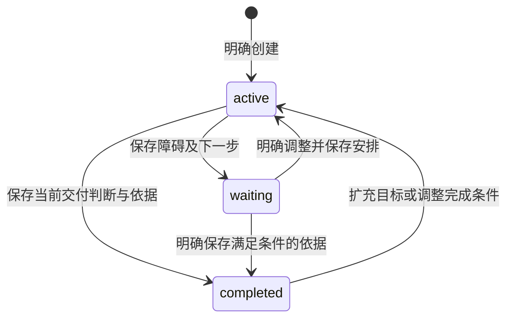

# research-tasks Spec Delta

## Purpose

让人和 Agent 从项目文件共同发现、创建、读取及维护面向持续成果的研究任务，以同一入口找到目标、当前安排、依据、障碍与下一步。任务的正文、工作项及采用语境保存在开放文件，过程和成果按需展开，换会话后仍可从实际材料继续工作。

## ADDED Requirements

### Requirement: 文件任务权威与明确身份

研究任务 SHALL 归所属项目，以一个 UTF-8 Markdown 文件作为入口，保存可校验的格式版本、稳定任务身份、名称及研究状态等元信息，并以正文或明确文件引用承载目标、交付条件、约束、当前计划、进展、障碍及下一步。长过程、比较理由、计划和成果 SHALL 可独立成文，由入口关联，各份内容只有所属文件一处权威。数据库仅可保存必要操作记录或可重建索引，不保存另一份任务正文或当前进展权威。

任务引用 SHALL 同时标识项目、任务和明确入口文件，路径只用于发现与定位，不能以标题、最近修改或会话身份代替。修改名称、正文或应用内文件位置 SHALL 保留任务身份；入口元信息身份改变后旧任务引用不得写入新对象。已发现的复制入口造成相同任务身份的多个候选 SHALL 分别展示并诊断歧义，不能静默合并或任意选择一个；有界扫描不得将尚未检查的页面报告为已排除重复。

#### Scenario: 多任务与新会话发现

- **WHEN** 同一项目有多个任务，新会话按用户要求查找其中一个
- **THEN** 可取得候选摘要及明确入口，读取目标、当前安排、材料和下一步；歧义时明确询问，不依赖旧聊天或按修改时间猜测

#### Scenario: 改名与重复入口

- **WHEN** 入口文件被应用内改名，或用户复制出具有相同任务身份的另一入口
- **THEN** 改名后原引用仍对应原文件；复制候选各自保留文件身份，重复身份不能被解释为自动替代或第二项已确认任务

### Requirement: 有界发现与文件变化重读

任务发现 SHALL 在明确公开范围分页读取候选和摘要，返回扫描续页、范围版本及逐项解析诊断。没有任务目录时 SHALL 返回空范围，不因查询创建目录或任务。摘要不能代替当前入口正文或承诺全项目瞬时一致；刷新及重读 SHALL 反映磁盘实际内容。无效、超限、未知格式或损坏入口 SHALL 保留实际文件及诊断，不能静默修复、截断后保存或回退到旧索引正文。外部未登记的移动不能仅凭相同路径或相同文字认领旧文件身份。

#### Scenario: 人工更改入口与过程文件

- **WHEN** 用户通过普通编辑器修改任务入口或关联过程文件，随后调用发现并重读
- **THEN** 取得修改后的实际内容及依据，旧摘要不覆盖文件，过程材料按需读取，不因列表刷新一次展开全部正文或全部库材料

#### Scenario: 非任务与损坏入口混合分页

- **WHEN** 发现页包含普通 Markdown、损坏任务、合法任务及尚未扫描的后续文件
- **THEN** 合法任务和逐项诊断可用，普通文件不冒充任务，续页按已扫描范围推进，不能将当前页无结果宣称全项目无任务

### Requirement: 共同创建更新与所属授权

人和 Agent SHALL 使用同源任务操作；人工操作不要求会话、模型或项目信任，Agent操作核对当前项目工作域、可信执行身份及项目信任。跨项目只读能力不得经任务入口获得身份登记、写入、关联或程序执行权限。会话 SHALL 不绑定任务，一次能力调用不能自动创建任务；创建须来自用户明确要求或已确认建议。

首次创建 SHALL 使用稳定操作身份、禁止覆盖、返回实际入口身份及文件依据，并能核查原操作未知结果。更新 SHALL 核对原任务身份、入口文件身份及整份读取依据，在原文件保存临界区拒绝内容或实体变化，不自动合并。请求及结果 SHALL 有界，失败不能覆盖磁盘内容或用户后续草稿。

#### Scenario: 人与 Agent 并发保存

- **WHEN** 人和 Agent 基于同一入口版本编辑，人工修改先保存成功
- **THEN** Agent过期保存被拒绝并要求重读；两份候选及已保存成果保持，不能以名称相同绕过保护

#### Scenario: 同路径同内容替换

- **WHEN** 入口读取后被另一实体替换，即使路径和文字相同
- **THEN** 旧实体依据不能保存新文件，结果明确要求核查，不能把新文件当作原入口

#### Scenario: 创建回执丢失或无权限

- **WHEN** 创建结果未知后调用方按原操作身份查询，或全局Agent请求写目标项目任务
- **THEN** 前者只核查原创建、不重复副作用；后者拒绝，不能将目标只读授权升级为任务写权限

### Requirement: 可调整研究状态与工作项导航

任务 SHALL 表达研究工作当前为 active、waiting 或 completed，并与执行 running、失败、取消及 checkpoint 状态分别呈现。研究状态只能由明确文件更新改变，执行结束、来源故障或产物存在不能自动完成任务。已达当前完成条件的任务 SHALL 可在明确新增目标或调整条件后重新 active，既有成果及当时条件继续保留在所属材料。

任务内部 SHALL 支持按稳定工作项身份表达计划项、同任务依赖、并行及材料入口；不以新增任务替代每次计算或方法调用。计划正文拆出时，入口只维护导航和引用，不能再维护一份完整计划。

#### Scenario: 研究结果扩展

- **WHEN** 当前完成条件已满足，用户要求补充新的研究范围
- **THEN** 原成果与条件保留，更新目标、当前安排和状态，不复活旧执行或要求绑定旧会话

#### Scenario: 工作项用于执行或委派

- **WHEN** 调用方明确关联某个工作项，或没有关联任务直接调用方法
- **THEN** 前者可按任务及工作项引用找到所需材料，后者仍合法；任务状态不由执行返回自动推进

### Requirement: 来源与成果关联及部分保存核查

任务 SHALL 在入口文件保存库来源指针及项目材料、计划、过程和实际成果的引用、用途及本任务采用语境。库内容仍由库提供，不因关联复制为知识副本，也不建立库材料到项目引用的反向表。保存引用不代表已实际读取、验证或完成科研交付；实际取用 SHALL 返回所属版本及依据。

过程／成果保存和入口关联 SHALL 分别确认。成果已保存而入口关联失败、取消或结果未知时 SHALL 保留实际文件、原创建／保存依据及已确认关系，只核查并补缺失关联，不重复生成、覆盖或回滚成果。关联更新须核对当前入口，重定向只影响明确任务及引用并保存理由，其他任务保持各自判断。当前项目内文件引用 SHALL 沿项目所属语义展开，独立恢复副本不得暗中读取或写回原项目。

#### Scenario: 长过程保存后关联冲突

- **WHEN** 多份长过程材料已逐份保存，更新任务入口时遇到人工修改
- **THEN** 保留全部已保存文件和实际引用，报告入口关联未完成；重读入口后可只补关联，不能声称整个工作已交付或重新生成这些文件

#### Scenario: 相同来源不同采用与重定向

- **WHEN** 任务A排除某来源、任务B采用同一来源，用户仅要求重定向A的指定引用
- **THEN** 更新A的目标和理由，B的引用及判断不变，新目标不能冒充旧指针读取成功

#### Scenario: 独立备份副本

- **WHEN** 从备份恢复任务及其项目材料到新的项目
- **THEN** 副本身份与权限独立，文件引用在副本中核对，缺失材料如实报告，不能以原项目路径补齐或覆盖原成果

### Requirement: 来源异常保留事实并等待决定

来源读取 SHALL 遵循已确认材料引用行为矩阵，返回可证明的所属对象、错误和取用状态。明确删除、库访问异常、托管内容缺失、外链失效、权限拒绝或身份不符时，Agent MUST 暂停依赖该来源的工作，询问用户并等待明确选择；不能自行忽略、重定向、搜索入库或用缓存、模型记忆和替代材料充当原来源。对象不存在且已可靠查询无删除记录时，由 Agent 核查，不擅自推断用户删除。

缺少删除记录等提供者时 SHALL 明确报告分类能力不可用及已有原错误，不能伪造删除操作者、无删除历史或恢复成功；依赖该分类的工作保持待决定。来源故障 SHALL 保留项目自身过程、判断、成果及引用。恢复原对象或明确重定向后，只有实际重新取得可靠内容才可报告可读。

#### Scenario: 附件缺失且没有删除历史提供者

- **WHEN** 所指附件读取失败，现有提供者不能证明删除或无删除记录
- **THEN** 保留实际错误及分类缺口，Agent暂停询问；项目成果仍可查看，不假称已恢复或按同名条目替换

#### Scenario: 用户选择忽略

- **WHEN** 用户明确忽略一个不可用来源
- **THEN** 保存其选择和范围，被跳过来源不作为已读依据；需要调整完成条件时明确记录，未获选择前不得继续依赖该来源

### Requirement: 任务视图与共同上下文

工作台 SHALL 在右侧任务面板提供有界候选、创建与选择，中间详情展示所属入口的目标、约束、研究进展及材料导航，并通过共同文件视图编辑正文。详情和列表从同一文件事实取得信息，不维护可编辑的派生正文。任务选择、打开材料或显式附加入口 SHALL 保持会话接收者及未发送指令；只有用户明确附加才将入口引用和依据加入共同 composer，普通导航不自动发送。

任务视图 SHALL 随项目切换保存所属标签和草稿，旧项目或旧请求的迟到回执不能覆盖新选择；资源打开、权限及未保存内容继续沿共同视图规则。加载、读取失败、保存冲突、关联未完成和来源不可用 SHALL 可分别诊断；浏览器与Electron使用相同组件和事件路径，键盘及状态文字可访问。

#### Scenario: 任务导航与项目切换

- **WHEN** 用户选择任务、打开成果、填写指令后切换项目，而旧项目保存回执晚到
- **THEN** 当前项目任务和草稿不被旧回执覆盖，回到原项目可继续其入口草稿，库资源保持独立

#### Scenario: 明确附加及保存失败

- **WHEN** 用户明确附加当前任务入口并发送，随后任务保存失败
- **THEN** 已发送项仍保留原身份及依据，保存错误和候选可核查，不将草稿冒充磁盘成果，也不切换接收会话

### Requirement: 任务科研图动作保留所属权威与实际调用指针

任务详情 SHALL 提供单一按需“运行科研图”动作，经科研所属目录选择图版本及开放配置，使用用户选择的会话、可选工作项和source链接。服务端 SHALL 重读完整TaskRef及入口basis、核对工作项与链接用途／范围，经所属提供者取得实际ResourceEvidence并核对既有链接版本；不信任客户端自报执行权限或材料版本。共同正文未保存时不得启动，未知启动须保留原请求身份。科研所属适配负责原human身份下的授权、会话空闲、启动去重和运行记录，任务不另建启动机制或运行状态权威；无实际提供者时目录明确不可用。

已受理调用的project/session/invocation/instruction/run指针 SHALL 先保存为过程材料，再按原入口basis关联；过程创建和任务关联分别返回实际结果。部分失败保留已受理调用、实际文件及原操作身份，不自动重跑、回滚或伪报整合成功。

#### Scenario: 来源变化或未保存入口

- **WHEN** 入口有未保存草稿，或服务端重读发现入口／所选来源版本已变化
- **THEN** 保留草稿及原依据，拒绝启动并可诊断，不以客户端提供的新版本覆盖

#### Scenario: 启动后关联失败

- **WHEN** 科研调用已受理，过程材料创建或入口关联失败／未知
- **THEN** 返回实际调用身份及独立保存／关联结果，保留所有已成功材料，不自动重跑或把run状态复制到任务

### Requirement: 科研调用的独立历史输入

任务入口作为科研输入时 SHALL 先保存独立调用输入快照，记录原TaskRef、入口Evidence、工作项、目标session及原invocation/instruction、所选来源指针与入口正文；快照只作历史输入，不替代当前任务权威或复制库正文。Graph SHALL 消费快照的实际ref/basis及来源Evidence，后续任务关联不能使本次输入失效。快照未完整确认不得启动；其稳定创建身份为processOperationId加`_input`，路径为`tasks/<processOperationId>.graph-input.md`，结果未知保留原身份供核查。

实际调用过程指针 SHALL 保留快照Evidence；返回结果的可选inputSnapshot只表示已确认的原创建结果。旧记录无该字段仍可核查原调用，不能补造快照。快照保存而启动拒绝或未知时保留实际文件及原请求，不能称科研已完成或自动重放。

#### Scenario: 任务入口关联不会改写已受理输入

- **WHEN** 科研已接受入口的独立输入快照，任务随后保存process链接或被人工修改
- **THEN** worker仍按快照原basis读取本次历史输入，原TaskRef及入口basis可追溯，外部修改快照本身则照常拒绝

#### Scenario: 输入快照创建未知

- **WHEN** 独立输入文件发布或登记未能确认
- **THEN** 保留派生创建身份，报告unknown并核查原操作，不能调用科研启动或用未确认文件冒充输入

### Requirement: 历史输入读取及入口自引保护

历史输入显示 SHALL 按原快照ref/basis有界读取；原文件后续变化时明确拒绝，不能重新描述当前版本冒充历史输入。当前入口自身 SHALL 只由快照承载，不能再作为live来源重复提交；该选择在启动及准备快照前明确拒绝，不改变任务文件的通用引用格式。

#### Scenario: 快照被外部修改

- **WHEN** 用户打开本次调用输入，而快照文件已被外部改写
- **THEN** 按原依据报告版本变化，不展示新内容或旧缓存为已核对输入

#### Scenario: 来源链接指向入口自己

- **WHEN** 所选source链接指向同一任务入口，包括未指定链接basis的情况
- **THEN** 在准备快照和启动前拒绝，不留下本请求的快照创建操作
