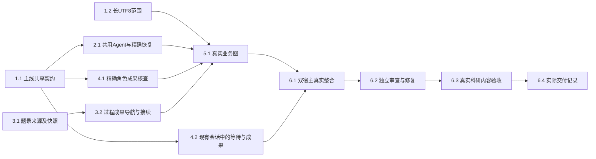

# 执行任务

## 1. 最小共同契约与真实文本范围

- [x] 1.1 主线在protocol的原GraphProgress增加可选有界contentReads／roleResults、精确消费namespace及registered Agent元数据，核旧记录仍通过原schema，真实页／章／文本片段不混作全文。构建及原契约／登记代表检查通过后提交并同步，才能派发消费者；本任务不表示生产恢复或科研交付已经完成。
- [x] 1.2 文献线独占resources.read的UTF8根因修复及必要窄底层，按design在8MiB字节范围内核原身份／basis、严格解码与真实offset／size／nextOffset，保留base64路径。沿resource-access扩独立已知长尾、多字节、非法／超限及续读变化代表；不修改Graph合同、保存、解析引擎或同源TaskLink。主线接收858c529→16857db，真实红2/2、绿15/15，独审无确证P1/P2；每次范围重读完整快照的IO限度见delivery。

## 2. 同一执行中的真实Agent节点

- [x] 2.1 Agent线实现宿主／worker共用装配、串行consumer与原config恢复门，普通Agent及registered同时消费；精确namespace和完整原上下文核对、累计覆盖引用事务、未确认adopted补ACK与成功task skip均经真实KernelApplication／worker／SQLite核查。原工具回执、ModelAccess／预算、取消／撤权、graphResume及未知效果保护不降低。主线接收813d87f→ce6bdda，并修复两项独审P2：新根落盘但ACK未提交的恢复、首条实际HumanMessage；四个真实窗口4/4及普通接续／压缩／累计／terminal四项4/4通过，双路复核关闭。本项不等于生产业务图或最终科研验收。

## 3. 文件任务与来源承接

- [x] 3.1 任务线增加library-source TaskLink及真实题录读取端口，含此类来源的输入使用v2快照，原v1继续可读；沿TaskGraphs／解析／原任务详情导航更新所有受影响调用方，核原source身份／version／revision与权限、不伪造附件Evidence。机械代表覆盖仅题录、后补真实附件及旧v1；不改会话projection或Agent装配。主线接收c1fb988→c7d97a8，并修复独审发现的真实受理窗口P1：题录guard延续到原harness事务前同步检查，三类真实竞态红绿及原准入保护通过，复核无确证P1/P2；具体结果见delivery。
- [x] 3.2 沿原TaskRef／工作项及CAS建立真实报告／过程导航，入口冲突或unknown保留研究文件，显式补链不重生成。任务线f86b152接为a16d0e3，作者真实worker五项及窄边界分别5/5、1/1，主线代表1/1，独立scope／导航9/9；最终Browser／Electron综合2/2核同任务新会话补材料、真实旧成果读取、原fileId更新、新旧快照及历史依据保留。业务图与共享装配的剩余恢复／科研及跨模块最终验收仍归5.1／6组，不由本项替代。

## 4. 可核查成果与现有会话呈现

- [x] 4.1 项目线消费1.1的roleResults，沿原FileEdit精确核after Evidence及project／session／run／instance，增加projects原artifact键单项查询的窄端口，科研交付分别核保存、run关联和当前读回。保留旧creation校准行为；以同fileId更新、人工后改、关联unknown／错run代表证明不按路径／同文／旧creation补绿。不得查询时save／reconcile；缺证据仍unknown。主线接收4da53e→cfb37a7，独审无确证P1/P2，整合构建及两项真实角色保存代表2/2通过；具体模拟边界见delivery。
- [x] 4.2 交互线沿原business-session／projection将当前真实Graph等待问题及成果入口呈现在同一Dock／Overlay，派生展示不伪造Message／Artifact／耗时或历史；普通composer继续原send，迟到旧run不盖新状态。先对齐并按需更新UI设计；复用task-graph-launch双宿主核问题可见、草稿保持、同run回复、成果打开及刷新不重复。主线接收4b7f4db→8e8c323，投影3/3及整合Task／会话双宿主4/4通过；仅当前快照，真实业务图及科研内容未随本项验收。

## 5. 内建项目文献综合业务

- [x] 5.1 生产scholoom.project-literature-synthesis@1已同源登记，实际准备／取材／综合／自查／独立保存／交付及真实等待复用共用Agent与领域工具。按实际ToolMessage形成有界正文范围，按精确FileEdit形成角色保存，判断及过程先落持久候选再写入。PDF页／章节／长文本、题录条件、渐进新增、预算与异常代表均有真实内部接线；独审发现的来源等待、消费恢复及两类保存问题已修复复核，20个不同内核代表的最近结果分次通过，具体首败／最新日志与替身见delivery。旧材料分析未迁入，受控模型不表示科研质量通过。

## 6. 整合与交付

- [x] 6.1 主线保全来源提交及顺序整合，最终双宿主共享组合6/6通过；补齐真实任务CAS竞争后部分成果可打开、普通composer同run补链且无新模型／报告重生成，以及人工UI保存human FileEdit／原beforeEvidence，综合尾项Browser＋真实Electron2/2通过（原120秒未放宽）。真实默认worker／broker／SQLite／文件／版本／过程／任务关系及原草稿／新会话接续已核，默认model-kernel诊断回归1/1；原旧材料分析未迁入。范围及首败见delivery，仅模型HTTP受控，不代表科研质量。
- [x] 6.2 独立gpt-6.1-sol／high分路核消费恢复、原材料与历史授权、保存归属及任务关系，结合既有取消／ModelAccess接缝结果和本次实际默认worker／SQLite故障探针；来源P2及累计三项恢复／保存P2均经定向红绿和原审查员复核关闭，限定范围无新增确证P1/P2。严格namespace／原config与未知效果保护保持，未将自查当独立审查。全队列故障、断电、科研质量及最终产品剩余边界不由本项外推，见delivery。
- [x] 6.3 经产品入口完成获授权真实样本的首次综合及补材料后的新会话续做；最终d703三来源科学稿completed／usable，独立C1–C3／C5及本run全文消费通过；普通产品Agent在人工事实反馈下完成C4过程范围及误录身份更正，独立复核确认C1–C5整体达到。报告及旧过程保持，新过程完整保留旧正文，任务仅更新现有过程链接basis；第一次校订失败及所有历史稿保留。实际模型MiniMax-M3.1-Flash／medium，7次独立校订请求及人工介入边界见delivery，不称原Graph自动自查成功。
- [x] 6.4 开发说明已更新共同600秒期限及精确等待恢复，同一delivery逐项对应六项完成判据、最终36/36等验证及科研独评，并明确Linux阶段、人工反馈、Windows／macOS、交互报告与CI边界。既有模块架构未改变，无新增架构声明或依赖；真实成果、失败历史、所有者停止及持久cache接续已核，不以CLI工件存在代替交付。

## 续做入口

按design的写入归属先完成1.1；源码、受影响产物及必要检查同步验证后再派发1.2／2.1／3.1／4.1／4.2。5.1等待真实共享consumer与任务／交付接口合入，不猜未来helper。其余未具备独立前置的树保留；不为占满七树重复测试。任务进度以本文件为准，执行证据写delivery及本轮持久cache，均不依赖/tmp。
