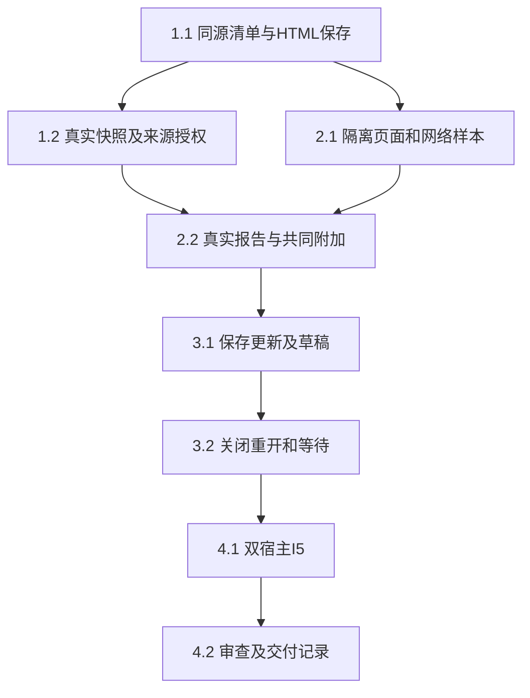

# 执行任务

当前27/27。Linux真实K/C/M/P、通用HTML／JS、原生呈现、产品三组双宿主验收及最终交付已接收，正式规格已同步。分层证据、原失败及平台／科研质量边界见[delivery](delivery.md)，实施决策和调查分别见design／investigation。

## 1. 同源报告及真实项目保存

- [x] 1.1a 本轮：protocol/report-contracts同源manifest／snapshot／桥schema及容量／跨字段校验，editor/report-codec有界头部解析和转义编码；必要protocol叶导出／架构声明，不注册操作、不扩ResourceRef。以独立固定样本验证格式、UTF-16／字节边界及额外字段拒绝；先构建再模块测试。
- [x] 1.1b 生产接入：UI设计报告分节、公开根导出及resources.report注册、HTML条件保存、派生映射；真实ManualApplication验证保存重开、同内容替换拒绝、只读目标和库权限不扩大。
- [x] 1.2a 本轮：editor/report-resources的注入窄端口ReportResources深模块，复用共同describe/read及相对路径解析；核对入口／依赖／来源、path-ref一致、前后basis、read/send、容量、撤权和混合版本拒绝。测试adapter可替换，不新建存储／DTO，手工粘贴来源不作完整溯源承诺。
- [x] 1.2b.1 已验收：真实项目／库授权Adapter及editor公开入口，Manual及普通根执行的报告describe/read和模型准入复用声明来源授权，经真实broker及所属存储验证queue／final／restart；target和旧报告历史沿1.2b.2b交付，委派沿1.2b.2a交付。
- [x] 1.2b.2a 本轮：从Delegations.resources提取唯一checkReadable，普通describe/read/document及报告入口／展开Evidence复用；成功展开的来源沿现有Evidence仓储按子实例保存，子模型queue／最终同步准入核查范围与领域read/send，session记录继续保护父及重启。真实父子worker／库／报告验证全部允许、缺项／旧basis／撤权拒绝、取消及恢复，不把声明核查记为实际正文read。
- [x] 1.2b.2b 目标报告及旧报告历史版本Adapter完成：历史使用可信FileEdit原正文／Evidence／path，整组返回前同步复核全部声明来源；原版本摘录进入受理末次及持久模型复查。单目标入口／依赖／来源只允许原目标内既有身份，不登记或扩大授权，库／第三项目来源拒绝；当前坏清单不阻断合法原版本。真实host指令受理及执行读取、历史跨段撤权和现有目标／委派竞争联合59/59；独审发现已修复复核，完整I5仍开放。

## 2. 页面内浏览与共同动作

- [x] 2.1a 调查原型已交付：tests/fixtures/report-frame专用候选模块及真实Browser／Electron静态夹具，消费实际ReportResources快照与有版本的资源字节，复用Bridge schema；合法脚本及清单资源、HTTP／UDP探针、CSP／父frame-src／导航／资源通道、宿主访问及有界桥生命周期已有代表性证据。两宿主实际STUN外发、Browser忙循环阻塞反例见delivery；本子项接收当时调查，正式承载沿2.1b验收。
- [x] 2.1b 正式Linux承载接收：沿独立platform提供者的原唯一准入、私有六操作与完整归属，实际K/C/M/P接通冻结字节、跨账户安装、通用Node、可信原生DOM及ReportView。新P的bootstrap／初始恢复／网络拒绝／忙循环停止均通过，持久停止与容量归零；新P产品、selection、lifecycle各双宿主2/2。输入／IME／读屏／分发按delivery各层证据限定接收，不将native样本或Module替身当作产品。

- [x] 2.1c 独立准备接缝：在现有provider内部沿同一真实ProcessAdmission租约，ready后才调用可信freeze准备回调，复用原记录／分片及失败收尾，不新增wire操作、第二次reserve或假assets。同实例重复准备合并，取消／撤权／失败及迟到结果不得启动或提前释放在途准备；创建OS范围前先持久原intent。实际ReportResources消费者与可替换OS端口独立验证，服务／浏览器仍不启用。
- [x] 2.1d 真实Linux准备接线：默认OS提供者与实际ReportResources.freeze经prepare完成真实字节／准入／启动／停止，覆盖满槽后延迟读取及冻结期间取消。复用已登记固定静态native探针及原policy，在自有scope验证持久intent、实际字节、完整停止及容量；不复制原17项原生矩阵，不启用服务／浏览器或改公共wire，前置不满足准确交回。
- [x] 2.1e T1安装前方案：基于已选可信账户模型及现有provider／唯一admission，形成固定native跨身份控制候选的最小安装文件／权限／请求与恢复接缝、验证及卸载方案。第21轮接收规划，独审发现的M观察视图及storageId格式矛盾经主线修正并复核关闭；当前草案入口见原研究。未安装、创建账户／策略或启动服务；方案不等于T1实际通过，系统部署仍须具体授权。
- [x] 2.2 实际文献对比页面支持筛选／排序／展开，已加载对象通过原子appendContextItems进入同一composer，用户检查正文后沿原session.send；核对objectIds、报告basis、明确来源、comment与接收者不变。超限整批拒绝保留草稿。真实安装product与selection分别双宿主2/2，R1摘录／basis在R2保留，20项、合并超过16项及未知对象整批拒绝且不执行；证据见delivery当前节。共享贡献及资源符号由主线整合。
- [x] 2.2a 独立共同增量：appendContextItems同步返回成功／失败，一次完整合并校验后单次写回，16项／64KiB或非法项整批拒绝且原草稿不变；原单项委托同一实现，失效接收者及往返切换旧回调拒绝。复用真实useBusinessSession／草稿与贡献测试，补图片夹具消费者，运行必要类型／构建及双宿主单项／迟到回执保护；独立审查整改后只关闭本子项，不据此关闭完整2.2／报告I5。
- [x] 2.2b 可信报告选择消费者：createReportContext捕获已核snapshot、视图／版本和原接收者，将实际对象、明确来源及comment原子交原共同草稿；关闭／往返失效、非法／未知／超限整批拒绝。主线消费者与共同贡献9/9、独审5/5及六组有界探针通过；只关闭独立模块，不声称真实资源授权、浏览器或I5接通。
- [x] 2.2c 可操作的可信模块夹具：在既有UI harness中以实际消费者、共同草稿及检查／编辑／移除入口承接固定文献对比样本的筛选／排序／展开和显式附加。实际内部草稿、版本／接收者和容量保持，client／来源快照与控制器替身明确；禁止执行任意报告脚本或新增产品工作台，不以夹具通过关闭完整2.2。

## 3. 完整更新、草稿与接续

- [x] 3.1 经真实harness保存新资源后条件发布HTML入口，范围订阅合并最新候选，完整验证后自动更新；有页面／composer草稿时保留原页提示，明确查看新版仍保留原显式项。真实安装product双宿主2/2覆盖worker保存、自动更新、草稿保护、显式换版与来源撤权；发布前失败、关联unknown、迟到候选与旧资源不可得沿已接收Module及真实worker回归，保留旧成果且不重放写入。证据见delivery当前节。
- [x] 3.1a 真实普通harness报告发布片：第20轮按第19轮design已允许的发布前失败分支接收正常多文件发布／并发条件冲突，真实worker、文件／清单与关联分别核实；不新增工具或发布wire。未验关联unknown显式转3.1c，不以本项关闭刷新／浏览器或完整3.1。
- [x] 3.1b 候选更新Module：沿真实ResourceEvidence／ReportSnapshot和实际授权加载端口，有界合并候选、拒绝迟到／坏版本／撤权；完整核查后无草稿可切换，有页面草稿或原显式项则保留原页及待看新版，明确查看新版不改共同草稿。仅metadata生命周期，不运行页面或拥有OS范围，不改共享ResourceView。
- [x] 3.1c 普通harness发布关联unknown：实际文件保存但关联未确认时，沿原run／实例／文件编辑及原查询核查，不重复写入、创建或自动重放；真实worker／仓储与受控外部模型，仅在原保存关联seam故障注入，复用3.1a。第21轮主线接收实际关联INSERT失败→原pending保留→artifacts.reconcile补关联，文件／编辑／原身份及旧报告保持；不以UI提示或自然语言回答代替磁盘与关联事实。
- [x] 3.1d 真实client更新适配：绑定当前入口身份，经原KernelClient的describe／resources.report和范围通知驱动已交付更新module；忽略不相关事件、合并粗粒度核查，真实来源撤权／重连／换配置／关闭令旧结果失效。第21轮接收，旧页独有来源复核、可读依赖basis前进及订阅异常隔离均有代表证据。不扫描项目／全库、不假取消已发RPC；活连接串行不扩大为断线后远端handler已结清，不新增公共端口或页面运行。
- [x] 3.2 按窗口／配置／报告版本保存有界浏览状态和草稿，关闭／重开核对身份权限及原版本不可得提示；工作台关闭不取消普通已受理执行，调试内核仍按原生命周期退出。真实安装product／lifecycle分别双宿主2/2覆盖准确原版恢复、新会话取材及关窗后保存，固定registered图的原run／wait／instruction保持，实际ready不推进，合法共同composer发送才接续；普通内核重启及撤权沿真实reconnection2/2。不可得资格沿已接收Module／内核回归。证据见delivery当前节。
- [x] 3.2a 有界报告状态保管：复用原drafts及既有桥JSON／64KiB限制，按可信配置／窗口／项目入口身份／basis读写原browse／draft／dirty；只读取准确key，损坏／超限／错版本可辨，不迁草稿到新版、不另建存储。独立测试真实适配，内存降级不说磁盘可靠保存。
- [x] 3.2b 真实registered图报告接续片：固定测试Graph沿真实保存／等待／checkpoint与重启，重连及读取报告不消费等待，合法新session.send才继续；新会话能从实际报告及明确来源读回接续。只验机械链路，无生产业务Graph／真实模型或科研质量，不以单内核例关闭双宿主。
- [x] 3.2c 可信模块汇合夹具：同一固定文献对比页真实消费updates／report-drafts／report-context及共同session草稿／检查器，核新版保护／显式切换、关闭重开状态、旧动作失效及完整restore封套64KiB拒绝保留草稿。第21轮主线双宿主4/4接收；client／来源授权仍是明确替身，后续真实接线沿原3.2继续，不启用任意报告脚本、不关闭产品3.2／I5。
- [x] 3.2d 原版本恢复资格Module：原ReportResources增加reviewHistorical，可信原FileEdit描述／正文确定完整原集合，独立核当前read／相应access与稳定ref，再复用严格historical；仅在前后资格均获肯定时区分完整available和字节unavailable，未知／撤权／坏清单及无关错误不批准copyOnly。主线42460c2模块36例＋真实Manual/历史3例共39/39，独审无确证P1/P2；不新增公共RPC／历史缓存、渲染接线或假完整快照。主线另行接真实文件权威与内核，完整3.2／I5保持开放。

## 4. 整合与交付

- [x] 4.1 主线报告I5接收：真实报告／库来源／共同composer／broker／harness worker／保存／刷新，新P产品、selection、lifecycle三组Browser／真实Electron共6/6，所属内核实际stopped。模型仅外部HTTP受控，无真实API；本轮runtime／view／K控制／保存／契约52/52，类型、协议生成及架构通过，Linux目录包及真实包preload smoke通过。普通HTML／PDF双宿主4/4沿既有CSP回归，分层边界及历史失败保留在delivery。
- [x] 4.2 页面隔离、来源授权、发布、并发、草稿、系统更新与最终证据经独审及问题复核接收；开发说明更新实际安装与可用条件，UI设计与真实路径一致，初设改为正式规格引用。两份delta已同步，delivery记录新P系统与双宿主结果、独审、历史失败及平台／科研质量边界，strict验证通过；按实际结果完成交付。

## 收口状态

Linux阶段行为已通过真实系统及双宿主产品验收，4.1／4.2最终接收完成，正式契约见openspec/specs。Windows验证后置，macOS受管能力明确不可用；所有未验范围和历史失败保留在delivery，不以本轮结果扩展为完整Web平台或科研质量保证。
