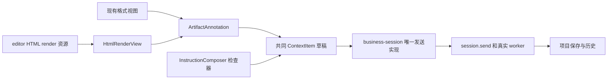
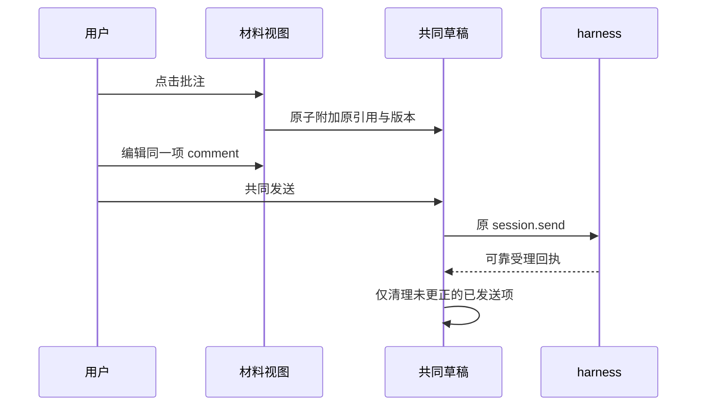

# 实现设计

## 变更总览

## 方案与接口

复用当前 ContextItem 和 schema，不新增 RPC 或持久库。ArtifactAnnotation 以明确点击绑定新的 itemId；显示该 item 的共同 comment，关闭保留，移除沿原方法。旧编辑器只操作捕获的接收者及 itemId；焦点移动清除实时选择而不影响已附加快照。使用已有语义样式与可访问控件，覆盖键盘操作。

business-session 将发送核心提为同一函数，普通正文和仅批注入口共用。WorkbenchSession／ContextContribution 仅增加工作台内的 sendAnnotations 回调及可用状态；共同按钮和快捷键在正文空白时调用。相同禁用条件覆盖连接、信任、配置、归档及待核查；发送瞬间捕获原项，重用 instructionId 与确认清理。

editor/runtime 的 savedRender 接受 PDF／HTML，描述返回真实格式；基于同一输出 basis 读取。ResourceView 按已加载 descriptor 分派，RenderPane 和共同打开复用 HtmlRenderView。静态 iframe 使用 allow-same-origin，绝不授予 allow-scripts；现有 renderedHtml 清理与 CSP 保留并补齐实际探针发现。父宿主仅监听本 frame，复用提取至 content-selection 的有界 Range 摘录，跨 realm 用所属 DOM 类型。产物选择不写源码 location。

RenderPane 区分最新 job 与当前展示 output；有相关共同项或 dirty 时暂存最新完整候选并提供查看新版，失败仍沿 lastSuccess，异步回执按产物身份丢弃。只读权限核查和资源释放由视图复用既有端口。

## 文件变化

- 新 ArtifactAnnotation.tsx：共同批注编辑器；改 FileEditor、PDF／Document／Image reader、InstructionComposer 消费。
- 改 business-session、session、ContextContribution、Workbench 与共同发送控件：仅批注发送，不重复可靠受理。
- 改 editor/runtime 和其原测试：HTML render 提供者；改 ResourceView、RenderPane、render-output；新 HtmlRenderView.tsx。
- editor/resources 的受管 Quarto 配置显式声明本次 render 输入，避免隐藏配置目录导致输入发现为空；真实 HTML 整合同时覆盖。
- 改 content-selection、MarkdownPreview：提取有界摘录并复用，保持原公式／表格行为。
- 扩展 material-interactions、context-bridge、render-materials 与 editor-runtime 定向测试；必要新静态 HTML 组件测试使用既有 harness。
- 更新 UI 设计先于界面实施；开发说明记录实际入口，清理“批注和差异全未接入”的过时概述。无计划删除业务文件。

## 验证与风险

主 Agent 负责发送、frame 权限、更新保护和真实整合；有界辅助实现负责本地编辑器及 HTML 提供者，写入集合互斥。独立审查核对接收者、数据保护、资源身份与静态 frame。

复用静态双宿主测试配置，隔离所有库／项目及端口，不启动日常开发服务，不依赖 /tmp。模型在 HTTP 边界受控，内部 worker、broker、存储和历史真实。核对仅批注与空材料、迟到回执、对象／区域载荷、HTML 原依据、重开、撤权、淘汰、编译失败／草稿新版及安全探针。类型、必要构建、架构及 OpenSpec 通过后交付；科研质量、三平台分发和活动脚本报告不在本变更验收内。
