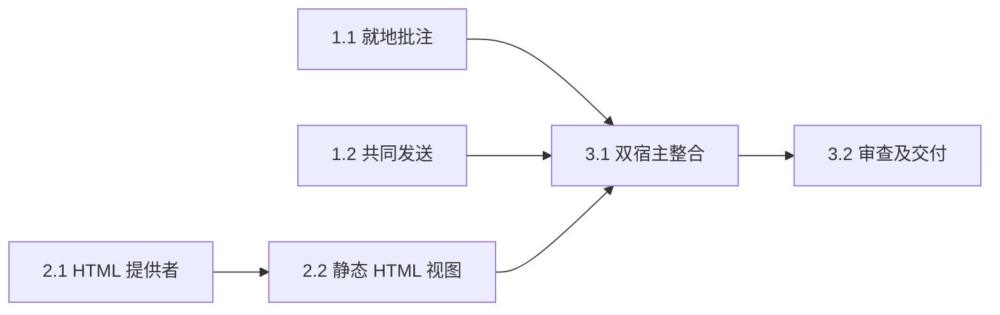

# 执行任务

## 1. 材料旁共同批注

- [x] 1.1 实现共享 ArtifactAnnotation 与现有格式入口／检查器同步，保护当次快照、接收者及容量；扩展原 material-interactions 的对象与区域发送验证。辅助 Agent 仅拥有该组件、各 reader、project-ui、InstructionComposer 的检查器和 material-interactions；发送控件由主 Agent 整合。
- [x] 1.2 复用唯一发送实现接入仅批注发送，主 Agent 拥有 business-session、session、ContextContribution、Workbench 及共同发送控件；扩展 context-bridge 核对空材料、仅批注、禁用状态、迟到确认与会话切换。

## 2. 静态 HTML 排版选择

- [x] 2.1 editor/runtime 支持真实 HTML render 描述、字节及解析；辅助 Agent 仅拥有 runtime 与其定向内核测试，验证依据、只读、撤权及失效，保持 PDF 回归。
- [x] 2.2 主 Agent 实现 HtmlRenderView、共享 Range 摘录、共同资源格式分派及 RenderPane 完整候选／草稿保护；真实 HTML 选区、来源、重新打开及安全探针通过。

## 3. 整合与交付

- [x] 3.1 主 Agent 在真实 Browser／Electron 工作台验收文字、结构对象、图片区域与 HTML 链，覆盖实际发送／修改／历史、旧产物草稿／新版／失败、权限和迟到回执；完成必要类型、构建、架构、OpenSpec 检查及实际开发入口更新。
- [x] 3.2 独立审查 frame 权限、来源依据、接收者、保存与草稿保护，处理发现；实际执行后获取 delivery 指引填写同一 delivery.md，核对本批范围和未验边界。
