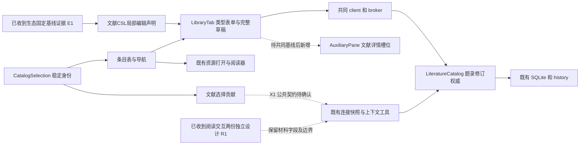
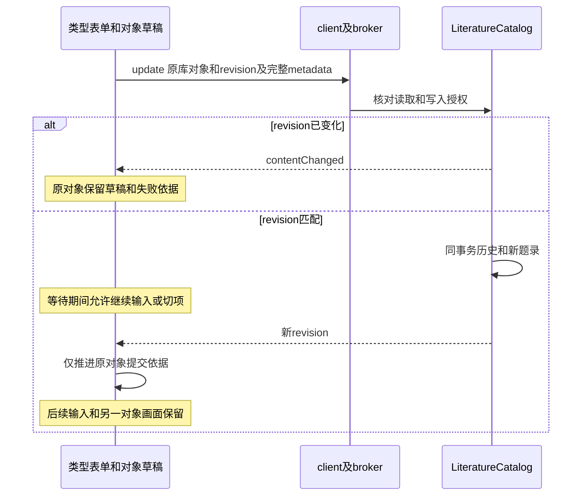

# 实现设计

## 2026-10-26 实施范围更新

用户已选定独立catalogSelection贡献及本线完整公共提供者。下面X1审查稿现作为实施依据：同源叶DTO、可选快照及确认结果、真实library有界核对、宿主broker装配、harness实际库追踪和三类模型准入／恢复核查，随后UI贡献。未同步b838402时不改写公共基线；本树对旧共同代码做有界增量，临时隔离组合核对新公共符号。生态和项目私有源码不拷入，本树接入验收仍待用户同步。验证先构建，真实SQLite／ManualApplication／KernelApplication与受控模型边界，不用无注册叶声明代替。模型外发复查不能只留在工具调用处。

## 变更总览

本设计对应 B 批，依据见 [proposal](proposal.md)、[investigation](investigation.md)。**E1调查和R1两份设计已正式消费；X1按A交审查稿，真实公共提供者尚未接入。** 排序沿B列配置／F查询排序边界。本轮授权CSL局部编辑和公共方案准备，实际结果见delivery；候选不表示已发布。



## 方案与接口

### 本轮闭合的CSL局部编辑范围

已正式消费主线快照，精确路径、版本和有损边界见investigation的“第二阶段交接”。本轮在4.1／4.2内只实现原生CSL草稿的局部编辑，不把40个Zotero类型反向推断为当前对象类型。产品目录明确提供32种CSL类型值、已核对的直接文本字段、author／editor／translator／container-author四组姓名，以及四类日期的literal表达；目录是源码中的编辑能力声明，不是上游调查JSON或迁入映射。未知类型／字段／姓名属性保留；非字符串文本、复杂日期和未支持姓名形状仍通过完整JSON检查与编辑。类型切换隐藏不适用控件，保留对应值。

姓名按CSL角色数组保存组内顺序，调整角色只移动完整姓名对象，不拆中文名、不丢粒子及扩展属性；不宣称恢复Zotero跨角色orderIndex。日期只修改已有literal或新建literal，不解析raw／date-parts／季节／时区。Extra、note、citation-key、固定状态及来源身份不进入类型化控件。现有完整JSON路径保留其原契约，不增加插件写入入口。没有新增持久化字段、数据迁移或正式键提供者。

这些是可独立接受的4.1a／4.2a子任务；完整4.1／4.2在原始字段及来源身份的公共契约形成前保持未完成。额外权威由独立公共OpenSpec规划承接，不能用本次CSL目录声称生态E1—E3运行提供者已经就绪。

### 1. 深层模块和唯一事实源

- `LiteratureCatalog` 继续掌握题录、修订、历史、集合和授权；GUI／Agent 经相同 schema／broker。字段修改仍提交完整 metadata，不改成隐式服务端合并，也不引入第二个题录表或迁移整库。
- CSL编辑目录在 `packages/protocol/src/library-metadata.ts` 维护一次，由 `library.ts` 导出，UI消费可编辑类型、直接文本字段、姓名角色和literal日期声明。它不收紧领域开放metadata校验、不定义原Zotero逆映射；现有领域仍负责完整对象、16KiB及授权／修订校验。Zotero数字ID、原包SQL和对象适配留生态私有实现，完整共同原值／来源／键权威见独立规划。
- `CatalogSelection` 是列表选择 module：interface 只接受身份、当前可见顺序和用户动作，隐藏主选、锚点及范围重建；调用方不再同步维护另一套行号状态。React 使用同一不可变快照驱动行、详情和贡献，避免 class 内变更但视图不刷新。
- library UI 的选择、查询、草稿和列偏好由按实际库身份及窗口隔离的状态承接。独立增量复用现有draft存储，导航、当前查询范围的选择／滚动和列偏好分别按范围读取，不加载所有历史范围；`LibraryTab`先取得实际库身份再装配该状态，tab重开按原身份恢复。选择模型通过React订阅公开同一快照。右栏接线后消费同一对象状态，不复制保存入口；当前无需新增公共provider。
- 可替换 seam 已存在于 client、ContextContribution 和宿主装配，不新增通用框架。领域独立测试用真实库；UI 状态测试可替换 client。最终接线使用真实内部提供者。

### 2. 类型编辑和条件保存

类型表单与高级 JSON 共用一个 `metadataText`／解析后的完整对象草稿；JSON 无效时保留文本，阻止类型控件提交，不用上次合法对象覆盖坏草稿。字段改动从完整对象复制，仅设置或显式删除目标字段。创建者改动只触及目标角色和元素，保留未编辑属性，顺序是数组顺序；角色、姓名形状和日期表达以 E1 确认的映射为准。未知类型和值可检查，现有开放 metadata 不改为会排斥既有合法记录的全量封闭枚举。

手动建项继续走 `library.ingest`，沿原 batchId／origin／version；更正继续 `library.update{sourceId,revision,metadata,tags,collectionIds,relatedIds}`。返回 `LibrarySource.revision` 是提交成功依据，列表／详情不另推测保存成功。字段校验不能越过原16KiB／DOI／授权保护。正式引用键和来源身份不从 UI 临时拼接；若 E1 要求新增数据，先补本 change 的精确 delta 或按职责另拆，不预设迁移。

草稿键在已取得 `library.status.id` 后使用配置目录、工作台实例、实际库id和sourceId；复用 `context-drafts.ts` 的 `workbenchInstanceId()`，不另建窗口身份。已完成2.2的窗口隔离；旧配置路径＋sourceId键保留，身份核对后提供显式恢复，不覆盖已有新草稿。未知库身份时不恢复到其他库。回执捕获提交的库／对象／revision／快照；成功只推进对应对象，失败也保存到对应对象。显式重读需确认丢弃；通知不丢dirty数据。



### 3. 稳定选择、集合与列（本线可独立部分）

选择快照的内部语义为 `{libraryId, primaryId?, selectedIds, anchorId?}`，sourceId 是领域 UUID，非 CSL `metadata.id`、DOI 或行序。主选是最后明确选中的对象；取消主选时取当前可见顺序中第一个仍选中身份，无剩余则为空。Shift 只选择当前已加载页的身份范围；锚点不在当前页时从本次目标开始。Ctrl／Cmd全选只选当前页，保留键盘及菜单替代，不定义新全局快捷键。

查询键含库 id、集合／搜索／标签及页位置；当前页最多100个选择，全部按身份存储。范围刷新以已载入结果与原选择求交，详情跟随重建后的主选；不按行号恢复、不为隐藏选择查遍全库。切页／筛选的新范围不含原选项时清除当前贡献但保留草稿；按导航键保留先前选择／滚动，返回并取得该范围后再按当前页核对。tab 卸载保留 library 状态，连接切换到不同实际库时隔离。

集合树复用 `library.collections`，建议在文献契约增加父范围查询：`parentId: null` 表示根，具体 id 表示其直接子项，不指定则原有扁平查询；仍用 offset／limit／nextOffset（默认25、上限100）。展开只请求该父级当前页，叶节点由该范围的空结果确认，保留“继续加载”入口。`saveCollection` 继续负责身份与循环规则。库通知只使当前根页、展开分支及题录页失效，不自动遍历所有分支。现有集合创建和多归属更正保留；C批的拖放／删除／批量组织不在此实现。

列偏好按实际库和工作台保存，复用当前题名、作者、年份、版本和附件登记列的显示／顺序／宽度，题名保持可见。宽度使用可访问调整控件和已有语义尺寸，虚拟行只处理当前页；不为列值逐行拉正文或全部详情。**排序留F查询批，本批只交列显示／顺序／宽度，保留服务端默认updatedAt顺序**；新增按列排序未经范围确认不实施。

### 4. 提供／消费接口和字段语义

| Interface／事实源 | 提供者 → 消费者 | 本批使用及失败语义 |
| --- | --- | --- |
| `library.status`／`LibraryStatus` | library → UI／宿主 | id为当前实际库；revision为库失效通知依据，不替代 source.revision。授权 read／write／send分别检查。 |
| `library.list/get/update/ingest/history`／`protocol/library.ts` | library → GUI、Agent | list分页结果和nextOffset是实际范围；source.id稳定、revision用于更正、metadata开放、version为发表版本、origins为来源信息。过期拒绝contentChanged；权限和不存在沿原错误码。 |
| `library.collections/saveCollection` | library → UI／Agent | 增加上述父范围读取；parentId是集合父身份，非项目归属。保存及循环拒绝保持原权威。 |
| CSL局部编辑声明 | 文献 → UI；生态可只读参考 | 32种CSL类型、直接文本、四姓名角色和literal日期；不提供40原类型逆映射／原角色顺序，不向插件公布数字ID。原值、来源、键权威仍未提供。 |
| 当前题录贡献（X1候选） | 文献UI → 共同上下文 → harness | 实际libraryId、viewId、primarySourceId、sourceId与观测revision集合；题录修订不冒充materialVersionId。包含可用范围、变更结果；实际读题录仍走领域授权。 |
| `ResourceRef`／`onOpenResource` | library → 共同阅读 | 仅真实附件id＋材料版本；题录选择不触发正文读取。可读、缺失、变化仍由原提供者判断。 |
| 右栏文献详情槽位 | library状态拥有者 → shell | 可选ReactNode／纯视图入口，shell只负责页签及显隐，不访问库仓储；具体符号与其他线交接。 |

### 5. X1 需要确认的公共契约选项

**推荐 A：在现有快照增加独立的题录选择贡献**，复用连接、来源、receiver和工具，文献域提供类型化 `libraryId/sourceId/observedRevision`，主选单列；当前页最多100条，仍受有界字节预算，超限明确失败。显式ContextItem保留16项预算及材料语义。宿主给 `ContextBridge` 注入窄题录授权／核对端口，经broker到library；模型准入及恢复复用已有 libraryUsed 追踪，不因当前未读正文而绕过send核查。确切schema、字段名、可观察的过期结果和实现拥有者需由提供者确认，再补齐公共delta；以上不是已发布DTO。

**B：把题录加入共同对象／资源引用联合。** 优点是复用现有证据授权管线；代价是 ResourceAccess、ContextItem、内容编码和恢复的全部分支都要承认“题录不是字节材料”，并解决100／16容量差异。若阅读线已形成能表达题录的共同对象契约，评估复用该方案，不另建竞争联合。

不选独立“最后选择”库工具或独立窗口关联；它们会复制可信来源和生命周期。A／B都不允许伪造附件、只读首项、全局最近窗口或由快照授予权限。X1没有确认前，公共schema与跨域接线任务保持受阻；本线不能把 `packages/harness`／kernel 的改动当作已授权所有权。

### 6. UI 与阅读交互边界

沿[UI设计](../../../docs/ui-design/README.md#文献管理设计方向)：中间 library tab 为可折叠集合导航＋条目表；现有管理表单仍是同一个限高区域。右侧 `AuxiliaryPane` 增加文献详情页签，复用 `CatalogItemPane` 的题录／附件／标签／关联分区；多选只显示选择数量、主选及可用查看入口，不暗示已实现批量更正。收起右栏保留草稿和主选，不新增第四区。既有附件／共同阅读入口原样接入，不重建正文编辑器。

控件继续使用现有 btn、pane、表单和虚拟列表；状态、字号、圆角和间距引用 `styles.css` 语义token。仅在确有新语义时补浅／深两套映射。重命名可访问名同步现有双宿主用例；不得为了“像表格”静态断言HTML／CSS。错误贴近原对象，全局批次沿现有状态接口，不增加内部方案说明到产品界面。

已正式读取快照内两份design及ContextItem同源增量（精确路径见investigation），分别核对：

| 阅读change | 本线提供／消费 | 独立性与等待 |
| --- | --- | --- |
| `add-material-annotation-interactions` | 提供真实库附件／版本和题录权威；消费共同上下文贡献、输入框与格式视图。 | 选区／批注／差异和材料修订归阅读及所属保存权威，不进入本批；相关写回仍等生态调查。X1须核对该设计。 |
| `add-interactive-research-reports` | 可消费题录身份及明确读取，选择动作仍进共同输入框。 | 报告运行隔离、筛选／更新／关闭重开由阅读线另一change独立承接；本批不等待报告交付，不建报告执行记录。 |

本线只提出文献详情槽位，当前项目快照实际仅提供taskNavigator，没有已发布library槽位。项目任务页签、通用对象选择及差异组件不代定；不把两个阅读change合并进B批。

## 文件变化

以下为实施文件范围；受阻公共分支仍是候选，实际改动及验证见delivery。

| 文件／符号 | 动作和拥有者 |
| --- | --- |
| `packages/protocol/src/library.ts`、候选新 `library-metadata.ts` | 文献线：父范围collections、E1闭合后的类型／字段同源声明和DTO导出；保留开放metadata。 |
| `packages/library/src/catalog.ts` `collections`／相关校验 | 文献线：按父范围有界查询，复用update事务和历史；只补确需的字段规则，不重写摄取。无已知必需数据库迁移，E1若改变此结论先回到规划。 |
| `workbench/library/CatalogSelection.ts`、`CatalogItemList.tsx`、`CatalogItemRow.tsx` | 文献线：身份快照、可观察多选、列配置、焦点／范围和虚拟列表。替换旧索引调整方法前搜索全部调用方，删除无用行号补丁。 |
| 同目录 `LibraryTab.tsx`、`LibraryToolbar.tsx`、`CatalogItemPane.tsx`、`CatalogItemSidenav.tsx`、`library.css` | 文献线：复用管理入口，拆出类型表单、集合导航和单一状态拥有者；草稿及对象错误、右栏详情。候选新增 `CatalogItemForm.tsx`／`CollectionNavigation.tsx`／`LibraryController.tsx`，按实际内聚职责落文件，不预建空壳。 |
| `workbench/drafts.ts` | 复用现有存储入口；库身份键和恢复逻辑尽量留library目录，不修改其他领域草稿语义。 |
| `Workbench.tsx` 活动视图／`AuxiliaryPane`装配；`business-session.tsx` library装配；`session.ts`可选详情入口；`shell/AuxiliaryPane.tsx`文献页签 | 必要公共增量由文献线提出具体符号；R1先交接，独立可接收增量不能依赖私有未入dev实现。其余项目／任务／会话路径归各线。 |
| `protocol/workbench-context-contracts.ts`、`context-contributions.tsx`、`harness/instruction-context.ts`／runtime工具、`kernel/application.ts`上下文装配 | **X1候选公共增量，未获得跨线定案**；按A／B选择落实最小变动。现有连接store、可信来源与发布生命周期复用。 |
| protocol生成映射、`architecture.json`及宿主注册 | 仅当已定接口确需变更时由提供者一起交付。映射通过 `generate:contracts` 生成，不手写第二套DTO；不为UI内部状态加broker操作。 |
| `tests/kernel/literature-catalog.spec.ts`、`manual-application.spec.ts`、相关context用例；`tests/ui/library.spec.ts`、`context-bridge.spec.ts` | 文献增量随所属实现扩展，公共上下文修改由其提供者同步调用方及测试。只有稳定行为缺口才新增选择模型小测试。 |
| `docs/ui-design/README.md` 文献设计／本地题录库分节、`docs/development.md`本地文献库／上下文节 | 实施时先更新UI事实源再改结构；把“JSON为主／tab内两栏”和已完成A批仍写“后续接线”的漂移改为当前状态，其他段落仅引用；本轮不修改正式文档。 |

## 验证与风险

### X1精确公共delta（审查稿，未发布／未接线）

按A保留现有连接来源、receiver、viewId、revision、selectedItems、selections全部语义。只在`WorkbenchContextSnapshot`及`ContextSelection`增加可选`catalogSelection`；它不生成ContextItem，不进入显式草稿或session.send载荷。`selectedItems`继续只指向`selections.itemId`，题录ID不复制到该数组。材料16项及快照64KiB限制保持，题录另有100项上限；编码后超过64KiB整次发布拒绝并清除旧实时快照，不截断、不读全库凑范围。

```ts
type CatalogSelection = {
  libraryId: string;                         // 实际LibraryStatus.id
  range: { query: string; collectionId: string | null; tag: string;
    offset: number; limit: number };          // query<=200/tag<=100，offset安全非负，1<=limit<=100
  primarySourceId: string | null;
  items: { sourceId: string; observedRevision: number }[]; // 0..100，身份唯一
};
type VerifiedCatalogSelection = {
  libraryId: string; libraryRevision: number;
  items: { sourceId: string; observedRevision: number;
    currentRevision: number; state: 'current' | 'changed' }[];
};
```

ID沿现有id字符串限额，revision／offset必须安全整数。主选为空当且仅当items空，否则必须属于items；items顺序保留UI选择顺序，primary单列，数量不得超过range.limit；range描述已加载查询范围，不能表达“全库全部命中已选”。UI发布前按当前已载入身份求交，范围切换／断线沿原移除机制。附件只通过已有selections中实际取得的ResourceRef/basis贡献；不为题录查询首附件、不声称附件齐全、不推断可读。无附件题录照常贡献。

`workbench.context.read`的available结果增加可选`catalog: VerifiedCatalogSelection`；snapshot保留原观察修订，currentRevision另列，changed不自动重绑用户要求。不能确定用户意图时沿原契约询问／等待；元数据正文仍通过library.get明确读取。本次结果只返回身份、修订和范围，不复制100份metadata或正文。

建议新增内部同源只读`library.selection`：输入`{libraryId,items}`，结果`VerifiedCatalogSelection`，waitMs=5000。文献提供者先检查实际库身份、read/send及可信执行上下文，再有界读取source.id/revision，最后再次检查权限；不扫描附件／材料，不提供写入权。库身份不符返回instanceMismatch，无对象返回notFound，撤权permissionDenied；缺提供者unavailable。任何一项失败则整个工具响应失败，不静默过滤成部分成功；当前没有删除记录提供者，不能把notFound解释成已删除或恢复。

ContextBridge新增窄catalog端口`read(input)`及同步`check(libraryId)`，由宿主以真实broker／library能力装配，不能由renderer提供回调身份。readInstructionContext只消费原指令可信来源；核对材料后再核对catalog，全部成功才返回。成功前记入harness所属会话meta的`catalog-library-context:<sessionId>`实际libraryId，并保留原`library-context`已用标记；本产品单共同库实例不允许悄悄改成新库身份。普通Agent／registered Graph／能力子执行在模型准入前、排队后及最终同步检查均调用catalog.check核对原库身份及当前read/send和有效实例；恢复仍读取此记录，不能靠只有题录身份、没有正文而跳过外发检查。历史观察修订不作为永久版本锁，当前读取及更正继续用真实领域依据。

| 独立增量／提供者 | 拥有文件／符号 | 消费者与顺序 |
| --- | --- | --- |
| X1a 文献同源声明 | 新候选`protocol/catalog-selection.ts`，library内部`library.selection`、workbench快照可选字段；原schema保持单源 | 先审查DTO和权限语义；生成映射重生，不复制调查JSON。候选补丁不等于已发布。 |
| X1b 文献领域与宿主 | `LiteratureCatalog`有界revision核对，`manual.ts`内部注册、`application.ts`ContextBridge装配，`architecture.json`消费声明 | 依赖X1a，经真实broker验证；不依赖本线私有UI或生态HostCatalog。 |
| X1c harness共同消费 | `instruction-context.ts`、`runtime.ts`的read_workbench_context、三类模型准入及所属meta追踪 | 依赖X1a／b；保留Agent委派、科研历史注册、阅读位置编码和全部原工具，按符号合并。 |
| X1d 文献UI贡献 | `ContextSelection`／Provider的catalog可选项及空材料时发布条件、LibraryTab、Workbench活动library条件 | 依赖X1a／b／c；保留活动resource和项目快照的活动task条件，以及R1未来appendContextItems。关闭／切换仅更新所属view。 |

最小验证：空选、无附件、17／100／101项、重复ID、非法主选、安全整数、64KiB；旧材料快照和R1位置字段同时可用；真实库revision变化、跨库身份、撤权、断线／多窗口；在模型队列及最终同步检查之间撤权／换库无HTTP请求；重启不借其他来源。只有X1a候选结构校验可在本轮独立运行，其余必须随真实提供者进入共同基线后验收。报告的appendContextItems与题录100项独立，不取消16项原子附加上限。

### R1及右栏符号接入设计

R1实际快照的位置增量保持：text.location引用readingLocationSchema，region.target的image／pdf／object，object.contentState；contextItemContent的对应编码同步保留。报告仍只规划，不把其resources.report／appendContextItems当已存在端口。M1／M2／M3保持所属领域等待，本线CSL编辑不解决库正文写回。

先接入项目快照实际`AuxiliaryPaneProps.taskNavigator`、TaskList和协议TaskSummary，保留Workbench的taskPort、taskRevision、taskWatchError、taskDraftKey、taskCreation、associateTask、resolveResource、renderTask及taskNavigation迟到保护。随后仅加文献自己的`libraryInspector?: ReactNode`到WorkbenchSession与AuxiliaryPaneProps，TabId加library并在辅助区并列内容分支呈现。Workbench把同一library状态拥有者的Inspector送入该槽位；session.library继续是中间tab，不能重复挂载LibraryTab作详情。详情状态需提升为库拥有的单一实例后才接线；本轮不改这些公共符号。

项目变更接入→X1贡献公共增量接入→用户同步本树→文献Inspector接线，是符号依赖顺序，不表示B批必须等待完整任务业务。UI夹具按符号合并：保留本线openWorkbenchWindow和desktops登记，同时保留项目createSession的`string | {projectId:string}`签名及按项目定位／data-session-id等待；不采用整文件覆盖。

最小验证随任务分支执行，不先跑全仓。环境准备先核对Node24、依赖与构建；本轮已获锁定依赖安装及必要验证授权。根脚本的 `test:ui` 会执行setup，验证直接使用已准备的Playwright CLI。UI夹具只启动其拥有的隔离测试宿主，不启动日常开发实例；测试期间不重建或改动共享产物。

| 增量 | 最小入口／预期 |
| --- | --- |
| 身份选择与列 | 小型表驱动选择测试（若无现成入口才新增）；扩展library双宿主，在重排、页边界、筛选、返回导航和tab卸载后比较真实UUID／主选；可访问键盘操作和列偏好重载。 |
| 类型编辑及库读取 | 扩展literature-catalog、manual-application：E1独立样本的角色／字段、未知嵌套保留、原revision冲突和重启读回；父范围分页。不是用实现输出生成oracle。 |
| 草稿竞态 | 复用library UI用例：保存中继续输入、切项迟到成功／失败、断线／刷新／撤权；RPC gate拦截发送不能代替服务端已提交回执丢失，后者沿真实代理／提供者交付边界注入。 |
| X1真实接线 | 扩展context-query／context-resources／workbench-context及context-bridge：无附件题录、17和100条、主选、当前修订变化、多窗口、断线、跨库身份拒绝、send撤回及模型排队后再检查。外部模型用原受控HTTP，内部库／broker／worker真实。 |
| 保护既有能力 | 复用attachments、resource-opening、resource-lifecycle定向双宿主，核对浏览不读正文及原附件身份／草稿；不把D批阅读专项纳入。 |
| 构建／契约 | 按受影响分支运行 `pnpm --config.optimisticRepeatInstall=false typecheck`、`pnpm check:architecture`、lint、build；公共schema变动再执行现有生成器self-test及映射一致性检查。通过后不无理由扩大回归。 |

双宿主示例入口（**未执行**）：`SCHOOLOOM_UI_PORT=5721 SCHOOLOOM_UI_DATA_DIR=<本轮新建隔离目录> xvfb-run -a node node_modules/@playwright/test/cli.js test --config playwright.ui.config.ts tests/ui/library.spec.ts tests/ui/context-bridge.spec.ts --workers=1`。预留5721–5729作为本线候选测试范围，运行前核对占用，不声称已向其他树预约。库、项目、输出及日志全部隔离，仅停止本轮拥有进程，测试期间不重建共享产物。

诊断沿既有库状态、history、batch、工具收据、run／instance及UI错误，记录库／source／revision、查询范围和请求归属，区分发送、受理、提交和刷新。调查中的文献Windows用例实施前做阶段诊断，材料／上下文接续失败由实际提供者核对并交接；公共worker问题交提供者独立处理，未诊断不得改超时。本地Linux通过不关闭Windows或真实Mac／分发验收；macOS只验人工题录及已声明降级。

独立验收路径：从产品入口在合成真实库收录 → 类型化更正未知字段样本 → 集合和列导航／多选 → 同会话实际工具查询变化后的选择 → 重启读回。人工路径无需模型或harness；工具路径真实harness但受控模型。B批不等待任务模型、业务Graph、报告、完整生态宿主；需要的公共选择端口必须真实，替身通过不能关闭该整合任务。关键权限、并发和草稿保护安排独立只读审查，最终接受仍由本线主Agent完成。

## 待办边界

- **真正阻塞**：X1候选的公共审查、真实library／host／harness提供者和共同基线同步；右栏槽位尚未接入。E1／R1调查已收到，不能再以缺设计为由等待。原值／来源／正式键／原子提交的三个政策问题由`define-library-zotero-record-authority`承接，完整4.1／4.2仍开放。
- P1沿原B/F分批闭合为本批列配置、F统一查询排序；没有新增排序实施。若将来确认B要按列排序，另补服务端契约、稳定次序与跨页oracle，不在本轮扩展。
- C负责组织／附件及批量动作，D负责笔记与共用阅读，E回收合并，F搜索／排序，G引用格式，生态负责H提供者。正式引用键归文献域，但本批只保证不损坏既有信息；不顺带确定存储和生成。
