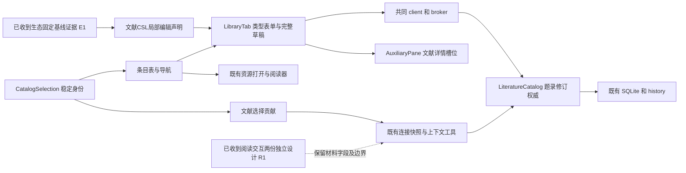
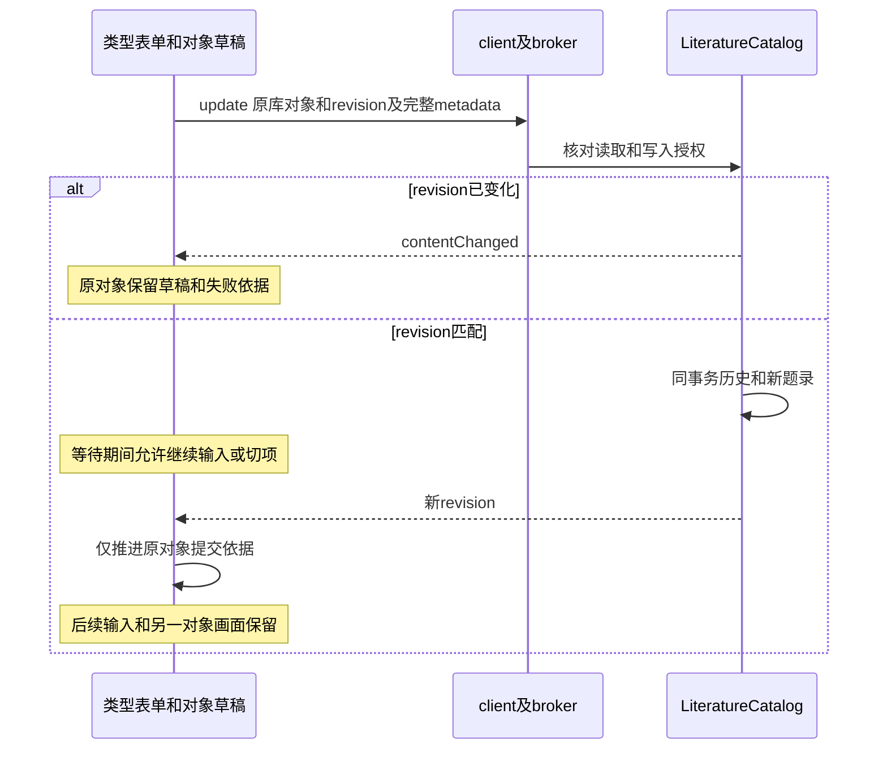

# 实现设计

## 29cd728后的6.1 Linux业务整合子片

开工时本树HEAD29cd7283388dfd752911eacb9c3bf8416031db15且clean。仅扩`tests/ui/context-bridge.spec.ts`既有题录选择场景，复用已交付组件、现有createDevelopmentKernel及startModelKernel，不改本轮项目独占fixture.ts、Agent独占model-kernel.ts／execution-diagnostics。先人工入口导入含未知嵌套的独立CSL样本→已有字段／数字日期／circa类型化更正→集合归属及导航→列配置→关闭内核并重启读回；人工结果在模型准入前独立核对并记录。重启经现有development bootstrap启动真实CLI内核、附着owner，不用普通独立CLI实例冒充开发宿主可接管实例；不改变产品启动或锁归属契约。

随后复用原外部模型夹具，只发read_workbench_context及library_get工具调用；library_get身份由真实上一次上下文工具结果取得，不注入结果或UI选择。原17项题录与显式材料独立预算保持，使用实际列表键盘范围选择；先在第二页获得真实上下文工具回执，再返回选择已更正对象读取最新上下文及library_get，发送仍沿原会话。第二次模型响应仅在外部边界用显式promise门等待选择提交，不替代内部工具或回执。工具完成后关闭model内核并经同一既有development入口重启，核同库、同来源身份、完整metadata、集合、列及原会话三条完整工具回执；工具id／runId／input／output／状态均比较，不能只保留名称即通过。仅模型HTTP响应受控，仓储／客户端／工具／worker／文件真实。

日期oracle沿既有固定CSL官方两端样本1987-08-03／2003-10-23及circa=1，预期静态核对，未知嵌套为显式合成保留样本。不新增字段映射或产品政策；4.1／4.2精确剩余由本轮只读核查写investigation／tasks。只复用当前已验构建，结果／profile／TMPDIR均在本轮.cache独立根；有共同harness缺口则保留人工子验收和准确阶段，不改共享夹具或逐项加时限。

## 938c33f后的5.4a真实进程消费者

主线已选定并同步A，当前源码938c33f且开工前clean；配置不再等待方案。本片仅修改原`tests/ui/zotero-original.spec.ts`及原工件，复用现有构建，不改共享helper／生产CLI／UI组件。

准备阶段用真实KernelApplication建立隔离共同库／期刊／键并核默认缺配置拒绝；关闭准备app后调用`startIsolatedKernel(profile, configuration)`。全部后续断言改用返回client的真实RPC；原记录／历史读取随当前client更新，不重新打开已关闭的准备仓储。既有bootstrap代理保持相同origin，只转交当前helper实际endpoint；每次新endpoint重新安装原传输门，不创建第二个server／provider／launcher。

已提交题名回执丢失与未送达请求分别保存本地冻结pending及dirty CSL；调用helper.stop（绑定原instanceId）并等待自有exited，再向同一库显式注入同一原包配置启动新进程。核PID／runtime instanceId更换、实际libraryId不变，原窗口／origin不变，reload后pending的identity／revision／requestId／title不变。前者只读查committed、后者只读查notFound且仍待核查；原值／正式键／历史及CSL旧保存依据不变，传输观察不得出现额外replaceTitle。

缺配置在准备app真实核unavailable；当前进程查询错误libraryId及撤read分别拒绝，不作notFound。最后用错误绑定配置真实再启动一进程，GUI对原pending查询必须显示unavailable并保留冻结请求；对错配实例的匹配请求另核instanceMismatch。所有操作仍经原权威，不代写回执。场景继续原90秒预算，不改生产期限，若出现未闭合阶段先保留首个失败再诊断。

已有shared／desktop／host构建由主线在本树同步复验，本片只改测试无需重建。最小验证为tools类型及Biome、原单个zotero-original双宿主场景（真实Linux受管Electron／BBT9.0.68原包）；不重跑14UI或旧macOS列表。停止仍等待自身child退出、CLI status核对，不能使用重新发现的CLI stop。A只证明可信测试父每次显式注入的serveKernel进程路径，B标准CLI持久恢复继续未提供。

## 第十轮主线：测试侧可信进程提供者

主线选择并交付下述A的测试侧边界：`tests/isolated-kernel.ts::startIsolatedKernel(directory, configuration)`及私有IPC入口`tests/fixtures/isolated-kernel-process.mjs`。调用者先准备并关闭隔离库，每次启动显式传同一IsolatedZotero；子进程调用真实serveKernel，父端核ready对应自身PID并持有development owner。返回实际endpoint、client、child、exited及stop，不增加生产配置或协议。

停止沿原owner.shutdown绑定instanceId，等待自有child close，再以CLI status核对。原建议中的CLI stop会重新发现当前实例，存在停止接替者的竞态，因此本夹具不调用它；不修改CLI行为或声称已验证其预期实例控制。未知时保留配置、不清锁或自动重试；准备阶段失败只处理自身fork的child。窄测试已核三次真实进程、库身份、notFound、错误绑定与旧句柄不停止接替实例；没有运行原包或GUI。5.4a的下一步是文献消费者使用该提供者，完成下述两宿主真实原包及冻结请求恢复，尚不能勾选。

普通CLI持久受控配置B仍未设计或交付。以下为4312262时提出的候选依据，A的实际停止路径以上述实现为准。

## 4312262后的重启接线调查

本轮当前路径和源码证据见investigation首节：UI夹具直接注入Application／KernelServer；serveKernel有可信构造参数，普通CLI start／serve及bootstrap没有isolatedZotero配置加载／传递。**不能满足本轮条件实施分支，停止在此方案。** 原单条GUI及页面重载保持已接收，不用它们代表内核进程重启保证。

需主线确认的是验收入口及共享配置归属，不是新的题名／导出产品政策：

| 候选 | 最小提供者／写集 | 可以证明与限制 |
| --- | --- | --- |
| A：仅测试侧可信serveKernel进程入口（建议） | 建议共同工程／计算生命周期维护者提供`tests/fixtures/isolated-kernel-process.ts`一类测试入口；生态核对现有IsolatedZotero配置和原包路径，文献只消费夹具扩展原GUI场景。所有文件名为建议，当前未新增。 | 使用现有serveKernel、真实运行锁／endpoint及独立Node进程，CLI status／stop真实；不新增普通产品配置。重启由同一可信测试父进程重新注入配置，**不证明标准CLI start持久恢复配置**。 |
| B：标准CLI start也恢复受控隔离配置 | 主线另定有界公共配置增量，生命周期／bootstrap／CLI共同拥有加载／传播；生态负责可接受宿主配置及包约束，文献仍只消费。 | 才能证明普通CLI启动配置恢复；必须先定配置的创建／读取权限、绑定／失效及撤销机制，范围超过本线当前授权。不能只加任意路径／JSON／环境开关或从metadata读取。 |

推荐A承接本轮仅测试目标；若主线要求验收必须从标准CLI start发起，应先交付B的公共契约，不能将A的结果改称B。两者均未发布／接入，本轮不替共同工程定案。

### A的最小可审查接法

1. 配置只由可信测试父进程创建并持有，复用现有IsolatedZotero类型`{libraryId, executable, args, packageDirectory}`，不新增协议DTO或第二配置权威。原包／可执行入口沿既有固定BBT夹具和已有依赖解析；库、包、profile及工作台origin均在本轮隔离根下。先用共同库API完成样本／来源／固定键准备并关闭准备app，取得真实libraryId；不得复制真实库、用来源副本或原operation.json自报授权。
2. 新测试进程入口仅调用已有`serveKernel(canonicalProfile, {development:true, isolatedZotero:trustedConfig})`，无新KernelServer或provider。测试父进程通过私有IPC发送自身构造的配置；入口不成为生产CLI选项／renderer可见配置。重启时仍由父进程显式提供同一固定配置，拒绝实际libraryId不匹配；生产无配置仍unavailable，read／write／send及受管执行能力仍由现有领域检查。
3. 复用既有运行锁、发现、状态／stop和开发owner。静态UI启动前先确认配置内核ready并由父进程持有开发owner，再让原Browser／Electron和静态bootstrap附着同目录。停止时用真实CLI stop并等待原进程退出／锁释放，再启动新进程；若unknown／停止未确认则停在核查，不清锁、不补启动或加时限。新instanceId／PID与旧进程退出分别记证；原libraryId／来源identity及同一工作台origin保持。此入口需要共同工程认可后才能创建，不在当前树私自实现。
4. 文献消费者只复用现有CatalogOriginalActions、drafts、zotero.result与单一CSL草稿，不改业务源码来适配假配置。保持工作台窗口／origin稳定，页面reload重新引导当前实际endpoint；不把关闭新建窗口后的新工作台身份当同一草稿恢复保证。

### 提供者具备后才执行的最小验证

先共同／宿主／桌面构建，再冻结产物，扩展原zotero-original场景，不重跑无关14UI：

- 在实际库原值更正已提交后丢失真实回执，保存冻结identity／revision／requestId及未保存CSL。真实CLI stop→确认完整退出→可信入口重建原配置进程→同origin工作台reload；只调用原zotero.result得到committed，题名／其他原值／键及历史无重复，CSL草稿／旧保存依据不变。
- 原请求未送达同样跨重启查询notFound，继续保留pending且不重放；另核缺配置／库不匹配或read撤销时拒绝，不能把unavailable当notFound。模型无需参与，broker／SQLite／文件／锁／子进程和原包真实，传输门仅控制送达／回执丢失。
- 两宿主使用同一真实CLI／serveKernel进程路径。收尾只停自有执行，结果目录内登记项目保留至配置退役；safe诊断仅记录阶段、实例／PID、授权与稳定结果，不输出token或bootstrap正文。原包仍限已验Linux，macOS不可用和其他平台目标边界不放宽。

未实施的文件／符号：上述测试进程提供者、现有CLI／bootstrap的可选配置契约（仅B需要）、原GUI重启场景。库权威／zotero协议／结果语义／生产期限不属于本片写集。主线确认提供者／入口、交付并同步后才解除5.4a；本轮无新增行为，所以不改变delta规格。

## 0b78815后的滚动提交边界与单条原值消费者

本树共同源码0b788151b5e17665a26d9286dfd1d12f6e2e0c30且开工前clean，前片已接收并同步。先处理macOS原失败：原日志旧:683实际断言scrollTop返回200，不是列宽。代码先同步设置scrollTop后立即读属性，未等待原生scroll触发虚拟列表更新／偏好保存。验证先观察当前可见列表及其虚拟行提交，再保留原分页返回的精确滚动断言；不改生产数值、超时或加sleep。当前同一基线新CI的macOS步骤已通过，不能据此声称改动前稳定复现或新改动已在macOS通过。

第一步写集仅tests/ui/library.spec.ts及本change调查／任务／交付；复用既有虚拟列表及滚动拥有者，不提前更改生产布局。

无阻塞问题，基于已定D1—D3及本树真实接口，第二步限单条所选且唯一可映射schema44期刊原值：

- 新增库内CatalogOriginalActions，由同一LibraryContents传入scope、libraryId、主选sourceId／revision、当前单选及read／write状态；在原CatalogItemPane题录分节内增加“原值与导出”折叠区。不复制CSL草稿、选择或提交台账；只有原值题名输入与冻结的待核查请求按既有draftKey／readDraft／writeDraft保存，跨卸载占用复用librarySaves。
- 用户点击核对才调用zotero.inspect，sources只有当前sourceId／已保存revision。展示返回的已保存CSL及完整原值、identity三字段、revision，题名equal／different及其余notComparable。不会从未保存CSL猜原值或从capabilities推断宿主可用。无配置／未支持原值沿真实unavailable错误；多选不开放此动作。
- 独立题名输入保留准确字符串，不trim、不转换、不改其他原值／键。点击预览后显示原题名／新题名、身份和修订；再点提交才调用zotero.replaceTitle，仅携带libraryId／requestId／sourceId／revision／identity／title。输入／核对结果变化使预览失效。提交成功只刷新权威投影，不保存、丢弃或推进既有dirty CSL草稿依据；其随后保存仍通过原CAS冲突及明确重读流程。
- expression仅在用户勾选“采用所示原值导出”后构造，格式限现有bibtex／biblatex。输出仅来自exported.text，selectionRequired不显示文本并重新展示核对材料；题名相同仍明确确认，因为其他属性不可比较。旧修订／身份不继续导出；格式／选择／修订／连接变化清除确认和旧输出。导出文本只读，首片不新增磁盘路径／批量操作。
- 请求发出前持久化原requestId及完整题名请求。提交期间防重复；真实committed／rejected回执才解除pending。contentChanged明确保留题名及CSL草稿、要求重核；失联／outcomeUnknown等不明结果保留pending，只开放zotero.result只读核查，不自动重放。notFound仍不能证明安全重试。迟到查询／响应仅更新原scope对象的同requestId，旧选择不会覆盖新对象；核对／导出的异步响应还核当前选择依据代次，离开再返回不让旧文本重新出现。损坏的操作草稿只显示核查错误，不覆写原文或导致工作台崩溃。
- 可信配置使用既有KernelApplication构造注入及tests/ui/task-graph-launch.spec.ts的双宿主真实startKernelServer／本机bootstrap代理模式：测试端传isolatedZotero，产品renderer及内部broker／SQLite／受管原包真实；静态承载仍用已有构建，无生产开关、私有API或provider替身。该模式不覆盖serveKernel运行锁／CLI重启，不能声称恢复可信配置；页面重载仅重连原真实服务。仅Linux与现有本地BBT9.0.68原包运行真实导出，不回退macOS执行限制。

第二步写集：库内新组件、LibraryTab对应贡献、既有library测试与新增zotero-original双宿主测试，以及原change／UI设计／开发文献节。协议／存储／生态监督及其他装配不改。关键验收为单选／明确expression、准确title及其他值／键保持、dirty CSL保护与CAS冲突、真实回执丢失后跨重载只查询不重放；外部模型无需介入，传输门仅控制并发／真实回执丢失。

## 8a2f0ce后的数字日期区间与circa子片（已接收）

2026-10-27本树为8a2f0ce522dfbab4110e63e84e542f6660e6115e且初始clean。沿已接收4.1c／4.2c、5.3与唯一表单／JSON草稿，只交4.1d／4.2d，不改报告授权、生态外发P1、来源原值或原有工作台装配。当前CLI进度20/25不是本片未通过或整个change完成的依据。

独立证据为CSL schema／specification v1.0.2与官方processor-tests固定blob：date_Uncertain的circa=1，date_TextFormFulldateYearRange的[[1987,8,3],[2003,10,23]]，数字字符串混用与[0]开放端点样本另行保留。schema允许每端1—3分量、最多2端，分量可以字符串／数值，circa可以字符串／数值／布尔；本片只支持原正整数分量范围，不把schema允许的全部表达宣称为已支持。citeproc-js 1.4.61的is-uncertain-date按circa真值判断，闭合布尔和0／1；字符串“0”不能当false，不做通用字符串转换。证据位于`/tmp/scholoom-library-date-round7/`，仅为标准／样本调查，不是Zotero宿主或引用排版验收。

日期规则及边界：

- 唯一共享编辑声明新增catalogEditorNumericDate，包含2端上限、年1—9999／月1—12／日1—31、已支持circa值及已知复杂属性；library.ts只补其导出，不修改开放metadata schema。catalogDateParts改为返回所有端点，编辑helper追加可选endpoint=0，原单端调用不变；所有调用点和测试一起更新。
- 每端精度独立，年／年月／年月日均为连续前缀。只改指定端点／分量，深复制被修改的端点并复制日期对象，保留其余端点、circa及未知属性；不解释历法、不补分量、不排序或交换端点。无效整数／范围、跳过前缀、中间清空、带结束端点时清空唯一起始年均拒绝，原metadata保持。原有非公历、season、raw、literal与数字并存的日期仍只读；未知扩展不主动解释且原样保留。
- 增加结束年才创建第二端点，不猜填结束值，不生成空端点。尾部清空只缩减该端精度；移除结束日期是明确动作。只删除最后数字时仍保留其他日期属性，只有显式“清除日期”才删除整个日期对象；无date-parts剩余的属性对象继续JSON核查。
- circa以未指定／约略／非约略呈现。布尔或0／1可改，既有数值类型在显式切换时保持0／1；新标记使用布尔值。未改circa时不得归一化。未知circa字符串／其他值保持只读及JSON核查，不妨碍单独更正已知数字属性；season／raw／calendar等已知含义未定日期整体不开放数字控件。literal沿原已有字段编辑路径，不解析原文或自动转数字日期。
- UI仍为CatalogItemForm：起始端沿原年月日可访问名，结束日期以原生details按需展开，已含区间时可检查两端；加circa选择及明确移除结束动作。无效输入显示就地错误并保持原JSON，不另存日期草稿或保存状态；浏览器number输入badInput不当成用户清空。

写集：protocol/library-metadata与library.ts必要导出、catalog-metadata、CatalogItemForm、LibraryTab详情表单的sourceId key及既有catalog／library测试、原change和文献设计／开发分节。该key只隔离表单临时错误／展开偏好，不另存对象草稿。先更新UI文档，再补RED及实现；先共享／桌面构建，后冻结产物跑helper／真实保存、冲突与重启、library双宿主关键表单及右栏／迟到回归。完整4.1／4.2、Windows任务不关闭；未同步的生态原值题名／导出选择API不复制、不接假UI。

## 4b13183后的原生CSL剩余编辑子片

2026-10-27本树HEAD为4b13183f7489d3cae12fd0a7d1a9e83fb33d7384且初始clean；5.3及生态持续外发授权P1已由主线接收，证据`/tmp/scholoom-round6-acceptance-dXuzCA/acceptance.md`，本轮不修改这些路径。完整4.1／4.2继续开放，只实施4.1c／4.2c。

固定schema44及utilities源码已从原始commit只读取得，版本仍为70c3aa98627413d6a30dca955886eafbde085ce9／1dd38e27edf81e9d9c4161c957b7efb7f5681ac3。Utilities.itemToCSLJSON明确跳过shortTitle输出、使用title-short；姓名按角色分组，name／fieldMode=1单名进入literal，其他姓名保留family／given，主角色无显式映射时才投影author；日期含原字符串解析、季节及accessDate时区处理。这些转换并不可逆。本轮不导入其反向类型选择、日期解析或Extra处理。

无阻塞问题，基于“只更正CSL目标属性、原值独立保留、不推断反向映射”闭合：

- 唯一library-metadata目录增加9个直接字符串控件：call-number、collection-title、dimensions、event-title、genre、medium、references、section、title-short；新增host角色用于broadcast／motion_picture。文本共44字段、角色共22；32种类型不变。其适用集合来自固定itemTypes／baseField投影并集，表示CSL编辑能力，不标识原Zotero类型。
- 补齐现有container-title／publisher／publisher-place／volume／issue／page／ISBN／ISSN／edition／event-place的已知类型适用范围，保留所有原可编辑范围，不收窄开放metadata。event-place纳入上游audioRecording／presentation／videoRecording的place特例；publisher-place不因该特例给song／speech新增逆映射。新增控件只改自己的CSL键，例如genre不改metadata.type，title-short不覆盖既有shortTitle，references不改relatedIds。
- CatalogItemForm继续通用消费同一目录；机构／单名沿既有literal，个人只填family也不猜拆given，角色移动／排序沿原helper移动完整姓名对象。将既有“添加机构”可见名明确为“添加机构／单名”，可访问名沿原入口。literal与family／given并存时沿既有分支只局部改literal、保留其余属性，不做姓名表达转换；非字符串或未知形状保留原值与JSON核查。
- 复杂日期、raw／season／circa／范围、跨角色原始顺序、Extra原行、正式键及来源保持原权威。本轮不增加日期转换／编辑分支。shortTitle历史别名不自动回填或归一化，原有值仍在完整JSON中核查；只明确编辑标准title-short。

写集：protocol/library-metadata、CatalogItemForm的上述标签、既有catalog-metadata／literature-catalog及library测试、原change调查／设计／delta／tasks／delivery及必要文献UI分节。无新provider、schema、迁移、保存台账或右栏状态。上游4个独立样本以未修改converter执行核对，只有schema字段／角色查询为隔离facade；不是Zotero宿主或生态生产接入，证据`/tmp/scholoom-library-metadata-round6/upstream-oracle.json`。测试用独立静态预期，不从新声明生成oracle。

最小验证：声明适用范围RED→共享及桌面构建→helper／真实库保存、修订冲突及重启核查→library双宿主关键表单、单一右栏／跨组及迟到草稿。测试期间冻结产物，使用静态UI与隔离profile。最新CI基线40315429083的Windows四个文献集成失败仍在执行状态观察／权限收尾边界，无本域提交失败证据，不改生产时限；精确调查写investigation，目标平台任务不关闭。

## 共同基线1026796后的5.3实施切片

在1026796阶段，七域源码、X1、原值权威和已支持编辑声明均已入dev。证据为`/tmp/scholoom-round5-acceptance-WBreMJ/{acceptance.md,synchronized.json}`，不再应用旧累计补丁或等待同步。5.3实际依赖1.2、2.2、3.2及4.1a／b、4.2a／b；4.1／4.2随后补齐a–d的授权范围，当前具体覆盖与保留边界见investigation首节。

唯一文献状态拥有者仍为LibraryContents，保留CatalogSelection、完整JSON草稿、librarySaves及原保存函数。新增库内`library-details.tsx`的窄视图贡献：每个business-session实例持有一个贡献对象，仅发布ReactNode及带身份核对的释放函数；LibraryContents以生命周期发布原CatalogItemPane，右栏消费者订阅该派生视图。贡献不保存metadata／草稿副本，不查询DOM、不读取仓储；卸载拥有者时释放自己的视图，过期释放不清除新贡献。详情从中间区移出，同一时刻只挂载一次。

business-session只新增对应贡献实例及`libraryDetails`可选ReactNode，并将同一贡献传给LibraryTab；session.ts增加该字段。Workbench把libraryDetails传给AuxiliaryPane，并持有辅助页签选择以在折叠／展开后保留；openTab仅对library跨组复用已有tab，防止拆分后重复挂载两个拥有者，保留原flush及overlay收起流程。原taskNavigator、TaskPanel、programs、资源与上下文装配不改。AuxiliaryPane增加“文献详情”页签，保留文件／材料／任务。详情显示当前页已选数量／主选，复用原题录／标签／关联／附件及JSON核查；字段不支持形状仍保留，不新增映射。300px右栏页签以横排标签折行，不压成纵排。

写集：上述库内贡献、LibraryTab、library.css；business-session/session/Workbench/AuxiliaryPane对应符号；既有library/context-bridge/resource-opening相关测试；本文、tasks、delivery及文献UI／开发分节。无protocol操作、数据迁移或runtime修改，生成映射只读核对。回归先构建再冻结产物，复用静态UI承载及隔离profile；关键场景覆盖多选／主选、收展、切项目／会话、关闭重开、冲突／迟到草稿、共同附件入口和按主选有界读取。现有内核与字段证据复用，不重做X1或完整映射。

## round4 B批编辑子范围（历史设计与证据）

主线`/tmp/scholoom-round4-acceptance-JCUBNw/acceptance.md`已接收本树X1及原值／来源／正式键／原子事务首片，确认0519904已消费。分页超帧疑虑已由512KiB listPage反例撤回，不修改分页。当前未提交成果全部保留，不再同步或重复开发X1。

无阻塞问题，基于“只编辑CSL自身可表达值、来源原值由library权威保持、既有CSL行为不回退”实施以下子范围：

- 类型仍为已核对的32个CSL值；40个Zotero类型的多对一原类型保存在library.originals，表单不新增逆向选择器或猜类型。新增20个一一文本字段：archive、archive_location、source、authority、chapter-number、collection-number、event-place、journalAbbreviation、license、number、number-of-pages、number-of-volumes、original-publisher、original-publisher-place、part-number、part-title、PMID、PMCID、scale、status。
- 新增17个声明上唯一的CSL角色：chair、performer（castMember）、composer、contributor、director、executive-producer、guest、interviewer、narrator、original-author、organizer、producer、recipient、reviewed-author、series-creator、collection-editor、script-writer。原四角色不收窄；新增角色按固定itemTypes可证明的CSL类型集合呈现，不适用的既有值只读保留。此集合只表示至少一个来源类型支持，不反推broadcast／motion_picture等来源原类型；原生performer等未声明角色不猜转author。
- 四个日期键保留literal原文编辑，增加**只有date-parts单一属性、一个端点、1至3个正整数（年1—9999、月1—12、日1—31）**的直接年月日编辑。只操作CSL数字，不解析日期原文、时区、季节或历法；非公历及其他语义需完整JSON表达。空日期可明确选择原文或年月日，已有值不自动转换格式。仅尾部日期精度可清除，整日期可明确清除；不因清月份丢弃既有日。范围、raw、circa、season、未知附属属性及不支持形状保持可核查和JSON入口。

唯一编辑声明仍是`protocol/library-metadata.ts`，35个文本字段与21角色；`CatalogItemForm`仍由它投影，完整JSON是唯一对象草稿，`catalog-metadata.ts`仅承接有界局部更正／日期数字操作。原值／来源／固定键不进入表单写入载荷，保存继续原ingest／update与revision，不增加迁移、依赖或新接口。新增类型适用集合是显示能力，不收紧开放metadata。

文件／符号：扩展上述3文件的声明、角色呈现及日期控件；扩展原catalog-metadata、literature-catalog和library UI测试；同步本文、investigation、适用delta、tasks／delivery及开发／文献UI分节。不改library-records权威、公共X1、项目私有右栏或C—I。使用已构建静态UI承载，参考本线交接包ui.config及既有static-ui.mjs；先构建后测试，运行时不重建。

验证：独立上游形态样本先核对book出版社／页数、journal PMID、film director／castMember、patent filingDate；实际回归选取book→journal手动录入、字段／角色／日期更正与真实库保存／重启，未知嵌套、复杂姓名粒子／日期和library.record原值／来源／固定键保持。film／patent只作声明取证，不声称另有运行样本。复用既有冲突／迟到草稿双宿主回归。未闭合的别名call-number／collection-title／dimensions／event-title／genre／medium／references／section、shortTitle双输出、Extra及正式键转换仅保留，不写逆转换；主线决定或精确utilities样本到达后才安排该分支，不影响本次可编辑CSL范围。

## round3／4实施范围更新（历史）

当前正式HEAD70be8bf，0519904祖先，原成果未提交且完整保留。主线已验收X1同源声明、真实library／broker／host、harness恢复与模型准入、UI及原值权威首片；没有新增公共源码需要同步。新补丁进入dev及其他消费者仍需主线接入，本树不重复等待既有基线。

独立catalogSelection贡献已实现：同源叶DTO、可选快照及确认结果、真实library有界核对、宿主broker装配、harness实际库追踪、三类模型准入／恢复及UI贡献。实际结果见delivery；生态和项目私有源码不拷入。模型外发复查覆盖排队后与最终同步边界，不能只留在工具入口。

## 变更总览

本设计对应B批，依据见[proposal](proposal.md)、[investigation](investigation.md)。E1调查、R1设计及共同基线已消费；X1与原值／来源／键权威首片已在dev和本树1026796，不能据此宣称生态完整生产消费。排序沿B列配置／F查询排序，本轮消费实际AuxiliaryPane实施详情。



## 方案与接口

### 已交付的初始CSL局部编辑范围

已正式消费主线快照，精确路径、版本和有损边界见investigation的“第二阶段交接”。本轮在4.1／4.2内只实现原生CSL草稿的局部编辑，不把40个Zotero类型反向推断为当前对象类型。产品目录明确提供32种CSL类型值、已核对的直接文本字段、author／editor／translator／container-author四组姓名，以及四类日期的literal表达；目录是源码中的编辑能力声明，不是上游调查JSON或迁入映射。未知类型／字段／姓名属性保留；非字符串文本、复杂日期和未支持姓名形状仍通过完整JSON检查与编辑。类型切换隐藏不适用控件，保留对应值。

姓名按CSL角色数组保存组内顺序，调整角色只移动完整姓名对象，不拆中文名、不丢粒子及扩展属性；不宣称恢复Zotero跨角色orderIndex。日期只修改已有literal或新建literal，不解析raw／date-parts／季节／时区。Extra、note、citation-key、固定状态及来源身份不进入类型化控件。现有完整JSON路径保留其原契约，不增加插件写入入口。没有新增持久化字段、数据迁移或正式键提供者。

这些是已交付4.1a／4.2a子任务；本轮新增范围见首节4.1b／4.2b。原始字段、来源及键权威已由独立change交付首片，生态实际消费仍未就绪，不能把CSL编辑目录当生态逆向映射。

### 1. 深层模块和唯一事实源

- `LiteratureCatalog` 继续掌握题录、修订、历史、集合和授权；GUI／Agent 经相同 schema／broker。字段修改仍提交完整 metadata，不改成隐式服务端合并，也不引入第二个题录表或迁移整库。
- CSL编辑目录在 `packages/protocol/src/library-metadata.ts` 维护一次，由 `library.ts` 导出，UI消费可编辑类型、直接文本字段、姓名角色和日期键声明；本轮扩展见首节。它不收紧领域开放metadata校验、不定义原Zotero逆映射；现有领域仍负责完整对象、16KiB及授权／修订校验。Zotero数字ID、原包SQL和对象适配留生态私有实现，共同原值／来源／键权威由独立change提供首片。
- `CatalogSelection` 是列表选择 module：interface 只接受身份、当前可见顺序和用户动作，隐藏主选、锚点及范围重建；调用方不再同步维护另一套行号状态。React 使用同一不可变快照驱动行、详情和贡献，避免 class 内变更但视图不刷新。
- library UI 的选择、查询、草稿和列偏好由按实际库身份及窗口隔离的状态承接。独立增量复用现有draft存储，导航、当前查询范围的选择／滚动和列偏好分别按范围读取，不加载所有历史范围；`LibraryTab`先取得实际库身份再装配该状态，tab重开按原身份恢复。选择模型通过React订阅公开同一快照。右栏接线后消费同一对象状态，不复制保存入口；当前无需新增公共provider。
- 可替换 seam 已存在于 client、ContextContribution 和宿主装配，不新增通用框架。领域独立测试用真实库；UI 状态测试可替换 client。最终接线使用真实内部提供者。

### 2. 类型编辑和条件保存

类型表单与高级 JSON 共用一个 `metadataText`／解析后的完整对象草稿；JSON 无效时保留文本，阻止类型控件提交，不用上次合法对象覆盖坏草稿。字段改动从完整对象复制，仅设置或显式删除目标字段。创建者改动只触及目标角色和元素，保留未编辑属性，顺序是数组顺序；角色、姓名形状和日期表达以 E1 确认的映射为准。未知类型和值可检查，现有开放 metadata 不改为会排斥既有合法记录的全量封闭枚举。

手动建项继续走 `library.ingest`，沿原 batchId／origin／version；更正继续 `library.update{sourceId,revision,metadata,tags,collectionIds,relatedIds}`。返回 `LibrarySource.revision` 是提交成功依据，列表／详情不另推测保存成功。字段校验不能越过原16KiB／DOI／授权保护。正式引用键和来源身份不从 UI 临时拼接，现由`define-library-zotero-record-authority`的library.record／commitRecords提供；本轮只核对CSL更正不改变该权威。

草稿键在已取得 `library.status.id` 后使用配置目录、工作台实例、实际库id和sourceId；复用 `context-drafts.ts` 的 `workbenchInstanceId()`，不另建窗口身份。已完成2.2的窗口隔离；旧配置路径＋sourceId键保留，身份核对后提供显式恢复，不覆盖已有新草稿。未知库身份时不恢复到其他库。回执捕获提交的库／对象／revision／快照；成功只推进对应对象，失败也保存到对应对象。显式重读需确认丢弃；通知不丢dirty数据。



### 3. 稳定选择、集合与列（本线可独立部分）

选择快照的内部语义为 `{libraryId, primaryId?, selectedIds, anchorId?}`，sourceId 是领域 UUID，非 CSL `metadata.id`、DOI 或行序。主选是最后明确选中的对象；取消主选时取当前可见顺序中第一个仍选中身份，无剩余则为空。Shift 只选择当前已加载页的身份范围；锚点不在当前页时从本次目标开始。Ctrl／Cmd全选只选当前页，保留键盘及菜单替代，不定义新全局快捷键。

查询键含库 id、集合／搜索／标签及页位置；当前页最多100个选择，全部按身份存储。范围刷新以已载入结果与原选择求交，详情跟随重建后的主选；不按行号恢复、不为隐藏选择查遍全库。切页／筛选的新范围不含原选项时清除当前贡献但保留草稿；按导航键保留先前选择／滚动，返回并取得该范围后再按当前页核对。tab 卸载保留 library 状态，连接切换到不同实际库时隔离。

集合树复用 `library.collections`，建议在文献契约增加父范围查询：`parentId: null` 表示根，具体 id 表示其直接子项，不指定则原有扁平查询；仍用 offset／limit／nextOffset（默认25、上限100）。展开只请求该父级当前页，叶节点由该范围的空结果确认，保留“继续加载”入口。`saveCollection` 继续负责身份与循环规则。库通知只使当前根页、展开分支及题录页失效，不自动遍历所有分支。现有集合创建和多归属更正保留；C批的拖放／删除／批量组织不在此实现。

列偏好按实际库和工作台保存，复用当前题名、作者、年份、版本和附件登记列的显示／顺序／宽度，题名保持可见。宽度使用可访问调整控件和已有语义尺寸，虚拟行只处理当前页；不为列值逐行拉正文或全部详情。**排序留F查询批，本批只交列显示／顺序／宽度，保留服务端默认updatedAt顺序**；新增按列排序未经范围确认不实施。

### 4. 提供／消费接口和字段语义

| Interface／事实源 | 提供者 → 消费者 | 本批使用及失败语义 |
| --- | --- | --- |
| `library.status`／`LibraryStatus` | library → UI／宿主 | id为当前实际库；revision为库失效通知依据，不替代 source.revision。授权 read／write／send分别检查。 |
| `library.list/get/update/ingest/history`／`protocol/library.ts` | library → GUI、Agent | list分页结果和nextOffset是实际范围；source.id稳定、revision用于更正、metadata开放、version为发表版本、origins为来源信息。过期拒绝contentChanged；权限和不存在沿原错误码。 |
| `library.collections/saveCollection` | library → UI／Agent | 增加上述父范围读取；parentId是集合父身份，非项目归属。保存及循环拒绝保持原权威。 |
| CSL编辑声明 | 文献 → UI；生态只读参考 | 32种CSL类型、44文本字段、22角色和四日期键的literal／简单数字表达；不提供原类型逆映射，不推断跨角色原顺序，原值经library.record核查。 |
| 当前题录贡献（已实现X1） | 文献UI → 共同上下文 → harness | 实际libraryId、viewId、primarySourceId、sourceId与观测revision；题录修订不冒充materialVersionId，读取按实际领域授权核对。 |
| `ResourceRef`／`onOpenResource` | library → 共同阅读 | 仅真实附件id＋材料版本；题录选择不触发正文读取。可读、缺失、变化仍由原提供者判断。 |
| 右栏文献详情槽位 | library状态拥有者 → shell | 可选ReactNode／纯视图入口，shell只负责页签及显隐，不访问库仓储；具体符号与其他线交接。 |

### 5. 已实现的独立题录贡献

现有快照独立增加catalogSelection，复用连接、source、receiver和工具；文献提供libraryId／sourceId／observedRevision、主选及当前范围，最多100条并受64KiB整快照预算。显式ContextItem保留16项材料语义。宿主向ContextBridge注入窄catalog端口，经真实broker到library；模型准入及恢复保留原库身份和libraryUsed追踪，不绕过read/send检查。精确DTO及符号见下文与同源schema，不新增最近窗口／最后选择权威或题录ResourceRef。

### 6. UI 与阅读交互边界

沿[UI设计](../../../docs/ui-design/README.md#文献管理设计方向)：中间 library tab 为可折叠集合导航＋条目表；现有管理表单仍是同一个限高区域。右侧 `AuxiliaryPane` 增加文献详情页签，复用 `CatalogItemPane` 的题录／附件／标签／关联分区；多选只显示选择数量、主选及可用查看入口，不暗示已实现批量更正。收起右栏保留草稿和主选，不新增第四区。既有附件／共同阅读入口原样接入，不重建正文编辑器。

控件继续使用现有 btn、pane、表单和虚拟列表；状态、字号、圆角和间距引用 `styles.css` 语义token。仅在确有新语义时补浅／深两套映射。重命名可访问名同步现有双宿主用例；不得为了“像表格”静态断言HTML／CSS。错误贴近原对象，全局批次沿现有状态接口，不增加内部方案说明到产品界面。

已正式读取快照内两份design及ContextItem同源增量（精确路径见investigation），分别核对：

| 阅读change | 本线提供／消费 | 独立性与等待 |
| --- | --- | --- |
| `add-material-annotation-interactions` | 提供真实库附件／版本和题录权威；消费共同上下文贡献、输入框与格式视图。 | 选区／批注／差异和材料修订归阅读及所属保存权威，不进入本批；相关写回仍等生态调查。X1须核对该设计。 |
| `add-interactive-research-reports` | 可消费题录身份及明确读取，选择动作仍进共同输入框。 | 报告运行隔离、筛选／更新／关闭重开由阅读线另一change独立承接；本批不等待报告交付，不建报告执行记录。 |

本线在当前AuxiliaryPane中新增可选libraryDetails，保留真实taskNavigator；不改项目任务语义，不把两个阅读change合并进B批。

## 文件变化

以下为实施文件范围，已实现切片见delivery；右栏消费当前共同基线，实际验证由5.3交付记录承担。

| 文件／符号 | 动作和拥有者 |
| --- | --- |
| `packages/protocol/src/library.ts`、`library-metadata.ts` | 文献线：父范围collections、闭合的类型／字段同源编辑声明和DTO导出；保留开放metadata。 |
| `packages/library/src/catalog.ts` `collections`／相关校验 | 文献线：按父范围有界查询，复用update事务和历史；不重写摄取。本change不增加数据迁移，原值权威迁移归独立change。 |
| `workbench/library/CatalogSelection.ts`、`CatalogItemList.tsx`、`CatalogItemRow.tsx` | 文献线：身份快照、可观察多选、列配置、焦点／范围和虚拟列表。替换旧索引调整方法前搜索全部调用方，删除无用行号补丁。 |
| 同目录 `LibraryTab.tsx`、`LibraryToolbar.tsx`、`CatalogItemPane.tsx`、`CatalogItemSidenav.tsx`、`library.css` | 文献线：复用管理入口、`CatalogItemForm.tsx`／`CollectionNavigation.tsx`和现有单一选择／草稿状态；右栏通过library-details派生视图贡献消费同一状态，不新建controller空壳。 |
| `workbench/drafts.ts` | 复用现有存储入口；库身份键和恢复逻辑尽量留library目录，不修改其他领域草稿语义。 |
| `Workbench.tsx` 活动视图／`AuxiliaryPane`装配；`business-session.tsx` library装配；`session.ts`可选详情入口；`shell/AuxiliaryPane.tsx`文献页签 | 仅新增libraryDetails、辅助页签选择及文献分支；本树已含真实项目／任务和programs，不整文件覆盖。其余项目／任务／会话路径归各线。 |
| `protocol/workbench-context-contracts.ts`、`context-contributions.tsx`、`harness/instruction-context.ts`／runtime工具、`kernel/application.ts`上下文装配 | 独立题录贡献、真实提供者及模型／恢复复查已在dev及本树验收；本轮复用，不修改这些公共符号。 |
| protocol生成映射、`architecture.json`及宿主注册 | 仅当已定接口确需变更时由提供者一起交付。映射通过 `generate:contracts` 生成，不手写第二套DTO；不为UI内部状态加broker操作。 |
| `tests/kernel/literature-catalog.spec.ts`、`manual-application.spec.ts`、相关context用例；`tests/ui/library.spec.ts`、`context-bridge.spec.ts` | 文献增量随所属实现扩展，公共上下文修改由其提供者同步调用方及测试。只有稳定行为缺口才新增选择模型小测试。 |
| `docs/ui-design/README.md` 文献设计／本地题录库分节、`docs/development.md`本地文献库／上下文节 | 先更新UI事实源再改结构，文献分节记录实际已交付与待接入边界；不修改openspec/specs正式规格。 |

## 验证与风险

### X1精确公共delta（本树已实现／主线已验收）

按A保留现有连接来源、receiver、viewId、revision、selectedItems、selections全部语义。只在`WorkbenchContextSnapshot`及`ContextSelection`增加可选`catalogSelection`；它不生成ContextItem，不进入显式草稿或session.send载荷。`selectedItems`继续只指向`selections.itemId`，题录ID不复制到该数组。材料16项及快照64KiB限制保持，题录另有100项上限；编码后超过64KiB整次发布拒绝并清除旧实时快照，不截断、不读全库凑范围。

```ts
type CatalogSelection = {
  libraryId: string;                         // 实际LibraryStatus.id
  range: { query: string; collectionId: string | null; tag: string;
    offset: number; limit: number };          // query<=200/tag<=100，offset安全非负，1<=limit<=100
  primarySourceId: string | null;
  items: { sourceId: string; observedRevision: number }[]; // 0..100，身份唯一
};
type VerifiedCatalogSelection = {
  libraryId: string; libraryRevision: number;
  items: { sourceId: string; observedRevision: number;
    currentRevision: number; state: 'current' | 'changed' }[];
};
```

ID沿现有id字符串限额，revision／offset必须安全整数。主选为空当且仅当items空，否则必须属于items；items顺序保留UI选择顺序，primary单列，数量不得超过range.limit；range描述已加载查询范围，不能表达“全库全部命中已选”。UI发布前按当前已载入身份求交，范围切换／断线沿原移除机制。附件只通过已有selections中实际取得的ResourceRef/basis贡献；不为题录查询首附件、不声称附件齐全、不推断可读。无附件题录照常贡献。

`workbench.context.read`的available结果增加可选`catalog: VerifiedCatalogSelection`；snapshot保留原观察修订，currentRevision另列，changed不自动重绑用户要求。不能确定用户意图时沿原契约询问／等待；元数据正文仍通过library.get明确读取。本次结果只返回身份、修订和范围，不复制100份metadata或正文。

内部同源只读`library.selection`：输入`{libraryId,items}`，结果`VerifiedCatalogSelection`，waitMs=5000。文献提供者先检查实际库身份、read/send及可信执行上下文，再有界读取source.id/revision，最后再次检查权限；不扫描附件／材料，不提供写入权。库身份不符返回instanceMismatch，无对象返回notFound，撤权permissionDenied；缺提供者unavailable。任何一项失败则整个工具响应失败，不静默过滤成部分成功；当前没有删除记录提供者，不能把notFound解释成已删除或恢复。

ContextBridge新增窄catalog端口`read(input)`及同步`check(libraryId)`，由宿主以真实broker／library能力装配，不能由renderer提供回调身份。readInstructionContext只消费原指令可信来源；核对材料后再核对catalog，全部成功才返回。成功前记入harness所属会话meta的`catalog-library-context:<sessionId>`实际libraryId，并保留原`library-context`已用标记；本产品单共同库实例不允许悄悄改成新库身份。普通Agent／registered Graph／能力子执行在模型准入前、排队后及最终同步检查均调用catalog.check核对原库身份及当前read/send和有效实例；恢复仍读取此记录，不能靠只有题录身份、没有正文而跳过外发检查。历史观察修订不作为永久版本锁，当前读取及更正继续用真实领域依据。

| 独立增量／提供者 | 拥有文件／符号 | 消费者与顺序 |
| --- | --- | --- |
| X1a 文献同源声明 | `protocol/catalog-selection.ts`，library内部`library.selection`、workbench快照可选字段；原schema保持单源 | DTO、权限语义和生成映射已实现并验收；未进入dev不等于已向其他消费者发布。 |
| X1b 文献领域与宿主 | `LiteratureCatalog`有界revision核对，`manual.ts`内部注册、`application.ts`ContextBridge装配，`architecture.json`消费声明 | 依赖X1a，经真实broker验证；不依赖本线私有UI或生态HostCatalog。 |
| X1c harness共同消费 | `instruction-context.ts`、`runtime.ts`的read_workbench_context、三类模型准入及所属meta追踪 | 依赖X1a／b；保留Agent委派、科研历史注册、阅读位置编码和全部原工具，按符号合并。 |
| X1d 文献UI贡献 | `ContextSelection`／Provider的catalog可选项及空材料时发布条件、LibraryTab、Workbench活动library条件 | 依赖X1a／b／c；保留活动resource和项目快照的活动task条件，以及R1未来appendContextItems。关闭／切换仅更新所属view。 |

最小验证：空选、无附件、17／100／101项、重复ID、非法主选、安全整数、64KiB；旧材料快照和R1位置字段同时可用；真实库revision变化、跨库身份、撤权、断线／多窗口；在模型队列及最终同步检查之间撤权／换库无HTTP请求；重启不借其他来源。本树真实X1验证已执行，精确结果见delivery与round4主线验收；后续dev接入仍须实际验证。报告的appendContextItems与题录100项独立，不取消16项原子附加上限。

### R1及右栏符号接入设计

R1实际快照的位置增量保持：text.location引用readingLocationSchema，region.target的image／pdf／object，object.contentState；contextItemContent的对应编码同步保留。报告仍只规划，不把其resources.report／appendContextItems当已存在端口。M1／M2／M3保持所属领域等待，本线CSL编辑不解决库正文写回。

当前已包含真实`AuxiliaryPaneProps.taskNavigator`、TaskList和TaskPanel，保留Workbench的taskPort、taskRevision、taskWatchError、taskDraftKey、taskCreation、associateTask、resolveResource、renderTask及taskNavigation迟到保护。文献新增`libraryDetails?: ReactNode`到WorkbenchSession与AuxiliaryPaneProps，AuxiliaryTabId加library；Workbench只转交该视图，不重复挂载LibraryTab。LibraryContents继续唯一持有状态，通过库内派生视图贡献呈现原CatalogItemPane，精确写集见首节。

1026796已提供实际AuxiliaryPane及七域实现，没有待同步门。UI夹具同时保留本线openWorkbenchWindow和desktops登记、项目createSession的`string | {projectId:string}`签名及按项目定位／data-session-id等待；公共修改按符号组合，不整文件覆盖。

最小验证随任务分支执行，不先跑全仓。环境准备先核对Node24、依赖与构建；本轮已获锁定依赖安装及必要验证授权。根脚本的 `test:ui` 会执行setup，验证直接使用已准备的Playwright CLI。UI夹具只启动其拥有的隔离测试宿主，不启动日常开发实例；测试期间不重建或改动共享产物。

| 增量 | 最小入口／预期 |
| --- | --- |
| 身份选择与列 | 小型表驱动选择测试（若无现成入口才新增）；扩展library双宿主，在重排、页边界、筛选、返回导航和tab卸载后比较真实UUID／主选；可访问键盘操作和列偏好重载。 |
| 类型编辑及库读取 | 扩展literature-catalog、manual-application：E1独立样本的角色／字段、未知嵌套保留、原revision冲突和重启读回；父范围分页。不是用实现输出生成oracle。 |
| 草稿竞态 | 复用library UI用例：保存中继续输入、切项迟到成功／失败、断线／刷新／撤权；RPC gate拦截发送不能代替服务端已提交回执丢失，后者沿真实代理／提供者交付边界注入。 |
| X1真实接线 | 扩展context-query／context-resources／workbench-context及context-bridge：无附件题录、17和100条、主选、当前修订变化、多窗口、断线、跨库身份拒绝、send撤回及模型排队后再检查。外部模型用原受控HTTP，内部库／broker／worker真实。 |
| 保护既有能力 | 复用attachments、resource-opening、resource-lifecycle定向双宿主，核对浏览不读正文及原附件身份／草稿；不把D批阅读专项纳入。 |
| 构建／契约 | 按受影响分支运行 `pnpm --config.optimisticRepeatInstall=false typecheck`、`pnpm check:architecture`、lint、build；公共schema变动再执行现有生成器self-test及映射一致性检查。通过后不无理由扩大回归。 |

双宿主示例入口（**未执行**）：`SCHOOLOOM_UI_PORT=5721 SCHOOLOOM_UI_DATA_DIR=<本轮新建隔离目录> xvfb-run -a node node_modules/@playwright/test/cli.js test --config playwright.ui.config.ts tests/ui/library.spec.ts tests/ui/context-bridge.spec.ts --workers=1`。预留5721–5729作为本线候选测试范围，运行前核对占用，不声称已向其他树预约。库、项目、输出及日志全部隔离，仅停止本轮拥有进程，测试期间不重建共享产物。

诊断沿既有库状态、history、batch、工具收据、run／instance及UI错误，记录库／source／revision、查询范围和请求归属，区分发送、受理、提交和刷新。调查中的文献Windows用例实施前做阶段诊断，材料／上下文接续失败由实际提供者核对并交接；公共worker问题交提供者独立处理，未诊断不得改超时。本地Linux通过不关闭Windows或真实Mac／分发验收；macOS只验人工题录及已声明降级。

独立验收路径：从产品入口在合成真实库收录 → 类型化更正未知字段样本 → 集合和列导航／多选 → 同会话实际工具查询变化后的选择 → 重启读回。人工路径无需模型或harness；工具路径真实harness但受控模型。B批不等待任务模型、业务Graph、报告、完整生态宿主；需要的公共选择端口必须真实，替身通过不能关闭该整合任务。关键权限、并发和草稿保护安排独立只读审查，最终接受仍由本线主Agent完成。

## 待办边界

- **剩余缺口**：4.1／4.2的a–d授权编辑已交付；精确未支持表达保留JSON核查，见investigation首节。父项覆盖／验收收尾、Windows1.4及整体6.x仍开放，不能据Linux6.1b关闭跨平台／分发或科研质量。X1、5.3、原值权威及既有政策均已具备实际证据，不再等待相同公共接入。
- P1沿原B/F分批闭合为本批列配置、F统一查询排序；没有新增排序实施。若将来确认B要按列排序，另补服务端契约、稳定次序与跨页oracle，不在本轮扩展。
- C负责组织／附件及批量动作，D负责笔记与共用阅读，E回收合并，F搜索／排序，G引用格式，生态负责H提供者。正式引用键归文献域，但本批只保证不损坏既有信息；不顺带确定存储和生成。
