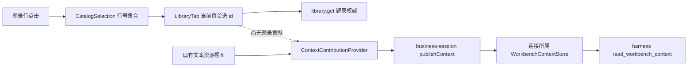

# 调查依据

## 29cd728：4.1／4.2具体覆盖与Linux整合输入

本轮核对当前`packages/protocol/src/library-metadata.ts`及唯一CatalogItemForm／metadata helper，结合固定Zotero10.0.5 schema44（`70c3aa98627413d6a30dca955886eafbde085ce9`）、utilities（`1dd38e27edf81e9d9c4161c957b7efb7f5681ac3`）和既有CSL独立来源。固定转换样本在`/tmp/scholoom-library-metadata-round6/upstream-oracle.json`，CSL1.0.2 schema及官方日期输入在`/tmp/scholoom-library-date-round7/{csl-data.json,date_TextFormFulldateYearRange.json,date_Uncertain.json,date_TextFormYeardateYearRangeOpen.json}`。本轮只读核证，未重新执行上游转换或原包；不把前轮样本阅读称为本轮宿主执行。

| 对象 | 当前已交付 | 精确保留边界 |
| --- | --- | --- |
| 类型／文本 | schema44映射的32个CSL目标类型；47个文本目标中的44个编辑项 | citation-key属正式键权威；note不作Extra编辑；历史shortTitle保留，固定转换输出title-short。不从CSL逆推Zotero类型／Extra。 |
| 数字型字段 | 文本属性显式编辑，不强制转换既有值 | CSL允许volume、issue、page、edition、chapter-number、collection-number、number、number-of-pages、number-of-volumes为数字；这些数字值继续JSON核查，不冒充可编辑字符串。 |
| 创建者 | 22个映射角色、family／given／literal显式编辑、同角色完整对象移动 | particles／suffix／static-ordering等属性保留，无专用控件；混合literal／family／given对象可局部改literal并保留其他属性。跨角色总顺序、Zotero首要角色重建没有本批逆映射契约。 |
| 日期 | issued／accessed／original-date／submitted；1–2个正数端点，各端年／年月／年月日；circa布尔或数值0／1 | 数字字符串、开放末端[[1987],[0]]、BCE[-44]、season、literal／raw混合保留。circa字符串"0"／"1"或2无标记控件，合法数字端点仍可局部修改并保留该标记。不解析自由文字或猜公历。 |
| 其他CSL表达 | 当前开放metadata按原值完整保留，JSON为核查／显式编辑路径 | CSL类型classic／collection／entry／event／figure／musical_score／pamphlet／performance／periodical／regulation／review／review-book／treaty，角色compiler／curator／editorial-director／illustrator及available-date／event-date不在固定Zotero目录覆盖内。新增专用控件须另有范围依据。 |

编辑目录与领域校验分别承担职责：同文件的`cslMetadataSchema`保留开放metadata，领域还核题名、DOI及16KiB等既有约束；不会将UI目录当封闭schema。固定映射的license／part-number不在该CSL1.0.2属性集合，以及calendar等任意扩展可保留，并不证明它们符合CSL标准。原值inspect／独立title更正／导出选择已交付，不重新列成未决政策。

因此32／44／22／4授权编辑范围内未发现遗漏声明或表单实现；4.1a–d／4.2a–d已经记录相应证据。父4.1／4.2暂留开放用于覆盖与验收收尾，不再用“完整复杂映射未完成”暗示要新增逆转换、季节或别名政策。本轮6.1b只证明Linux业务闭环，Windows1.4、完整6.1／6.2、分发及科研质量继续按真实证据处理。

新代表场景的日期端点静态取官方输入1987-08-03／2003-10-23，circa=1取date_Uncertain；题名、出版者、作者与未知嵌套为明确合成夹具。预期更正只改变publisher、结束日及circa，不由新映射自身生成预期。真实产品导入文件与保存，真实CLI内核重启及原会话工具读取；模型HTTP受控，内部不替换。任务和结果仍维护原tasks／delivery。

## 2026-10-28：938c33f消费真实进程提供者

当前HEAD`938c33f2c9fcafb2cce11b0c165b2fb1e9a818c3`，开工前clean。主线已选择并同步A：`tests/isolated-kernel.ts::startIsolatedKernel`与`tests/fixtures/isolated-kernel-process.mjs`。旧“等待配置选择／提供者”只描述4312262阶段；普通生产CLI持久恢复B仍未提供，不能混同。

### 实际提供者及消费者复核

- helper先核canonical目录stopped，fork自有child，私有IPC显式传IsolatedZotero；子入口调用真实serveKernel，ready后核实际PID并持有development owner。stop以原owner.shutdown绑定原instanceId，等自有child **close**，最后只用CLI status核对；不调用重新发现的CLI stop，不放宽锁／停止／unknown规则。本线没有修改这些共享符号。
- 原GUI测试的bootstrap代理保留，但权威从直接KernelApplication／startKernelServer改为helper的真实endpoint。准备app关闭后，所有get／record／history／update与授权检查经可更新的当前RPC port；重启不再读取已关闭的准备仓储。bootstrap动态返回当前endpoint，WS传输门在新URL上重新安装，原窗口及origin保持。
- 真实BBT9.0.68原包来自已有本地XPI，实际宿主仍沿/usr/bin/xvfb-run与已安装Electron及本树managed.cjs。默认缺配置先在准备app核unavailable；已运行进程的错库请求、撤read，以及实际错误绑定配置重启分别验证拒绝，不把错误写作notFound。只有notFound本身保留原pending，无重放。
- 两个关键分支均跨stop／child退出／显式注入新进程／reload：真实已提交回执丢失查committed，未送达请求查notFound。冻结对象包括原libraryId、sourceId、来源identity三字段、观测revision、requestId、title及完整dirty CSL草稿／旧revision；runtime instanceId和PID可变，来源实例不得改绑。记录／键／历史按真实RPC读回，不代写回执。

本轮首跑与独立审查补强后的最终双宿主均2/2通过，每宿主四个实际PID／runtime instanceId，保留在各自original-actions.json。补强专门在committed查询处理完成后再保存CSL，真实RPC仍携带旧revision并被contentChanged拒绝；notFound完成后也与同一原始CSL快照比较，不以查询后的新快照掩盖推进。缺配置拒绝在关闭前的真实准备app核对，错误绑定／撤read在真实RPC进程核对；没有把全部拒绝场景冒称普通CLI无配置重启测试。具体命令与证据边界见本轮delivery。

共享／桌面／宿主已有构建入口与产物已由主线在本树复验：`/tmp/scholoom-round10-acceptance-j1MosP/sync-build-results.json`中literature-workbench code=0，日志为该包正式转交的sync-build.log。本片不改生产源码，按用户指令直接使用当前产物，先tools类型／Biome后单个原GUI双宿主测试，运行中不重建，不重复14UI或旧macOS列表。构建的复用不冒充本轮重新构建结果。

### 当前CI输入边界

读取正式交接的ci-baseline-*／ci-failure-matrix.json：8c2fd24／Checks40479176954，Linux内核746通过26跳过、UI126通过32失败4跳过，Windows内核688通过42失败42跳过，macOS job成功；只回执差异的4312262／40476577071中Windows727通过3失败42跳过。计数差异不能证明新增源码缺陷或统一根因；不沿用旧4失败清单，不以一次通过关闭启动稳定性。本片没有调查开发承载或以普通静态产品运行开发样例，不处理其他域UI失败。

新Checks40540362614的只读head／步骤截点保存在`/tmp/scholoom-library-process-round10/ci-observed.json`，不以启动或其他平台步骤替代本片真实原包／GUI结果。Windows execution diagnosis仍按实际授权场景另记，不主动触发全仓重跑或等待其他线。

## 2026-10-27：4312262可信配置／进程重启缺口

本树HEAD为`4312262c1a1f432ccd706dd1eb6ff6468765fd4e`，开工前clean。已消费`/tmp/scholoom-round9-acceptance-IER31D/{acceptance.md,main-ui-result.json}`及当前源码；前片单条GUI／unknown重载只查询已接收。本轮仅核配置／真实进程重启，以下为源码调查，未执行新业务或重跑已绿UI。

### 当前实际路径

| 入口／符号 | 实际参数与事实 | 对重启证据的影响 |
| --- | --- | --- |
| `tests/ui/zotero-original.spec.ts:34,46,147` | 测试端构造IsolatedZotero并传入KernelApplication，随后直接startKernelServer；本机bootstrap代理只返回该实际endpoint，其他资产来自静态renderer。 | 真实broker／SQLite／原BBT与页面重载成立；没有经过serveKernel的运行锁、endpoint发布或独立内核子进程重启。 |
| `apps/kernel/src/application.ts:65,77,80`、`lifecycle.ts:264,270,315` | KernelApplication和serveKernel均接受可选isolatedZotero，后者确实复用同一Application及运行锁／server。 | 这是已有可信构造seam，参数由调用进程内存提供；不是CLI持久配置加载器。 |
| `apps/kernel/src/cli.ts:16,149,164` | parseArgs没有隔离宿主配置项；serve只传development，start也只传development给ensureKernel。 | 普通CLI不能创建／恢复带隔离原包配置的内核；能查询预先由其他可信调用者注入的服务，不等于能启动它。 |
| `apps/kernel/src/lifecycle.ts:357,375` | ensureKernel派生cli.js serve，参数只有canonical data-dir及可选development；无isolatedZotero传递／加载。 | 即使进程继承相同目录，重启的新Application也不恢复构造参数。 |
| `apps/kernel/src/bootstrap.ts:21,83`、`apps/desktop/kernel-bootstrap.ts:56` | bootstrap只提供目录、Node入口及development；开发owner沿CLI start/status附着。 | 现有UI引导不补注入隔离配置，也不能从capabilities推定配置已存在。 |
| `apps/kernel/src/zotero.ts:57,66` | check先核configuration及实际libraryId；result同样先check，再读library.commitResult。 | 普通CLI重启后，原库回执可能仍在SQLite，但zotero.result会因缺隔离配置返回unavailable。不能把它当notFound／结果丢失或安全重放。 |
| `apps/kernel/src/zotero.ts:239`及`apps/zotero-host/src/main/managed.ts:18` | operation.json是已授权单次导出的原包派生投影／profile配置；BBT_PACKAGE等宿主环境只服务原包入口。 | 不是内核启动配置或授权来源，不能读该文件来自动启用内核。 |

`tests/kernel/zotero-host.spec.ts:327`先关闭准备app，再在同一测试进程显式调用serveKernel(...isolatedZotero)并让CLI查询／导出；它证明现有seam可用，不是CLI start跨进程配置恢复。:698的题名unknown样本查询同一个app；:893的重建Application仍再次显式传配置。这些定义不填补当前缺口，本轮也未重跑冒充新结果。

当前CatalogOriginalActions以实际库／窗口／sourceId保存冻结pending请求：包含原identity三字段、观测revision及requestId，查询只用原libraryId／requestId；CSL仍走唯一草稿及旧CAS依据。新内核runtime instanceId不能替换原Zotero来源instanceId，重启不能重建来源实例、推进原revision或补交旧写入。配置缺失时保持原操作待核查及真实错误，不绕过zotero.result隔离检查。

**结论：CLI现有配置根本没有该能力。** 按用户本轮条件停止在原design的具体方案；5.4a实际跨进程验收受阻，不能通过新写测试launcher、另一server、普通生产启用或现有14UI重跑伪造闭合。

### 平台输入与追加目标事实

完整基线输入为caf9025／Checks40455958976：Linux完整组743通过／1失败／26跳过，Windows完整组687通过／41失败／42跳过；Windows原生定向16通过／3跳过、Linux原生19通过分别记录。macOS旧人工13通过／1失败、fallback2／2、入口4／4；不按数量推同因果，不沿用旧4失败清单。

用户追加且已读取`/tmp/scholoom-round9-acceptance-IER31D/macos-job-current.json`：Checks40476577071、head4312262、macOS job122096177783 **completed/success**，fallback、入口及双宿主人工工作台步骤均success。`.github/workflows/checks.yml:74`明确人工步骤包含platform-availability及library.spec.ts，因此原列表同例已有新目标通过证据，不再重复追查旧失败。它不覆盖Linux-only原包导出或未知回执跨内核重启，也不是完整Checks／Windows通过。前一只读查询的截点保留在`/tmp/scholoom-library-restart-round9/ci-observed.json`，以此次更新的主线原始job证据为准；不轮询其他线或触发重跑。

## 2026-10-27：0b78815后的真实失败与原值GUI接口

当前正式共同源码`0b788151b5e17665a26d9286dfd1d12f6e2e0c30`且开工前clean，主线接收／同步／定向复验见`/tmp/scholoom-round8-acceptance-UrXA7y/`。原日期子片、生态inspect／replaceTitle／expression、报告及授权修复均已在本树，旧“生态新接口未同步”属于历史，不再阻塞本轮消费者。

### 原macOS失败实际是分页滚动

原始`ci-baseline-failures.log` L29—47显示Browser旧tests/ui/library.spec.ts:683对`listbox.scrollTop`期待200、得到0；不是列宽。Electron同例通过。当前场景先`element.scrollTop=200`，随后只读同一同步属性；它不能证明异步scroll事件已经让useVirtualizedList更新可见行并由CatalogItemList保存范围偏好。当前locator按可访问名在唯一文献region查询，非缓存ElementHandle；没有读旧卸载节点或第二个隐藏列表的确证。

保守修正仅在现有测试中等待首个虚拟行的可访问身份随滚动实际变化，再翻页；继续核对精确返回位置，未放宽值／时限或加sleep。未发现需要改产品布局的证据。本机双宿主首次定向2/2通过；旧目标日志只能证明间歇失败，未在本机声称稳定复现200→0。

本轮只读查询Checks40454653610时总体仍in_progress，但macOS job122025046737的人工双宿主及package步骤已success，源码仍为未含本轮修正的0b78815；不能把它算作修正后目标实跑。Windows diagnosis40454653566已success，仅覆盖其实际定向场景。原样job证据在`/tmp/scholoom-library-gui-round8/ci-{checks,windows}-observed.json`；下载macOS文本日志受到gh终端转义保护拒绝，未冒充读过该份详细运行trace。

最新已完成全仓基线仍以用户提供的b2f3b50／40447074031为输入：Linux734通过／1失败／23跳过，Windows715通过／4失败／39跳过，macOS人工13通过／1失败。Windows四项为host-connection断联、lifecycle占锁、literature-attachment执行等待及platform-availability计数；不沿用旧54项清单。本线不改共同监督、生命周期、unknown、停止或容量保护；附件阶段协查由Agent安排承接，不凭本机结果关闭Windows。

### 已同步生态契约与可用性

事实源为`packages/protocol/src/zotero.ts`及`apps/kernel/src/zotero.ts`：

| 操作／字段 | 本轮消费者准确语义 |
| --- | --- |
| inspect：libraryId、sources[{sourceId,revision}] | 单条有界读取，返回已保存csl／original／citationKey及同一revision；comparison.title严格equal／different，remaining固定notComparable，不能用未保存草稿替换csl。 |
| original.identity | instanceId／libraryLocator／objectKey全部精确使用返回值；唯一schema44 journalArticle且满足journalOriginal受限字段／姓名／关系检查，缺准确title或多来源返回unavailable。 |
| replaceTitle：libraryId／requestId／sourceId／revision／identity／title | title为1—4096字符串，原样保存，不trim。只有fields.title被替换；完整其他原值、CSL及正式键沿共同commitRecords保留，共享revision递增。inspect／replaceTitle不启动BBT。 |
| export：format、sources的expression | 格式bibtex／biblatex；未选expression返回selectionRequired且无文本、不启动原包。明确zotero-original identity后才生成实际BBT文本；没有键则unavailable，不隐式填键。 |
| replaceTitle receipt与zotero.result | 外层queried只是查询原requestId，不代表重新执行；结果committed／rejected来自共同稳定回执。失联／outcomeUnknown留原请求，仅result只读核查；notFound不能证明安全重放。 |

所有入口要求可信构造中的isolatedZotero与实际libraryId匹配；capabilities列表不证明可用。人工inspect／result要求read，replaceTitle另要write，export还要send；Agent另有send／可信执行检查，GUI不绕过。普通内核默认unavailable，macOS受管执行不可用保持，首片不提供启用真实库或输入原生路径的renderer开关。

LibraryTab当前dirty对象收到原值更正通知仍保留CSL全文与旧editRevision，因此随后保存会按CAS冲突；这是本片保留且实测的契约，不自动rebase或把原值写入成功当CSL保存成功。原值输入／pending仅保存自己的题名意图与冻结请求，复用drafts及librarySaves，不复制CSL状态。

### 可信隔离夹具与证据限制

没有现成生态UI启用配置，可信seam已在KernelApplication／serveKernel的isolatedZotero构造参数。直接沿普通UI middleware启动后补注入不可行；开发owner生命周期也不会在CLI重启后保存该参数。本片复用现有`tests/ui/task-graph-launch.spec.ts`的实际KernelApplication＋startKernelServer＋本机bootstrap代理到既有静态renderer模式，只在测试端构造隔离配置。没有新增生产provider、开关、broker替身或自动重启配置。

测试真实共同SQLite／文件与原BBT9.0.68未修改XPI，期刊样本来自既有zotero-host独立Preserved journal输入；所有身份经真实createSourceInstance／摄取／commitRecords创建。传输门只控制真实请求派发与真实成功回执丢失，保留实际库回执和历史；无假成功provider。该夹具验证同一真实服务的页面重载／重连，**不覆盖serveKernel锁与CLI进程重启注入**。原包使用既有受限兼容facade，不能称完整原生Zotero用户库／宿主验收；外部模型未参与人工动作。

独立窄审查发现两个局部确证风险：只比较当前single／revision会让离开再返回后的迟到导出复现；JSON null损坏草稿在保护分支之后仍被解引用。已分别用所选视图依据的对象代次拒绝旧异步响应、校验失败后避免解引用；在真实双宿主主场景扩展多选→同一主选期间迟到导出无输出，以及损坏另一对象草稿后工作台仍可用的回归。没有新领域schema／存储或保存入口。

## 2026-10-27：8a2f0ce后的数字日期区间与circa

开工前本树clean，HEAD为`8a2f0ce522dfbab4110e63e84e542f6660e6115e`；主线验收、同步及定向复验见`/tmp/scholoom-round7-acceptance-SdxHy8/`。本节为当前输入，下方分阶段记录保留其历史范围，不再等待旧公共同步。仅闭合4.1d／4.2d，原值／来源／正式键、5.3及X1不重做。

### 独立日期证据与实际表达

只读调查材料和执行记录保留在`/tmp/scholoom-library-date-round7/`，未新增运行依赖：

- [CSL schema v1.0.2](https://raw.githubusercontent.com/citation-style-language/schema/v1.0.2/schemas/input/csl-data.json)，本地`csl-data.json`：date-parts为1—2端点、每端1—3个字符串或数字分量；circa允许字符串、数字或布尔。schema允许不代表表单支持全部表达。
- [CSL specification v1.0.2](https://raw.githubusercontent.com/citation-style-language/documentation/v1.0.2/specification.rst)，本地`csl-json.rst`实际为规范正文；数字日期范围按起止端表达，各端精度不能靠补齐推断。
- 官方[citation-style-language/test-suite](https://github.com/citation-style-language/test-suite)固定树`6eefc5b07c6969ab8999e48542acbcc131cba864`的processor-tests：`date_TextFormFulldateYearRange` blob `eabb3a8feb8cea087464191014c134204ba5d3e8`使用`[[1987,8,3],[2003,10,23]]`；`date_Uncertain` blob `a5d3da05c3ee677cd97dfdee5840076b6a623027`使用circa=1，预期含circa。文件以原名.json保留，预期来自固定输入／输出，不从新helper生成。
- 反例：`sort_DateVariableRangeMixed` blob `996a2ec25cc5a35dbb6243205f613e64fe41b5f1`含数字字符串；`date_TextFormYeardateYearRangeOpen` blob `d9007628f565a9c0befbc0b86053d82bda4ae4dc`使用`[[1987],[0]]`。均保持JSON核查，不将字符串变数字或把0改成猜测年份。
- [citeproc-js 1.4.61 attributes.js](https://raw.githubusercontent.com/Juris-M/citeproc-js/1.4.61/src/attributes.js)的is-uncertain-date条件按circa真值判断；布尔true／false和数字1／0可对应约略／非约略，字符串`"0"`仍为真，不能用数字强转显示成false。此为独立参考处理器，不声称是当前Zotero运行引擎。

`node /tmp/scholoom-library-date-round7/standard-probe.mjs`已核对schema、上述固定样本及原参考条件，日志`standard-probe.log`通过。VM只执行未修改的circa条件；未执行排版、日期解析、Zotero宿主或替代产品provider。取证中两个候选文档URL返回404，没有把缺失内容作为依据。

本片支持既定正整数范围内一端或两端、各端独立年／年月／年月日；只更正指定分量、circa或明确移除结束端，保留未知日期属性及完整metadata。旧数值circa显式切换仍保持0／1，新标记布尔；未改标记不归一化。raw／literal与数字并存、season／calendar、负年、数字字符串、开放端点、未知circa均保留；其中未知circa只禁用标记编辑，仍可局部改已知数字端点。非法输入包括原生number的badInput，不作为清空保存。

季节／非公历或混合literal／raw需要额外解释规则，现有输入不足以确定结构控件应改哪个权威值；继续JSON核查。后续可选择仅编辑原属性，或先定义显式表达转换及丢弃确认；后者将扩大产品范围。本片不依赖该选择、不解析自由字符串或从CSL重建原类型、姓名、Extra和来源原值。

### 生态原值题名／导出选择的当前库承载

仅核对本树正式源码：`protocol/library-records.ts`的OriginalRecord.fields保持开放JSON；`LiteratureCatalog.commitRecords`可在一个共享revision CAS内提交完整original，并独立选择是否更改metadata。相同来源身份元组更新原值，改变元组则新增关联；没有独立original修订。省略key保持正式键／固定状态。成功记录与稳定结果同事务提交，requestId重放及commitResult已存在；入口授权／schema／字节校验失败不保证已有结果收据。真实manual broker注册和既有library-records测试均存在，不能把存储能力等同新增调用方已授权。

结论：独立原值题名存储及CAS不缺底层模型；生态仍须按schema44及实际journal类型验证目标字段。08中D1—D3已定，不重新提作待决。当前`zotero.export`没有本轮新增的显式导出选择接口，kernel/zotero回调目前只处理键／Extra，不提交任意原题名。生态新后端尚未共同同步，本片不复制其API、不接假UI、不自动双写CSL／原值。

### 最新CI阶段复核

以39be889／[Checks40432749785](https://github.com/leike0813/Scholoom/actions/runs/40432749785)为最新已完成基线，原日志`/tmp/scholoom-round7-acceptance-SdxHy8/{ci-baseline-failures.log,ci-baseline-summary.json}`。Linux709通过／9失败／23跳过，Windows641通过／54失败／39跳过／7未运行，macOS不可用校准2通过，人工入口3通过／1失败。主线指出Linux9项本地已修正，不据此关闭Windows。

Windows文献剩余观察：literature-attachment在L3708附近、断言:55仍queued；literature-integration在L3737附近、断言:67仍running；pdf-isolation在L3795附近、断言:86仍queued。没有新增本域提交／授权失败证据，也不能只从状态证明共同worker根因。**document-integration已在L2142通过14.1秒**，含撤send后failed与无新增模型请求断言；不再沿用旧“四项均失败”。library-records两项和literature-catalog亦通过。原始阶段不足以替代Windows现场准入／worker／请求／回执与停止时间线，1.4继续开放；本轮不改超时或生产保护，未额外下载diagnostic artifact或触发CI。

## 2026-10-27：固定源码闭合的原生CSL子范围

本树已同步4b13183f7489d3cae12fd0a7d1a9e83fb33d7384且开工前clean。主线已接收右栏／跨组唯一库、历史／undo、真实I1和生态普通期刊／BBT及持续外发P1；见`/tmp/scholoom-round6-acceptance-dXuzCA/{acceptance.md,synchronized.json,sync-build-results.json,sync-kernel-results.json}`。旧同步等待和旧374项CI记录不代表当前状态。以下round4／共同起点段落保留为历史取证。

本轮只读取得两份固定原始源码：

- `https://raw.githubusercontent.com/zotero/zotero-schema/70c3aa98627413d6a30dca955886eafbde085ce9/schema.json`，version44；与已消费E1 mapping的版本一致。
- `https://raw.githubusercontent.com/zotero/utilities/1dd38e27edf81e9d9c4161c957b7efb7f5681ac3/utilities_item.js`，Zotero10.0.5固定utilities。第77—130行依次读取文本候选及baseField，首个有效字符串成为CSL目标；第78行明确跳过shortTitle输出，只写title-short。第141—179行按显式角色或原类型primary→author投影，机构／单字段name及fieldMode=1进入literal，其他进入family／given，按角色分组保留组内顺序；跨组原顺序不可恢复。第188—230行日期另含解析、season及accessDate时区变换；第287—299行反向类型使用规则或首个候选，不能作为本项目身份权威。

源码临时证据及独立执行结果位于`/tmp/scholoom-library-metadata-round6/`。四组输入直接执行未修改itemToCSLJSON，ItemTypes／ItemFields／CreatorTypes仅以原schema实现查询facade，未加载Zotero宿主、日期解析或Extra。断言预期手工依据原源码／schema核对，不从新编辑目录生成；这只能作为映射oracle，不能当真实生态生产提供者。

| 具体输入／上游结果 | 本轮可无损编辑的CSL目标 | 保留边界 |
| --- | --- | --- |
| film.genre=Documentary、videoRecordingFormat=DVD、runningTime=01:23:45、shortTitle=Source short | genre／medium／dimensions／title-short | 只改CSL；不把CSL type=motion_picture反猜film或videoRecording。既有shortTitle历史键独立保留，不回填、同步或合并。 |
| computerProgram.programmingLanguage=TypeScript、system=Linux、seriesTitle=Analysis tools | genre／medium／collection-title | 相同CSL目标在原类型中语义不同，类型切换只改metadata.type，原字段／身份不变。 |
| patent.applicationNumber=US12/123456、priorityNumbers=P-42、references=Prior application | call-number／issue／references | 不将申请号当正式引用键，不将references文本当relatedIds。 |
| case.reporter=Court reports、reporterVolume=12、firstPage=42、history=Appeal history | container-title／volume／page／references | 补现有字段的法律类型适用范围；不重写原有字符串或关联身份。 |
| presentation.conferenceName、hearing.committee；audioRecording／presentation／videoRecording.place的上游特例 | event-title／section、event-place及已知类型范围 | 只依据固定字段目标呈现，publisher-place不因特例新增song／speech逆映射。 |
| host.name=科学影像中心；host.lastName=单名且firstName为空 | host:[{literal:科学影像中心},{family:单名,given:''}] | literal不能证明是机构还是个人单字段名；UI入口可明确输入两种CSL表达，但不自动互转、拆名或恢复fieldMode。完整对象与扩展属性随角色内移动。 |

新9文本字段加已有35共44，host加已有21角色共22；32种CSL类型不变。原先“13种主要角色缺少证据”现在已能准确说明：固定utilities在缺显式角色映射且该角色为原类型primary时投影author；CSL侧author早已支持，但仍不能从author猜回inventor／programmer等原角色。所有新增范围仅编辑CSL自身，不提供原类型／原值自动同步。

### 仍需选择或独立证据的分支

| 反例／输入 | 当前无损行为 | 后续选项及影响 |
| --- | --- | --- |
| 原creators为host A、contributor B、host C，CSL为host[A,C]、contributor[B] | 只更正CSL组内顺序；原creators／orderIndex完整保留 | A继续CSL分组编辑（本批已定）；B另提供来源关联的原创建者编辑与明确写入意图，会扩大原值提交范围，不能从CSL倒排。 |
| CSL issued含两端点、circa／season／raw、负年份或附属扩展；原日期字符串还可能含时区与部分日期 | 保留原JSON及原日期，不让简单年月日控件改写 | A保持JSON核查（当前）；B另定CSL范围／历法的结构化编辑，不自动解析原字符串；解析及原值同步需要单独产品语义和上游Date证据。 |
| metadata.title-short=Changed short与历史shortTitle=Legacy short并存 | 只明确改title-short，历史键仍完整可查 | 如需“合并短题名／删除别名”，须定义冲突优先与显式丢弃动作；本片不推定允许删除或统一两值。 |
| 原film为DVD／Documentary，人工将CSL改为software／Linux／TypeScript；原Extra或正式键另有原行 | CSL与原值各自真实可读，revision、原值／键保护不变 | 生态导出差异方案由其本轮调查承接。自动双写会猜原类型／字段，未获授权；需要选择明确来源字段及原子意图，不能为导出一致覆盖原值。 |

这些分支不阻塞本次直接CSL编辑；完整4.1／4.2保持开放。没有新增公共schema、模型授权、原值权威或来源表。

### 最新CI文献阶段核对

最新实际基线为6b22d602046baa7c1349bf66059c61d79c07ae40／[Checks40315429083](https://github.com/leike0813/Scholoom/actions/runs/40315429083)：Linux内核689通过／9失败／16跳过；Windows628通过／49失败／30跳过；macOS入口3通过／1失败。只读核对`/tmp/scholoom-round6-acceptance-dXuzCA/ci-baseline-failures.log`及ci-baseline-summary.json，没有重跑CI或目标Windows。

| Windows测试／日志行 | 实际观察及阶段 | 本轮结论 |
| --- | --- | --- |
| literature-attachment-integration:14，L3894—3911，断言:55 | 回执已返回，5000ms观察completed实际queued；后续batch／原字节断言未到 | 受理后推进边界，不能据queued认定未启动worker，不能证明附件提交失败。Linux L8984通过17.3秒。 |
| literature-integration:15，L3923—3940，断言:67 | 人工摄取／通知及另一客户端读已过；首次MODEL_LIBRARY期待completed实际running | 工具／权限及执行收尾待时间线，无本域写入或权限失守结论。Linux L9000通过11.8秒。 |
| document-integration:15，L3313—3330，断言:98 | 第一轮EPUB及记录真实读写已过；撤send后期待failed实际running，模型计数断言未到 | 外发授权／收尾边界仍开放，不能称拒绝已通过或违规外发已发生。Linux L8794通过9.1秒。 |
| pdf-isolation:12，L3952—3969，断言:86 | 阻塞解析时题录查询／status仍响应；另一普通会话期待completed实际queued | 共同执行推进现象；后续停止和再次解析未验到。Linux L9055通过5.1秒。 |

当前源码runtime.ts在模型wrapModel路径才写running；queued覆盖名额、启动、实例初始化等多个阶段，running不证明已发HTTP。权限错误之后的受管停止确认也可能先于终态发布。断言直接读持久snapshot，不经过renderer；没有UI刷新故障证据。Windows capability-isolation／harness-recovery／context-instructions亦有相似状态观察，但共同根因尚不能确证。公共harness调查归Agent／平台，文献保留batch及工具收据协查；不延长生产时限或削弱停止／容量保护。

需目标现场补run／instance、准入、worker初始化、模型请求数、工具／batch回执、停止开始与确认时间；可复用tests/execution-diagnostics.ts，先保存首个错误再处理清理错误。现有日志足以更新调查输入，不足以关闭1.4，未读取诊断artifact压缩包不伪称已核对其trace。

## 2026-10-26 round4续做事实

当前HEAD为`70be8bfcda5ab1453c20428f9eb3b367d90ed0b7`，`0519904`（含b838402）已为祖先。实际同步证据在`/tmp/scholoom-sync-recovery-wyn13R/{recovery.md,synchronized.json}`；主线`/tmp/scholoom-round4-acceptance-JCUBNw/acceptance.md`独立接收本树X1及原值／来源／正式键／有界事务首片，未接入dev。以下第二阶段及共同起点均为历史调查，不能覆盖当前实现状态。本轮未访问其他真实工作树或读取／打断仍工作的research-task-workspace。

本轮精确复用`/tmp/scholoom-phase2-handoff-VZS5mS/zotero-ecosystem/openspec/changes/connect-zotero-host-bbt/evidence/zotero-10.0.5-mapping.json`及同目录investigation。固定Zotero10.0.5、schema44 `70c3aa98627413d6a30dca955886eafbde085ce9`、utilities `1dd38e27edf81e9d9c4161c957b7efb7f5681ac3`；仅静态读取已正式交接的上游提取结果，未运行Zotero或生态HostCatalog。

| 独立上游证据 | 闭合范围及限制 |
| --- | --- |
| csl.type有32个唯一值，broadcast／document／motion_picture／personal_communication含多种原类型 | 既有32类型目录已覆盖，类型控件只改metadata.type；原Zotero类型读library.record.originals，不从CSL反猜。 |
| csl.fields中20个剩余唯一文本目标，结合itemTypes.fields及baseField得到适用CSL类型并集 | 增至35字段。代表样本book.originalPublisher→original-publisher、numPages→number-of-pages、journalArticle.PMID→PMID；不把并集反推成原类型身份或逆向写回。完整清单见design首节与唯一声明。 |
| csl.names显式唯一目标17个，creatorTypes及itemTypes决定适用集合 | 增至21角色；seriesEditor→collection-editor、director→director、castMember→performer可明确声明。原四角色不收窄；不将原生performer误作castMember，不将缺少显式映射的inventor等13种原主要角色猜填author。姓名粒子及扩展对象完整保留，组内顺序不等于Zotero跨角色orderIndex。 |
| 日期存在原字符串、partial／range、raw／circa／season等形状；filingDate→submitted只明确字段目标 | 增加CSL自身单端点date-parts的有限数字编辑，不自动解析filingDate或其他原字符串。复杂日期及附属属性保留，literal已有扩展属性沿原路径保留。数字只检查分量范围，不宣称历法校验／转换。 |
| call-number／collection-title／dimensions／event-title／genre／medium／references／section及shortTitle双输出存在别名／多对一，Extra另经extraToCSL | 本轮不提供这些逆转换。未知／不支持值及开放metadata保留，正式键及固定状态继续由library权威承担，不在UI另造metadata协议。 |

来源副本默认新实例／明确重绑定、正式键大小写不敏感冲突及有界多对象原子提交已有用户决议和本树真实首片，不再列为等待产品政策。完整生态事务和来源重绑定UI仍未交付；本轮不修改这些提供者，仅用真实record／commitRecords种入合成原值以检查表单隔离。

分页误报已由主线实跑撤回：共同listPage的512KiB预算对40条约60KiB原值只返回8条／481791字节并给出nextOffset。本轮没有改分页。复用主线`verification-plan.json`及`literature-workbench/ui.config.mts`的本线验证范围，自己生成的静态承载配置位于`/tmp/scholoom-library-round4-LRNQ1I/`，读取本树构建产物及既有`/tmp/scholoom-sync-recovery-wyn13R/static-ui.mjs`。运行／首次探针及最终证据见delivery，不将读取设计当作真实提供者消费。

当前只剩完整映射／复杂原值转换的精确证据、5.3真实项目右栏、1.4目标Windows诊断和整体6.x验收；X1以及0519904消费门已具备实际证据。原4.1／4.2父任务继续开放，局部4.1b／4.2b独立交付。

## 第二阶段正式交接与闭合范围

2026-10-25 用户正式提供 `/tmp/scholoom-phase2-handoff-VZS5mS/`，允许只读消费包内其他线工件。`manifest.json`列明各源树共同基线`e3d58fc807827a78493dcd16e38de28c8d02766e`；本树未切分支、没有访问其他工作树实体或会话。`acceptance.md`接收本线2.1／2.2／3.1／3.2，未确认本线缺陷；主线实际重跑内核8/8、双宿主6/6，不把此局部结果当整个B批完成。`coordination-plan.md:180`起为本轮公共接入顺序依据。

### 精确消费路径

以下路径均以 `/tmp/scholoom-phase2-handoff-VZS5mS/` 为根，未包含文件沿本树共同基线核对：

| 输入 | 实际消费及边界 |
| --- | --- |
| `zotero-ecosystem/openspec/changes/connect-zotero-host-bbt/investigation.md` | 逐项读取固定版本、来源／删除身份、字段／姓名／日期／Extra、BBT及茉莉花保存和SQL／通知／缓存事实。来源版本是Zotero10.0.5 `ca61760225d25191d0c65acbfd0c4f12a172d263`，schema44子仓`70c3aa98627413d6a30dca955886eafbde085ce9`、blob `71e8898a7c22c8c3d165945aba76c723c0573eb5`，utilities `1dd38e27edf81e9d9c4161c957b7efb7f5681ac3`。 |
| 同目录 `evidence/zotero-10.0.5-mapping.json` | 检查40类型、121字段名、37角色及32个CSL类型映射；按itemTypes、baseField、csl.fields和csl.names交叉核对。只作独立取证，不复制成产品schema或运行时依赖。 |
| 同目录 `design.md`、`delivery.md` | 确认H1只交付原包／真实Electron和注入Adapter；真实来源身份、原值、正式键及固定状态、CAS／原子提交／未知结果核查仍缺。fixture中的SQL和数值ID不是共同提供者。 |
| `research-interaction/openspec/changes/add-material-annotation-interactions/design.md` | R1材料分支已收到。消费既有ResourceRef/basis、ReadingRecordPort和ContextContribution；M1库写回、M2归因与撤销、M3产物依据仍开放。本线不接管这些语义。 |
| `research-interaction/openspec/changes/add-interactive-research-reports/design.md` | R1报告分支单独收到，仍仅规划。清单／页面桥／更新独立于B批；拟增appendContextItems整批附加仍受16项／64KiB，不能视为已经发布。 |
| `research-interaction/packages/protocol/src/workbench-context-contracts.ts`及`packages/harness/src/instruction-context.ts` | 实际位置增量为text.location、region.target、object.contentState，均可选；不含题录贡献。X1必须保留这些字段及其编码，不能把题录塞入16项ContextItem；位置schema仍引用library声明。 |
| `research-task-workspace/apps/desktop/src/renderer/src/workbench/{shell/AuxiliaryPane.tsx,session.ts,Workbench.tsx}` | 真实任务增量有taskNavigator、TaskSummary、TaskList、TaskPanel／renderTask及活动task上下文；没有已实现文献详情槽位。文献只规划额外槽位，待共同基线后叠加，不能覆盖项目分支。 |
| `research-task-workspace/tests/ui/fixture.ts`与包内本线同路径 | 项目createSession接受项目身份；本线openWorkbenchWindow提供双宿主第二窗口。两符号同时保留，不整文件替换。 |

### E1逐项决定

| 事实 | 本领域已闭合的B批局部范围 | 仍缺的权威／限制 |
| --- | --- | --- |
| 40种Zotero类型投影到32种CSL值，broadcast／motion_picture／document等多对一 | 原生CSL类型选择器可以编辑metadata.type，未知类型仍保留 | 不能从CSL反推film/videoRecording、note/attachment/document等原类型，原始类型须独立权威。 |
| 文本有baseField和一对多／多对一映射，ISBN等可能只保留首值 | 只编辑直接CSL字符串；数值或其他既有形状不转成字符串，留JSON | 不据映射逆造原始字段；出版地特例、原始多值和原始格式需保存原值。 |
| 姓名有firstName/lastName/fieldMode及全局orderIndex | CSL的author/editor/translator/container-author数组可调整个人／机构名和组内顺序，完整姓名对象移动，粒子和扩展属性保留 | 不自动拆中文名，不把角色数组顺序冒充Zotero跨角色顺序；其他角色／形状沿JSON保留。 |
| 日期有原字符串、部分日期、季节、时区及上游解析 | 仅新建或更正CSL literal；原date-parts/raw/复杂形状保留，显式JSON编辑 | 不将日期字符串自动转年月日或反向本地化；原值与投影需分开保存。 |
| Extra经extraToCSL，含未知行、aliases、CNKICite/Status | 类型表单不编辑note／Extra／citation-key；其他字段更正原样保留它们 | 正式键及固定状态没有共同权威，不能以任意metadata键代替；完整JSON仍只具有现有CSL更正语义。 |
| 来源是实例命名空间＋库定位＋对象key，不是itemID/DOI/citationKey | 继续使用本库UUID、source.id、revision；不新增来源映射 | 复制／恢复／重入代际、同步version与发表version分离，需要另立公共契约。 |
| BBT有executeTransaction/save/saveTx、缓存先行及resetKeyOnChange | 继续现有单题录CAS，不向生态提供插件事务适配 | 多对象原子提交、固定键保护及提交后通知／未知结果核查需要领域提供者，H1不能代替。 |

E1的**调查输入等待已解除**；完整原值／来源／键／提交设计仍由新公共规划`define-library-zotero-record-authority`承接。任务4.1／4.2仅推进已闭合CSL子任务，父任务保持开放。R1两份设计均已消费；等待的是公共接入与具体提供者，不再要求用户提供同一设计。

X1按A给出审查稿，见design“X1精确公共delta”，本轮不将候选接口注册到产品。排序保持B列偏好／F查询排序的既有分批边界，不新增排序功能。以下“当前事实”均为第一轮共同起点调查，不覆盖本节正式交接及delivery实际结果。

## 当前事实与复用选择

2026-10-25，在共同起点 `e3d58fc807827a78493dcd16e38de28c8d02766e` 静态核对。开始工作区干净，无 `.codegraph/`；本树 `.agents/skills` 缺失，只读复用用户指定主库的 `openspec-ff-change`、`codebase-design`。原生辅助 Agent 保持 `gpt-6.1-sol / high`，只调查本树 UI／测试；主 Agent 抽查选择、保存、协议和 CI 断点。经验查询没有匹配结果。本轮未运行应用、业务测试或插件实验，未取得其他工作树结论。

### 已交付基础，不再重建

| 依据 | 已有事实与本次使用方式 |
| --- | --- |
| [库管理恢复 delivery](../archive/2026-10-24-restore-library-management-entrypoints/delivery.md) | 手动建项、JSON／文件摄取、授权、集合基础、修订更正、批次接续、备份恢复及草稿已接真实入口；记录的 Linux 双宿主定向 16/16 是历史证据，不是本轮实跑。 |
| [上下文桥 delivery](../archive/2026-10-24-establish-workbench-context-bridge/delivery.md)及[正式规格](../../specs/workbench-agent-context/spec.md) | 连接所属快照、可信指令来源、实时工具、共同 composer、显式项及 Graph 接续已交付。复用这些机制，只补题录提供者和必要公共契约。 |
| [领域交接 delivery 当前状态](../archive/2026-10-24-establish-domain-execution-handoffs/delivery.md#当前状态与成果)、[工作域 delivery](../archive/2026-10-23-establish-scoped-execution-foundation/delivery.md) | 资源、授权、broker、执行、恢复已有基础。Linux／Windows 受管，macOS 执行显式不可用，人工题录仍可用；不复制 driver 或引入替代执行。历史阶段的“不能启动七域”不覆盖最新收尾及本轮授权。 |

### 源码事实与 B 批差距

以下路径相对仓库根，行号取本次共同起点。

| 路径／符号 | 现有能力 | 具体差距／风险 |
| --- | --- | --- |
| `packages/protocol/src/library.ts:6` `cslMetadataSchema` | 必填 title，其余 CSL 字段开放；`LibrarySource` 有 UUID、revision、version、origins，`library.status` 有独立库 id。 | 没有完整类型／字段／创建者目录。开放字段保留能力不等于类型化编辑契约已形成。 |
| `packages/library/src/catalog.ts:247` `validateMetadata`、`:287` `update` | 16KiB 单条预算、DOI 校验、原 revision 事务核对、history、双向 relatedIds；更新不更改对象 UUID、version 或 origins。 | `metadata: input.metadata` 整体替换；仅提交表单可见字段会删除未知字段。不能把更正改成无条件合并而破坏显式删除语义。 |
| `packages/library/src/catalog.ts:210` `list`、`:349` `collections` | 题名／DOI、单集合、标签筛选；默认25／上限100；列表还有512KiB响应预算，可能提前 nextOffset。 | 固定 updatedAt／id 降序，集合分页按 id，与树父子顺序无关。首25集合不能伪装完整树。 |
| 同文件 `saveCollection`、`packages/library/src/schema.ts` | parentId、多集合归属、循环拒绝已有；题录正文存 JSON。 | B 批无需创建第二套集合仓储；完整组织、拖放和批量更正在 C 批。 |
| `workbench/library/LibraryTab.tsx:379,648,958`（renderer） | 手动题名／DOI／版本表单及 CSL JSON 更正；真实历史、授权与备份入口。 | 缺类型化字段及创建者角色／顺序。类型化界面须与完整 JSON 共用草稿。 |
| `CatalogSelection.ts:6`、`CatalogItemList.tsx:63`、`LibraryTab.tsx:111,232` | Set<number>、pivot 行号；回调把集合首行映射为当前页 id。 | 没有独立主选身份；分页／过滤／更新时间重排后旧行号仍可能高亮其他对象。模型改变但首项相同可能不触发 React 刷新，是静态风险，未实跑。 |
| `LibraryTab.tsx:50,283,413`、`workbench/drafts.ts` | `useRead` 忽略旧请求结果；dirty 阻止刷新覆盖；保存回执对照对象及提交快照，保留后续编辑并推进原修订；localStorage 失败退内存。 | 草稿键使用配置路径＋条目 id，未用实际库 id；迟到失败写 tab 共用错误；显式重读清空草稿，类型切换不能复用它来丢弃字段。 |
| `CatalogItemList.tsx:79`、`CatalogItemPane.tsx:67`、`ReadingSection.tsx:4` | 虚拟列表、固定五列、tab 内详情／附件及占位阅读区。 | 可配置列、完整集合导航未接；右侧文献详情是 UI 设计目标，尚未实现。保留真实管理入口，不扩展阅读占位为另一阅读器。 |

### 字段及来源身份核对

| 当前字段 | 已知语义／保留方式 | 尚不能决定的部分 |
| --- | --- | --- |
| `LibraryStatus.id`、`LibrarySource.id`、`revision` | 内部库／题录 UUID、题录整数修订；选择使用身份，草稿基于所读修订。 | 外部 Zotero 库／条目身份的对应关系等待 E1。 |
| `version`、`origins` | version 是发表版本标签；origins 是现有来源字符串集合，均非类型标识或来源对象主键。 | 不能把 origin 字符串、DOI 或正式引用键充当来源身份。 |
| `metadata.title/type/DOI/URL/abstract` | 现有 CSL 载荷；仅 title 必填，type 为开放字符串。 | Zotero 10.0.5 类型名到 CSL type、多对一映射及不支持类型仍待 E1。 |
| `author` 等角色、姓名对象 | 现有 JSON 可以存任意数组／嵌套值；测试已有 `author[{family,given}]` 样本。 | 全部角色、机构名／literal、日期和类型专属字段不得按一个期刊样本推断。 |
| 未知 CSL 字段、创建者扩展属性、非标准日期 | 当前 ingest／update 可原样保存合法 JSON；类型化修改应从完整草稿按明确字段改值。 | 未支持形状只读展示并可在 JSON 中明确编辑；不可默默改成空字符串或空数组。 |
| `collectionIds/tags/relatedIds` | 现有组织关系，与 metadata 同一修订提交。 | Zotero 父子附件／笔记、关系 URI、deleted／恢复不是本批新增关系。 |
| 正式引用键及固定状态 | 领域决定归文献，当前 `LibrarySource` 无专有契约。 | 不把 metadata 附加字段或 BBT 缓存认作最终存储，E1 评估是否影响本批字段保留；实际生成／迁入在后续 change。 |

固定版本依据是[兼容决议](../../../.scratch/scholoom-foundations/issues/05-zotero-compatibility-policy.md)及[架构 §7](../../../docs/architecture.md#7-外部系统与复用边界)的 Zotero **10.0.5**；[功能基线](../../../.scratch/domain-development/research/zotero-desktop-baseline.md)只给官方功能入口，明确未逐项验证全字段。已有[最小宿主原型](../../../.scratch/scholoom-foundations/prototypes/bbt-minimal-host-prototype/README.md)用 BBT 9.0.68／茉莉花1.1.39 作过合成样本实验；本轮仅阅读其代码和记录。

原型 `literature-store.mjs:13` 仅列 journalArticle／attachment／note／annotation，`:75` 的 saveTx 只是 save 别名，通知和 SQL 覆盖局部样本。它不能证明完整 Zotero 类型／创建者映射、事务失败语义或固定键保护；不复用其样本 SQL 为生产契约，也不代替生态线调查。

### 当前选择与工具的实际链路

依据：`workbench/project-ui.tsx:153`、`context-contributions.tsx:96`、`business-session.tsx:111,708`、`Workbench.tsx:665`、`apps/kernel/src/workbench-context.ts`、`packages/harness/src/instruction-context.ts:62`。库 tab 无 resource 时当前 activeViewId 为 null；打开库不切换项目或会话。

`resources.ts:20` 的库 ref 只包含 attachmentId／materialVersionId；`workbench-context-contracts.ts` 的 ContextItem 都要求此类资源证据。`readInstructionContext` 要求每个 selectedItems id 对应 selections.itemId 并执行资源授权。快照允许100个 selectedItems，但 selections 与显式项沿用同一数组schema，各自最多16项；快照整体和显式项列表分别受64KiB限制，并非二者合计只有16项。当前实现仍不足以发布100条题录证据。裸 id、虚构附件、任取首附件或悄悄截为16条均不满足真实选择目标。题录领域贡献需要 X1 的公共增量，不能仅在 UI 填字符串完成。

### 相关验证与 CI 输入

复用 `tests/kernel/literature-catalog.spec.ts`（身份／批次／集合／冲突／恢复）、`manual-application.spec.ts`、`context-query.spec.ts`、`context-resources.spec.ts`、`workbench-context.spec.ts`；UI 复用 `library.spec.ts:79` 的保存中继续输入、切项迟到保存、冲突和刷新，及 `context-bridge.spec.ts:119` 的真实工具路径。后者目前选择的是打开的库附件，未覆盖题录表。

[Checks 40100596838](https://github.com/leike0813/Scholoom/actions/runs/40100596838) 对应 `55d020c`，不是本树 HEAD。共同计划记载 Linux UI 101通过／9失败／2跳过，Windows 内核374／15／12，macOS job成功。本机日志 `/tmp/scholoom-next-parallel-baseline-failures.log` 已只读核对，以下断点是事实，不是根因结论：

| Windows 失败入口 | 日志位置及实际断点 | 实施前需要的证据 |
| --- | --- | --- |
| `literature-attachment-integration.spec.ts:55` | 日志6907附近，run 五秒仍 queued，尚未核对后续批次／字节断言。 | 指令受理、容量／worker启动、模型／工具及批次提交时间线。 |
| `literature-integration.spec.ts:67` | 日志6936附近，run 五秒仍 running。 | 区分已完成人工摄取、实际工具执行和结果刷新；不从用例名归因授权失败。 |
| `pdf-isolation.spec.ts:86` | 日志6965附近，另一会话仍 running，尚未进入后续停止及下一份 PDF 断言。 | 原解析隔离、并发执行及实际停止记录；必要公共缺口交实际提供者。 |
| `context-instructions.spec.ts:432` | 日志6676附近，首次发送后run仍queued；尚未检查显式项持久化／原来源或执行重启。 | 共同上下文提供者承接受理／排队／worker时间线，文献线消费其材料接续依据；不能据此断言持久化损坏。 |
| `work-materials.spec.ts:27` | 日志7077附近，首次材料任务run仍running；尚未核对workspace.md及后续新会话续做。 | 科研／Agent实际提供者核对工具与成果保存阶段，文献线记录相关前置；不扩大本批为任务／Graph实施。 |

旧 Linux 日志中 library／attachments／context-bridge 双宿主通过不能外推当前 HEAD 或 Windows。本轮不修代码、不追加全仓测试、不改生产时限；未来重现时先保存 trace 和上述阶段证据，再决定是否为测试等待预算问题。

## 第一轮待输入表（当前状态见本文首节）

本轮不需要实验来证明上述缺口；现有代码已足以否定“只有 UI 控件缺失”。以下是有范围的等待输入，不能以工件存在标记闭合。

| 编号／提供者 | 必须交付的输入与停止条件 | 阻塞范围 |
| --- | --- | --- |
| **E1 生态线** | 固定10.0.5来源版本／链接；库与条目身份、类型／字段／创建者角色、关系对照和不可逆信息；BBT／茉莉花保存、SQL、通知、固定键行为及证据边界。文献线据此确认共同映射与无损样本，不等待完整插件宿主。 | 类型目录、来源身份及受影响写入契约不能定案／实施；稳定 UI 身份选择及原草稿保护可独立设计。 |
| **X1 文献＋共同上下文提供者** | 题录引用和主选的表达、独立选择容量／分页、当前库身份与 revision、读取／外发授权及后续模型准入如何接入。选项见 design；需对照阅读交互设计，由用户或实际提供者确认公共增量。 | 真实题录上下文工具的公共 schema、harness／kernel接线及整合任务；不能仅发布无证据 id。 |
| **R1 阅读交互线** | 当前树没有 `add-material-annotation-interactions`／`add-interactive-research-reports` 的具体 design。用户转交后分别核对选择贡献、公共文件符号及图形材料写回前置。 | 公共选择扩展与右栏接线的交接确认；不阻塞本线目录和选择状态内部设计，不要求两条业务同时交付。 |
| **P1 用户范围确认** | B批“列可调整及排序”与F批“列表排序”的承接需明确：B含最小服务端排序，或B只做列显示／顺序／宽度、排序留F。 | 仅排序分支；不以当前页内排序冒充全结果排序。 |

## 结论与承接

本线可闭合的方向：继续使用 LiteratureCatalog、共同客户端、原修订保存与持久草稿；用稳定身份改造列表选择，不增加新库、状态权威或运行时。类型编辑必须保存完整 metadata，集合导航必须有界，界面结构沿既有 UI 设计。

第一轮上述等待现已由首节正式交接更新：E1／R1输入收到，X1精确A候选已提出，排序保持B列配置／F查询排序。尚未具备真实X1提供者和原值／来源／键／事务公共权威，不称整体实施准备完成。实际竞态、双宿主和重启结果见delivery，Windows诊断仍由1.4承接。
