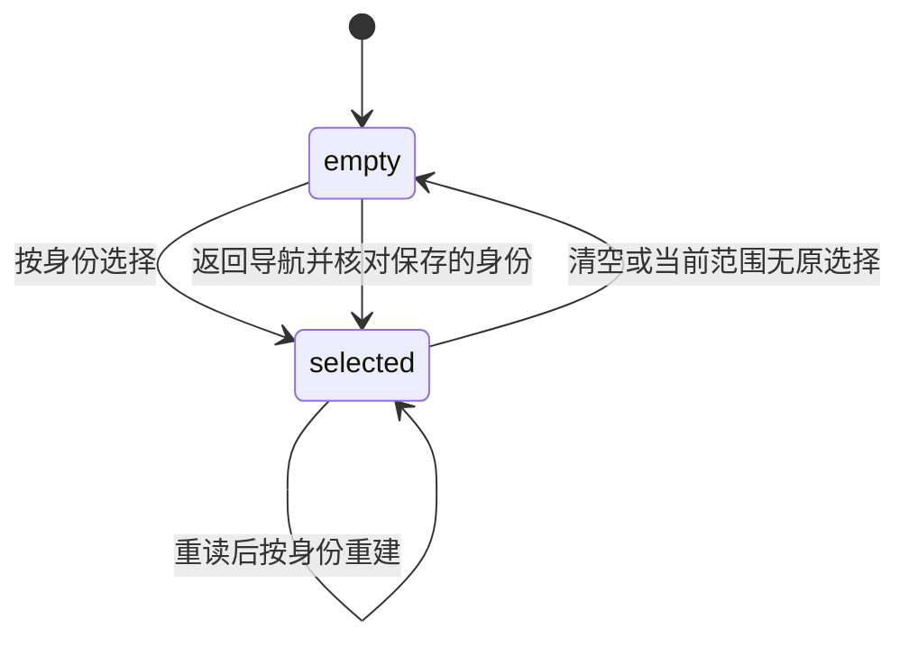
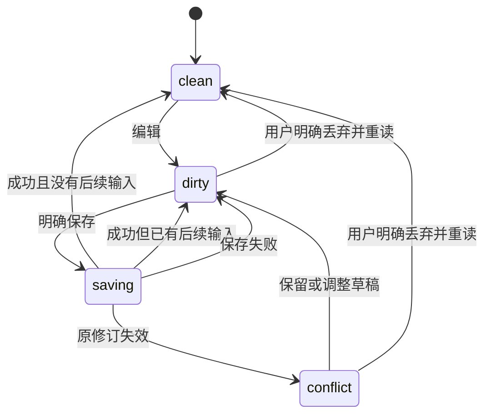

## ADDED Requirements

### Requirement: 类型化题录编辑保留完整题录

工作台 SHALL 提供按已核对类型／字段契约编辑题录及创建者的入口，并经共同题录权威保存；创建者支持已声明的角色、姓名表达和顺序。类型化界面与完整 CSL JSON 编辑 SHALL 使用同一对象草稿，修改明确字段之外的未知字段、嵌套属性及未支持值必须保留。切换类型 SHALL 保留原有数据，对不适用字段给出可核查呈现，不静默删值或改写来源身份、正式引用键及固定状态。手动创建 SHALL 使用已有摄取及逐项结果，不建立另一套建项权威。

#### Scenario: 更正题名保留扩展字段

- **WHEN** 条目含未知 CSL 字段、创建者扩展属性及未被表单支持的日期，用户只更正题名并保存
- **THEN** 重启读取仍取得新题名及其余原值，旧修订可查，原来源与条目身份保持

#### Scenario: 有序创建者及类型切换

- **WHEN** 用户调整已支持的创建者角色／顺序并切换条目类型
- **THEN** 保存后的角色及顺序可由人和 Agent 读回，未明确修改的姓名属性及类型专属值保留，不适用值可检查

#### Scenario: 表单无法表达原值

- **WHEN** 合法既有题录含类型表单不能表达的值或未知类型
- **THEN** 原值仍可查看及通过完整 JSON 明确编辑，其他可编辑字段的保存不会将其重置；无效 JSON 草稿保留且不提交

#### Scenario: 原生CSL局部编辑边界

- **WHEN** 用户从同源目录选择32种CSL类型，修改44个支持的文本字段、22组CSL姓名角色或四日期键的literal／受支持一端或两端数字表达及circa
- **THEN** 保存只改变明确字段，姓名角色调整移动完整对象并保留组内顺序；复杂日期、非字符串值、不适用字段、未知类型及扩展仍可核查且不自动归一化，不反推Zotero原类型或跨角色顺序

#### Scenario: 日期端点精度与复杂值保护

- **WHEN** 用户编辑一个或两个数字date-parts端点，每端为年／年月／年月日正整数
- **THEN** 只更正指定端点与分量，按年1—9999／月1—12／日1—31检查，精度独立，不补齐或重排；其他日期属性／未知值及完整metadata保留，非法输入不破坏原草稿，季节、raw、非公历或其他未支持表达保持原值及JSON核查

#### Scenario: circa独立更正与端点删除

- **WHEN** 用户更正受支持数字日期的布尔或0／1 circa，或明确移除结束端点
- **THEN** 只修改相应属性，既有circa数值类型保持，未改标记不归一化；移除结束端点不改变起始精度或其他日期属性，清除最后数字也不隐式删除未知属性，整个日期删除须明确动作

#### Scenario: 扩展角色与原值权威分别保存

- **WHEN** 用户手动录入书籍、出版者与页数、丛书编辑及年月日，再更正角色、日期并切换到期刊类型
- **THEN** 同一草稿保留不再适用字段、完整姓名属性和未知嵌套值，更正经真实领域保存及重启可读回；library独立保存的原始类型／字段、来源关联、正式引用键及固定状态不因CSL表单操作改变，修订冲突仍保留原草稿

#### Scenario: 目标角色当前值不受支持

- **WHEN** 当前metadata中某角色不是姓名数组，用户编辑其他创建者
- **THEN** 原角色值保留且该角色不能作为表单移动目标，其他更正可正常保存，完整JSON仍可明确编辑原值

#### Scenario: 原生CSL别名目标与原值分离

- **WHEN** 用户明确编辑genre、medium、dimensions、collection-title、call-number、event-title、references、section或title-short等已声明字符串
- **THEN** 只改变明确CSL键，genre不替换条目type，title-short不覆盖既有shortTitle，references不修改关联身份；不推断或写回Zotero类型专属原字段，未知值与原值／正式键保持

#### Scenario: 主持人及单名的有序更正

- **WHEN** 用户在broadcast或motion_picture中添加或调整host的个人、机构／单字段姓名及角色内顺序
- **THEN** literal或family／given按明确输入保存，完整姓名及扩展对象移动，既有其他角色及复杂日期保留；不从CSL分组顺序恢复Zotero跨角色orderIndex

### Requirement: 按身份维护主选和多选

文献列表 SHALL 以实际库身份及稳定条目身份保存当前主选、多选与范围选择依据，主选属于当前已选集合，空选择没有主选。单选、增减选择及范围选择 SHALL 与实际可见顺序一致，任何选择变化均更新高亮、详情及领域上下文。分页、筛选或范围重读 SHALL 按已载入身份核对，离开当前结果范围的对象不冒充新行；清除当前选择不删除对象草稿。集合导航的选择和滚动可以在返回同一导航范围后恢复，但恢复前 SHALL 按当前结果重新核对身份。切换项目、会话或库视图 SHALL 不把文献对象归属改到新项目，也不隐式切换 Agent 接收者。

#### Scenario: 保存使列表重排

- **WHEN** 条目更正使列表顺序改变但选中身份仍在当前页
- **THEN** 高亮、主选详情与工具贡献仍指向原身份，不转移到其旧行号上的其他条目

#### Scenario: 分页或筛选离开选择

- **WHEN** 新结果范围不包含原选中条目
- **THEN** 当前选择不含这些隐藏对象，旧详情不会冒充新页选择，未保存草稿可在重新打开原条目时继续

#### Scenario: 主选与多选分别可辨

- **WHEN** 用户连续增选、取消主选并进行范围选择
- **THEN** 当前多选集合与主选均可核对，主选始终为空或属于集合，未显示的分页条目不被范围操作暗中选入

### Requirement: 有界集合导航和列配置

工作台 SHALL 提供真实集合层级的展开、收起、分页及筛选，明确当前加载范围及后续入口，不因展示集合树读取全库条目或全部附件。只呈现已有能力的入口；同一条目跨集合保持同一身份，打开集合不修改其归属。条目列 SHALL 可配置显示、顺序及宽度，并在同一工作台和库重新打开后保留；列值来自当前有界结果，不逐行读取正文。列及导航偏好不成为题录事实或改变 Agent 会话。

#### Scenario: 子集合跨越多个分页

- **WHEN** 集合层级及同级集合超过单页容量
- **THEN** 用户可逐页访问对应父级的子集合，不因首个扁平分页缺少父节点而将子集合展示为错误根节点

#### Scenario: 列配置和库导航重开

- **WHEN** 用户调整列显示／顺序／宽度，浏览另一集合后重开库
- **THEN** 偏好恢复，当前结果和实际主选仍按稳定身份核对，正文和未展开附件没有被隐式读取

### Requirement: 右栏详情消费唯一文献状态

工作台 SHALL 在既有AuxiliaryPane提供文献详情页签，消费当前库唯一选择及对象草稿拥有者生成的视图。中间区 SHALL 保留管理、集合导航和条目表，右栏复用CatalogItemPane的题录、附件、标签、关联及完整JSON核查；多选显示数量与主选，不暗示批量更正。右栏 SHALL 不另存题录、草稿或保存状态，不从DOM或全库投影推断选择；读取仅针对当前主选及既有有界页。附件继续共同资源打开，浏览及更正不隐式切换会话接收者或工作域。

#### Scenario: 收展及页签切换保留对象草稿

- **WHEN** 用户在文献详情编辑后收起右栏、切换辅助页签并返回，或切换项目／会话后重新打开共同库
- **THEN** 原主选及对应未保存草稿沿同一库／窗口身份恢复，右栏不出现第二份保存入口；文件／任务和programs入口保持可用

#### Scenario: 关闭拥有者与迟到保存

- **WHEN** 库tab关闭或不再呈现，原保存请求迟到返回，随后用户重新打开库
- **THEN** 旧详情贡献被释放，旧回执只处理原对象和提交依据；重新打开沿原草稿恢复，冲突保留后续输入，详情与当前页主选一致

#### Scenario: 另一组已有库tab

- **WHEN** 用户拆分tab组后，从另一组再次打开文献库
- **THEN** 工作台激活已有库tab及其同一选择／草稿，不挂载第二个LibraryContents或竞争同一详情贡献

### Requirement: 类型化更正延续对象草稿保护

类型化更正 SHALL 沿原修订条件保存，题录、创建者、标签、集合及关联编辑共享该对象草稿与提交依据。未保存内容 SHALL 按配置、工作台实例、实际库身份和条目身份隔离；切项、切 tab、范围通知、断线、页面重载及迟到回执不覆盖后续输入。保存成功只推进对应提交的修订；保存失败或冲突保留原草稿，错误归原对象。显式重新读取会丢弃更正时 SHALL 先让用户明确选择，保留可取回草稿的机会。

#### Scenario: 原值题名更正独立于未保存CSL

- **WHEN** 用户对当前单选、已核对唯一受支持期刊原值的准确identity／revision／title预览并提交独立题名更正
- **THEN** GUI SHALL 只调用同源原值题名动作，其他原值／来源／正式键及未保存CSL完整保留，不自动保存CSL或推进其旧修订依据；冲突仍保留草稿并经明确重读处理

#### Scenario: 明确采用已核对原值导出

- **WHEN** 用户检查当前单选的已保存CSL、原值及不可比较边界，并明确选择采用所示原值
- **THEN** GUI SHALL 使用该identity／revision的zotero-original expression请求现有导出；仅exported产生文本，selectionRequired无文本，选择／修订／格式变化或失联使旧确认及输出失效，不自动补键或推断原值

#### Scenario: 原值更正回执不明

- **WHEN** 原值题名请求失联或结果不明，用户重载或重开详情
- **THEN** GUI SHALL 保留原requestId及提交输入，只读查询原结果，不自动重放；notFound不得解释为安全重试，迟到结果只归原对象，明确冲突保留题名及CSL草稿

#### Scenario: 类型编辑期间迟到成功

- **WHEN** 更正请求在途时用户继续修改创建者或切换条目，随后收到旧提交成功
- **THEN** 仅原对象草稿的修订依据前进，后续创建者输入及新对象画面保留，重新打开原对象仍可继续

#### Scenario: 迟到失败与冲突

- **WHEN** 原条目保存因冲突或网络失败迟到返回，此时已打开另一条目
- **THEN** 失败保留在原条目的待处理状态，另一条目内容和草稿不被覆盖，用户可核对原草稿及当前权威修订
