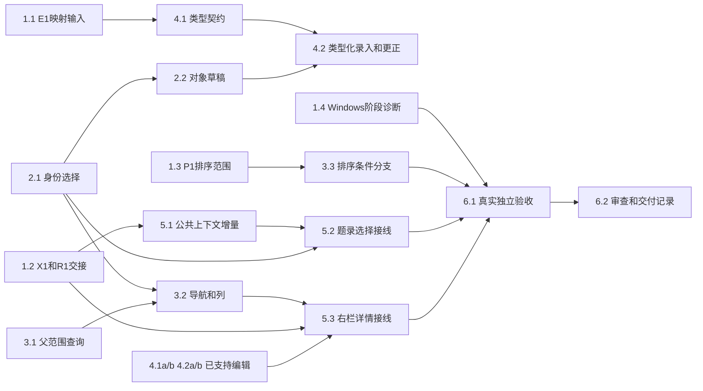

# 执行任务

## 938c33f后的5.4a消费

主线已同步真实`startIsolatedKernel`，A配置前置具备。本轮直接扩原zotero-original双宿主场景：关闭准备app后全程真实RPC，已提交回执丢失／未送达分别跨真实stop、child close及显式注入重启查询，核冻结pending与CSL旧依据、键／历史不变；拒绝缺配置／错库／撤read。只改所属测试与原工件，不改helper／CLI或重跑14UI，B仍未交付。

## 4312262后的配置／进程重启边界

本轮已核对真实CLI→ensureKernel→serve及现有UI注入路径。CLI没有isolatedZotero可信配置加载／传递能力；按用户条件只交investigation／design中的提供者及候选方案，不创建新server／launcher或跨模块配置，不重复已绿14UI。原macOS列表同例已有4312262新目标通过证据；不再调查旧失败。

- [x] 5.4a 已消费主线startIsolatedKernel，在原GUI单个场景用实际BBT9.0.68与每宿主四次真实内核进程启动验证A。committed／notFound均跨原实例stop、child close及同库显式注入重启，冻结identity／revision／requestId与完整dirty CSL保持；查询后实际CSL保存仍以旧revision被CAS拒绝。缺配置、错误库请求、撤read及错误绑定重启均拒绝而不假作notFound；无重放、原值／键／历史不污染。首轮2/2、独立审查补强后最终双宿主2/2通过，日志见delivery；不改共享helper，B及完整4.1／4.2／I6／E6仍开放。

## 0b78815后的有界GUI消费者

前片已在共同源码0b78815接收并同步，本轮先核对原macOS分页滚动200→0（原日志并非列宽），随后沿当前单一详情／草稿消费已同步zotero.inspect／replaceTitle／export。仅单条及唯一受支持期刊原值；不重用旧patch，不扩大4.1／4.2、I6或生态E6。具体设计与可信夹具先核实，缺接口则精确交回。

- [x] 3.2a 原失败实际为分页scrollTop而非列宽；可观察提交等待及精确恢复断言保持。原本机定向2项／最终library12项后，现已消费同源码4312262的Checks40476577071 macOS job122096177783 completed/success，人工步骤含library双宿主，同例新目标已通过；不再追查旧失败。不据此宣称原包导出、重启或全平台完成。
- [x] 5.4 单条所选唯一受支持原值的独立题名预览／更正及显式原值导出GUI，沿已同步DTO、唯一详情及可信隔离构造；不改CSL草稿／依据／键／其他原字段。真实内核3项、原值GUI双宿主2项及原library12项通过；冲突、真实回执丢失／请求未送达后只查询不重放，notFound保持未决，迟到选择及损坏草稿回归通过。首轮失败／独立审查修复及实际结果见原delivery，完整4.1／4.2／I6／E6仍开放。

## 8a2f0ce后的数字日期有界续做

当前共同源码8a2f0ce；原生CSL字段、单一右栏及报告／生态授权修复已接收。本轮仅4.1d／4.2d：数字区间与有证据circa表达；复杂／字符串日期及季节／非公历仍保留。基线最新CI为39be889／40432749785，平台实际状态写调查，不重复旧累计patch、同步等待或勾完父任务。

## 4b13183后的4.1／4.2有界续做

主线已接收5.3及全部前片，当前共同源码4b13183，原同步／公共未接入条件失效。本轮只交4.1c／4.2c，原类型／原值／Extra逆转换及复杂日期仍保留，不为关闭父任务造映射。CI调查使用6b22d60／Checks40315429083实际平台日志，精确阶段与保留缺口写原investigation；不再把旧374项记录当最新基线。

## 共同领域实现接入后的5.3

当前共同基线1026796d854b8f568c3e819f13268a9638980bc1，工作区初始clean。七域源码及本线既有成果均已合入dev，旧“未入dev／等待用户同步／缺项目私有实现”条件失效，下方分阶段授权文字保留为历史。本轮只实施5.3及可达的本机验收子范围，完整4.1／4.2与跨平台／整体I6不自动关闭。先更新文献UI设计，再沿唯一状态拥有者贡献详情；不应用旧/tmp累计补丁。

## round4继续4.1／4.2（历史授权）

已读取round4 acceptance，接收X1及原值／键／事务首片；0519904已在本树，不同步、也不为已撤回分页误报返工。原design首节已闭合20字段、17角色及简单CSL单端点数字日期范围；只扩展原唯一编辑目录和表单，复杂／别名值保留。执行4.1b／4.2b后停止，5.3及整体I6继续等待共同接入。

## 2026-10-26先前阶段授权（历史）

恢复核对：HEAD `70be8bfcda5ab1453c20428f9eb3b367d90ed0b7`，0519904（含b838402）已为祖先，恢复前clean。用户明确由主线同步后恢复，替代下文旧等待条件；现在只在本树正式源码实施，不建立/tmp组合。同步与已有切片证据见`/tmp/scholoom-sync-recovery-wyn13R/recovery.md`及`synchronized.json`，不能作为本轮X1已完成证据。

用户选定独立题录选择贡献并授权完整公共X1提供者、harness模型前及恢复复查和本线UI接入，现已在同步后的正式源码实现并经主线验收。公共补丁含DTO／注册／真实库与宿主／调用方／生成映射／必要测试，可脱离私有UI构建。原值／键／事务另在define-library-zotero-record-authority实施，不混入本change；右栏5.3等待共同接入，不扩C—I批。本轮选择可审查补丁，不提交、推送、归档或安装新依赖。

2026-10-25 用户先授权独立实施及锁定依赖安装，后续正式转交主线快照并授权CSL闭合局部任务及公共方案准备。E1调查／R1两份设计已消费；X1由审查稿推进为本树真实提供者，进入dev及其他消费者仍由主线接入。排序留F。CLI ready不表示完整交付。依据见 [investigation](investigation.md)，方案及拥有者见 [design](design.md)。

取得实施授权后，**首批可独立实施为2.1、2.2、3.1、3.2**；只复用现有已知数据和端口，不等待完整生态宿主、科研Graph、任务或报告。文献线主Agent整合；任何辅助实施仅在明确文件所有权后有界委派，不建立协调Agent／DAG。

## 1. 待输入与条件分支

- [x] 1.1 E1调查输入闭合：正式消费快照内固定10.0.5调查、mapping、design、delivery，逐项记录类型／字段／姓名及顺序／日期／Extra／身份与键的有损边界。CSL局部契约在本change闭合；原值／来源／键／事务首片已在`define-library-zotero-record-authority`实现并经主线验收，三项政策已有决议。不由本项勾选声称完整4.1／4.2或生态生产接入就绪。
- [x] 1.2 已消费0519904及1026796共同基线并闭合独立题录贡献契约，真实提供者、模型／恢复复查及UI已验收并进入dev；不再等待公共方案选择或用户同步。
- [x] 1.2a 逐份消费阅读材料／报告design、ContextItem同源增量及项目AuxiliaryPane实际源码，核对R1边界与右栏符号、taskNavigator／活动task及多窗口fixture合并点，精确路径见investigation；不再等待同一设计重复转交。
- [x] 1.2b 已闭合独立题录贡献的精确100项DTO、范围／主选、16项材料独立预算、修订／授权及三类模型准入复查、提供者清单和独立增量顺序；真实实现与验证由5.1记录，历史候选补丁不再代表当前接线状态。
- [x] 1.3 P1按原B／F分批边界核对：本批列显示／顺序／宽度，查询排序留F；不实施未经确认的新排序，保留服务端默认顺序，依据见design及本轮主线协调计划。
- [ ] 1.4 当前已完成938c33f／Checks40540362614，平台逐项结果见共同计划“第十一轮验收后的安排”及本change主线delivery；Linux／Windows未全绿，不能据不同运行数量推新增源码缺陷或启动稳定。附件／共同初始化由所属线协查，本机5.4a双宿主各有通过依据仍不等于平台关闭。

## 2. 稳定选择与对象草稿：首批独立成果

- [x] 2.1 文献线在`CatalogSelection`、`CatalogItemList/Row`及`LibraryTab`把行号集合改为单一库／条目身份快照，具备主选、锚点、增减／范围选择和当前页求交；删除不再需要的索引调整路径。复用现有测试，必要时加一个表驱动选择用例；通过重排、筛选／分页、取消主选及首项不变的多选刷新验证。工具贡献尚等5.2，此项只接受真实列表／详情状态结果。
- [x] 2.2 文献线在library目录提取实际需要的状态拥有者，tab卸载保留选择／导航／列和草稿；详情保存仍复用原修订及完整metadata。复用既有工作台实例身份，按窗口和实际库id隔离草稿并保留旧路径草稿的显式恢复，迟到失败归原对象；扩展`tests/ui/library.spec.ts`，覆盖多窗口、切项／切tab、刷新、保存中继续输入、迟到成功／失败及冲突重读，不覆盖另一库或新草稿。所需UI设计更新随此项先写文献分节，符号移出目录前沿1.2交接。

## 3. 有界集合导航与表格列

- [x] 3.1 文献线扩展`protocol/library.ts`的`library.collections`父范围及`LiteratureCatalog.collections`，复用原集合身份和保存／循环校验；生成受影响映射并通过契约校验。扩展`literature-catalog.spec.ts`，用真实多级、跨页且父子id无顺序保证的样本验证根／直接子项范围、nextOffset、原有扁平读取及权限；不扫描条目或附件。
- [x] 3.2 依赖2.1、3.1，在library目录接真实可折叠集合导航、逐分支分页及范围恢复，提供当前五列的显示／顺序／宽度偏好；复用虚拟列表与语义token。先更新文献UI设计对应段，再扩展双宿主library用例，检查超过25集合、筛选后身份、列偏好重载和浏览不读正文；不新增未接线的回收／搜索／批量入口。
- [x] 3.3 依赖1.3，按排序留F条件结案：design明确边界，UI保留已有默认顺序，只提供列偏好；没有新增排序分支或本页排序冒充全结果排序。

## 4. 类型化录入与更正：E1后实施

- [ ] 4.1 **依赖1.1**：文献线交付类型／字段／创建者同源声明，明确Zotero基线与CSL表达、未知字段及不支持值语义，GUI和领域校验从同一声明消费；不封闭现有合法metadata。用独立核对样本检验类型专属字段、姓名／机构表达、角色顺序、日期和未知扩展保留；对无法映射者保留待核查状态，不猜填。
- [x] 4.1a 已闭合首个CSL子范围：32种CSL编辑类型、直接文本、四姓名角色与literal日期共享声明；未知值与复杂日期保留。领域保持原开放schema与16KiB边界，不反推原Zotero类型。helper、领域重启及双宿主验收通过；原值／来源／键另由所属change提供，不在表单复制权威。
- [x] 4.1b 依据固定10.0.5证据补20个一一文本字段、17个唯一角色及适用CSL类型，增加单端点数字日期的局部编辑；未知／多对一／复杂值只保留和核查。声明仍单源，不从CSL猜原类型／角色，不收紧开放metadata；独立静态样本及真实保存／重启验证通过，见round4 delivery。
- [ ] 4.2 **依赖2.2、4.1**：将类型表单接入已有手动ingest与update，JSON与表单共用完整草稿；显式改字段／删除语义、类型切换保留和保存冲突均按delta。扩展`library.spec.ts`及必要catalog用例，从入口录入、多角色更正、只改题名保留未知嵌套字段，重启后通过真实领域接口读回；批次、来源、历史和16KiB保护继续通过。同步UI设计／开发说明文献节。
- [x] 4.1d 以固定CSL标准／官方样本闭合数字date-parts两端及各端精度、布尔／0／1 circa的明确编辑；共享声明与helper单源限制，保留未知属性及未支持值，无效输入不破坏原metadata。基线RED及内核16项通过，不扩自由解析、原值／Extra或来源契约，父4.1保持开放。
- [x] 4.2d 唯一表单／JSON草稿接数字区间、circa、明确结束端移除及就地非法输入反馈；真实保存／冲突／重启和双宿主library12项通过，随后仅补强原生badInput观察并定向双宿主2项通过。核对当前库事务边界，未同步生态API不接线；实际结果与补丁见原delivery，父4.2与Windows不关闭。
- [x] 4.1c 固定上游源码及独立样本闭合9个原生CSL文本字段、host角色和现有字段缺失的类型适用范围；明确单名／机构、跨角色顺序、复杂日期、别名／Extra及原值的有损边界。仅编辑目标CSL属性，不改原值／来源／正式键或开放schema；固定上游4样本及声明回归通过，父4.1保持开放。
- [x] 4.2c 通用表单消费上述目录，同一JSON草稿实际录入／更正影像、软件、法律／专利的代表值与host个人／机构单名；类型切换、姓名对象／顺序、复杂日期及未知嵌套、shortTitle历史别名原样保留。内核14项真实保存／冲突／重启及双宿主12项关键表单／右栏单实例／迟到草稿通过，更新同一delivery并停止，父4.2保持开放。
- [x] 4.2a 依赖4.1a局部目录及既有2.2，复用同一CatalogItemForm接手动ingest与update完整JSON草稿；不适用值只读保留、非法目标角色禁用。library双宿主及catalog重启／历史测试通过，验证类型／姓名／组内顺序／角色／日期与未知值持久保留；不包含原Zotero原值、身份、正式键或插件事务。
- [x] 4.2b 同一表单实际录入／更正新增字段、角色及简单日期；类型切换不删值，日期格式不猜转换，姓名对象完整移动。真实领域重启及静态承载双宿主验证通过，原值／来源／固定键、未知嵌套和冲突／迟到草稿不变；原delivery已更新，本轮可审查增量补丁交回，不作Git提交。

## 5. 公共增量与工作台真实选择：X1／R1后实施

- [x] 5.1 文献同源catalog-selection、library.selection/checkSelection、真实SQL修订核对、宿主broker及harness ledger与模型／恢复复查；architecture及同源映射同交付。契约、真实库／worker及注册Graph回归通过，公共提供者现已进入dev和本树1026796，不依赖私有UI。
- [x] 5.2 文献UI经既有ContextContribution发布当前范围／主选／身份及观测修订；Workbench仅新增library活动视图，保留原receiver。真实双宿主17项无附件选择、翻页到工具调用时最新主选及接收者、既有上下文／草稿／多窗口回归通过；模型仍为受控HTTP。
- [x] 5.3 **依赖1.2、2.2、3.2、4.1a／4.1b、4.2a／4.2b**：在当前真实`AuxiliaryPane`增加文献详情页签，消费同一library状态生成的主选／多选摘要、CatalogItemPane和类型／JSON草稿；不复制保存入口或状态。保留项目文件／任务与programs及共同附件打开；双宿主收展、切项目／会话、关闭重开、冲突／迟到草稿和有界读取通过，另修复跨组重复库实例及300px标签纵排，首轮24项／最终6项分别留证。完整4.1／4.2不作为此独立消费者的前置。

## 6. 独立验收与交付

- [ ] 6.1 文献线主Agent在已构建、独立配置／库／项目／端口的真实内部接线中验收：收录 → 类型化更正 → 集合／列与多选 → 原会话工具读取实际选择 → 重启读回；复用library／context-bridge及必要attachments／resource-opening／resource-lifecycle定向双宿主。运行受影响类型、架构、lint、构建及生成映射检查，逐项保留结果；Windows相关验证未通过不称跨平台完成，macOS沿人工降级，未用真实模型则明确证据边界。
- [x] 6.1a 本轮5.3本机子验收：构建后在隔离Linux配置中运行library／context-bridge／resource-opening／attachments双宿主，核对右栏唯一详情、主选／多选、折叠／展开、项目／会话及库tab生命周期、原冲突／迟到草稿、共同附件入口和当前主选有界读取；相关类型／架构／lint及生成映射只读检查通过。首次重复实例RED、视觉问题和最终复验详见delivery；不据此关闭完整映射或Windows／整体I6。
- [ ] 6.2 对关键接口、读写／外发权限、修订冲突、迟到回执和数据保留完成独立只读审查，主Agent核对整改及最小复验。实际执行后再取delivery instructions并填写`delivery.md`，对照proposal完成判据、所有未决项和验证范围；全部必要结果真实完成后才更新本项，不由CLI ready代替验收。

## 续做入口

共同源码938c33f已实际消费，5.4a的A真实进程／原包／双宿主子片已验证，原配置缺口等待不再适用；当前25/30，达到本轮边界停止。完整映射4.1／4.2、Windows1.4及整体6.x／生态E6保持开放；未知操作只查询不重放，不新增B生产配置或真实库接线，不归档或自动启动后续阶段。
