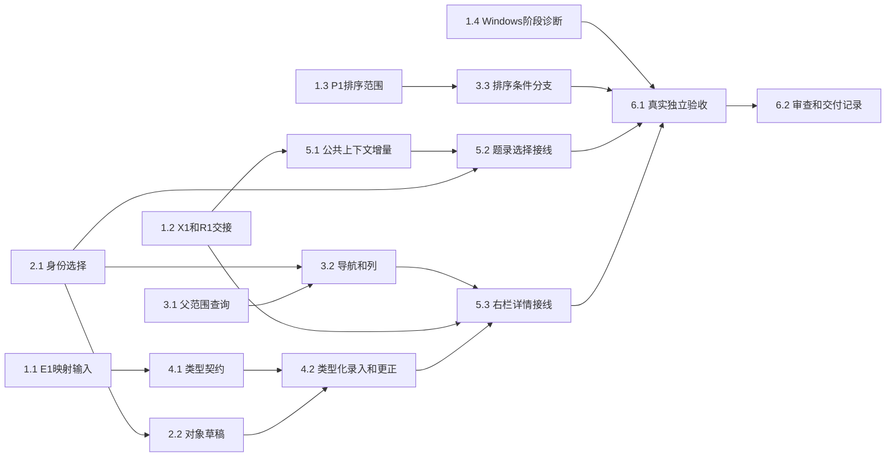

# 执行任务

## 2026-10-26 本轮授权范围

用户选定独立题录选择贡献并授权完整公共X1提供者、harness模型前及恢复复查和本线UI接入；不再等待公共方案选择。本树HEAD仍e3d58fc，b838402非祖先，禁止自行同步；本树局部验证与临时b838402隔离组合分别记录。公共补丁必须含DTO／注册／真实库与宿主／调用方／生成映射／必要测试，可脱离私有UI构建。原值／键／事务另在define-library-zotero-record-authority实施，不混入本change；右栏5.3不在本轮优先切片，不扩C—I批。允许可审查本地提交或补丁，本轮选择补丁，不推送、归档或安装新依赖。

2026-10-25 用户先授权独立实施及锁定依赖安装，本轮再正式转交主线快照并授权CSL闭合局部任务及公共方案准备。E1调查／R1两份设计已消费，X1按A提出审查稿但真实公共提供者未接入；排序留F。CLI ready不表示公共接口定案。用户库、Git提交／推送、PR及归档未授权。依据见 [investigation](investigation.md)，方案及拥有者见 [design](design.md)。

取得实施授权后，**首批可独立实施为2.1、2.2、3.1、3.2**；只复用现有已知数据和端口，不等待完整生态宿主、科研Graph、任务或报告。文献线主Agent整合；任何辅助实施仅在明确文件所有权后有界委派，不建立协调Agent／DAG。

## 1. 待输入与条件分支

- [x] 1.1 E1调查输入闭合：正式消费快照内固定10.0.5调查、mapping、design、delivery，逐项记录类型／字段／姓名及顺序／日期／Extra／身份与键的有损边界。CSL局部契约在本change闭合；需原值／来源／键／事务的数据模型已拆到`define-library-zotero-record-authority`规划，其三项政策仍受阻，不由本项勾选声称完整4.1／4.2或生产生态提供者就绪。
- [ ] 1.2 **等待X1公共接入**：A候选技术设计与R1交接已完成；公共审查、真实提供者及dev接入／同步未完成，5.x保持受阻，不把快照设计当生产接口。
- [x] 1.2a 逐份消费阅读材料／报告design、ContextItem同源增量及项目AuxiliaryPane实际源码，核对R1边界与右栏符号、taskNavigator／活动task及多窗口fixture合并点，精确路径见investigation；不再等待同一设计重复转交。
- [x] 1.2b 按A提出精确100项题录贡献DTO、范围／主选、16项材料独立预算、修订／授权及三类模型准入复查、提供者清单和独立增量顺序；本轮仅交公共审查稿与未注册候选补丁，不关闭5.1。
- [x] 1.3 P1按原B／F分批边界核对：本批列显示／顺序／宽度，查询排序留F；不实施未经确认的新排序，保留服务端默认顺序，依据见design及本轮主线协调计划。
- [ ] 1.4 在实际提供目标Windows验证环境后，对调查列出的literature-integration、literature-attachment-integration、pdf-isolation失败按发送／受理／worker／工具提交／刷新阶段复现并留trace；向共同上下文及科研／Agent实际提供者核对context-instructions／work-materials材料接续失败，记录其交接证据。若公共执行缺口阻塞文献验收，与实际提供者确认独立补充；没有新证据不调整超时或削弱原授权和停止断言。Linux静态阅读不作为此项完成依据。

## 2. 稳定选择与对象草稿：首批独立成果

- [x] 2.1 文献线在`CatalogSelection`、`CatalogItemList/Row`及`LibraryTab`把行号集合改为单一库／条目身份快照，具备主选、锚点、增减／范围选择和当前页求交；删除不再需要的索引调整路径。复用现有测试，必要时加一个表驱动选择用例；通过重排、筛选／分页、取消主选及首项不变的多选刷新验证。工具贡献尚等5.2，此项只接受真实列表／详情状态结果。
- [x] 2.2 文献线在library目录提取实际需要的状态拥有者，tab卸载保留选择／导航／列和草稿；详情保存仍复用原修订及完整metadata。复用既有工作台实例身份，按窗口和实际库id隔离草稿并保留旧路径草稿的显式恢复，迟到失败归原对象；扩展`tests/ui/library.spec.ts`，覆盖多窗口、切项／切tab、刷新、保存中继续输入、迟到成功／失败及冲突重读，不覆盖另一库或新草稿。所需UI设计更新随此项先写文献分节，符号移出目录前沿1.2交接。

## 3. 有界集合导航与表格列

- [x] 3.1 文献线扩展`protocol/library.ts`的`library.collections`父范围及`LiteratureCatalog.collections`，复用原集合身份和保存／循环校验；生成受影响映射并通过契约校验。扩展`literature-catalog.spec.ts`，用真实多级、跨页且父子id无顺序保证的样本验证根／直接子项范围、nextOffset、原有扁平读取及权限；不扫描条目或附件。
- [x] 3.2 依赖2.1、3.1，在library目录接真实可折叠集合导航、逐分支分页及范围恢复，提供当前五列的显示／顺序／宽度偏好；复用虚拟列表与语义token。先更新文献UI设计对应段，再扩展双宿主library用例，检查超过25集合、筛选后身份、列偏好重载和浏览不读正文；不新增未接线的回收／搜索／批量入口。
- [x] 3.3 依赖1.3，按排序留F条件结案：design明确边界，UI保留已有默认顺序，只提供列偏好；没有新增排序分支或本页排序冒充全结果排序。

## 4. 类型化录入与更正：E1后实施

- [ ] 4.1 **依赖1.1**：文献线交付类型／字段／创建者同源声明，明确Zotero基线与CSL表达、未知字段及不支持值语义，GUI和领域校验从同一声明消费；不封闭现有合法metadata。用独立核对样本检验类型专属字段、姓名／机构表达、角色顺序、日期和未知扩展保留；对无法映射者保留待核查状态，不猜填。
- [x] 4.1a 已闭合CSL子范围：32种CSL编辑类型、直接文本、四姓名角色与literal日期共享声明；未知值与复杂日期保留。领域保持原开放schema与16KiB边界，不反推原Zotero类型。helper、领域重启及双宿主验收通过；完整原值／来源／键规则仍由公共规划承接。
- [ ] 4.2 **依赖2.2、4.1**：将类型表单接入已有手动ingest与update，JSON与表单共用完整草稿；显式改字段／删除语义、类型切换保留和保存冲突均按delta。扩展`library.spec.ts`及必要catalog用例，从入口录入、多角色更正、只改题名保留未知嵌套字段，重启后通过真实领域接口读回；批次、来源、历史和16KiB保护继续通过。同步UI设计／开发说明文献节。
- [x] 4.2a 依赖4.1a局部目录及既有2.2，复用同一CatalogItemForm接手动ingest与update完整JSON草稿；不适用值只读保留、非法目标角色禁用。library双宿主及catalog重启／历史测试通过，验证类型／姓名／组内顺序／角色／日期与未知值持久保留；不包含原Zotero原值、身份、正式键或插件事务。

## 5. 公共增量与工作台真实选择：X1／R1后实施

- [ ] 5.1 **依赖1.2**：由确认的公共提供者交付最小同源题录选择契约、授权／修订核对与宿主／harness适配，复用连接关联和现有工具；生成映射与architecture装配同交付。扩展现有context内核测试，覆盖无附件、17／100条、主选和范围、库身份不符、版本落后、撤权及模型排队后的再检查；不把替身通过当真实接线完成。公共增量须可独立接入dev，不依赖本线未入dev的私有UI。
- [ ] 5.2 **依赖2.1、5.1**：文献UI经既有ContextContribution发布当前身份选择，Workbench让活动library视图可贡献，business-session保持原receiver。扩展`context-bridge.spec.ts`，从实际多选入口让真实工具读变化后的完整选择，核对分页／tab变化、无附件、断线／多窗口和原会话草稿；模型边界沿原受控HTTP。
- [ ] 5.3 **依赖1.2、3.2、4.2**：以已交接的`AuxiliaryPane`文献详情槽位呈现同一library状态的主选／多选摘要及类型详情；不复制`LibraryTab`保存入口。保留项目右栏和既有附件打开，双宿主验证右栏收展、切项目／会话、tab关闭重开、草稿和有界读取；同步UI设计及必要可访问名测试。

## 6. 独立验收与交付

- [ ] 6.1 文献线主Agent在已构建、独立配置／库／项目／端口的真实内部接线中验收：收录 → 类型化更正 → 集合／列与多选 → 原会话工具读取实际选择 → 重启读回；复用library／context-bridge及必要attachments／resource-opening／resource-lifecycle定向双宿主。运行受影响类型、架构、lint、构建及生成映射检查，逐项保留结果；Windows相关验证未通过不称跨平台完成，macOS沿人工降级，未用真实模型则明确证据边界。
- [ ] 6.2 对关键接口、读写／外发权限、修订冲突、迟到回执和数据保留完成独立只读审查，主Agent核对整改及最小复验。实际执行后再取delivery instructions并填写`delivery.md`，对照proposal完成判据、所有未决项和验证范围；全部必要结果真实完成后才更新本项，不由CLI ready代替验收。

## 续做入口

E1／R1已收到，P1按B／F边界闭合；X1真实公共接入、右栏及完整原值／身份／键／事务模型仍开放，1.4尚无Windows实跑。续做先读delivery实际结果和公共规划三项待决政策，不把局部4.1a／4.2a通过扩成完整B批。达到本轮边界后停止，不提交、归档或启动C—I批。
