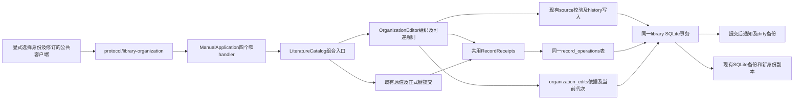
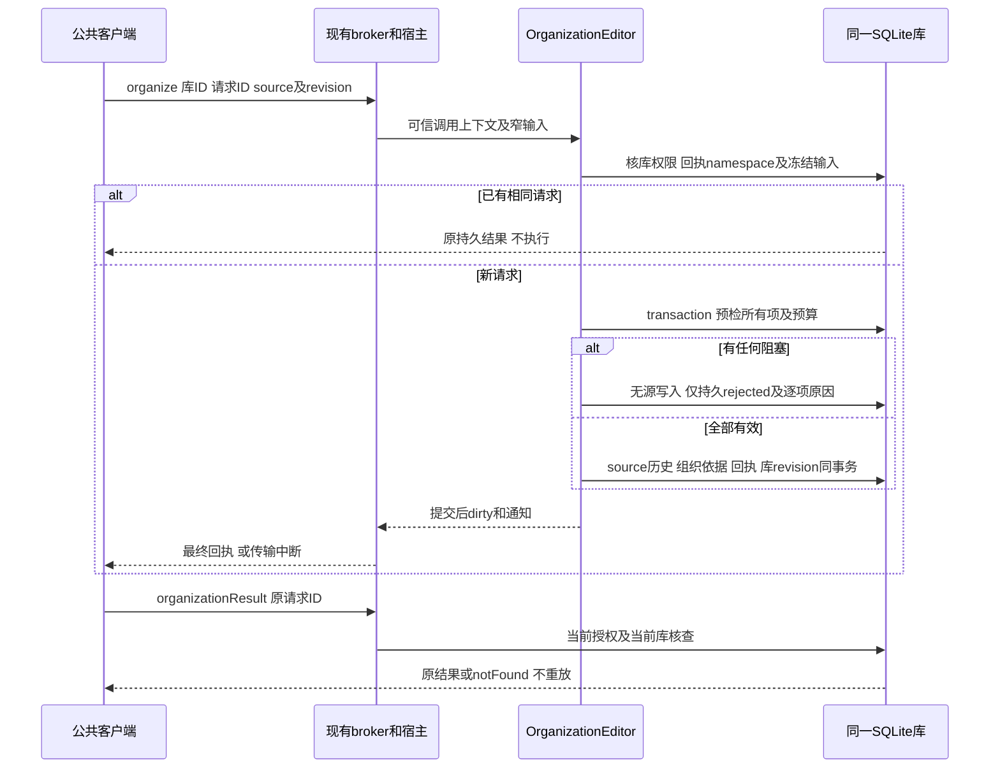

# 实现设计

## 变更总览

本change沿C命名，首片仅交既有source的集合成员／标签整理及可逆记录。依据见[investigation](investigation.md)：当前单条update及原子authority提交已经真实存在；不为拆模块复制catalog，不用逐条update循环冒充原子批量，也不把完整C／D／E的关系待决项塞进首片。

第十五轮已实施叶契约及library内四个方法，实际提供者结果见[delivery](delivery.md)。图中公共客户端／宿主注册仍为3.1目标，未发布公共操作；真实进程恢复及UI兼容性分别留3.2／3.3。以下保留完整C1目标设计，不将领域直调验收写成整条公共路径已接线。

## 方案与接口

### 1. 权威与模块

- `OrganizationEditor`为library私有deep module，对外四个领域方法；内部隐藏字段意图、预检、字节预算、原子提交、代次／修订核对及明细分页。SQL仍在同一library库，不引入项目数据库、文件日志或另一个当前题录表。
- 用一个小的`RecordReceipts`私有模块收拢现有record_operations的查找／同请求核对／最终结果持久化；旧commitRecords保留原业务计划和事务，不整段搬走catalog。新表只是组织可逆依据，不能另存第二份请求结果。
- 私有store seam绑定同一Drizzle数据库及现有`recordAccess`、source读取、集合验证、`remember/writeSource`、库revision、dirty／通知。`OrganizationEditor`通过该seam写源，不能重复一套metadata／权限校验。写源adapter在事务内保存before及完整after，只改组织字段／revision／updatedAt；metadataOrigin、CSL未知值及原值／键表均不改。
- 人工KernelClient经现有broker及宿主注册进入；Agent身份若调用同源端口仍走现有可信执行上下文检查，不从请求接收actor／授权提升。本片不新增可自报操作者；组织记录不是E的删除证据。
- root工具名单保持现状，不为了暴露C而将整个commitRecords的原值／正式键能力加入。后续Agent／GUI消费者使用相同端口，须另交真实来源／外发准入和界面接线；本片不修改harness runtime或共享UI fixture。

### 2. 同源DTO

唯一schema源为`packages/protocol/src/library-organization.ts`。1.1提供叶schema、派生类型／验证器及library具名导出供提供者独立测试；3.1与实际handler一起组合公共操作并生成business／client映射，不提前发布尚无handler的端口。下列已有叶定义及领域实现，尚未注册公共接口。

| 方法 | 输入 | 输出与语义 |
| --- | --- | --- |
| `library.organize` | `{libraryId, requestId, changes: OrganizationChange[1..100]}` | `OrganizationReceipt`；read＋write、effect=write、沿现有5秒操作等待语义，不增加超时。 |
| `library.organizationResult` | `{libraryId, requestId}` | `{libraryId: 当前库, outcome: OrganizationReceipt或{requestId,state:notFound}}`；read，原outcome不改库身份或输入，不重放。 |
| `library.organizationEdit` | `{libraryId, editRequestId, offset?:0, limit?:25, expectedEditRevision?}` | 当前库／originLibraryId、editRevision、position、lastActionRequestId、资格诊断及成员差异页；read。offset>0必须带第一页取得的代次，变化则contentChanged。 |
| `library.revertOrganization` | `{libraryId, requestId, editRequestId, expectedEditRevision, direction:undo或redo}` | `OrganizationReceipt`；read＋write，新动作请求身份，原请求查询仍走organizationResult。 |

`OrganizationChange`只有`sourceId`、非负safe-integer `revision`及至少一个`tags?:string[]`／`collectionIds?:id[]`。禁止metadata、original、key、relatedIds或附件参数。省略字段保持；`[]`清空。每个集合／标签数组最多100、值唯一，集合ID沿现有id约束，标签非空且沿现有长度100限制；精确字符串比较，不trim／改大小写。按集合比较后只保留实际变化，输入仅排列不同则保留当前数组并报告unchanged；保存的before/after仍保留实际旧／新数组。

`OrganizationReceipt`包含原`libraryId`、`requestId`、`state:committed|rejected`、按输入顺序的`results[<=100]`及可选总体ErrorInfo。逐项为`{sourceId,status:applied|unchanged|blocked|notApplied,revision?,error?}`：成功项给当前提交修订，unchanged不递增；被阻塞项给结构化错误，其他有效项notApplied。全局预算失败可令全部notApplied并给总体resourceLimit。该DTO不冒充旧RecordReceipt，旧keyCandidate等语义保持。

明细页为`{sourceId,field:tags|collectionIds,value,before:boolean,after:boolean}`成员差异；不返回完整CSL／原值／before-after整数组。响应含当前库及原库身份、原组织请求身份、记录代次和位置`applied|undone|unchanged`，资格诊断只包含有界sourceId／错误码，不能当租约。未成功提交的请求用organizationResult查拒绝原因；对其请求明细返回invalidRequest，不伪造可逆依据。无实际变化的成功请求有position=unchanged、空差异，不允许undo／redo。

请求冻结后按JSON值深比较，沿现有语义，不按字段集合“等价”替换原输入；同requestId改数组顺序也不是同一冻结请求。查询同ID但操作namespace错误返回invalidRequest，不借此泄露其他种类回执。

### 3. 预算与原子边界

复用`recordLimits.changes=100`、`recordLimits.requestBytes=262144`；新增组织before/after实际变更参与集投影预算262144。预算计算用UTF-8序列化实际捕获值，先于任何source/history写入；不包括CSL或原值。样本字节见investigation；这些是本片拟定的资源限制，不是吞吐承诺。响应复用整包512KiB字节分页，limit最多100；成员差异每行一项，不能返回100份完整快照。超限不自动chunk，缩小范围由调用方明确重新发起。

提交顺序：当前read/write及libraryId→schema／请求预算→namespace及同ID结果→同一数据库事务内再次检查权限／库身份→读全部指定source→逐项修订／标签／集合及投影预算预检→一次写全部实际变更、旧source历史、组织依据及成功回执、库revision→事务成功后dirty和通知。预检确认拒绝时尚无源写入，直接在同一事务持久唯一rejected回执和库revision，无需先回滚再开第二事务；拒绝记录同样进入dirty／备份。发生数据库写入异常则整事务回滚并抛实际错误，不伪造终态；原authority的既定拒绝语义不改变。拒绝回执／通知是操作诊断，不是源数据部分成功。

SQL事务内不await外部依赖、不做文件操作。请求signal在进入提交前检查；客户端取消或断线不保证事务撤回，完成后用原身份核查。操作等待、busy_timeout及生产容量不改；发生真实迟延先保留阶段诊断，不能加统一timeout。

### 4. 持久化与撤销／重做

library v4→v5新增：

1. `record_operations.kind`，旧行默认`authority`；新值`organization`／`organization-history`。同requestId仍在同表唯一，跨kind重用拒绝。storage value类型扩展为旧RecordReceipt与新OrganizationReceipt的union；旧commitResult检查authority再返回，旧请求／旧JSON结果内容不重写。新organizationResult只查两种C namespace，拒绝把authority结果当组织操作。
2. `organization_edits`，以初始组织requestId关联同表committed结果，保存originLibraryId、创建时间、实际变更字段before/after、实际参与source、当前expectedSourceRevision、editRevision、position及lastActionRequestId。它不保存第二份结果，不存文件，不从旧history补造记录。无变化成功行可用空参与集、editRevision=0、position=unchanged表示。

首次实际组织更正position=applied／editRevision=1。undo期望applied，redo期望undone；在同一事务内核editRevision、originLibraryId与全部实际变更项当前整条source.revision（不含原no-op项），并验证要恢复的集合仍存在。任何不符整组拒绝；不允许force、字段级静默rebase或仅比“值又相同”。成功将本次变化字段恢复到before或after，每个源revision+1、保存当前完整source历史、记录代次+1、更新预期source修订及位置，并同事务保存新动作回执。

实际变化前同时核对条目修订与记录代次的下一值仍为safe integer；上限拒绝不改变源、历史或记录head。条目无变化不增加source.revision；新回执及组织依据的持久化仍推进库revision，使dirty／自动备份可以感知记录变化。组织持久类型与表在schema同源声明，避免schema反向依赖组织实现。

原请求重复只返回旧committed结果，即使当前position已undone；不会变成redo。动作新ID重放同理。两个客户端同时撤销同一代次，最多一个成功，另一个依据失效；不需要全局撤销栈，不撤销别人的后续更正。

迁移沿现有Drizzle journal及`before-migration-v4.sqlite`，未来版本门槛更新为5；旧v4权威回执填authority，不猜字段。组织操作未扩大现有库read/write/send资源种类，不增授或清除既有授权；独立restore继续原有read=true/write=false/send=false。新表随SQLite备份自动纳入；不改材料文件备份循环。

正常重启保留同一libraryId及组织head。副本restore重新生成libraryId，组织originLibraryId和冻结请求保持旧值：result包装当前库／原outcome供审计，edit以原／当前库身份及既有instanceMismatch错误诊断来源不符，revert在权限重新授予后仍instanceMismatch，不能因sourceId／revision相同而跨库执行；不新增originMismatch错误码。副本新操作必须读副本当前状态、使用新requestId；不重写项目引用，也不宣称现有ResourceRef已绑定库ID。

### 5. 独立交付与后续消费者

首个实际路径为真实KernelClient→现有JSON-RPC／broker→四handler→OrganizationEditor／SQLite：读取已有source和集合，显式构造组织输入，查询结果及差异，撤销重做，再真实重启核查。不依赖模型、受管原包、新UI、项目删除提供者或阅读分支结论。

已有B选择和草稿作为消费者兼容性回归：身份／修订改变沿旧通知有界刷新，pending CSL草稿不自动保存／丢弃／推进依据。将来GUI必须沿现有LibraryTab／唯一选择／详情和语义token；先交实际提供者，再单独确定批量交互，不新增第四区或原生路径开关。Agent root接入需同时登记实际libraryId的既有持续授权ledger并测试模型前复查，跨域hook由主线统筹，本片不提交未注册叶声明冒充Agent交付。

## 文件变化

| 拟写文件／符号 | 所有权与目的 |
| --- | --- |
| `packages/protocol/src/library-organization.ts`；`library.ts`／相关library模块契约和index导出 | 文献：四方法DTO／验证器／operation语义，旧authority DTO及工具名单保持。 |
| `packages/library/src/record-receipts.ts` | 文献：只提取当前回执查找、冻结输入检查及持久化，不移动原值／键业务计划。 |
| `packages/library/src/organization.ts`；`catalog.ts`的组合方法／commitRecords回执调用／initialize版本门 | 文献：组织deep module及私有store seam，复用源校验／历史，保留原catalog其他职责。 |
| `packages/library/src/schema.ts`、`migrations/0004_organization.sql`及meta journal／必要schema快照 | 文献：kind和依据表、v4→v5原子迁移。编号实施前若被其他已合入迁移占用，重取当前序号，不覆盖。 |
| `apps/kernel/src/manual.ts::libraryHandlers`四项及可信context检查；最终schema生成的business/client／module映射 | 文献符号增量，所有原handler／TaskPort／programs／resources等装配保留；先同源生成，不手写第二套类型。 |
| `tests/kernel/library-organization.spec.ts`、`library-records.spec.ts`／`library-record-migration.spec.ts`必要扩展、原catalog测试 | 文献：契约、真实client／broker、legacy不回退、迁移／副本／故障边界。 |
| `tests/ui/library.spec.ts`中的一个已有草稿／选择代表场景 | 文献：新领域动作触发旧UI时的兼容性回归，不新造批量GUI；不改fixture／rpc-gate／model-kernel。主线诊断catch、空观察、有界save参数保留。 |
| `docs/development.md`文献操作分节、本文／tasks，实施后同change delivery | 记录真实入口及边界，不更新正式规格或虚构交付；无UI结构变化无需现在改视觉事实源。 |

不写生态schema、项目TaskResearchPort／FileEdit装配、harness根工具、资源叶协议或他树文件。

## 验证与风险

- 先schema／生成／类型守卫，再真实SQLite／broker／客户端定向验证：多集合不复制、两字段及省略／清空／no-op，100项及多字节／旧值预算边界、重复ID／错库／撤权，末项失败前项不污染，旧原值／键／CSL未知值保持。
- 撤销／重做核一个代表并发序列：后续metadata写入、值改回同值、head过期、无变化／重复请求及同ID跨kind；差异有界分页／代次变化，丢回执查真实结果、未送达notFound不重放。
- v4独立夹具升级、真实进程重启、备份后后续成果及副本恢复；原authority回执／键／原值、材料版本／阅读记录保持，副本有read无write并重新授权后仍拒绝旧origin操作。数据库失败注入限事务／回执边界，不用替身数据仓储通过最终验收。
- 生产改变先按影响构建，测试期间冻结产物；复用当前kernel生命周期、同源客户端、隔离配置及静态UI，不安装依赖／新launcher，不重跑全部B或BBT。GUI兼容性只选一个关键场景双宿主；目标平台、真实模型／科研质量各按实际结果，未跑不计通过。
- 诊断复用requestId、libraryId／originLibraryId、操作kind、整体／逐项状态、ErrorInfo、editRevision和有限差异页，不记录原文／nativePath。发送未知、持久结果及UI刷新分别可核对；query不扩大授权。

## 待办边界

C1没有待产品选择的阻塞。第十五轮主线已接收本规划，下一片授权实施1.1／1.2及2.1／2.2，先交同源契约、迁移和真实组织提供者；3.1后的公共客户端、恢复及UI兼容性继续按任务依赖另行验收。不能把本片readiness写成完整C已闭合。集合结构更改、关系批量与元数据撤销继续独立切片；D／E关系前置仍开放，不为项目等待跳批或伪造删除证据。

### 后续关系方向

用户委托主线选择后，第十五轮采用调查表的A方向：独立附件采用可空父项及显式创建模式，旧自动候选和对象身份保留；阅读记录保留形成时来源，当前父项从附件读取；移父／用途碰撞明确拒绝并保留两身份，合并留E；显示名称与解析格式依据分开；新共同资源引用显式绑定库身份。最后一项的旧引用必须重核所属库，不能静默绑定当前库。理由是保护既有引用和论据，避免为整理动作引入合并或整库重写。

这些选择确定后续规格的方向，不构成已完成迁移或可调用接口。C1不改上述模型；C2／D须先核具体schema、旧数据、所有资源与阅读消费者及副本恢复，再起草有界变更。共享资源接口由主线统筹，文献线不在本次提供者写集中夹带实施。
