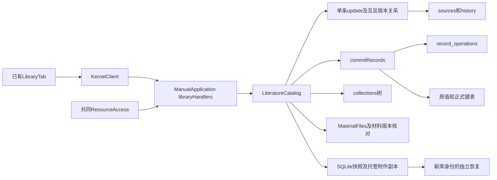

# 调查依据

## 当前事实与复用选择

基线 `58eda1404fcc60036ce0e0f3ce30d5453ce1ee30`，开工clean，无.codegraph。已按CONTEXT、领域票02／03、模块依赖决定、存储变更#13及library-foundation-plan的C小节核查；没有同名或等价组织／撤销change。B的4.1／4.2关闭和新Mac人工目标通过已由第十四轮主线接收，B的1.4／6.1／6.2仍开放。下表来自当前源码／正式规格和既有delivery静态复核；本轮未运行业务测试、原包或GUI。

| 面向C的能力 | 当前事实、符号与依据 | 差距／本片处理 |
| --- | --- | --- |
| 集合结构 | `catalog.ts::collections/saveCollection`（约676–732）；`library.ts::library.collections/saveCollection`；parentId树、循环检查、按父分页已有 | 结构操作无collection revision／撤销；本片仅引用既有集合，不修改结构，不把成员移动当集合移动。 |
| 成员／标签 | `catalog.ts::update`（616–674）在同一sourceId写tags／collectionIds，source.revision CAS、history保存；metadata必填，单条操作 | 可复用source/history/权限及容量校验；缺窄批量契约、稳定逐项结果和可逆组织记录。首片只补这些。 |
| 关联版本 | 同一update拒绝自身／缺失目标，逐个互反更正邻居relatedIds并保存其历史和递增修订；正式catalog规格明确双向版本关联 | 已有真实互反写入，不是占位或任意有向图。本片不改relatedIds；未来批量关系须显式计入邻居参与集／冲突，不能只核主选。 |
| 原子写入／回执 | `library-records.ts::recordLimits/libraryRecordOperations`；`catalog.ts::commitRecords/commitResult`（约278–484）；`schema.ts::recordOperations` | 已有100项／256KiB、整组事务、原值／键／CSL提交及稳定committed/rejected；只含metadata/original/key。复用唯一record_operations回执，不把当前题录历史直接当undo。 |
| 附件独立性 | `library.ts::libraryAttachmentSchema`（454附近）、`schema.ts::attachments`（109附近）都要求sourceId；`acceptFiles/commitMaterial`（786／1512附近）无父项时创建文件名候选题录 | 有独立attachmentId/materialVersionId，尚无受支持的无父题录附件。SQL无父项外键，异常孤儿不能冒充独立附件。独立化不在本片。 |
| 附件更正／父关系 | `material-files.ts::relocate`只重定位同内容外链；`catalog.ts::relocateAttachment`异步后复查记录／授权；摄取去重键为sourceId/purpose/storage/hash | 无附件revision、名称／用途更正或移父／脱离接口；父项还冗余于JSON和阅读记录sourceId。不能沿用摄取去重替移父合并定案。 |
| 共同资源 | `protocol/resource-contracts.ts::libraryRef`、`editor/resource-access.ts::describe/verify`、`manual.ts::resourceOperation` | ref为attachmentId/materialVersionId，无sourceId或libraryId；宿主绑定当前库，版本／实际字节／授权被核对，正文只读。不能声称ref自身已区分原库与恢复副本；本片不变更资源协议。 |
| 备份／恢复 | `catalog.ts::makeBackup/restore`（1654／1722附近）SQLite backup复制全库、从快照分页复制托管附件；restore到不存在独立目录，新libraryId，read=true/write=false/send=false | 同库新表自动进数据库快照；新文件表不会自动进材料循环。本片仅DB记录；新组织记录须保存originLibraryId，副本可审计、不可直接重放或撤销原库操作。 |
| 迁移 | `catalog.ts::initialize`（122附近），library migrations 0000–0003，当前user_version=4；旧库迁移前副本、未来版本拒绝 | 规划v4→v5增加组织依据及回执namespace，保留旧数据／授权，不推测旧历史可逆性；不触及项目统一v6。 |
| 真实入口 | `manual.ts::libraryHandlers`（1789附近）显式注册当前library方法，KernelClient由同源生成；`harness/runtime.ts`仅遍历libraryToolMethods，原commitRecords不在工具名单 | 首片必须交完整公共端口／宿主注册／生成调用方，不能只加schema叶。新C端口先供真实KernelClient；root工具与GUI为后续消费者，不能为C直接开放整套原值／键工具。 |

该图只画现有调用／数据流，新组织端口尚未实现。A及题录／附件基础沿归档`2026-10-16-establish-local-literature-catalog`、`2026-10-16-ingest-local-literature-attachments`、`2026-10-20-unify-workbench-resource-opening`的delivery及当前源码复核；原值／键复用`define-library-zotero-record-authority`，不重建已归档基础。

## 影响方案的未知项与实验

### 本片技术选择已闭合

采用C1“既有条目集合成员／标签的原子整理与可逆记录”，从完整C拆出首个独立领域提供者；成员是source上的集合，不复制或移动材料。四个新窄端口共用原record_operations，旧commitRecords／commitResult保留原DTO及旧回执；新增operation namespace只区分现有authority与新organization/history记录，不表示对象删除分类。

全体参与项先验有效库身份、授权、source修订及目标集合／标签，结构有效但某项失败时整组rejected；逐项显示blocked和notApplied，不伪报部分成功。撤销重做核组织记录代次和实际变更项的整个source修订，只反向修改组织字段，任何后续变化均拒绝。不需要跨文件原子发布、模型、原包、项目引用扫描或额外服务。

### 字节预算调查

问题是能否复用现有100项／256KiB请求，并为可逆依据给出有限预算，避免小型“清空”请求捕获超大旧值。已有recordLimits为100／262144，当前listPage响应预算524288。保留请求预算；建议新增捕获的before/after参与集投影预算262144，超限在变更前整组resourceLimit，不自动拆成部分提交。它是本规划的新预算，不能称为既有保证。

执行`TMPDIR=/home/joshua/.cache/scholoom-literature-round14-8g6NiQ/tmp node /home/joshua/.cache/scholoom-literature-round14-8g6NiQ/organization-size-samples.mjs`，输入是独立合成UUID形状标识、集合及UTF-8标签，只作JSON实际字节计数，无DB／领域调用／时间测量。输出位于同根`organization-size-samples.json`及log；问题得到回答即停止，业务限额／回归由tasks验证。

| 合成样本 | request字节 | before/after投影字节 | receipt字节 | 按拟定预算 |
| --- | ---: | ---: | ---: | --- |
| 25条、2集合／3标签 | 6915 | 11901 | 2235 | 在预算内 |
| 100条、2集合／3标签 | 27315 | 47601 | 8535 | 在预算内 |
| 25条、5集合／10个近100字多字节标签 | 81815 | 161701 | 2235 | 在预算内 |
| 100条原各有100集合／100标签，清空 | 9515 | 3345901 | 8535 | 依据超限，必须整组拒绝 |
| 100条密集新值 | 3310115 | 6613201 | 8535 | 请求超限，受理前拒绝 |

这些数值不证明真实库吞吐或迁移性能。组织回执不返回CSL／原值，明细按成员差异分页并复用整包512KiB预算；不能将100份完整题录或完整快照塞入一帧。原子边界与逐项失败、请求未知只查询以及授权不可放宽均不因容量调整改变。

### 完整C后续分支：调查候选，不阻塞C1

下表保留调查时的候选及代码依据；第十五轮已选方向以[design的后续关系方向](design.md#后续关系方向)为准。具体迁移及公共接口仍须另行形成规格，未进入C1写集。

| 具体问题与代码证据 | 候选及推荐 | 影响／当前状态 |
| --- | --- | --- |
| 无父附件与旧自动候选：sourceId必填，plan末节明列C/D待定 | A：nullable父项＋显式独立创建模式，保留旧默认候选与旧身份；B：另设唯一父关系表并一次迁移权威。推荐A减小迁移面，但要和阅读记录语义一起定案。 | 不自动把旧候选转独立、不删除题录；此分支受阻，未起草可执行迁移或相应spec。 |
| 阅读记录sourceId是当前父还是形成时来源：saveReadingRecord从当前附件复制，历史保存旧值 | A：记录保留形成时来源，当前父从附件查；B：随移父改记录及修订。推荐A保护原论据，须主线／阅读线确认字段含义及独立时空值。 | 父项、历史、摄取回执不能顺手重写；D前置尚未闭合。 |
| 移父／用途与sourceId/purpose/storage/hash唯一键冲突 | A：明确拒绝，保留两身份；B：显式合并。推荐A，合并留E。 | 不由摄取“复用附件”推断可合并；本片不提供移父。 |
| 名称决定解析：resource-access/catalog按扩展名分派，paper.pdf改paper.html会改变读取语义 | A：分离显示名与格式依据；B：先仅允许同格式更名。推荐A作为后续模型方向，须具体迁移及资源消费者设计。 | 未扩展附件name或材料版本模型。 |
| 库ResourceRef没有libraryId，恢复保留attachment/version ID | A：共同增量为新引用显式绑定库身份并规定旧引用重核；B：只在提供者会话绑定。推荐主线审A，精确处理旧引用，不做静默当前库fallback。 | 公共资源增量由主线组织；本片组织操作已有显式libraryId，不依赖该新提供者。 |

## 结论与承接

无阻塞问题，基于首片仅组织既有source的假设制定C1方案；proposal所列结果不依赖后续附件／资源分支。不存在“完整C关系已稳定”的结论，E删除／恢复／合并和D独立笔记仍等待相应关系交付。新端口、事务、迁移、诊断及真实客户端验收进入design/specs/tasks；规划轮没有创建delivery或声称候选接口已发布／业务实跑。第十五轮主线已确定后续关系方向，下一片授权范围见tasks。

规划工件经原生`gpt-6.1-sol/high`辅助独立只读复核：共同回执namespace与旧DTO、原子拒绝、后续整条source修订／组织代次、副本origin约束无阻塞发现。父核将撤销场景中的“附件关系”更正为当前真实递增source修订的“版本关联”；不据尚未存在的附件更正端口制定验收。该审查不是实现验收。

规划核查入口及结果均在上述cache根：`status-planned.json`／`apply-planned.json`确认五项依赖齐备、9项实施任务均未完成，delivery不存在。首次strict出现单条要求过长警告（`openspec-strict.log`），按原子提交／身份保持拆分后C1与原B strict、scholoom-dev schema均通过（`openspec-strict-final.log`、`openspec-b-strict.log`、`openspec-schema.log`）。`check-planning.mjs`检查写集、工件／停止边界及新文件空白；其初次误判git no-index的差异退出码，修正检查脚本后通过，原日志与`planning-boundary-check-final.log`均保留。Mermaid仅人工核语法及图文关系，未作渲染验收；未重建或运行B绿色业务组。
