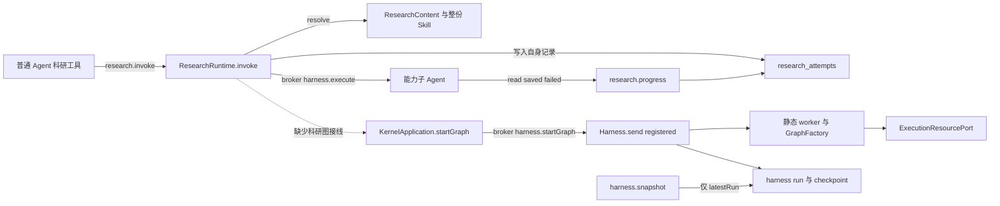

# 调查依据

## 当前事实与复用选择

### 基线与证据等级

2026-10-25 初始调查时，本树 HEAD 为用户指定共同起点 `e3d58fc807827a78493dcd16e38de28c8d02766e`，开始时 `git status --short` 为空，没有 `.codegraph/`。当时已读根 AGENTS、开发说明、基础决策地图、七线计划、科研职责 Q8–Q10、共同分工和阶段约定。该次工具注册中没有 tool_search／原生 multi_agent_v1，也无可用 OpenViking search/read 组合；初始调查未委派、访问其他树或发送消息。

初始调查时本树缺少 `.agents/skills`；按当时用户授权只读采用主仓 `/home/joshua/Workspace/Code/JavaScript/Scholoom/.agents/skills/openspec-ff-change/SKILL.md` 与 `codebase-design/SKILL.md`。该次 OpenSpec CLI 为1.15.0，项目阶段说明的历史验证基线为1.14.1，工件以当时 CLI instructions 为准；没有升级 CLI。当时本树没有现成 `node_modules/@playwright/test/cli.js`，未通过 pnpm 隐式准备依赖；后续用户已授权且已完成按锁安装，见下文实施输入。

以下调用链与差距表保留实施前基线的静态阅读依据；archive 中的运行记录属于历史证据，初始调查未重跑业务测试、worker、模型或 UI。当时的公共机制缺口足以支持接口归属讨论；G1 的后续决定与实现见下文，当前科研行为见 design 及源码，不能将基线缺口视为仍未实现。

### 实施前调用链与差距

实线由起点源码核实；虚线表示当时缺失关系。该图记录调查基线，不表示当前接线或验收状态。

| 模块／来源 | 已有能力 | 本线差距及复用结论 |
| --- | --- | --- |
| [ResearchContent](../../../packages/research/src/content.ts)、[内置声明](../../../packages/research/src/builtin/material-analysis/capability.yaml)及 SKILL.md | 从固定目录读取唯一 `scholoom.material-analysis` 1.0.0；声明 `execution: agent`，输入为项目路径 | 没有 Graph 目录、开放 config schema 或节点资源描述。保留旧入口，新增源码目录；不把 YAML 改造成第二套流程语言 |
| [ResearchRuntime.invoke/progress/list/initialize](../../../packages/research/src/runtime.ts) | 输入、项目授权、稳定调用／重试、真实读取、成果身份及缺项；progress 核对 project/session/run/instance；查询默认25、最多100 | `runId` 是发起父执行，科研 attempt.id 是业务尝试，不是 registered run.id；sources/used/artifacts 只有 path/fileId。现有 active/executing Map 不适合跨持久等待，不将它扩成另一执行监督器 |
| [ResearchRecords 与 schema](../../../packages/research/src/records.ts) | 只访问 research_attempts，项目物理容器注入；restore 与 initialize 将旧 running 标中断 | 旧记录形状和恢复语义应保留；图记录使用显式判别，不将等待图按旧 running 扫描改成中断；不复制 harness 状态 |
| [ExecutionGraphs](../../../packages/harness/src/graph-registry.ts)、[图 DTO](../../../packages/protocol/src/graph-contracts.ts) | 校验 graphId/version/stateFormatVersion/configSchema；host/worker 同源；GraphFactory.resume/create | 直接复用。科研描述引用 GraphDefinition，不能再手写等价注册字段。`version` 是含节点素材的整体实现版本 |
| [生产注册](../../../apps/kernel/src/execution-graphs.ts)、[worker](../../../apps/kernel/src/execution-worker.ts) | 静态入口共用同一注册集合 | 集合为空。固定图以测试宿主注入，不默认冒充已发布综合能力；将来生产业务图沿同一源码装配 |
| [KernelApplication.startGraph 与 runtime-internal](../../../apps/kernel/src/application.ts)、[harnessModuleOperations](../../../packages/protocol/src/harness-module-contracts.ts) | `harness.startGraph` 返回 instructionId/runId；仅宿主 system 主体可选择图；后续消息沿 session.send | 科研域可复用此入口。不是客户端任意传 Graph 的授权，也不是执行中 Agent 的图子调用 |
| [Harness.executeCapability](../../../packages/harness/src/runtime.ts) | 旧能力子 Agent 的受管、额度、取消与父子关系 | 在 registered/resume 分支明确抛 unavailable。新图不能塞进旧 invoke 工具后宣称已可运行；本 change 不扩通用子图机制 |
| Harness.snapshot/latestRun、[runSchema](../../../packages/protocol/src/harness-record-contracts.ts) | 可查询最新 run、graphProgress、modelConfig、graph.wait/checkpoint 绑定 | 无公开内部按旧 run 或原 instruction 查询的窄接口；G1 阻塞完整科研历史关联。科研模块不得直接读 runs 表或用当前 run 冒充历史 |
| [资源契约](../../../packages/protocol/src/resources.ts)、宿主 executionResources | ResourceRef、basis、材料版本；read/document、save、create/creation；保存与关联分开 | 复用真实资源提供者。库正文只读；首个固定图输出当前可信项目，不需要库修订或新的库成果写入能力 |
| [architecture.json](../../../architecture.json) | research 已允许消费 harness.startGraph，但未声明 resources 与 harness.snapshot；禁止引用 harness 实现 | 新消费契约逐项补策略；图的 LangGraph 装配留宿主静态适配，科研节点与交付规则留 research，不新增依赖或跨包私有 import |

### 已归档公共基础与测试依据

- [工作域交付](../archive/2026-10-23-establish-scoped-execution-foundation/delivery.md)：固定 application、隔离 scratch、目标只读和模型最终授权已交付。跨项目读取不登记身份、不写缓存；不得重做。
- [领域执行交付最终段](../archive/2026-10-24-establish-domain-execution-handoffs/delivery.md#macos-显式不可用与人工降级收尾)：最终24/24，Linux／Windows 受管执行，macOS 显式不可用及人工降级；较早“公共基础尚未完成”段落是历史状态。已有17项 Graph／checkpoint 定向和资源创建／关联故障依据，不等于本线验收。
- [上下文交付](../archive/2026-10-24-establish-workbench-context-bridge/delivery.md#主分支最终接收)：17/17，完整 InstructionContext、可信来源、逐条 IPC、持久后消费与大批上下文均已交付。无需本线重建。
- [原科研能力交付](../archive/2026-10-16-establish-research-capability-runtime/delivery.md)：提供材料分析的历史 Linux／双宿主证据；当时共享模型的描述不覆盖后续受管子进程架构，现状以 runtime 为准。
- [registered-graph.spec.ts](../../../tests/kernel/registered-graph.spec.ts) 与 [graphs.mjs](../../../tests/fixtures/domain-execution-worker/graphs.mjs)：已有真实 checkpoint／interrupt、普通消息接续、确认丢失、升级、取消和撤权。固定夹具绕过 ResearchRuntime，只证明通用入口。
- [research-module.spec.ts](../../../tests/kernel/research-module.spec.ts)：自身表加可替换 ports 的独立测试；[research-capabilities.spec.ts](../../../tests/kernel/research-capabilities.spec.ts) 覆盖旧入口与真实受控模型／客户端。优先扩展这些行为测试，不断言节点顺序、提示词全文或内部 Map。
- `resource-access.spec.ts`、`resource-creation.spec.ts`、`registered-context.spec.ts`、`workbench-integration.spec.ts` 提供资源与故障参照；新增测试仅覆盖“经过科研域”及业务交付判定的缺口，不重复制公共矩阵。

### CI 输入：初始日志证据与后续排查范围

[Checks 40100596838](https://github.com/leike0813/Scholoom/actions/runs/40100596838) 固定源码 `55d020c696407c3d80b984a9f1535054c311ae2c`；本机原日志 `/tmp/scholoom-next-parallel-baseline-failures.log`。该提交不同于当前规划起点，不能表述为本树重跑结果。

| 相关证据 | 能确认的事实 | 后续承接 |
| --- | --- | --- |
| 日志4730附近，Linux browser `tests/ui/harness.spec.ts:11` | 等待 analysis.md 含42的5秒谓词读到空串；测试把所有 readFile 错误折叠为空，不能区分未启动、未保存和读失败。同场景 Electron 通过 | 实施前科研线与 Agent 线对照发送回执、父子 run/instance、科研 attempt、工具、磁盘及 trace；不直接加超时 |
| 日志4757／4879，双宿主 `harness.spec.ts:79` | `releaseRpcGate` 返回 No held RPC，未证明请求曾被拦截 | Agent 线主责；科研旧入口回归受影响时消费其结论；区分 gate、发送、受理、执行与刷新 |
| Windows context-instructions/harness-recovery/harness 等 | 多个 completed 断言实际为 queued/running；只有末态和5秒超时，没有足够阶段依据 | Agent 线主责；科研接续验收不得以这些失败推定 driver 坏或放宽生产时限 |
| 日志6586–6609 | Windows registered-graph 14个分支及 research-capabilities 11项均记录通过 | 支持保留既有机制，不支持完整 CI 绿色或本线科研接线已经完成 |
| 日志6990–7010 platform-availability | 预期0子进程、实际9；缺少归属分类证据 | Agent 线公共增量；不能删除零未受管执行保证 |

Linux UI 101通过／9失败／2跳过、Windows 内核374通过／15失败／12跳过，macOS job成功，沿七线计划保留。其他文献、PDF、同名项目失败归原责任线；该次 CI 调查未修代码或追加全仓运行。

### 初始文档漂移与相邻设计

初始调查时，开发说明的科研段引用 `apps/kernel/src/research/builtin/`，实际内容已在 `packages/research/src/builtin/`；旧 P5a 方法包管理与源码 Graph 决定不一致。实施文档应更新对应入口与边界，不追改历史 delivery。架构文档的2026-10-19现状段不替代源码证据。

本树 `openspec list --json` 初始无 active change，未找到 `add-material-annotation-interactions/design.md` 或 `add-interactive-research-reports/design.md`；没有假装收到另一树设计。已读[阅读交互职责 Q2–Q6](../../../.scratch/domain-development/issues/07-research-interaction-scope.md#answer)与 UI 设计入口：两份 change 沿同一阅读线分别形成，资源、选择、共同 composer 与报告隔离由该线维护。此 change 不创建它们、不设计报告 SDK，也不等待报告完成才跑固定图。实际设计文件到达本树后再核对交接。

生态 Zotero10／BBT／茉莉花前置调查尚未收到；本线不改库身份、字段、关系、正式引用键或材料修订，只消费现有版本化 ResourceRef，因此不替生态线作上游结论，也不以其未交付阻塞只读固定材料调查。

## 影响方案的未知项与实验

### G1：历史执行事实与调用关联的公共接口（方案 A 已选并独立实现）

调查来源：基线 Harness.snapshot 只取 latestRun；registered 取消后新消息可以建立新 run，旧调用不能靠一条最新快照证明所有实际尝试。科研业务记录需在启动回执丢失、重启、取消后新尝试时仍能与真实执行对应。以下保留当时的选项比较。

| 选项 | 依据与代价 |
| --- | --- |
| A，已选：harness 提供有界执行历史／原指令查询 | 复用 Run schema 与指令幂等记录；按所属 session、已知 run／初始 instruction 找事实，并有界发现后续实际尝试，科研只存业务数据。公共契约、broker、授权及类型映射由独立变更承接 |
| B：公共持久事件／回执投递 | 可主动交接执行变化，但需重启补偿与丢回执查询，维护成本更大；现有 notify 没有持久投递语义 |
| C：只用最新 snapshot 或科研复制完整运行状态 | 当前接口不足，且丢失历史或制造第二权威，不满足已确认目标，不采纳 |

后续用户明确选择方案 A。[add-harness-execution-history](../add-harness-execution-history/design.md) 已实现 `harness.executions`，按指定项目／会话及 runId、instructionId、originInstructionId 三选一查询，返回 `{runs, nextOffset?, instruction?: Message}`；命中 instructionId 时返回原 Message，消息缺失明确 unavailable，响应整体受512KiB限制。宿主生成并传递 `originInstructionId`，普通接续及取消后新尝试继承，新显式启动另起来源，旧历史不猜测补链。G1 公共接口不再是待输入项；公共与科研消费的独立验收结果见两份delivery。

### G2：执行中的 Agent 调用 registered 图

现有 `harness.execute` 明确 unavailable。本 change 采用已经交付的宿主 `harness.startGraph`，固定图通过真实科研模块接入；旧工具仍只调用旧材料分析。将 registered 子调用与等待挂接到通用委派属于 Agent 线公共机制，后续如需要另提范围。此限制已经划入本 change 非目标，不阻塞本次固定图规划。

### G3：任务与阅读交互输入

项目线的任务／work item DTO 未收到；首个固定图不要求 taskId。若未来可选业务关联进入 schema，必须引用提供者类型；本轮只规定 seam 和替身的验收边界，不造自有任务模型。I1 真实关联待项目线提供。

阅读线两份 design 到达后核对资源引用与普通消息接续即可；无本线 UI 变化，也没有报告动作直接恢复 Graph 的新渠道。实际报告／批注整合保持待输入，不成为固定图验收前置。

## 结论与承接

2026-10-25 实施输入更新：用户已授权实现本 change，选择 G1 方案 A 并授权独立公共查询增量；另明确允许按锁文件安装既有依赖。`pnpm install --frozen-lockfile` 已完成，锁文件未改。公共查询及来源增量、科研消费、故障及恢复均已完成本线独立验收，实际命令及证据边界见 [delivery](delivery.md)。

后续原生子 Agent 对 CI 追加只读调查：已核对固定头55d020c与本树均存在的`tests/ui/harness.spec.ts:118` gate错配。测试拦截files.save，而已有文件沿project-ui.tsx的port.save和resource-controller.ts实际调用resources.save；客户端把method直接放顶层RPC，没有外层封装。日志4757／4879的No held RPC可由此解释，该失败发生在发送Agent指令之前。材料分析browser空串与Windows末态超时仍缺运行阶段／trace证据，不能据此加超时；同场景Electron通过、Windowsregistered与科研用例通过的边界保持。该次调查未改本线外UI测试或生产等待时限。

可闭合：复用现有执行机制、资源权威、科研仓储和诊断入口；新旧路径共存；固定图校准不定义真实综合。对上述独立范围，无阻塞问题，基于“宿主启动、测试静态图、当前项目保存成果、库只读、任务可选”的假设制定方案。

G1 公共实现供科研消费，后续以真实接线及运行结果判断整合状态。G3 的任务／阅读设计输入仍未收到，I1 真实任务关联与 I5 整合验收均未确认完成；具体综合 Q7、用户自定义 Graph、纯库成果写入及多 Agent 另行承接。不以结构校验、源码存在或公共测试通过代替这些验收。

### 初始规划验证记录

初始规划阶段，`openspec validate connect-research-graph-runtime --strict`、`openspec schema validate scholoom-dev` 与 `git diff --check` 通过。新增未跟踪 Markdown 另以 `git diff --no-index --check /dev/null <文件>` 检查空白诊断，26个本地文件链接可达；当时工作区变化仅本 change 的6个文件（含 CLI 元数据），14项任务全部未勾选，delivery 不存在。Mermaid 只核对代码围栏、关系和正文一致性，未渲染；文件链接检查不验证标题锚点。该次规划未运行业务测试、构建、真实 worker 或 UI，这些历史结果不代表当前实施验收。

当时已读取 apply 与 delivery instructions；CLI 的 apply ready 只表示规划依赖文件存在。后续实施依据用户明确授权推进，当前验收仍须核对实际结果，不能沿用初始规划停止状态。

## 2026-10-28：声明科研调用 UI 首例的双宿主只读调查

### 范围与同源证据

本轮开始时HEAD为938c33f2c9fcafb2cce11b0c165b2fb1e9a818c3，工作区clean。仅调查 `tests/ui/harness.spec.ts:11` 的 `user invokes a declared research capability and opens its checked report`，不修harness／UI或扩展其他场景。依据七线计划“第十轮验收后的收敛安排”；职责仍沿科研票的Graph／执行分工，旧能力路径与新业务Graph分开。

原失败是 [Checks40479176954](https://github.com/leike0813/Scholoom/actions/runs/40479176954)，完整head为8c2fd24534001a9724f9c008482d404c336a5a07，Linux job为122104867775。主线提供的 `/tmp/scholoom-round10-acceptance-j1MosP/ci-baseline-failures.log` 第8828／9335行起分别记录Browser／Electron在第39行等待20000ms失败：`排队中 · 有已受理指令等待消费`；两个首次失败保持，不修改预期或期限。本run Linux内核746通过／26跳过，UI126通过／32失败／4跳过；本调查不扩展其他失败，不用其他run的数量推定同因。

通过本仓库只读API核对artifact 12728680109 `diagnostics-ubuntu-latest`，workflow_run/head与上述run一致。其476项目录中只有目标两宿主各自的error-context.md、trace.zip属于本例；四项已按ZIP CRC校验提取。原artifact及索引元数据、选择结果保留于 `/tmp/scholoom-research-ui-round10/`：artifacts.json、artifact-entries.json、first-case-evidence.json及selected/ui-5174/下两个 `harness-user-invokes-a-dec-88c29-nd-opens-its-checked-report-ui-*` 目录。browser-trace/、electron-trace/为对应trace解包结果。

完整65,548,621字节下载较慢，已停止本轮下载进程，保留的diagnostics-ubuntu-latest.zip为未完成前缀，不能作为完整ZIP使用。普通Range请求未生效；最终经artifact重定向地址的x-ms-range只取中央目录及上述四项，校验后读取。artifact-index.zip为带空洞的索引／选定区段副本，也不能当作全包验证结果。只分析本例内容，未在日志或文档暴露API凭据／签名URL。

### 首例实际调用路径与替身

该场景没有GUI科研方法选择器：第24–26行只配置合成模型凭据，随后经实际项目打开、信任授权及新会话发送普通指令 `MODEL_RESEARCH 用材料分析方法处理 input.md 并保存 analysis.md`。`business-session.tsx:504、541` 的onNew经client调用session.send，首例materials为空，无contextItems、methodId或version；input.md此时只是指令中的路径，不是已附加材料。它不使用research.requestGraph，不启动固定校准图。

CI的 `playwright.ui.config.ts:15` 继承单worker、零重试和失败trace，实际webServer为renderer开发承载；Browser为Chromium，Electron为真实应用窗口。`tests/ui/fixture.ts:27` 先确保开发内核；`tests/model-kernel.ts:7` 再停止该隔离配置的旧内核，用独立Node子进程调用真实serveKernel，注入modelEndpoint并等待ready。方法、broker、项目仓储、文件、受管worker和执行授权均为正式实现；外部模型使用 `tests/model-server.ts` 的loopback确定响应，目录选择交互也由夹具替换。首例没有科研模块端口或执行进程成功替身。

模型替身在 `tests/model-server.ts:295` 按工具历史依次要求discover_research_methods、load_research_method，再调用invoke_research_capability，参数为scholoom.material-analysis／1.0.0、materialPaths=['input.md']、outputPath='analysis.md'及含MODEL_RESEARCH_EXECUTION的合成目标。这是旧声明方法的机械接线，不能当作生产业务Graph、真实模型理解或科研质量证据。

`git diff 8c2fd24 HEAD` 核对上述UI测试／fixture、模型替身、harness、research、相关UI调用和kernel科研装配无差异；本段相关kernel差异仅lifecycle的启动观察／日志与事务持锁清理记录。旧run仍不能冒充938c33f上的新实跑。未用普通静态产品重跑依赖开发承载的场景，也未启动开发服务器。

### 观察到的阶段及尚缺事实

| 边界 | 同run证据与结论 |
| --- | --- |
| GUI配置、授权、新会话及发送 | 两份test.trace均通过这些动作。Browser发送点击pw:api@65为09:53:26.870–26.964 UTC；Electron pw:api@68为10:15:46.094–46.213 UTC。点击完成本身不是session.send原始回执 |
| 指令已受理的UI投影 | 两宿主随后持续显示queued／accepted文案。`business-session.tsx:884` 的状态来自received WorkbenchSnapshot，而非onNew的乐观run赋值；refresh在198–223行经workbench.watch取回。可确认UI看到过受理投影，不能据此证明整个等待期间服务端状态未变化 |
| 等待终点 | Browser expect@66在09:53:46.984 UTC失败，Electron expect@69在10:16:06.216 UTC失败，分别等待约20秒；两份error-context仅截取状态栏文本 |
| harness instruction／run／instance | Browser末段DOM可定位项目442aa6af-9573-4064-a75b-515d4df385fb、会话29110dcf-53d6-48fe-a055-04c006ff2b02、项目名scholoom-ui-research-mnsJVN。Electron仅能恢复项目名scholoom-ui-research-LXTPK9，不能恢复其项目／会话身份。两宿主都无原instructionId／runId／instanceId、consumed/checkpoint或实例阶段，不能断言未创建进程、名额不足或卡在initialize |
| 模型与科研模块受理 | 没有同次模型requests计数、工具RPC或ResearchAttempt记录，不能写成“首模型请求0”或“research.invoke调用0”。`runtime.ts:3029` 的能力工具、`application.ts:306` 的身份准入及 `ResearchRuntime.invoke:164` 均是尚未观察到的后续分界 |
| 成果与质量 | 失败发生在第39行；第42行首次readFile、后续usable／notAssessed检查及打开报告均未执行。没有成果读取失败或分析质量不合格的证据 |

Browser的1-trace.trace有73个frame-snapshot，1-trace.network有180个HTTP资源记录，console仅Vite连接及React开发提示；没有session.send／workbench.watch的WebSocket消息帧或父进程模型HTTP记录。最后一条bootstrap在09:53:48.044 UTC中断，晚于断言失败，属于finally停止内核／夹具收尾时间，不能倒推为最初queued的原因。Electron的0-trace.trace仅context-options，1-trace.trace只有默认Chromium空页newPage及一帧图像，两份network均为空，没有实际应用窗口的snapshot／网络记录；test.trace仍能证明测试动作与失败时间。

artifact目录没有ui-profile条目或UI内核日志，目标项目及科研数据库也未保留。startModelKernel的子进程stdout／stderr为ignore；首例finally在停止内核后删除合成项目，既有UI全局收尾不提供此例持久事实附件。因此不能通过现有包补查ResearchAttempt或实际执行状态，HTTP网络记录中没有模型请求也不表示模型请求为零。

### 分类与交给Agent／公共提供者的精确缺口

**分类：GUI已看到指令受理；最早未被确认的边界是harness消费／首次模型推进及相应snapshot刷新。没有科研域失败的正面证据。** 源码中Harness.send在1154–1189行保存未消费指令、accepted消息和queued run后安排schedule；schedule在1214行起等待reservation.ready后执行。普通执行直到wrapModelCall（2193行起）才设置running，持久消费由confirmInstructions（2092行起）核checkpoint后确认。故queued文案无法区分准入名额、父准备、子进程引导、初始化、消费确认前，或后端已推进而UI未刷新；这些是待区分的阶段，不是已确证的根因。

Agent／公共提供者后续只需沿上表同例身份与UTC窗口关联原session.send回执、instructions.consumed、run／instances及进程准备／initialize阶段、首次模型请求、工具invoke与research.attempts，再核workbench.watch返回revision／UI应用时点。`tests/execution-diagnostics.ts::observeExecution` 已提供内核侧观察，但需要KernelApplication实例；本例startModelKernel只向父进程返回stop，不能假装已有跨进程观察数据。若需补共享IPC或UI诊断接线，由主线统筹，本线不改该提供者。没有足够证据在上述候选间选定生产修复，也不以新增Graph、重做入口、重试、sleep或放宽期限填补缺口。

本次无业务变更或本机UI通过结论；此前内核26项通过只保护模块边界，不替代本例双宿主验收。停止于上述因果分类与同run缺证结论，实际操作和检查见delivery本轮记录。
