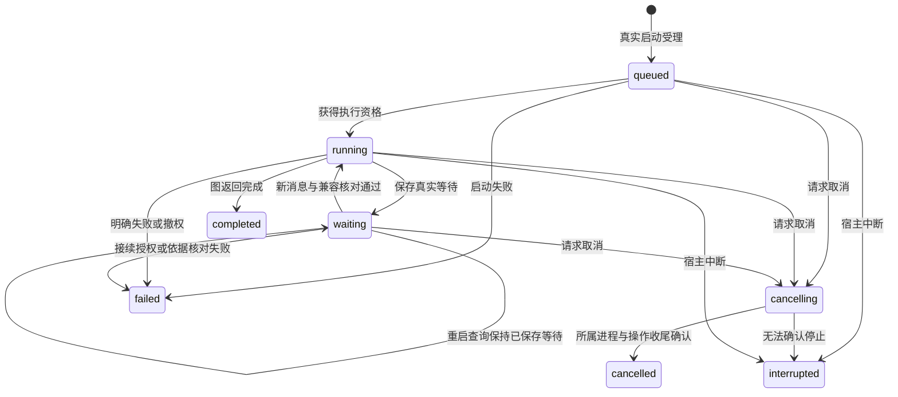

# research-capabilities Delta

## ADDED Requirements

### Requirement: 内建科研图的发现与开放配置

系统 SHALL 提供有界的源码内建科研图发现及按 graphId 与整体实现版本的精确描述，返回来源、用途、配置约束、交付约定和所属节点资源标识。节点指导、模板与检查素材 SHALL 随整体实现版本追溯，不建立独立 Method 实体或提示词发布生命周期。发现或读取资源 SHALL 不启动执行、不建立研究任务、不扩大材料访问权限。

图配置 SHALL 只接受声明开放的参数；缺失实现、版本不符、非法配置或必要素材不可用 SHALL 明确失败，不能静默选其他实现或回退到完整 Skill。用户／项目自定义代码装载继续不开放。固定校准图 SHALL 明示其机制验证用途，不作为实际科研充分性或真实综合流程已经交付的证明。

#### Scenario: 发现与精确描述

- **WHEN** 调用方分页发现已装配图并精确读取某一版本的描述
- **THEN** 返回该实现与资源的来源、配置和交付要求，查询不产生执行或任务

#### Scenario: 未开放的配置或代码

- **WHEN** 配置带有未声明参数、客户端模块路径、任意代码，或请求未装配版本
- **THEN** 请求在业务效果前被拒绝，既有成果保持，不选择默认图或通用 Agent 替代

### Requirement: 科研图调用关联实际执行事实

科研图调用 SHALL 保留稳定 invocationId、宿主确认的工作域、原始目标／配置与输入材料依据；每次实际执行尝试 SHALL 关联 harness 的真实 run，而非发起工具的父 run 或科研自造执行身份。图身份、整体版本、实际模型配置及节点素材来源 SHALL 可追溯；无模型图 SHALL 明确没有模型执行配置，不能伪造默认模型。

执行状态、实例、checkpoint、等待及指令消费 SHALL 由 harness 掌握，科研记录只保存调用、执行引用及业务交付事实。最新会话运行 SHALL 不能代替旧调用的执行结果。相同启动身份与相同输入的回执核查 SHALL 不重复开工；同身份不同图、目标、配置或输入 SHALL 拒绝。启动受理结果未知时 SHALL 保留原身份与诊断，先查实际执行，不盲目新建尝试。

研究任务关联 SHALL 按实际需要提供，不因发现图、开始调用或普通会话而自动创建任务；任务、文献及库成果的身份和正文权威仍归所属领域。

#### Scenario: 新执行开始后查询旧调用

- **WHEN** 同一会话已经开始较新的推进，调用方查询先前科研图调用
- **THEN** 返回与原调用关联的真实尝试、版本、配置及业务成果，不将最新 run 状态写入旧记录

#### Scenario: 启动回执未知

- **WHEN** 原启动指令可能已受理而调用方未取得成功回执
- **THEN** 原身份和原输入保留，查询核对实际受理与 run，不自动再启动另一执行

#### Scenario: 没有关联研究任务

- **WHEN** 已授权调用只需要读取明确材料并将固定成果交回当前项目
- **THEN** 可以在没有研究任务关联的情况下执行，调用与成果仍保留各自所属身份

### Requirement: 科研图的材料与业务交付核查

科研图 SHALL 沿共同资源引用和内容依据读取所属项目／库材料，记录实际采用版本及实际读取结果。输入中列出引用或预检可读 SHALL 不算实际取材；路径、同名文件或新库对象 SHALL 不能替代原身份。材料读取、模型外发与成果保存 SHALL 复核当前有效授权；异常沿所属材料诊断处理，需用户选择时暂停并等待明确输入。

首次成果 SHALL 经共同受保护创建取得真实 fileId 与 basis；已有成果修改 SHALL 使用原身份及当前读取依据。交付结果 SHALL 分开表达执行结果、实际保存、成果关联、必需交付缺项及科研充分性。必要成果未读回、读取不完整、关联未确认、操作效果未知或必要步骤未完成时 SHALL 不报告整体交付可用。科研充分性 SHALL 保持 notAssessed，固定样例通过不能代替科研判断。

#### Scenario: 混合材料与首次成果

- **WHEN** 固定图按明确引用读取一份项目文本及一份隔离库材料，并首次保存项目成果
- **THEN** 保留两类实际读取依据与真实成果引用，不隐式复制库原文为项目材料，不要求预建空成果

#### Scenario: 保存成功但关联不完整

- **WHEN** 成果已经保存，而关系登记失败或未确认
- **THEN** 保留文件、原操作身份及关联诊断，交付不完整，后续只核查原结果或补原关联，不重复生成成果

#### Scenario: 旧成果或材料身份被替换

- **WHEN** 同路径已有旧成果但本尝试没有保存，或实际材料已成为另一身份／版本
- **THEN** 旧文件不能满足本次交付，替代材料不能冒充原引用，当前文件及历史结果保持

### Requirement: 科研图等待与取消后的业务记录保持

科研调用 SHALL 沿共同执行生命周期查询等待、取消、失败及接续，不自行复制流程位置或推进 checkpoint。等待期间已保存成果 SHALL 可核查；新输入经所属会话普通消息进入当前等待，只有实际保存及消费确认后才报告已采用。取消受理 SHALL 不等于已停止，未知效果 SHALL 不被报告为取消完成。取消、撤权、失败或重启 SHALL 保留实际部分结果与原调用身份；查询和迟到结果不能自动启动推进。

兼容等待接续 SHALL 关联原真实尝试；必须新建执行时 SHALL 保留原尝试与成果，并关联新真实尝试。checkpoint 缺失／不兼容不能成为覆盖原成果或换用默认 Agent 的理由。下图表示对共同执行状态的查询投影，不新增科研运行状态权威。

终态之后的显式推进若建立新 run，原 run 不改回 running；旧成果先核查，业务调用关联新的实际尝试。

#### Scenario: 等待后关闭并重新查询

- **WHEN** 固定图保存成果及等待状态，工作台关闭或内核重启后重新查询
- **THEN** 能取得原等待、成果与缺项，查询不自动开工，后续明确消息按当前授权和 checkpoint 核对

#### Scenario: 保存中取消或撤权

- **WHEN** 一项保存已受理，而执行被取消或后续授权撤回
- **THEN** 实际操作结果按其真实收尾表达，已保存成果保留，新动作受当前授权约束，不提前报告整个调用已交付或取消完成

#### Scenario: 不兼容的接续

- **WHEN** 用户要求继续而原图版本或 checkpoint 已不兼容
- **THEN** 保留旧执行与成果，报告具体阻碍，只有显式核查及新尝试才能继续，不静默迁移旧状态

### Requirement: 图接入保持既有材料分析契约

新图入口 SHALL 与既有材料分析的发现、正文加载、显式调用及尝试查询区分。旧方法身份、版本和输入范围 SHALL 保留，旧记录可继续读取；不能补造旧记录没有的 Graph、库材料版本或真实执行关系。加载旧 Skill SHALL 不被报告为业务 Graph 已实现。

#### Scenario: 接入后查询和使用旧材料分析

- **WHEN** 调用方使用 `scholoom.material-analysis` 1.0.0 或查询其历史尝试
- **THEN** 原有输入、授权、尝试及交付语义保持，历史没有的信息不被新图字段伪造
