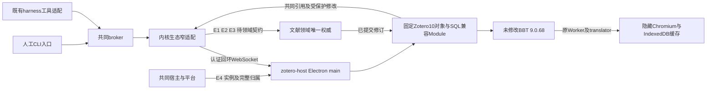
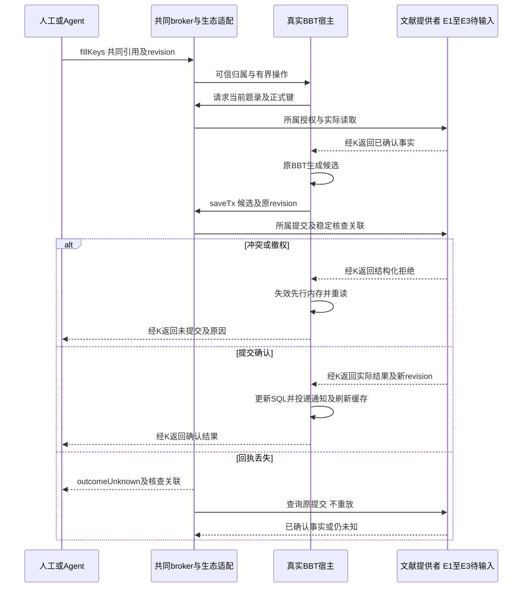

# 实现设计

## 第四轮回调收尾修复

主线验收`/tmp/scholoom-round4-acceptance-JCUBNw/acceptance.md`的E1是回调收尾缺陷，非文献来源E1。外层RPC结束只决定调用者等待结果，不能证明已受理callback结束。旧call finally删除inflight，stop快照只剩未结束的外层work，故只读请求300ms超时后，回调仍挂起也可错误closed。

修复复用原inflight结构：返回给调用者的work仍按原预算成功／失败；entry.work改为其完成后继续等待全部已受理callback的drained。finally只关闭该handle的受理闸门，drained真正结束才删除entry，保留原64操作容量。Promise.allSettled只核对生命周期结束，不改调用者拒绝或清空写入unknown。status新增pendingCallbacks诊断实际未结束回调，complete closed另要求inflight为空。

stop仍在原有界预算内等待entry.work；超时保持unknown、原未决关联及profile保护，scopeStopped可独立为true，不能替代callback完成。已受理回调结束后释放内部容量；没有其他未知效果且正常shutdown可确认时仍能正常closed。若关闭已超时并切断宿主，不因随后callback完成就抹去原unknown。本轮不改平台command、原包或生产时限，不新增生命周期Module，不接文献provider／生产装配。

## 第三轮实施范围与同步事实

2026-10-26，用户明确恢复；HEAD `eaf38be1ac2d350120805859175fc82cf9c36927`已包含`0519904`／`b838402`，恢复时clean。公共ManagedCommands观察／长时限、统一v5→v6、资源叶schema及共享来源／历史直接从本树消费，本轮不复制临时公共基线。主线同步证据见delivery；下文“第二阶段候选”保留当时调查，当前已采用独立认证host listener与私有stdin供应。

本轮可独立实施Interface是`HostConnection.start/status/call/close/cancel`、`workspace()`可信登记与`connectHost` main客户端。公共实现为kernel的`host-connection.ts`、client的`host.ts`、protocol的`host.ts`及子路径导出；不依赖programs、BBT或library，内部host操作不进入产品businessSchemas，不新增CLI／Agent业务入口。生命周期schema及FromSchema类型同源，既有业务生成映射保持由生成器核对，不手写重复映射。

`CommandWorkspace.launchInput`在宿主登记，ManagedCommands.start把供应函数绑定实际commandInstanceId；runCommand在准入／授权后一次取值、8KiB限额并再次授权后送既有stdin。普通execute及command观察行为不改。独立listener只绑定`127.0.0.1:0`，一次性凭据绑定kernel／host／command实例和protocolVersion，不能走connectProduct或取得human权限。main客户端不向renderer交凭据。

每次操作由声明校验并绑定冻结的原CallContext、参数副本和唯一handle。写入必须同步保留稳定关联，拒绝重复ID；回调另经提供者的authorize核对操作、方法和对象范围，读操作不能升级为写回调。所有已受理回调参与原结果及关闭等待；原包结果到达即关该handle的回调闸门，落盘等待期间也不再接受迟到写入。原操作、回调及RPC等待使用同一预算，不在跨进程等待中持有库事务。

监督记录`host-supervision.json`只保存三类实例、原生停止／插件关闭和最多64个未知关联，读写同为64KiB上限，不含token、候选题录或正式键。调用方持有kernel配置锁；同一配置只有一位装配者。恢复前不依据PID推定退出，坏文件原样保留，未知写入不重放。OS已确认停止而插件未知只保护profile，不占原生名额；OS scope未知或监督记录不可读时计入共同准入。原reserve在满容量时无法恢复未知占用且普通队列会过期，因此最小增加`ProcessAdmission.retainUnknown(instanceId)`：按原command身份与已有reservation／恢复占用去重，记录不可读时以配置标记保守阻塞。现有释放不能启动越额等待者，不提供凭PID遗忘未知的接口，不修改原生归属／停止后端。

真实装配先在固定Node host验证，随后在`tests/fixtures/zotero-host/managed-bbt.cjs`中组合真实Electron／原BBT／原Worker和明确合成catalog；该文件是校准调用方，非生产提供者。`tests/kernel/zotero-host-supervision.spec.ts`经真正ManagedCommands／stdin／认证WS／双向回调验证两种导出和正常／错误收尾。产品默认入口仍未绑定共同文献，生产不可用。

原包兼容只补实际缺口：Electron没有Gecko profiler会话，明确inactive，不支持profiling操作；固定9.0.68日志信封提供phase/task，宿主把shutdown任务错误结构化、脱敏并保留unknown，而非匹配具体错误文案或把Promise resolve当成功。保留原发布成员字节不变；固定信封适配的版本限制随升级复验。

文献政策已定：恢复／复制默认新来源实例，显式确认才重绑定；同库正式键大小写不敏感冲突，不改名或覆盖固定键；采用**有界多对象原子提交及稳定结果查询**。不再用两线相反的A/B编号。实际来源／原值／正式键／提交提供者仍待交付，当前公共开放CSL和集合分页不等于这些权威。本轮不落实共同库Adapter，不关闭I6、E5材料写回或E6生产保护；Windows／macOS未跑。

## 变更总览

设计基于[调查](investigation.md)，使用 codebase-design 的 deep module 检查：调用方只了解共同对象、操作及结果，宿主内部集中处理固定版本对象／SQL、原包环境、通知、Worker和生命周期。复用原生 Chromium、既有 broker、RPC 和领域保存；不另建插件市场、文献数据库或通用事件框架。

用户已授权实施。当前独立H1实现为Electron主进程中的ZoteroHost、隐藏renderer／原Worker与显式注入的合成Adapter；下图仍是整体目标分层，broker／共同文献／长驻监督尚未接线，E1–E4标注处保持受阻。

## 方案与接口

### Module、Interface 与可替换依赖

在 `apps/zotero-host` 内实现 `ZoteroHost` Module，外部 Interface 只承担 `status`、`fillKeys`、`export` 和宿主私有 `start/close`；Item、DB、Notifier、加载器、资源映射及Worker属于内部实现。内核仅装配 `ZoteroHostConnection` Adapter，经共同broker注册。没有独立消费者前不预先新建生态 workspace 包。

H1的实际Interface见 `src/main/host.ts`：构造参数是可信资源目录、独立profile和 `HostCatalog` 注入端口，不是产品业务载荷；测试Adapter的整数ID及SQL留在fixture。`status`标明 `injected-adapter` 和生产缺失能力，`closed/localResourcesClosed`只表示局部资源释放，不替代OS进程归属确认。下文zotero操作及内核Adapter仍是受阻的目标，不因私有Module存在而注册成功替身。

真实变化处的 seam 只有两类：共同领域消费端口，以及宿主的原生资源／进程端口。测试可在这些位置换 Adapter；不为每个Zotero函数再加一层可替换包装。前者已有真实 `library.get/update/...` 与测试替身，后者使用已有Electron／platform实现及失联夹具。原包执行本身不能被替换后声称兼容通过。

原型中的 bootstrap／Worker映射、IndexedDB、实际转换资源和通知反例可按职责抽取，保留来源与许可；不把整个临时 `literature.sqlite`、固定ID、空关系与占位服务搬入产品。Zotero原始源码按固定版本复用纯逻辑及初始化，系统依赖留在宿主适配。原包不修改；任何原包无法调用的必需服务明确失败并收束支持范围。

### 拥有与消费的契约

以下生态操作名及字段为本线拟提供的 Interface，尚未存在于源码。将集中在 `packages/protocol/src/zotero.ts` 的同源声明，语义与等待策略随声明派生。业务与内部传输复用载荷，不各建一套DTO。E1–E3涉及的领域载荷必须引用文献线提供的schema；表中的语义要求不是已收到的接口定义。

| 提供给谁／操作 | 请求字段及语义 | 结果及错误 |
| --- | --- | --- |
| 人与Agent：`zotero.status` | 宿主由配置／可信连接确定，不允许传可执行路径或原包路径 | host实例、生命周期状态、Zotero／BBT／资源版本、可用操作、受阻前置、失败阶段及有界错误；不含token、本机凭据或完整路径 |
| 人与Agent：`zotero.fillKeys` | `libraryId` 是共同库身份；`sources` 明确列 `sourceId` 与所读 `revision`；每次1–100条。`operationId`只作为所属领域提交核查的稳定关联，不能把RPC id当它。只补缺键，无replace参数 | 按条目返回未修改／已确认保存／冲突／失败／未知，附共同实际revision及正式键；回执形状、operationId归属及查询入口受E2/E3阻塞，不先实现生态自有提交台账 |
| 人与Agent：`zotero.export` | 同样的库与条目依据、`format=bibtex/biblatex`；来源数据不由调用方整份上传；无输出本机路径 | 原包实际文本、格式、所用共同对象和修订；UTF-8结果最多256KiB，超限`tooLarge`，不静默截断。不可核对版本返回`contentChanged`，无正式键提供者`unavailable` |
| 宿主生命周期：`start/close` | 仅宿主装配调用，可信实例资格、已登记私有配置与固定资源清单 | 返回受管状态及退出确认；不是普通产品／插件可用的任意进程控制方法。准确平台接入受E4阻塞 |

共同的 `permissionDenied/contentChanged/targetAmbiguous/outcomeUnknown/unavailable/resourceLimit/tooLarge` 沿 protocol/core 错误分类，不新增另一套可重试推断。填键的稳定关联和核查结果只关联文献提交，不另存可独立决定成功与否的生态记录。

| 消费的提供者 | 当前可用与字段语义 | 需要的增量／等待 |
| --- | --- | --- |
| 文献：`library.status/get/list/update/history` | `id`是共同库／条目身份，`revision`为CAS，`version`为发表版本；read/write/send分别授权；普通update整份metadata及tags/collectionIds/relatedIds不能被插件局部缓存覆盖 | E1的原类型／未知原字段／来源映射，E2正式键与固定状态，E3批量原子提交及未知查询，E6删除恢复。具体新方法名／字段不由本线定案 |
| 文献：批次与附件端口 | 摄取有batchId和逐项结果；附件有attachmentId/materialVersionId，分段最多256KiB | 不把摄取JSON套为任意插件保存事务。本次不读PDF字节，不需要Reader／material修订提供者 |
| broker及RPC | 声明生成类型、schema校验、有范围consumer；默认64普通等待、8控制预留、2MiB帧；损失按副作用语义报告 | 新增受认证host角色及反向调用注册，不能复用human `connectProduct()`。等待中仍处理callback，不占住对方回调所需锁或DB事务 |
| platform／共同宿主 | 私有目录、资源范围、进程准入／停止确认及现有原生归属实现 | E4必须先证实支持独立Electron及Chromium后代，不能直接将ManagedNode的Node启动器改成任意可执行器 |
| harness、CLI | 复用现有可信身份、库外发检查与工具schema适配 | `zotero.*`工具只包装同源操作，不增加模型或会话机制。人工CLI不要求harness或模型；Agent请求及后台回调保留原有效身份，不能以插件system身份升级 |

首批使用专属的隔离样本库，最多100条、仅已核对的普通期刊输入；全范围键集合用于冲突判断，不能只载入所选条目而忽略同库已有键。超出声明样本范围整项不可用，不悄悄裁剪。这个限制用于首个闭环，不是给生产大库定容量；全库分页投影、复杂类型及关系随后续范围另验。

### SQL、Item、正式键和通知

兼容层拥有的只是共同事实的派生视图：兼容libraryID/itemID/key由稳定映射解析；类型／字段目录来自固定Zotero资源；SQL通过实际SQLite语义执行，禁止按完整查询文本返回固定答案。只读投影包含原包真实需要的表／视图和删除／feed／类型过滤。数值ID初始化先按固定上游逻辑核对，不采用原型四个类型编号。

SQLite的具体宿主driver／原生ABI接入在E4明确执行位置后选择既有受控实现，不增加依赖；若现有Node／Electron ABI或资源接口不能支持，保持阻塞并返回可选方案，不为本轮规划安装。

Item同步属性和对象身份留在宿主内；跨进程传schema数据／范围引用，不把所有Item方法改为RPC代理，也不跨进程传数据库或原生句柄。插件 `setField()` 暂存候选，`save/saveTx` 才进入共同领域。候选必须在当前权限、revision、正式键与固定状态检查后提交，`skipDateModifiedUpdate` 不能跳过revision或审计。

SQL事务与远端保存的原子边界尚受E3阻塞：选A时需要共同有界mutation提交和实际结果，再更新派生SQL；选B时仅允许经原包路径验证不要求多对象事务的范围。两者都不能把当前多个 `library.update` 冒充一个 `executeTransaction`。不在网络等待期间持有共同数据库事务；领域批量操作必须在提供者本地完成。

已确认共同提交 → 更新兼容视图 → 按原包期待投递通知 → 确认缓存可用于导出。插件在save前已改的key map或IndexedDB缓存不得用作提交依据。保存被拒绝／回滚则失效受影响Item和缓存，并重读共同事实；通知失败则保存依然成功、导出暂不可用，诊断分别记录。不通过手工删缓存掩盖Notifier缺陷。

导出对共同领域声明为读取；本地插件缓存写入不授予题录修改权限。缺键时不隐式补键，先明确调用fillKeys。异步导出返回前重新核对库read及Agent适用send／执行资格、所选条目revision；变化则拒绝旧结果，不把原包读到过旧值当作当前授权或成功依据。

正式键及固定状态只保存在文献权威；BBT只读 shadow key是插件状态，首批不作为正式键接入。`resetKeyOnChange` 即使触发，也必须经过领域最终保护；首批默认禁用自动重设，且有反例验证最终保护确实生效。aliases／原Extra未知行与正式键分别处理，不能经整份CSL替换丢失。明确重生成及项目引用映射不在本次开放接口。

上述领域提交消息刻意不命名尚未提供的新方法；E3未闭合前禁止据此造一个“总是成功”的端口完成真实整合。

### 装载、资源与生命周期

复用Electron隐藏页面、原生DOM／Worker／IndexedDB承接BBT；固定XPI及执行成员在只读资源范围，插件状态和缓存写入本轮独立profile。可复用原型资源映射方式，但不能保留绝对临时路径、读取用户Zotero profile或加载动态下载代码。保留原包版本、来源、许可与实际成员记录；原包字节核对用于原包不修改这一明确契约，不再引入无关hash门禁。

Electron main承接固定可信插件所需Node宿主能力；renderer保持sandbox/contextIsolation、nodeIntegration=false，以窄preload／MessagePort取原Worker资源及有范围能力。加载原包的JS作用域不能被描述为第三方代码安全隔离；支持范围只包含已验证固定插件。不开放任意插件、任意路径、任意Shell或网络代理。

宿主与内核使用原 `RpcPeer` 双向机制。启动资格、token与instance绑定由宿主装配，连接仅能消费已登记生态／文献能力。token不进renderer、命令行或日志；插件不能发起 `library.grant`。入站操作沿原调用主体保留到异步回调；后台插件行为只在已授予范围内运行，无权限时不可写。

`starting` 只表示已创建，`ready`需原启动任务、Worker、所需提供者与样本范围都可用。首批不自动启用旧导出任务／旧库迁移／startup autofill；任何实际必经的多对象写入仍按E3阻塞，不通过裁剪原包启动图伪造ready。显式补键由产品操作触发。

H1全新profile使用原包已有偏好 `fillKeyAfter=0`、`autoPinMigrated=true`、`resetKeyOnChange=false`：第二项避免原偏好迁移将0重新解释为自动补键；这不是迁入已有用户设置的规则。原包完整启动任务未裁剪，正式保存入口仍未接线。

`close`停止新受理，收尾已受理领域提交，调用原包shutdown、flush插件状态、关闭Worker／页面／连接，最终沿共同进程归属确认。失联／卡死需要独立控制路径；不能把 `BrowserWindow.close()` 或PID消失当完整确认。E4未闭合时只能在测试拥有的隔离Electron夹具验证装载，不宣称产品监督完成。当前macOS保持不可用，Linux首个验收与Windows实际接线分开记录。

H1将纯导出等待与可能写入的补键／启动／shutdown分别跟踪：Worker失联可结束只读等待并销毁局部窗口，未确认写入继续保留归属。等待保存超时后，保存实际结束可再次close；shutdown或flush本身未确认则保留unknown，同实例不能凭一次空清理改报closed。窗口销毁使用主进程控制路径，不等待卡住的renderer执行JS。

E4复用核对已发现 `platform.runCommand` 经受管Node再启动外部程序的现有路径，Linux固定Electron／忙Worker取消实跑通过；它只有有界命令结果，尚不提供长驻host的ready、可信实例、反向WS或正常插件关闭。未来从此seam扩展，不把ManagedNode直接改为任意可执行入口；准确保证及其他平台结果仍需前置验证。

### 第二阶段E4长驻监督公共候选

本节消费主线正式快照，精确来源及原包反例见[investigation](investigation.md#第二阶段正式交接与消费者核对)。**这是待主线／提供者确认的公共设计，不是新增契约已获批准或已实现。** 本轮到此交回，不改平台、kernel或插件业务源码。E1–E3未交付不阻塞本节设计与固定样本监督校准，但阻塞实际共同库读写。

#### 复用事实与缺口

| 已有符号／事实 | 能证明什么 | 仍缺什么 |
| --- | --- | --- |
| 本树`platform.runCommand` → `ManagedNode` → `command-worker`；H1 Linux实际Electron／忙Worker取消 | 外部固定程序及其后代可留在已有原生归属；取消返回经过`worker.stop()`，不是仅观察根PID | 只有最终有界结果，无ready／认证／正常插件关停；不证明Windows或整个长驻生命周期 |
| 计算快照`CommandRequest.timeoutMs: number|null`、`CommandEvent`、`runCommand.options.instanceId/env/observe` | null表示没有程序总期限；每段输出等observer后ack；stopped在`ManagedNode.stop`确认后发出，observer失败影响释放 | command.ts的started在发送实际执行请求之前，只代表控制进程ready。快照C3的长整数timer溢出仍须计算修复；不用任意超长timeout模拟长驻 |
| 计算`ManagedCommands.prepare/start/cancel/close`、`CommandWorkspace` | 现有ProcessAdmission、固定可执行登记、排队后复核、commandInstanceId、异步观察、取消信号及失败保留占用可复用 | start返回是受理不是Electron或原包ready；cancel回ok不是停止确认。没有暂停受理／优雅关闭钩子或宿主身份。当前公共program操作注册在manual中回调`programs.commandEvent`，不能直接拿来当生态事件 |
| 本树`EntryRole.host`、`Broker.consumer/register`、`RpcPeer` | host角色已存在；可信context由宿主冻结，双向等待不阻塞反向接收；64普通等待／8控制预留／2MiB帧已有限制 | product WS认证直接`connectProduct()`绑定human/local。没有给插件颁发作用域凭据、按操作保留原调用身份或拒绝旧宿主实例的接线 |
| H1`ZoteroHost.start/status/close` | 原包与Worker可实际运行，局部资源可关闭；可能写入仍保留原Promise | shutdown可以被原包吞错而局部closed，已有实验中的profiler错误未修；不能直接把该返回用作监督层pluginShutdown确认 |

保持deep Module：拟在kernel新增一个`ZoteroHostConnection`，Interface只暴露可信装配的`start/status/close`及按同源操作转发。它集中凭据、实例、WS、ready、正常关闭和未知保护，内部接受command与领域端口。领域可用替身；固定原包及OS归属在验收时保持真实。不把所有Item方法远程化，也不把program运行记录变成第二个宿主／文献权威。

#### 连接和凭据选项

**推荐A：内核持有独立的host专用回环listener。** `ZoteroHostConnection`使用现有ws依赖和RpcPeer，在`127.0.0.1:0`接收一个受管实例。原`server.ts`的product认证及工作台订阅无需改变；host listener只分派生态内部生命周期和反向领域请求，不能调用product认证、kernel shutdown或library.grant。仍是共同JSON-RPC机制，不另造消息相关／重试系统。

**B：在现product server增加独立凭据种类及分派。** 可共用一个listener，但要同时改`server.ts`认证、连接持有者和业务分派，回归product／调试宿主资格，误绑定human的风险更高。没有确定的第二个消费者前优先A，不能只在现authenticate参数加`role:'host'`并信任客户端。

启动资格由内核建立，插件载荷不能颁发权限。最小候选绑定：`kernelInstanceId`对应本次内核、`hostInstanceId`对应本次兼容宿主、`commandInstanceId`对应受管命令，三者不可互换。OS pid只用于本轮诊断，不作为重连／停止权威。

凭据拟用**一次性stdin启动封套**：复用`CommandRequest.input`和command-worker现有stdin写入；在kernel私有`CommandWorkspace`增加`launchInput?(commandInstanceId)`供应函数，仅宿主登记可提供，prepare保留并复核其配置。`runCommand`内部拟增加同名供应选项，放在现authorize之后、worker.send之前调用一次，再填入既有input；不与调用方input同时使用。这样准入、beforeLaunch及再次授权完成前不消耗凭据，也不靠异步修改请求对象。有界封套只包含上述实例、host listener URL和单次token／协议版本及可信固定资源指针；现programStart不新增可由Agent传入token的字段。现`ManagedCommands.start`没有转发此私有input，须作为独立公共增量提出，不能声称已经可用。

Electron main在装载插件／创建renderer前一次性读取并校验封套；token只留main与内核内存，不放argv、环境变量、文件、日志或preload。现worker在program模式也会结束stdin，适合一次性供应，不用于持续控制。Linux／Windows真实Electron是否可按此方式读取必须各实测；若失败，返回受限pipe或私有文件方案及代价，不自动将凭据塞环境。固定可执行、入口、资源／profile目录来自宿主登记，产品／Agent不能传任意路径或args替换它们。

host认证候选载荷为token＋三个实例＋protocolVersion，服务端绑定预登记实例且token仅使用一次；启动deadline／首次连接／close使资格过期，不自动重连复用。重复／旧实例、不同协议、未登记scope、超帧或错误角色拒绝并关闭；一次失败不能取得product资格。未认证连接受现有生命周期等待上限和数量上限约束；不广播状态、接受Origin自报授权或允许无限连接重试。

#### 双向操作、ready与正常shutdown

| 候选内部消息／状态 | 字段语义及处理 |
| --- | --- |
| 认证后的host ready | 三个已绑定实例、固定版本组合、`scope: injected-adapter/common-library`、实际插件阶段／能力；版本和所需能力与内核登记相符，原包完整启动及Worker成功才进入对应ready。H1 ready不能满足common-library所需E1–E3 |
| 内核→宿主原操作 | 同源生态操作＋内核生成的本次调用handle；handle在内核映射原可信CallContext、所选库／对象／revision及允许回调种类。handle是临时关联，不是文献稳定提交id，插件不能自报principal或批准标记 |
| 宿主→内核领域回调 | 只带当前handle和已声明参数；内核核对host实例、handle寿命、对象集合、原授权，再用原broker消费端口调用实际提供者。结果继续沿同源schema；不能以host/system绕过原Agent send或库write。脱离调用的后台写入首批关闭 |
| 控制status／shutdown | 与业务等待分开使用现RpcPeer控制预留；shutdown先关新受理闸门，再让已受理保存回调和结果核查完成。不能先撤销token／关闭peer再声称没有在途保存 |
| 状态读取 | 分别记录`pluginState`、`scopeState`及文献提交是否可核查；当前失败阶段／受阻提供者和有界原因可诊断。started、socket已连接、页面ready、插件ready、原生stopped分别表达，不合并成一个success |

不在跨WS等待中持有共同DB事务或一个会挡住回调的全局互斥锁。宿主当前业务串行仍可复用，但shutdown不得等待自己占住的普通队列；反向库读取也不能因原调用仍等待而被阻止。普通队列满时控制仍有预留，写请求失联沿`outcomeUnknown`；只读等待可失败退出，不重放写入。控制响应不代表文献结果已知。

正常关闭候选顺序：关新受理 → 等待／核查已受理提交 → 原包shutdown及flush → 关闭Worker／窗口 → 返回可核对的局部收尾结果 → 主进程quit → 等command观察的原生stopped及其记录成功。主进程须保证关闭响应发完才退出。H1当前吞错缺口需先修并验证，不能只因原shutdown Promise resolve就置`pluginState=closed`。

ready沿现启动30秒预算，局部关停沿现5秒预算作为校准起点，不加长生产时限。超过等待只改变已知程度，不能推定无效果。WS／renderer／主进程失联、原包flush失败或控制忙时，独立受管cancel用于最终收尾；它复用现原生控制，不由插件运行普通spawn／kill树。异常退出即使scope已停，也必须分别报告插件未确认／文献结果未知，不能报告完整正常shutdown。

#### 重启与占用保护

拟复用command observer的intent／stopped确认点，在kernel配置目录保存一份有界的单host监督记录：三个实例、登记profile范围、最后阶段／原生scope确认和文献已受理稳定关联，**不保存候选题录或另建提交结果权威**。文件放置／恢复策略需主线确认；候选为`zotero-host-supervision.json`，不进入项目program_runs或delegations迁移。

启动intent记录失败则不启动；已启动后状态落盘失败保留unknown和占用。重启先核查此记录，旧非终态不自动开同profile的新实例；现平台没有跨重启重附任意PID的接口，不能按PID不存在清掉unknown。复用ProcessAdmission.reserve/retainUntil保护不明归属，恢复核查必须在新host准入前执行；若无法恢复可信停止依据，保守保持不可用并交回明确原因，不新增“强制忘记”产品动作。

进程容量、profile安全和领域提交分别处理：只有原生scope确认且观察可靠后才释放对应进程占用；已有scope停止但文献结果仍未知，仍不得重放／复用不明写入的profile。只有局部窗口已销毁时两者都不能假释。此设计还需要实际平台恢复能力／主线确认，不把program的项目重启扫描复制成生态实现。

#### 公共文件、依赖顺序和独立验收

下面是候选源码补丁的精确写集；**本轮没有生成或应用公共源码patch**，因为新增启动供应／监督持久化契约尚未确认。不要从临时快照整文件覆盖本树，也不要把未来文件列成已存在。

| 顺序／拟增量 | 文件／符号所有权及依赖 | 独立完成依据 |
| --- | --- | --- |
| P0 计算公共command观察 | 由计算线拆出`packages/platform/src/command.ts`／`command-worker.ts`、`apps/kernel/src/commands.ts`的start/cancel/observe、`protocol/platform.ts`相应声明和既有测试；不含programs包、project迁移或UI | 先修C3并验证null／合法大期限；旧execute与editor保持行为，日志ack／观察失败／原生停止成立。dev接入验证后由用户同步，本树当前没有这份增量 |
| P1 启动供应与监督候选 | `apps/kernel/src/commands.ts`的CommandWorkspace／prepare／start及`packages/platform/src/command.ts`增加宿主私有launchInput供应；新`packages/protocol/src/zotero-host.ts`集中内部认证／生命周期形状及窄导出；新`apps/kernel/src/zotero-host.ts`的ZoteroHostConnection和上述单host记录。生态提出，计算／宿主提供者核对公共符号；不改ManagedNode启动器／原生保证，不改program业务回调 | P0先同步；P1的输入供应、listener和恢复策略先确认，再按下一行校准。整个公共补丁不依赖programs或本树BBT私有实现 |
| P1 独立校准 | 新`tests/kernel/zotero-host-supervision.spec.ts`及固定进程夹具，扩展既有managed-commands／rpc必要缺口；不依赖BBT、library、programs、harness私有源码 | 可信stdin、错／旧实例、无ready、双向调用／队列满时shutdown、正常退出／控制丢失、intent／stopped落盘失败及重启unknown。领域端替身可用，不能算I6；实际Electron的stdin／后代关闭分别核对 |
| P2 生态私有接入 | `apps/zotero-host/src/main/index.ts`加可信启动模式、`host.ts`的生命周期状态与原包吞错处理、私有WS Adapter；kernel manual仅注册生态消费／close的窄装配块；必要architecture／构建导出 | P0／P1被确认接入后，真实原BBT＋原Worker＋显式样本Adapter核对ready、正常shutdown无被吞错误、失联、旧实例及后代退出。E1–E3缺失时只能报告injected-adapter，生产仍false |
| P3 真实共同接线 | 原任务2.1／2.2解除，沿本design的文献schema／生态操作、CLI／工具和I6；E6另外保护生产 | 提供者实接后才运行共同库提交、正式键和恢复验收；P1／P2样本通过不能勾选3组／4.1 |

P1实现前需确认：A／B listener选择、宿主私有stdin供应的Interface、监督记录归属／重启unknown处置。P1/P2可先用明确替身校准而不等待文献，但公共行为未定前只交方案。Linux与Windows分开验收，macOS继续明确不可用；本轮不扩展平台保证、自动导出、外部JSON-RPC、迁入或茉莉花路径。

### UI与可诊断入口

本次不新增产品界面布局。计划通过既有CLI与Agent工具机制提供首个有界操作入口；生态命令和工具仍需任务3.1新增。状态与逐项结果由同源操作查询，区分发送／受理／原包执行／领域提交／缓存刷新／导出。日志只保留关联实例、操作、共同引用、版本和失败阶段，不记录token或整库内容。

已读 `docs/ui-design/README.md`。后续可视配置接入已有Settings或library贡献，并复用StatusBarContext及共同composer、语义token；本次不修改 `Workbench.tsx`、文献表格、阅读器、差异或报告布局，不抢占阅读线两份change的所有权。

## 文件变化

**当前实施写集**为 `apps/zotero-host` 的host／环境／Worker／preload／renderer、固定资源及构建打包配置；`architecture.json`仅登记受控main的vm和preload的electron使用；新fixture／smoke／Linux有界归属用例及开发说明。实际结果进入delivery，未改文献／harness业务实现或正式规格。

以下表格仍划分整体目标写集；未完成项只有在E1–E4解除后才落实，当前进度以tasks为准：

| 文件／符号 | 所有者与用途 | 前置 |
| --- | --- | --- |
| `apps/zotero-host/src/main/index.ts`，新增 `host.ts` 的ZoteroHost、`compatibility/` 下实际需要的Item／SQL／Notifier／资源适配，必要preload／renderer资源入口 | 生态独占；集中原包装载、兼容对象与诊断，复用现外壳；不创建空通用插件框架 | 私有装载可独立；领域Adapter受E1–E3 |
| `apps/zotero-host/resources/` 固定版本清单与来源许可 | 生态独占；声明XPI／Zotero资源来源、版本及已验收范围；是否随仓内置按现有分发规则核对，不默认提交二进制 | 实施及必要资产准备授权 |
| 新增 `packages/protocol/src/zotero.ts`，其导出及现有生成器映射 | 生态拥有zotero操作；引用文献schema，不改其事实源；映射由既有生成入口生成 | E1–E3涉及的载荷暂不落实 |
| 新增 `apps/kernel/src/zotero-host.ts` 的ZoteroHostConnection；`manual.ts`注册块、`cli.ts`中生态子命令、所属server入口的host角色分派 | 本线提出的公共装配增量；仅生态注册、身份和监督接线，不重写product连接或其他领域装配 | E4；共享文件符号在实施前核对 |
| `packages/harness/src/tools/` 的生态工具注册片段 | 生态工具薄适配，Agent线拥有通用工具／执行机制；只按现有注册方式消费同源操作 | E1–E3；与Agent线核对实际插入符号 |
| `architecture.json` 的zotero-host／kernel消费声明，协议package导出／构建资源和现有打包配置必要片段 | 随提供者一起验证的公共增量，不在各线复制能力名单；不扩大任意原生访问 | 必要接口确定后 |
| `tests/fixtures/zotero-host/`、新增 `tests/kernel/zotero-host.spec.ts`、`tests/smoke/zotero-host.spec.ts`，必要调整entrypoints中宿主外壳用例 | 生态拥有固定样本、版本来源、可替换领域Adapter及真实原包／外壳组合；沿现Playwright配置，不新增测试框架 | 分层验收，见下表 |
| `docs/development.md`生态独立入口／诊断段，`docs/initial-spec/ecosystem.md`对应已转正式部分的链接 | 实际交付后更新运行入口与已实现范围，不提前宣称支持；当前“尚未接线”是正确事实，无需本轮改 | 实际结果后 |

文献线拥有 `packages/library` 与 `protocol/library.ts` 的来源、字段、正式键、材料修订和删除恢复；本线不修改其业务实现。阅读线拥有共同选择／批注／报告；项目线拥有项目引用映射。E4若需要改平台可执行目标或原生监督契约，先形成不依赖生态私有实现的公共增量规划，由其提供者及dev接入者核对；不顺手混入宿主私有补丁。

不删除历史原型／证据。本次没有可直接删除的生产冗余；复用时只抽取被首个链路消费的部分，避免并存新旧两套保存权威。

## 验证与风险

先复用已读的 `broker.spec.ts`、`rpc.spec.ts`、库题录／附件／阅读测试及现宿主entrypoints；新增用例只补原包装载、正式键保护与事务缓存、Electron所属停止这些可观察缺口，不静态断言规划文字／内部调用顺序。

| 层次 | 真实对象／允许替换 | 最小判据 |
| --- | --- | --- |
| 本轮规划 | CLI结构及已取上游schema；不启动应用 | OpenSpec strict／schema校验、JSON目录与来源摘取一致、相对链接／diff检查；不写业务测试 |
| H1 独立装载 | 真实Electron＋固定BBT原包＋原Worker；领域端可用显式私有合成Adapter，无共同契约已交付的暗示 | 原包完整ready、实际BibTeX/BibLaTeX、失败阶段和shutdown；不启动Zotero，不改XPI，不靠占位成功 |
| H2 保存一致性 | E1–E3确认后按正式schema替换领域端；SQLite／Item／Notifier及BBT缓存真实 | 已有键、更正不改键、相同候选冲突、CAS／撤权、回滚／写后通知失败、save前改内存失败、回执丢失，核对实际正式结果及下一次导出 |
| H3 I6真实整合 | 真实kernel／broker／回环WS／library／原包／宿主；人工CLI及实际harness工具；模型仅外部受控HTTP | 两个调用方同库读写，两格式与重启读回；未知提交不重放，双向回调不死锁；不能拿H1替代 |
| H4 归属与平台 | 真实Electron及Worker、受管归属控制；失联只在传输／控制边界注入 | 正常关闭、初始化失败、忙Worker／主进程失联，实际所属退出或保留unknown；Linux与Windows分别记录；macOS明确不可用 |

未来定向命令沿根 `package.json`，完成构建后通过已有Playwright CLI运行对应测试；直接用 `node node_modules/@playwright/test/cli.js` 避免根UI／smoke脚本附带安装。改动范围内运行typecheck、架构守卫及必要构建，不因为本轮规划重跑全仓。固定宿主测试若需要图形环境，使用已存在Xvfb／Electron，不安装。

每轮新目录保存数据、缓存、输出和证据；宿主WS使用绑定 `127.0.0.1:0` 后记录的实际端口，避免占用官方Connector／BBT端口。首个无UI结果不占UI端口；如后续借现UI夹具，显式使用本线预留5801–5809且运行前查占用。关闭仅处理本轮归属，不操作其他工作树或真实用户库。

静态检查后真实兼容、跨模块授权、并发及数据保护安排独立审查，审查者直接看契约、原包依据、实现和运行结果；结果与失败写delivery。CI基线按调查保留，不调生产时限、不靠`.first()`或更长timeout掩盖失败。未诊断的跨线失败只阻塞其实际消费路径。

最大风险是把派生SQL当第二份正式库、把分开RPC当同一事务、把插件候选键当提交或用缓存掩盖失败。相应保护集中在领域最终提交和宿主缓存失效处，接口未定就保留受阻。首个固定样本通过不授权生产写入，也不证明大库、自动导出、真实外部服务或目标平台分发。

## 待办边界

E1–E4是本change真实接线的**阻塞前置**，不是可安全后置事项；详见investigation的选项、责任方及解除证据。用户已授权按本方案实施；独立H1成果不解除这些前置。

E5由后续茉莉花及阅读材料修订设计承接；E6在生产写入前必须完成。自动导出／文件保护、外部JSON-RPC／pull export按后续BBT能力change从真实入口验收；茉莉花、Connector、单向迁入各自另立change，继续共用本宿主。完整macOS受管后端、SSH、对外MCP和签名分发不在本change。
## 共同领域接入后的期刊切片（1026796）

本轮按用户直接授权消费本树 `library-records.ts`／`LiteratureCatalog`，同步门已关闭。2.1/2.2 在本片仅指已有题录的来源实例、schema 44 原值、正式键及原子提交；删除恢复、材料写回不因此完成。复制源库由 `createSourceInstance` 新建实例，显式重绑定界面不在本片。

新增 `protocol/zotero` 的 fillKeys/export/result；人工 broker 与 harness 薄工具同源。宿主路径、固定原包目录及隔离 libraryId 由内核构造时注入，产品请求不能开启或更改它们；默认不可用，真实用户库仍禁用。kernel 私有 ZoteroOperations 掌握串行准入、真实 library broker 端口与 HostConnection；不增加正式键仓储。每次操作使用新的私有 profile 和实际受管 Electron，完整关闭后才放行下一次，未知归属继续沿原监督记录阻塞。

请求选择 1–100 个 sourceId/revision，fillKeys 必须携带稳定 operationId。投影读取 `library.record` 的唯一 schemaVersion=44、journalArticle 原值；不从 CSL 反推。多原值歧义、复杂类型／关系和不支持的字段形态明确 unavailable。实例/locator/objectKey 保留共同身份，宿主数字 ID 仅为本次派生 SQL 连接身份，不宣称为 Zotero 源库数字 ID。已有键与 pinned 取共同 record，覆盖原值中的历史 citationKey；不允许插件改已有正式键。

私有 JournalCatalog 使用 Node/Electron 已有 SQLite 执行真实 SQL，Item 与 SQL 均为可丢弃派生投影。外层适配事务包住原包 KeyManager.fill 的所有 saveTx；只收集缺键候选及原包必需的 Extra 别名清理，最后一次共同 commitRecords（最多100条/256KiB）。同库大小写不敏感冲突由共同权威检查全库，不自动更名或覆盖。确认提交后通过一个生态私有 `zotero.readCommitted` 回调，在kernel复查共同committed回执并按原选择顺序读取最多100条records（累计512KiB），再更新派生SQL、依次通知；不放宽公共每操作64次回调上限。通知／回读失败与提交成功分开返回，附有界原因，关闭本次宿主防止错误缓存复用。提交拒绝或未知不得写派生SQL；未知查询同operationId，notFound不授权重放。已存在回执的fillKeys只返回`state: queried`与原共同回执，`notification: notRun`只描述本次查询，不声称执行了新的选择或恢复了原通知历史；不新增持久通知台账。

导出仅 bibtex/biblatex，原包字节不改。输入 snapshot 及最终输出前核对 read/send、所选 revision、正式键与固定状态；输出最大256KiB，宿主仅返回文本，调用方负责明确保存。模型以外的内部路径必须真实。新增文件覆盖 protocol/zotero、host 私有 catalog/managed 入口、kernel zotero handler、harness 薄工具；共享装配只增对应 import、constructor option、broker handler、workspace、close 与架构符号，保留其他领域工具和恢复路径。

验证使用隔离真实 KernelApplication/library/broker/HostConnection/WS/受管 Electron/9.0.68 原包和合成期刊原值。已覆盖100条中99条一次补缺键、固定键、两格式文本、未选中键冲突、受理后撤权、revision冲突、未知查询、CLI停止重开和harness工具；模型以外内部模块真实。更正缓存验证使用共同original字段修订，不据此宣称已实现CSL编辑向Zotero原值的全部同步映射或resetKeyOnChange事件矩阵；3.2完整条件仍开放。真实库及Windows/macOS本轮不验，未完成的更广3.x/4.x/I6维持开放。
