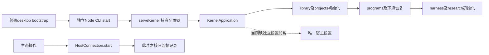
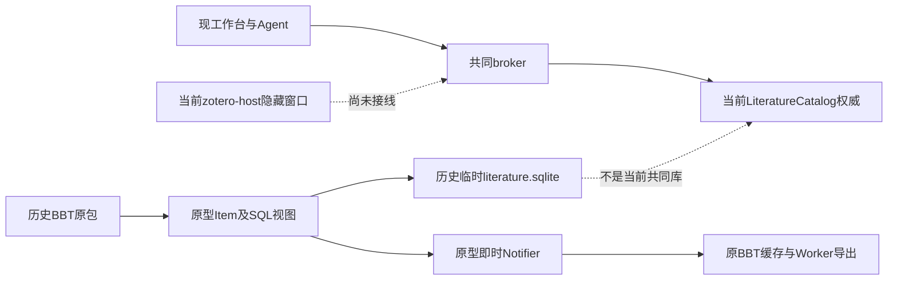

# 调查依据

## 普通Electron与既有系统helper校准（2026-10-29）

主线在全新cache中复制Electron44.5.1，排除原不具备root权限的helper，仅让自身`chrome-sandbox`槽位链接到本机已有`/opt/google/chrome/chrome-sandbox`（root:root、4755，前后身份不变）。没有安装、sudo、修改系统权限、加入no-sandbox或加载插件／用户库；这是普通兼容宿主前置，与报告bwrap全进程隔离是不同目标。生产资源校验器仍拒绝该链接，因此不称N2.4通过。

证据根`/home/joshua/.cache/scholoom-finish-active/zotero-system-sandbox-calibration/`。首次观察器把Electron自设`DBUS_SESSION_BUS_ADDRESS=disabled:`误判为宿主DBus泄漏，主动stop；其后的GPU失败位于收尾窗口，不能独立归因。后续仅允许这一精确sentinel，保留原白名单及20%CPU／512MiB／swap0／128tasks／30秒限额。`report-capture.md`实际到达main、renderer及可信页面，preload sandboxed/contextIsolated均true；renderer的NNP1／Seccomp2／filter1／CapEff0及NSpid两层均为实际OS读回。外部读取namespace链接被EACCES拒绝，保留缺证，不能因此改写为没有sandbox。

最后一轮仅为普通显示路径：先`:99` xdpyinfo通过，使用产品普通Electron启动参数、仅增加可信DISPLAY和必要XAUTHORITY，不启动或停止共享显示。`report-display.md`／`facts-display.json`记录renderer NSpid为2922457／4、上述sandbox正证据及同一scope归属；`capturePage()`确实执行后返回UnknownVizError，stderr仅DBus警告、没有本轮GPU fatal。原unit／cgroup及八个已见PID出生身份均已收尾，helper元数据未变。截图未产出；没有原包ready、生产固定资源校验及完整生命周期／布局验收，N2.4／5和整体E4／I6继续开放。现有roothelper若进入产品，须先明确受控系统依赖、唯一允许槽位及每次启动的身份／权限见证，不能泛化放开资源树链接或root所有权。

## N2续做调查：持久绑定与初始化恢复（7aff2c7）

2026-10-28，HEAD `7aff2c763504f0ddf3b2304eb6ea18b7ef0e389c`，起始clean。N1.2及两个消费者已由主线接收：共同内核15/15、真实BBT原值动作双宿主2/2；整合UI总计5/6，其中项目文件Electron保存失败交项目R16.1，不能记为整合全绿。实际回执入口为`/home/joshua/.cache/scholoom-round15-acceptance/`及delivery的第十五轮主线验收。本轮只读源码与测试定义，不复跑上述绿色组或操作任何库。

| 已核源码／符号 | N2需要补的精确接点 |
| --- | --- |
| `bootstrap.ts::bootstrapKernel`、`cli.ts::main`、`lifecycle.ts::ensureKernel/serveKernel`（当前约14／17／265行）；`desktop/src/main/index.ts::kernel:bootstrap` | desktop普通入口经独立Node CLI，开发入口委托既有调试宿主；start仅传data-dir／development，serve在canonical目录取得SQLite独占锁后生成真正status.instanceId并构造KernelApplication。没有读取生态设置；renderer只可请求ensure／inspect。单一读取点应在持锁的serve，而非bootstrap／renderer分别读设置 |
| `ManualApplication.initialize`（manual.ts:748）和`KernelApplication.initialize`（application.ts:507） | 先library、projects、programs记录／环境，再harness和research。生态没有初始化恢复步骤；需在Manual.initialize第一步await监督核查，在library初始化之后核绑定库ID，在programs／harness恢复或新准入之前完成未知scope记账。计算线本轮拥有programs恢复回调，本线只提出新增前置调用，不修改其Set／retain逻辑 |
| `ZoteroOperations.check/result/run`（zotero.ts:62／74／205） | N1已将result独立为共同只读查询，不能回退。其余四项仍要求构造供应IsolatedZotero；run创建操作快照和临时profile，HostConnection的kernelInstanceId仍为另一个randomUUID（约270行），不是serve的真实status.instanceId。需宿主供应真实父实例，不能修改programs使用的私有hostInstanceId来凑同名字段 |
| `HostConnection.initialize/retainUnknownScope/close`（host-connection.ts:220／196／546） | 单个`<data>/zotero/host-supervision.json`仅在新host.start时读取。非ENOENT／损坏／超64KiB及原未决阻止新host；原scope未知按commandInstanceId（缺身份时`host:<directory>`）调用共同retainUnknown。privateDirectory位于恢复try之外，目录权限准备失败不能当“无旧记录”。close未取得ownedIntent时不覆盖原失败现场 |
| `ProcessAdmission.retainUnknown`（admission.ts:40）及`ManagedCommands.start`（commands.ts:98） | retainUnknown按身份幂等、满容量时也能追加占用，不在等待队列超时释放；它扣除相应名额，并不封停所有执行，亦无恢复占用释放API。ManagedCommands没有recover或独立observe方法；实际start的intent／started／stopped观察和OS完整归属继续复用 |
| `HostRecord`（protocol/host.ts:55） | 只含旧kernel／host／command身份、scopeStopped、pluginClosed和至多64个unresolved ID，没有callback完整快照。scope已停但插件／领域结果未知只阻止生态重启，不占原生活动槽；重启后不能凭库回执或notFound清插件／原生事实。没有可安全结清原scope的公共提供者，本片不发明恢复／解除接口 |
| `privateDirectory/atomicPrivateFile`（platform/private-files.ts:8／44）及`ModelConfigStore.load`（models/config-store.ts:68） | 可复用私有目录／原子写和本机文件lstat、非符号链接、模式核查的做法。模型配置／凭据不是宿主设置存储。POSIX模式与Windows ACL保证分别说明；不能把现有helper称为已验证所有祖先路径／目标ACL。N2首目标Linux，Windows保护另验 |
| `ProjectStore.path`（projects/store.ts:211–240）、`DirectoryBrowser.browse`（projects/directory-browser.ts:15） | 普通项目文件访问按realpath拒绝整个applicationDirectory，目录浏览也排除配置根；任意外置资源目录不自动获得同一保护。因此N2建议将离线资源根固定派生在本配置的native-resources下，省去任意root字段和另一份外置目录保护规则 |
| `HostConnection.workspace`（host-connection.ts:146）、`ManagedCommands.prepare/start`和`runCommand`（platform/command.ts:35） | 公共CommandWorkspace已有env和beforeLaunch，ManagedCommands在容量等待后再次授权／调用beforeLaunch。HostConnection尚不透传这两项；runCommand默认环境不含DISPLAY／XAUTHORITY／TMPDIR。已绿测试用固定env包装和Xvfb前置，不能作为产品配方或扩通用继承环境 |
| `zotero-host/package.json`、`electron.vite.config.ts`、`managed.ts`、`resources/versions.json`与`host.ts::start` | 普通宿主包main是隐藏index，managed为独立构建入口；main依赖已打包，JournalCatalog用node:sqlite。现有版本为Electron44.5.1、Zotero10.0.5／BBT9.0.68；host只校验原包manifest版本／ID，既不获取资源也不证明原发布包来源。首片离线目录可固定裸Electron＋managed.cjs布局；产品安装包、自动下载、任意入口仍不属于N2首片 |

这是当前调用链，虚线标缺口；目标顺序及持久字段只在design的N2节维护。D14-2／3已选定，无待用户重复选择；精确公共恢复hook、窄显示环境及真实父实例来源仍须交主线审查，未伪称已实现。旧settings／资源加载器不存在，不必等文献再交原值、正式键、原子提交或回执。E6、真实用户库与Windows原包／正式分发限制保持。

调查输入仅Git源码和主线cache回执；本轮cache根`/home/joshua/.cache/scholoom-zotero-n2-97Zf3t/`。没有生产改动、CLI／原包／显示／服务实跑或新的业务失败；既有原失败沿上游回执保留，不从其他CI计数推导本片原因。

## 当前调查：普通CLI重启与原包装配缺口（f4ab1e5）

2026-10-28，本轮只读调查／规划，起始HEAD为f4ab1e5f1ed17ae9af656c1f9945005a2786d911且clean。主线已接收R13显示helper和真实原包／UI，当前任务不重复测试或启用生产。所有新工件／TMPDIR使用`/home/joshua/.cache/scholoom-zotero-r14-To16RE/`；下文旧轮/tmp路径仅为历史证据，非本轮输入。

### 当前源码逐层核对

| 层与源码 | 已存在／实际缺口 |
| --- | --- |
| `apps/kernel/src/cli.ts:21,74,90,149` | 参数只有既有data-dir等，已能发送五项zotero同源JSON到运行中的kernel；serve仅传development。start不接受、校验或持久保存生态启用、资源或库绑定 |
| `bootstrap.ts:22`、`lifecycle.ts:355,378` | bootstrap只调用普通CLI start/status；ensureKernel仅有development选项，启动serve时只传data-dir／development。没有从普通入口读取IsolatedZotero的链路；运行目录与生命周期锁不是生态配置权威 |
| `lifecycle.ts:266,314`、`application.ts:77,80`、`manual.ts:239,286` | 程序内确有可信构造注入：serveKernel options→KernelApplication→ManualApplication→ZoteroOperations。该类型只有libraryId、executable、args、packageDirectory；没有业务RPC可设置这些值，不能将其当已交付产品配置接口 |
| `tests/isolated-kernel.ts:24`、`tests/fixtures/isolated-kernel-process.mjs:8` | 测试父进程每次经私有IPC重传configuration，子进程再调用serveKernel；这是实际进程重启，但没有证明普通start自行恢复生态配置 |
| `tests/kernel/zotero-host.spec.ts:319`附近 | CLI读回／导出测试先由测试代码serveKernel(root,{isolatedZotero})启动；普通CLI只是consumer，不能据该绿例称start／serve产品装配已完成。UI重启同样由可信测试父重传配置 |
| `zotero.ts:57,66` | 五项操作共用配置门；无configuration或请求libraryId不等于绑定值，首先unavailable。result本体只是调用library.commitResult，inspect／replaceTitle也不启动原包，但目前仍受同一隔离门保护 |
| `manual.ts:509`、`packages/library/src/catalog.ts:83,277` | 当前共同库由同一dataDirectory下library/library.sqlite提供，identity、grants、原值／正式键及recordOperations均归library。commitResult只核当前库read／identity并按requestId查询真实committed/rejected/notFound；没有缺失的回执存储提供者 |
| `manual.ts:2036`及`server.ts:34` | advertised capabilities来自已注册broker操作；列出zotero方法只证明路由存在，不证明宿主配置、资源、就绪或权限可用。当前没有正式zotero.status操作；design旧表中它仍是目标 |
| `zotero.ts:253`、`host-connection.ts::initialize`及普通application initialize链 | HostConnection在实际run时构造，旧监督记录／unknown scope核对在其start中完成；所查普通初始化没有单独生态恢复调用。N2不能仅读回绑定JSON就声称完成启动恢复，仍须由公共宿主明确旧归属核查及准入顺序；N1不新增执行或恢复动作，不据其查询关闭完整E4 |
| `apps/zotero-host/src/main/index.ts`、`managed.ts:17`、`electron-builder.yml` | 默认入口只是隐藏窗口；受认证操作来自managed入口，读取kernel私有operation文件及stdin封套。包规则含out/resources，但未建立普通产品的可信安装资源解析／启用链，不能据打包规则或默认窗口出现认为原包已可用 |
| `resources/versions.json`、`host.ts:127` | 固定版本及上游asset URL已有，host读取准备好的解包目录并核manifest版本／id；不是下载、安装、发布或可信资源登记提供者。manifest匹配也不能单独证明原包来源可信 |

因此2.3剩余的是普通装配与跨平台／生产保护，不是重做HostConnection；3.1隔离library/broker/WS实际接线已有，普通入口的配置恢复／资源选择仍缺，不能再加一套题录、键或结果仓储来填缺口。

### 五种配置／权限事实不能互代

- **持久库身份与授权**：library.status的库UUID和read/write/send归library；实际初始化默认read=true、write=false、send=false、autoBackup=true（catalog.ts:140），本轮不改默认或自动grant。来源instanceId／libraryLocator／objectKey是原值身份，既不是启动路径也不是授权token；复制Zotero源库默认新来源实例、显式确认才重绑定继续有效。
- **可信启动配置**：IsolatedZotero的本机程序／参数／解包目录仅来自宿主构造；配置存在不授予库权限。没有全局通用生态settings loader可直接复用，所查普通启动链未读任何生态绑定；不能把libraryMeta、projects.json或runtime/endpoint.json改成第二个可写配置权威。
- **产品连接凭据**：server生成本次kernel连接token并由私有endpoint发布；CLI/client沿已有认证进入宿主绑定的human/product主体，不能从JSON自报principal。它不是插件长期凭据，也不是模型API key。
- **宿主短期凭据与实例**：HostConnection独立127.0.0.1 listener、一次性私有stdin、冻结CallContext及handle/回调范围已存在。zotero.ts:255目前为每个HostConnection生成kernelInstanceId随机值；不能假称它等于公开endpoint.instanceId。完整装配若要求审计关联真正父kernel实例，须由宿主提供明确来源，不凭同名字段推定。旧token／handle不随普通重启复用，不将host认证改为connectProduct。
- **结果与进程状态**：fillKeys.operationId是共同提交requestId，replaceTitle直接使用requestId；result返回共同回执，不证明插件shutdown、通知／缓存或整个导出完成。export无共同提交回执，fillKeys.unchanged可无receipt；notFound不证明未知写入回滚，不允许因此自动重放或清supervision门。

权限实况：inspect为人工read／Agent read+send；replaceTitle及fillKeys为人工read+write／Agent再加send；export两者都read+send；result人工read／Agent read+send，且当前仍需隔离配置。五个工具成功返回继续rememberLibrary→rememberCatalog，后续模型准入／重启核read/send。HostConnection与生态callback授权分别保留原调用主体、原输入、共同库／requestId和所选对象，不能用启动配置替代这些核对。

### 可独立推进与必须留给选择的部分

建议先评审design中的N1：普通CLI重启后的**只读共同结果核查**，复用现有DTO、broker和原子库，不涉及原包、显示、安装、可执行文件或真实库写入。当前隔离限制确实覆盖result，因此是否允许这一只读例外列为D14-1，不把“技术上可拆”写成已获产品授权。其余四方法门不随N1放宽。

完整原包产品装配N2至少还需唯一启动绑定归属、可信资源交付／解析、受控平台环境及启用规则；现有测试/usr/bin/env／Xvfb／no-sandbox不是生产策略。D14-2／D14-3未决时该分支保持受阻。共同库的原子提交／正式键／稳定回执已实际存在，不重复要求文献交同一provider；E6缺口仍阻止真实用户库启用。

本轮没有运行CLI、host或原包实验；上述行为结论来自当前源码，已绿范围只引用主线本轮main-kernel/main-ui及本树sync日志。图形资产可用性与新平台本轮未验。必需入口均已在Git或cache：`tests/fixtures/zotero-host/display.ts`、`tests/isolated-kernel.ts`及其子入口、当前CLI与普通library provider；主线cache的`preserved-tmp/zotero-better-bibtex-9.0.68.xpi`、`preserved-tmp/static-ui.mjs`、`create-ui-config.mjs`均存在。历史Git probe不作为N1前置，本轮未执行或解析其旧/tmp默认路径；若未来需要另用，须显式设置保全XPI并先做显示预检。

## 当前调查：CSL更正与原值／导出的差异（4b13183）

2026-10-27，仅调查和规划。当前HEAD为`4b13183f7489d3cae12fd0a7d1a9e83fb33d7384`，开始时clean；主线已接收普通期刊最多100条共同库／原BBT切片及持续外发授权P1。同步、构建、复验依据为`/tmp/scholoom-round6-acceptance-dXuzCA/{acceptance.md,synchronized.json,sync-build-results.json,sync-kernel-results.json}`中本树条目。本轮不应用历史patch，不重做宿主选型／H1／P1，不改生产实现。下文早期“尚无提供者”等判断是历史上下文，已由真实接入替代。

### 当前事实与契约定位

已接收的共同契约位于[`define-library-zotero-record-authority`的delta](../define-library-zotero-record-authority/specs/literature-catalog/spec.md#requirement-来源原值与题录投影分离)，明确“仅更正CSL SHALL 不覆盖未明确修改的原值”；该change尚未归档同步为`openspec/specs`中的新条文，不能因目录状态否定已接收契约，也不能擅自同步正式规格。当前[正式题录规格](../../specs/literature-catalog/spec.md#requirement-有界整理与授权更正)仍约束授权、修订拒绝和历史保留。

源码路径与实际行为：

| 路径 | 当前实际行为及证据 |
| --- | --- |
| `LibraryTab.saveDetail`（`apps/desktop/src/renderer/src/workbench/library/LibraryTab.tsx:523`）→ `LiteratureCatalog.update`（`packages/library/src/catalog.ts:616`） | 表单和JSON共用一个metadata草稿，提交CSL、标签／集合／关联与revision；整体替换CSL并增加共同revision，不写originalRecords、citationKeys或原值历史 |
| `library.record`（`catalog.ts:221`） | 返回同一source的当前revision、正式键／pinned和有界原值页；revision不是原值独立版本，也不代表CSL与原值相同 |
| `ZoteroOperations.run`（`apps/kernel/src/zotero.ts:103`）→ `JournalCatalog.refresh/getCreators/toJSON`（`apps/zotero-host/src/main/journal-catalog.ts:48/293/329`） | 只读取record中的唯一schema44期刊原值；SQL字段来自original.fields、作者来自原数组；citationKey覆盖自共同正式键，不读CSL metadata来自动覆盖 |
| `ZoteroHost.export`（`apps/zotero-host/src/main/host.ts:243`） | 未改动BBT9.0.68的Translators／Worker实际生成文本；当前revision/key复查保护读取依据，不能证明CSL表达已被采用 |
| `commitRecords`（`catalog.ts:289/421`） | `metadata`、`original`、`key`分别显式可选；原值按完整身份整体upsert。可以在一次共同事务中明确提交两个表达，但没有“CSL保存自动双写”的契约 |
| `zoteroTools`／`rememberCatalog` | 成功结果已复用共同会话库身份登记，下一次模型准入及重启继续核read/send。主线P1红／绿已接收，本轮不返工或另造ResourceRef |

### 隔离实跑与差异

可重复脚本为[`evidence/csl-original-probe.mjs`](evidence/csl-original-probe.mjs)。复用已接收`tests/kernel/zotero-host.spec.ts`的普通期刊样本配方，在新目录`/tmp/scholoom-csl-original-AUctoW`重建两个合成条目；未打开旧样本配置或真实库。使用真实KernelApplication、library／broker、SQLite、认证WS、ManagedCommands／OS归属、Electron和原BBT Worker；没有模块替身、假SQL或模型请求。构建先于脚本，首次运行成功，8次实际导出后scopeStopped/pluginClosed均true、unresolved为空。保留原配置及所有结果。

完整可审查读回及输入／回执在[`observations.json`](evidence/csl-original-4b13183/observations.json)，两格式文本及复现说明在[证据目录](evidence/csl-original-4b13183/README.md)。A沿既有英文题名样本；B原值creators顺序为author Chen → translator Li → author Wang → editor Kim，日期为`2024-03-14`，Extra含未知行、CNKICite及Status原文；两个正式键均固定。

| 操作阶段 | A/B共同revision | 原值与原值历史 | 原BBT实际文本 |
| --- | --- | --- | --- |
| baseline | 2/2 | 各一份原值；各2条原值／键历史 | 两格式原题名、2024日期、Chen/Wang作者、Li译者及Kim编辑可查 |
| 只更正A的CSL题名 | 3/2 | 两份原值逐字段不变；原值／键历史仍2/2 | BibTeX和BibLaTeX均与baseline逐字节相同，仍是旧题名 |
| 只更正B的CSL日期／作者组 | 3/3 | 原date字符串、跨角色原顺序、Extra及来源身份不变，历史仍2/2 | 两格式仍与baseline相同；没有采用CSL的2025–2026范围／circa、机构作者、粒子／suffix或新译者 |
| 显式提交A原值题名对照 | 4/3 | 只更正所选original.fields.title；A历史增至3，B仍2 | 两格式均出现新题名；共同正式键／pinned始终不变，B的歧义差异仍存在 |

共同CSL更正本身按当前契约成功，不能把上述差异归咎为保存失败或缓存未刷新。每次原包导出使用新profile，因而此反例独立于旧缓存。基线BBT会做title case，故“输出字符串与CSL不逐字相同”也不能单独作为陈旧判据。样本BibLaTeX还输出`pubstate = {raw-only}`，该值出现在原Extra的Status行；直接把CSL字段覆盖到Item并不能证明得到完整的“CSL导出”。

### 可确定的显式操作与不能推断的值

| 值／操作 | 可证明的最小范围 | 必须保留的差异／待确认输入 |
| --- | --- | --- |
| 已选schema44 journalArticle的title、DOI、URL→url字符串 | 用户明确选择目标原值和字段后，可逐字写入明确的新字符串；完整read-modify-commit保留未选字段 | 这是显式更正，不是还原原始来源。不同标点／DOI前缀是否规范化不自动决定；此次实跑只验证题名，不宣称其他字段已验收 |
| 日期 | 用户直接给定目标原date字符串时可以原样存储 | CSL literal不是Zotero原date；date-parts范围、季节、circa、精度与时区没有唯一原文。不得把格式化为ISO、截断端点或写入Extra当无损逆映射 |
| 作者姓名、机构、角色及顺序 | 已知目标原creator索引／完整原对象且用户只改明确姓名属性时，可以保留其他属性和位置 | CSL按角色分组丢失跨角色交错次序；literal／family-given、中文拆名、粒子和suffix没有唯一fieldMode／firstName／lastName。仅同角色排序不授权重排完整原数组 |
| 原类型、来源及关系 | 读取并保留现有itemType、schemaVersion、identity、relations | 不从CSL type倒猜原类型；多原值不得默认首条，不按key／路径重绑定来源；当前journalOriginal对多原值或复杂关系明确unavailable |
| Extra／未知字段 | 未选字段整体保留，含未知行、CNKICite、Status和别名 | CSL note不是raw Extra。不能用CSL清空、合并或替换Extra；显式Extra编辑、解析及原包效果须另定范围 |
| 正式键／pinned | 共同权威不变，原值更正请求省略key | 不从CSL扩展键、日期／作者变化或BBT重算结果覆写正式键 |

实现方案和需用户选择项见[design本轮节](design.md#csl更正与原值导出差异的待决方案4b13183)，本轮只提交推荐，不批准自动同步。

### 最新CI输入（替代旧374项基线）

当前实际基线是[`6b22d60 / Checks 40315429083`](https://github.com/leike0813/Scholoom/actions/runs/40315429083)：Linux内核689通过／9失败／16跳过；Windows628通过／49失败／30跳过；macOS入口3通过／1失败，另有不可用校准2通过。原始日志及清单来自用户提供的`/tmp/scholoom-round6-acceptance-dXuzCA/ci-baseline-failures.log`、`ci-baseline-summary.json`。

本线相关Windows `host-connection.spec.ts:159`（原日志3806–3830附近）期望outcomeUnknown、实际unavailable；它是失联／受理阶段待诊断，不是“超时不够”。本轮Linux原值差异实验不复现该平台场景、不修改监督判据、不计关闭。Windows文献整合／附件及双平台context-session失败仍归所属消费路径；macOS关闭重连和其他全仓失败也不由本轮局部成功消除。没有下载额外artifact、触发CI或跑全套。

## 第三轮已确认输入

2026-10-26恢复时只读确认HEAD `eaf38be1ac2d350120805859175fc82cf9c36927`，`0519904`／`b838402`均为祖先，工作区clean；主线同步说明 `/tmp/scholoom-sync-recovery-wyn13R/recovery.md`记录本树内核13/13、原包9/9和先构建后验证。它们是同步／旧切片证据，非本轮新监督的验收；本轮直接使用当前源码，不再组合/tmp公共代码。

本轮指令及 `/tmp/scholoom-round3-handoff-qefwKi/prompts/zotero-ecosystem.md`已选定独立认证host listener、一次性私有启动供应及监督实施。来源恢复／复制默认新实例、显式确认才重绑；正式键同库大小写不敏感、不改名／覆盖固定键；选择有界多对象原子提交完整语义及稳定结果查询。下面原A/B选项仅是第二轮历史，当前不再等待同一政策选择；仍等待文献实际schema／provider，不把公共开放CSL或合成SQLite当正式实现。

实施发现普通reserve无法在已满容量时登记未知scope，且普通等待有到期释放，不能用于恢复保护；已增最小`ProcessAdmission.retainUnknown`，按原command身份与已有reservation／恢复占用去重，不可读记录另以配置标记保守阻塞，原生停止后端不变。原生scope已确认停止而插件未知时不占名额，仍阻止该profile重启。相关独立回归及真实结果见delivery，代码事实以本树`platform/admission.ts`、`kernel/host-connection.ts`为准。

## 当前事实与复用选择

规划调查基线：2026-10-25，本树 `e3d58fc807827a78493dcd16e38de28c8d02766e`，初始工作区干净，无 `.codegraph`。首次规划只读源码／既有证据／固定上游文件，没有运行插件、业务测试或真实库实验。两个原生子 Agent 均为 `gpt-6.1-sol / high`，分别查公共端口及历史原型；主 Agent 抽查了 schema、`LiteratureCatalog.update`、`RpcPeer`、`connectProduct`、原型保存、上游 BBT 与茉莉花保存路径。未查询或操作其他树。后续实施依据用户“实现该change”，实际结果另见[delivery](delivery.md)。

### 证据版本与等级

| 对象 | 本轮可复核来源 | 可以支持的结论 |
| --- | --- | --- |
| Zotero 10.0.5 | 发布标签解析到 [`ca61760225d25191d0c65acbfd0c4f12a172d263`](https://github.com/zotero/zotero/tree/ca61760225d25191d0c65acbfd0c4f12a172d263)，本轮读取该版本 `userdata.sql`、`system.sql`、`.gitmodules` 及子模块指针 | 固定发布源码事实；不再把旧研究的 main `2cdc2cc3…` 当作发布版本 |
| 类型／字段／创建者／CSL | 该标签固定 `zotero/zotero-schema` [`70c3aa98627413d6a30dca955886eafbde085ce9/schema.json`](https://github.com/zotero/zotero-schema/blob/70c3aa98627413d6a30dca955886eafbde085ce9/schema.json)，schema version 44，blob `71e8898a7c22c8c3d165945aba76c723c0573eb5` | [完整语义目录摘取](evidence/zotero-10.0.5-mapping.json)：40种类型、121种字段名、37种创建者角色；不是 Scholoom schema，也没有猜数值 ID |
| CSL 转换实现 | 固定 utilities 子模块 [`1dd38e27edf81e9d9c4161c957b7efb7f5681ac3/utilities_item.js`](https://github.com/zotero/utilities/blob/1dd38e27edf81e9d9c4161c957b7efb7f5681ac3/utilities_item.js#L43-L285) | 类型、多值、Extra、日期及姓名转换有信息损失；只照映射表无法完整往返 |
| BBT 9.0.68 | [发布包](https://github.com/retorquere/zotero-better-bibtex/releases/tag/v9.0.68)；本轮重新读取固定 [`71cec8067843bc5cdcbac7e1e794a3803638a5e1/content/key-manager.ts`](https://github.com/retorquere/zotero-better-bibtex/blob/71cec8067843bc5cdcbac7e1e794a3803638a5e1/content/key-manager.ts) | 静态保存、SQL、缓存及重生成事实；源码快照与发布包成员对应仍需未来装载时逐项记录 |
| 茉莉花 1.1.39 | [发布包](https://github.com/l0o0/jasminum/releases/tag/v1.1.39)；本轮重新读取 [`b63a6a1e0ac4ce25fcd0c9200ec647b063ce02c0/src/modules/services/index.ts`](https://github.com/l0o0/jasminum/blob/b63a6a1e0ac4ce25fcd0c9200ec647b063ce02c0/src/modules/services/index.ts#L320-L425) | 重绑父项、保存、删除旧 parent、Extra／date 最终保存疑点；不能把分开的 saveTx 当成整任务事务 |
| 2026-10-04 原型 | [独立宿主结果](../../../.scratch/scholoom-foundations/research/zotero-host-minimal-results.md)、[缓存变更结果](../../../.scratch/scholoom-foundations/research/zotero-host-mutation-results.md)、[元数据结果](../../../.scratch/scholoom-foundations/research/zotero-host-metadata-results.md)、[参考宿主结果](../../../.scratch/scholoom-foundations/research/zotero-host-prototype-results.md)及各自证据链接 | 历史实跑，未在本轮重跑。完整 Gecko 与独立 Node＋Chromium 必须分别记录 |

历史原包路径 `/tmp/scholoom-host-prototype-assets-1bmhDr` 本轮检查已不存在；本树没有完整 XPI 快照，旧入口默认临时路径不可直接复用。未来需要按固定发布来源取得资产及另行授权任何必要准备；本轮没有下载／安装原包。直接读取父仓 `resource/schema/global/schema.json` 曾返回404，原因由 `.gitmodules` 和 contents 子模块指针核实，改为读取固定子仓；不是字段不存在。shell 网络受限后通过获准的只读 `gh api` 解析版本，未更改仓库。

### 可直接转交：身份及删除语义

来源：[10.0.5 userdata.sql](https://github.com/zotero/zotero/blob/ca61760225d25191d0c65acbfd0c4f12a172d263/resource/schema/userdata.sql)，本轮完整读取。

| Zotero 源事实 | 当前 Scholoom 对应 | 缺口／不能推出的语义 |
| --- | --- | --- |
| `items.itemID` 是本数据库整数主键，`UNIQUE(libraryID,key)` 限定条目 key | 共同库 `libraryStatus.id`、题录 UUID `source.id` | `itemID`、DOI、citationKey、文件哈希都不能替代来源对象身份。需要来源实例命名空间＋库定位＋对象 key；具体正式字段待文献线定案 |
| `libraries.libraryID/type/editable/filesEditable`；群组经 `groups.groupID ↔ libraryID` | 当前独立共同库与 read/write/send | local libraryID 不证明跨安装或复制库相同；账户／群组身份与本地库号、内容迁入与在线同步关系不能混同。上游 editable 不能授予 Scholoom 写入 |
| 条目 `version/clientVersion/synced` 是 Zotero 同步相关字段 | `source.revision` 为本地 CAS；`source.version` 为发表版本标签 | 三者语义不同，不将 Zotero version 填入 Scholoom 发表版本，也不把它当本地 revision |
| collection、savedSearch 各自也有 `(libraryID,key)`；附件／note／annotation 同为 items，另存父项关系 | `collection.id`、`attachment.id/sourceId/materialVersionId`、`readingRecord.recordId` 分离 | 兼容 itemID 可映射不同共同对象种类，不能让父题录 UUID 与子附件 UUID 相同；saved search 无共同提供者 |
| `deletedItems` 保留仍存在 items 的回收状态；`syncDeleteLog` 保存对象类型、库、key、删除日期 | 共同阅读记录有软删除和历史；题录／附件无对象删除恢复提供者 | 源库删除记录没有共同操作者审计的全部语义。重复接入、硬删除后重新入库、恢复原对象需不同处理；源 key 重现本身不足以确定恢复 |

建议交文献线比较两种来源命名空间：A，显式登记可随迁移保留的来源实例身份；B，在可核验账户／群组范围内使用上游稳定身份并处理离线个人库。A 可处理本地离线，但复制／恢复库是否同源需明确选择；B 有跨安装线索，但不能覆盖未登录库，也不能迁入同步权限。本线不替对方选择，不按目录路径或整库哈希生成正式身份。

### 可直接转交：字段、创建者及关系

完整类型、各类型有效字段、baseField、角色 primary 及 CSL 表只维护于[映射摘取](evidence/zotero-10.0.5-mapping.json)。这是调查数据，未来产品从固定上游资源生成自己的兼容目录，不让业务依赖 OpenSpec 文件。

| 范围 | 已核对映射 | 保留要求／现有差距 |
| --- | --- | --- |
| 类型 | `journalArticle→article-journal`，`bookSection→chapter`，`computerProgram→software`，`preprint→article`；40种全部在摘取中 | `film/videoRecording→motion_picture`、多个广播／通信类型共享 CSL 类型；`attachment/note/document→document` 也不能互相覆盖。保留原 itemType 后才能可靠反向编辑 |
| 常用文本 | `abstractNote→abstract`、`publicationTitle→container-title`、`url→URL`、`pages→page`、`numPages→number-of-pages`、`libraryCatalog→source`、`rights→license`；title/DOI/ISBN/ISSN 同名 | 以类型的 baseField 规则解析。转换器对 presentation 等的 place 有特例；ISBN 只取首值，CSL 往返不能证明原字段保真 |
| 日期 | `date→issued`、`accessDate→accessed`、`filingDate→submitted`、`originalDate→original-date` | 原始字符串、季节、时区与部分日期不等于简单年月日；上游会解析和本地化访问日期。共同原始值保留方式待文献线 |
| 创建者 | `firstName/lastName/fieldMode`＋`creatorType/orderIndex`；单字段机构名映射 CSL literal，个人映射 family/given；角色表含 author/editor/translator/bookAuthor 等 | CSL 按角色分组不能保留跨角色原始顺序，姓名粒子处理也会变化；不要对中文名统一拆分。当前开放 CSL 字段可保留 JSON，但没有类型化创建者编辑契约 |
| Extra 与键 | `extra→note` 需 `extraToCSL` 处理；`citationKey→citation-key` | raw Extra 中未知行、BBT aliases、茉莉花 CNKICite／Status 不应经 CSL note 反向覆盖。正式 citation key 不因任意扩展字段可写就已经有共同权威 |
| 标签／集合 | itemTags 有手动／自动 `type`，collectionItems 为多重归属，collections.parentCollectionID 构成树 | 当前共同 tags 为字符串，集合 parentId 可表达层级但无 CAS；自动标签类型／顺序等保留位置待文献线，不静默丢失 |
| related／其他关系 | itemRelations 是 predicate＋object URI；parentItemID 分别指向题录或附件；collectionRelations 独立 | 当前 `relatedIds` 是双向版本关系，`update()` 会反向更新，不能把任意单向 URI、合并替代关系直接塞入它 |
| 附件 | linkMode/path/contentType/storageHash 与 parentItemID；stored 文件与 linked file、linked URL 不同 | 共同 storage/materialVersionId 与 Zotero storageHash 分离；路径不是权限，文件变动不是 metadata 修订。linked URL、未下载文件和PDF批注需独立表达 |
| notes／annotations／搜索 | note 正文与父项；annotation 的 type/text/comment/color/position/sortIndex/isExternal；savedSearchConditions | 共同阅读记录只有 bookmark/highlight/note 与同版本位置，不能把 Zotero note 或 annotation.position JSON 无损直塞；全文索引是派生状态 |

数值类型／字段／角色 ID 的生成与宿主资源尚未在本轮运行核对。目录按稳定名称取证，未来兼容适配须复用固定上游初始化逻辑，核对真实 ID；独立原型的 `journalArticle=1` 等人为编号不是 Zotero10事实。未完成这一项不影响上述名字与语义目录转交，但阻止宣称完整 SQL 兼容。

### 插件保存、SQL、通知、缓存和固定键

BBT 本轮固定源码复核：

- `key-manager.ts:37–58` 的查询关联 `items/itemData/fields/itemDataValues`，missing 还访问 `libraries/deletedItems/feedItems/itemTypes`；要求 SQL 语义，不可按整条 SQL 字符串分派样例。
- `fill()` 默认跳过已有原生 citationKey，`replace:true` 可替换；写入 `saveTx({skipDateModifiedUpdate:true})`。`fillMissing()` 在 `executeTransaction` 内对多条 `save()`；普通对象保存和批次事务都必须兑现。
- `updateCitationKeys` 的 `Preference.resetKeyOnChange` 可在元数据变化时要求 replace。因此“默认 fill 稳定”不能证明所有偏好下已有键稳定。共同固定状态必须在最终写入处核对，不能只隐藏重生成按钮。
- `update()` 先修改内存 key map，再返回待保存 Item；保存 CAS 拒绝、撤权或回滚时，插件内存可能领先共同事实，需失效／重建后才允许导出。
- 可写条目以原生 `citationKey` 为准；只读原生键优先，缺键则生成 shadow key 并写 `read-only.json`，不写条目。旧 citationkey DB 只是迁移来源。当前源码没有足够证据把独立 pin 布尔字段当作其现成契约；固定状态由文献线定义并适配。
- `keyScope` 与 `citekeyCaseInsensitive` 决定候选冲突比较。该插件缓存中的唯一性不能替代并发下共同文献写入端的正式冲突约束。

历史通知实跑：正常 Item 保存通知触发原 BBT 的监听器及缓存更新；屏蔽通知时 DB 已改而实际 BibTeX 仍旧，说明投影不是简单重读即可。见[变更结果](../../../.scratch/scholoom-foundations/research/zotero-host-mutation-results.md)。

原型缺口可直接从本树核验：[literature-store.mjs](../../../.scratch/scholoom-foundations/prototypes/bbt-minimal-host-prototype/literature-store.mjs) 的 `saveTx()` 直调 `save()`，单条写后立即 `notifier.trigger`；另有 transaction 包装但没有提交通知队列、回滚后缓存协调。`notifier.mjs` 监听异常也可能使已写入的保存返回异常。它不能作为共同事务或未提交无效果的 oracle。

茉莉花本轮固定源码复核：`globalItemFix()` 保存新项后才改 Extra／date；附件任务再另次 saveTx，snapshot 分支可能保存重绑、erase 旧 parent、保存新集合。新项 Extra／date 最终是否全部持久化仍需 helper 与具体任务路径证据。其源文件匹配还会根据配置保留／备份／删除来源文件，[原静态依据](../../../.scratch/scholoom-foundations/research/zotero-storage-and-plugin-authority.md#茉莉花条目extra附件和本地状态)不能被理解为已获 Scholoom 原文件删除许可。首个 BBT change 不执行这些路径。

### 材料阅读写回交接

- 完整 Gecko 的历史[书签实验](../../../.scratch/scholoom-foundations/research/zotero-host-reader-results.md)写 `jasminum-bookmarks.json` sidecar，PDF 字节不变；原函数仍依赖 Reader 内部 DOM。sidecar 修改与PDF材料新版本必须分开。
- 独立 Node＋Chromium 尚未证明相同 Reader 写回。不能从完整参考环境的重开结果推断独立宿主已支持，也不能把书签节点树自动等同共同 bookmark 记录。
- 当前 `readingRecord` 保存 attachmentId/materialVersionId、稳定 recordId、revision、可信 createdBy/updatedBy；PDF 是 pageIndex／rects，EPUB/HTML 是 normalizationVersion／sectionId／UTF-16区间。原 PDF 不写回，库资源正文只读。
- 阅读线的 `add-material-annotation-interactions` 消费上述调查，需先明确 sidecar 对象、共同记录、材料字节修订的归属与转换，实际保存检查旧 materialVersionId。`add-interactive-research-reports` 的页面运行／更新不依赖插件宿主，本 change 不拥有报告协议或 composer。
- 首轮起始时尚无这两份设计；主线第二阶段已正式交接两份设计和位置schema快照，现已消费，见下节。材料写回提供者仍未交付，不能把设计已读当作写回已接线。

## 第二阶段正式交接与消费者核对

### 输入来源与证据边界

用户正式提供 `/tmp/scholoom-phase2-handoff-VZS5mS`，下称 **H**。`H/manifest.json` 将七份快照的来源树和共同基线 `e3d58fc807827a78493dcd16e38de28c8d02766e` 列明；它们只包含当时改动／未跟踪工件，不是完整仓库或已合入dev的提供者。本轮只读快照，没有访问其来源工作树、会话或发送跨树消息。

| 精确消费路径（均以H为根） | 实际消费结论 |
| --- | --- |
| `acceptance.md` 的阶段接收、Standards、独立运行证据；`coordination-plan.md` 的公共对接阶段 | 主线独立接收H1，9项原包smoke和1项Electron归属复验通过；生产及I6未接收。计算C3为合法30天timeout溢出成1ms，需计算线修复，不以本线改时限掩盖 |
| `literature-workbench/openspec/changes/complete-library-catalog-workbench/design.md`，同目录tasks／delivery | B批的字段目录、类型编辑仍待生态调查；候选`library-metadata.ts`未实现。正式键和来源身份不属于已交付B批能力 |
| `literature-workbench/packages/protocol/src/library.ts`；`literature-workbench/packages/library/src/catalog.ts` | 实际schema／保存实现已读，E1–E3没有新增提供者；相对本树相关源码只新增集合parentId分页范围。下面逐项给出差距 |
| `research-interaction/openspec/changes/add-material-annotation-interactions/design.md`；`research-interaction/packages/protocol/src/workbench-context-contracts.ts` | M1库正文写回仍阻塞；text.location、region.target、object.contentState为实际快照schema。共同选择增量不提供PDF版本提交或sidecar转换 |
| `research-interaction/openspec/changes/add-interactive-research-reports/design.md` | 独立项目HTML报告方案已读；ReportResources／iframe桥仍是规划，报告完成不是BBT或材料写回前置 |
| `project-execution/packages/platform/src/command.ts`、`command-worker.ts`；`project-execution/apps/kernel/src/commands.ts`；`project-execution/packages/protocol/src/platform.ts` | 已有快照源码提供program观察／取消／不限总期限模式，不能自动视为本树已有。长驻监督精确候选见[design](design.md#第二阶段e4长驻监督公共候选) |
| `project-execution/openspec/changes/add-project-program-runs/design.md`；`project-execution/tests/kernel/managed-commands.spec.ts` | 观察失败保留占用、日志背压和原生stopped有定义／测试；本轮未运行此树测试，不复制programs私有运行记录或项目迁移 |

未包含的基线文件以本树核对：`packages/library/src/schema.ts`、`packages/protocol/src/core.ts`、`packages/broker/src/{index,rpc}.ts`、`apps/kernel/src/{manual,server}.ts`、`packages/platform/src/{processes,admission}.ts`。已有`EntryRole`包含host，无需为插件再增加角色枚举；缺的是可信连接装配与作用域绑定。

### E1–E3：给文献提供者的最小需求

以下是本线正式交回的**消费者需求**，不是已批准的新DTO、存储布局或方法名。固定版本映射继续引用原[evidence](evidence/zotero-10.0.5-mapping.json)，不重新研究或另造目录。

| 项目 | 代码核对与现有能力 | 最小提供者及解除依据 |
| --- | --- | --- |
| E1 原字段／来源实例 | 快照`library.ts:6/21`的开放metadata／origins；`catalog.ts:248/1235`校验整份metadata并追加origin字符串。16KiB限额、DOI校验存在，但没有来源实例／对象映射。CSL相同类型可来自不同Zotero类型，原日期、Extra未知行、创建者跨角色顺序不能从CSL还原 | 文献拥有来源登记／查找／生命周期映射：来源实例、源库定位、对象种类及key／代际与共同libraryId/sourceId分别表达；拥有原类型、原字段、创建者顺序、Extra及未知关系的保留和局部更正规则。超限／不能保真须明确拒绝或返回差异，不静默截断。类型目录、原值载体和稳定来源映射可分批交付，但生态正式映射要等所需部分均实际可调 |
| E1 身份反例 | `catalog.ts:1281`新建UUID；DOI＋明确发表版本可复用，不是外部对象幂等；本树schema的id只是字符串。快照备份恢复在`catalog.ts:1413`生成新共同库身份 | 提供者必须区别同源重复接入、复制源库、硬删除后新对象和回收恢复原对象；复制是继续同一来源实例还是登记新实例需产品决定，不能按路径、itemID或源key猜。E6未就绪的场景继续不可用，不要求B批顺带实现整套迁入 |
| E2 正式键／固定状态 | 快照`library.ts:607` update无正式键字段／操作；`catalog.ts:317`整份替换metadata，DOI＋发表版本唯一性不等于键冲突规则 | 文献提供正式键和固定状态的唯一读取／补缺入口、逐条revision及最终写入保护；键域、大小写等价、同库未选条目及并发冲突必须由最终保存端核对。原包`citationKey`、raw Extra aliases和只读shadow key分开；不授权生态把任意metadata属性升级为正式键 |
| E3 提交与稳定核查 | `catalog.ts:295` update内部事务可反向更新relatedIds，但不能提交任意多Item候选；普通update无稳定提交关联，history也不证明某次丢失回执已提交。`accept/process`是逐项摄取并可部分失败，不是插件事务 | 逐条保存需稳定关联、原调用授权及CAS、实际修订／键结果与查询；选择A的多Item路径还需有界候选集、全部前置核对及全成全败。相同关联换载荷拒绝，断线查询原结果而不重放；结果须区分未提交、已提交和仍未知，核查仍经所属授权。关联归文献，RPC id与宿主实例不是提交身份 |
| E3 通知／缓存 | 快照`catalog.ts:188/344`的changed直接触发notify且调用仍在事务回调内；不能当作BBT提交后通知。宿主fixture事务只证明替身一致性 | 文献返回本地事务实际结果后，生态更新派生视图再投递原包通知；通知失败与领域提交失败分开。必要提供者回归：第二对象冲突／撤权全回滚、写后回执丢失查询、通知失败不回滚、并发相同键、固定键被偏好替换拒绝。已有单条CAS测试复用，不新增重复公共矩阵 |

本线拥有Zotero名字／数字ID和SQL兼容视图、原包候选、缓存失效及通知适配；文献拥有上述字段／保存／查询事实源；项目继续消费共同库指针。`relatedIds`会反向维护版本关系，不能用来承载所有Zotero单向URI；标签类型、附件父关系、note／annotation另按所属字段保留。

### 原包多Item路径与独立失败样本

原发布成员 `/tmp/scholoom-zotero-bbt-assets/package/content/better-bibtex.js` 可直接复核：

- `117800–117873`的`KeyManager.fill`先为所选缺键对象改内存，再逐条`saveTx`；**这是多Item调用、逐条提交，不承诺整批原子**。H1的`ZoteroHost.fillKeys`实际走此路径。
- `117909–117920`的`fillMissing`在一个`executeTransaction`内循环`update(item)?.save()`；`135315`是原包完整startup的必经调用，但内部受`fillKeyAfter`条件控制。H1新profile保持0，故完整启动调用存在而该写入分支未启用。不能把条件多Item写入说成每次启动必然发生，也不能通过删任务伪造ready。
- `update`在`118000`附近先存候选key map再暂存Item字段；回滚SQL不会自动回滚此私有map。

本轮隔离实验脚本／首次完整日志／结果分别为 `/tmp/scholoom-eco-phase2-nHIkpI/bbt-multi-item.cjs`、`first-run.log`、`results.json`。先构建host，再用 `xvfb-run -a node /tmp/scholoom-eco-phase2-nHIkpI/bbt-multi-item.cjs`；两份全新profile、真实Electron／原BBT／Worker、现有合成SQLite。两项均清除样本正式键，在第二个Item.save注入明确异常；独立预期来自上述原包控制流，不来自待实现共同提供者。

| 原包路径／相同故障 | 实际持久键 | 实际通知／BBT缓存 | 结论 |
| --- | --- | --- | --- |
| 显式fill两条 | 第一条`chenResearchAgentsReproducible2026`、第二条空 | 一条modify；第二条map仍有`LiZhongWenKeYanLiuChengYuanXingYangBen2026`，host降为degraded | 允许逐条结果时须准确承认第一条已提交，不能称全批无效果；失败候选不可用于后续导出 |
| 原fillMissing启用条件后调用 | 两条均空 | 无modify；map仍有两条候选 | 跨Item事务要求真实存在；仅循环共同update无法兑现；整个受影响缓存必须重核 |

第二项是在ready后有意调用原包内部方法以隔离分支，不是产品开放入口，也未通过`host.run`；其中host的ready不证明回滚后可导出。该实验仅提供失败样本，不证明共同库的事务、权限或正式键实现。运行器Node24.12.0，Electron44.5.1内嵌Node24.21.0／Chromium152.0.7977.130；未更改原成员、未触碰真实Zotero库。

E3仍有两个需提供者／主线确认的选项：**A，文献另交有界多Item提交及稳定查询**，可承接上述原子路径；**B，首批只开放显式逐条补缺键并准确呈现部分提交，继续关闭自动补键／其他跨对象原子功能**。B有代码证据可行，但缩小完整共同适配的支持范围，需要确认，不能本线自行选定后勾选2.2。两者均需要单条稳定结果查询、固定键保护及缓存重建，B并未消除E1／E2／E3。

校准另观察到：原`Orchestrator.run`在`43350`附近吞下shutdown任务异常，`135330`访问缺失`Services.profiler.IsActive`时只记日志。两项样本的close都为`closed/localResourcesClosed`但diagnostics有`shutdown done failed`。这证明本地销毁不等于完整原包正常shutdown；E4必须补齐实际兼容能力或准确报告插件收尾未知，并有原包失败反例。没有因为实验退出0就认定该错误已修复。本轮只更新交接工件，未改兼容业务代码。

### E5：两份阅读设计分别承接

材料design的M1明确“文献提供新材料版本提交，或继续只读”；其现有ReadingRecordPort继续保存记录，位置附在原ref／basis，不能冒充正文保存。已实现快照中的text.location引用共同readingLocationSchema，region.target区分image／PDF页／结构对象；这是选择依据，没有提供sidecar写入或PDF修订。

| 变化 | 权威／需要的提交依据 | 本线消费者边界 |
| --- | --- | --- |
| Reader的`jasminum-bookmarks.json`树变化、PDF字节相同 | 茉莉花sidecar树与共同ReadingRecord并非相同schema；文献／阅读需决定树、同版本位置、记录id／revision／可信作者的转换及冲突处理 | 既有完整Gecko改名实跑只支持sidecar事实，独立宿主Reader写回未证；不创建材料新字节版本或把树自动当共同bookmark。后续茉莉花change承接 |
| PDF正文／嵌入批注导致新字节 | 文献材料提供者核对attachmentId、所读materialVersionId、权限、实际新字节／新版本与稳定结果；旧字节及旧记录依据保留 | 不能覆盖旧PDF、复用旧materialVersionId或跨版本套旧坐标；新版本提交及失败／未知核查仍待M1，不因阅读design已收而闭合 |
| 项目交互报告更新 | 独立report design的项目HTML入口／依赖basis、ReportResources、opaque iframe和共同composer；不是Reader sidecar | 不消费BBT或材料写回作为报告前置，不把报告ready当宿主ready，不进入本change实现 |

因此“未收到两份设计”已解除；“材料正文／sidecar对应共同记录的提供者未交付”仍成立。BBT不读材料样本不等待M1／报告完成；E6仍保持生产不可用，迁入、茉莉花生产及外部导出功能均未展开。

### 当前公共实现与复用位置

| 当前实现／文件 | 已有能力 | 不能扩大解释的部分 |
| --- | --- | --- |
| `apps/zotero-host/src/main/index.ts`；`tests/smoke/entrypoints.spec.ts` 的 compatibility host 场景 | 隐藏 sandbox 页面及外壳 smoke | 无原包装载、共同读写、插件退出或原生监督 |
| `packages/protocol/src/library.ts`；`packages/library/src/catalog.ts` 的 update/accept/process | UUID、metadata、发表版本、CAS revision、read/write/send、持久摄取批次和逐项结果 | origins 是标签，不是外部对象映射；普通 update 没有稳定 mutation 查询；批次结果不适用于任意插件事务 |
| library 的 attachments/readMaterial/readingRecord | 附件与材料版本、分段读取、阅读记录CAS与创建核查 | 无通用材料替换及题录／附件回收恢复；`library.restore` 是新配置备份副本，非对象恢复 |
| `packages/broker/src/index.ts`、`rpc.ts` | 同源校验、consumer 范围、双向有界 RPC；64普通等待／8控制预留／2MiB帧 | broker 不替领域授权，不替插件提交；断线不自动重放 |
| `apps/kernel/src/manual.ts` 的 connectProduct() | 现产品连接绑定 local human/product | 不能直接给插件复用而取得完整人工权限；新增 host 角色接入是生态所需的公共增量 |
| `packages/platform/src/processes.ts/admission.ts`、kernel lifecycle | 受管 Node、归属退出确认、容量与本机生命周期 | 尚不证明独立 Electron 主进程及 Chromium后代受同样监督；macOS managedExecution 明确不可用 |

依据已归档[运行架构交付](../archive/2026-10-19-migrate-runtime-architecture/delivery.md)、[共同执行交接交付](../archive/2026-10-24-establish-domain-execution-handoffs/delivery.md)、[库入口交付](../archive/2026-10-24-restore-library-management-entrypoints/delivery.md)，共同资源、Graph driver、上下文和库管理已交付，不重做。旧 delivery 含当时中途记录，以顶部最终范围和当前源码为准。

实线分别来自当前源码和上面明确标为历史的原型；两个系统之间没有已实现桥接。

### 历史CI基线：已由当前40315429083基线替代

并行计划指定 [`55d020c / Checks 40100596838`](https://github.com/leike0813/Scholoom/actions/runs/40100596838)：Linux UI 101通过／9失败／2跳过；Windows完整内核374通过／15失败／12跳过；macOS仅既定降级范围通过。主 Agent 读取 `/tmp/scholoom-next-parallel-baseline-failures.log`，相关原始断言为：

| 失败入口 | 日志观察 | 对本线验收的处理 |
| --- | --- | --- |
| Windows `literature-attachment-integration.spec.ts:55`、`literature-integration.spec.ts:67`、`pdf-isolation.spec.ts:86` | 5秒轮询期望 completed，实际 running | 不能据此判插件保存错误或仅加超时。整合前分辨受理、worker、模型、领域提交与刷新，交文献／Agent等实际提供者诊断 |
| Windows `lifecycle.spec.ts:20` | 并发入口路径失败 | 宿主监督接线保留实例／占用诊断，不能回退为另起内核或不监督 Electron |
| Windows `platform-availability.spec.ts:147` | 预期0子进程，实际9 | 尚未分辨进程归属及全组干扰；不能删除零未受管执行保证。本线也不能凭隐藏窗已关闭释放归属 |
| Linux 题录／会话切换、旧 RPC gate、写作PDF预览 | 并行计划记录的9项失败 | 仅在消费路径受影响时定向核对；本轮不修代码、不追加全仓测试，不把历史定向通过写成全仓绿色 |

临时日志不是长期唯一证据，调查保留 workflow链接、测试定位和观察值；未来修复及复验结果仍进入所属 change，不复制公共CI修复任务。

## 影响方案的未知项与实验

规划轮没有执行实验。静态证据已足以选定模块职责与可独立宿主工作；以下未知会影响跨域方案，明确保持阻塞，不用私有假接口定案：

| 编号／负责人 | 待输入及可选方向 | 阻塞范围与解除证据 |
| --- | --- | --- |
| E1 文献线 | 恢复／复制默认新来源实例、显式确认才重绑已定；来源命名空间、对象代际、原字段／类型保留的实际提供者仍缺 | 正式映射和生产对象接入；提供同源schema／端口，覆盖重复接入、复制库、删除重入与原对象恢复，不仅发字段表 |
| E2 文献线 | 同库正式键大小写不敏感、不改名或覆盖固定键已定；正式键／固定状态及冲突端口仍缺，shadow key不能冒充正式键 | 真实补键及导出接线；收到实际读写契约与CAS、固定键保护证据，不自行选择metadata属性作为权威 |
| E3 文献线与生态线核对 | 已选有界多对象原子提交完整语义与稳定结果查询；原包逐条fill／原子fillMissing反例已交，不再待逐条方案选择 | 共同事务适配与I6仍需真实领域schema／provider及失败／回执核查实跑；不以多次RPC或fixture SQL伪造事务 |
| E4 共同宿主／平台，由本线交独立增量 | 本树已同步计算公共基础；已实施独立认证listener、stdin、实例／操作绑定、ready／shutdown／unknown与恢复门，Linux固定host及原BBT实跑见delivery | 本轮公共／私有切片可审查；产品共同库装配、Windows及完整分发仍未验收。未知scope容量按原command身份去重，不把started／局部closed当完整确认 |
| E5 阅读线＋文献材料提供者 | 两个design及位置schema已正式收到并分别核对；sidecar树／共同记录转换、PDF新字节提交及旧依据保护仍无提供者 | 后续茉莉花／材料修订；不阻塞BBT不读材料样本和独立报告，不以设计交接关闭材料写回前置 |
| E6 文献线 | 题录／附件对象删除、操作者历史、恢复与硬删除再入库规则 | 生产用户库启用与后续迁入；不要求等待整个文献工具完成，但不能以备份恢复替代 |

E1–E3政策及共同基础同步已获确认，但所需文献提供者尚未交付；E5设计交接已解除，材料写回与E6删除恢复仍缺。第三轮直接消费本树已同步正式公共代码；此前H快照消费与当前实跑证据分别记录，不能把公共监督通过当作共同库权威已接入。

未来获授权的必要验证只问两个局部问题：固定原包能否在当前Electron的Node＋Chromium层完整ready／shutdown；共同归属适配能否确认Electron及后代退出。使用新隔离配置和合成库、既有依赖及固定资产，保留版本与失败阶段；进入共同字段写入之前遇到E1–E3就停止该分支。无需重跑已结束的整个选型原型，未知项不以增加等待时长掩盖。

## 结论与承接

前置调查的静态交接已形成：固定发布身份／完整类型字段目录、关系差异、BBT与茉莉花保存风险可供文献／项目／阅读线使用；没有声称迁入或共同契约闭合。项目线继续消费共同库／材料稳定指针，不消费Zotero整数ID或副本。

无阻塞问题，基于以下假设制定方案：这里仅指原包装载、私有兼容适配和独立诊断；沿已决Node＋Chromium、固定原包、共同权威及隔离样本。用户已授权实施，E1–E4所约束的生产接线方案和任务仍明确受阻，E5–E6按所属路径承接。

### 本轮规划检查

- `openspec validate connect-zotero-host-bbt --strict`、`openspec schema validate scholoom-dev`通过；apply所需proposal／investigation／specs／design／tasks齐备，13项实施任务均未勾选，delivery未创建。
- Node只读核查映射摘取的itemTypes／meta／csl与本轮实际取得的固定上游JSON结构完全相同；40种类型、121种字段、37种创建者角色。22个本地Markdown文件链接可达；锚点和外链未全量验证。
- `git diff --check`及对7个未跟踪新增文件逐个 `git diff --no-index --check /dev/null <file>` 检查无空白问题；确认修改范围仅为本change。5个Mermaid块人工核对图文和围栏，未运行渲染器，不将OpenSpec校验说成图示渲染通过。
- 未运行构建、类型检查、业务／UI／插件测试或原型；这些本轮无实现改动且没有执行授权。上述结果只证明规划结构及证据摘取，不解除E1–E6。
- 原生子Agent对既有原型事实做了限定复核，发现并已修正拟新增CLI／工具误称现有能力、原型通知方法名错误两处；不将该复核称为生产设计或新增上游调查的独立验收。

### 实施中影响取舍的新依据

- 原BBT9.0.68 `content/better-bibtex.js` 的偏好迁移（原包43182行附近）在autoPinMigrated缺失且fillKeyAfter为0时会设置自动补键。H1全新profile沿既有原型设置autoPinMigrated=true，并实测启动缺键仍为空、显式fill后才保存；不能把此配置当成已有用户偏好迁入方案。
- E4的初始调查遗漏了 `packages/platform/src/command.ts` 的外部程序承载：runCommand先受管启动command-worker，再spawn固定外部程序。新Linux实跑见delivery，证明其能收尾真实Electron及忙Worker；有界结果接口没有长驻ready／身份／WS／正常shutdown，所以不解除E4。
- BBT使用前会修改内存键；失败保存、未知flush及Worker失联仍须分开。H1关闭记录只描述局部资源，不能替代共同提交或OS完整退出；相关并发、路径与失联反例及修复记录见delivery。
