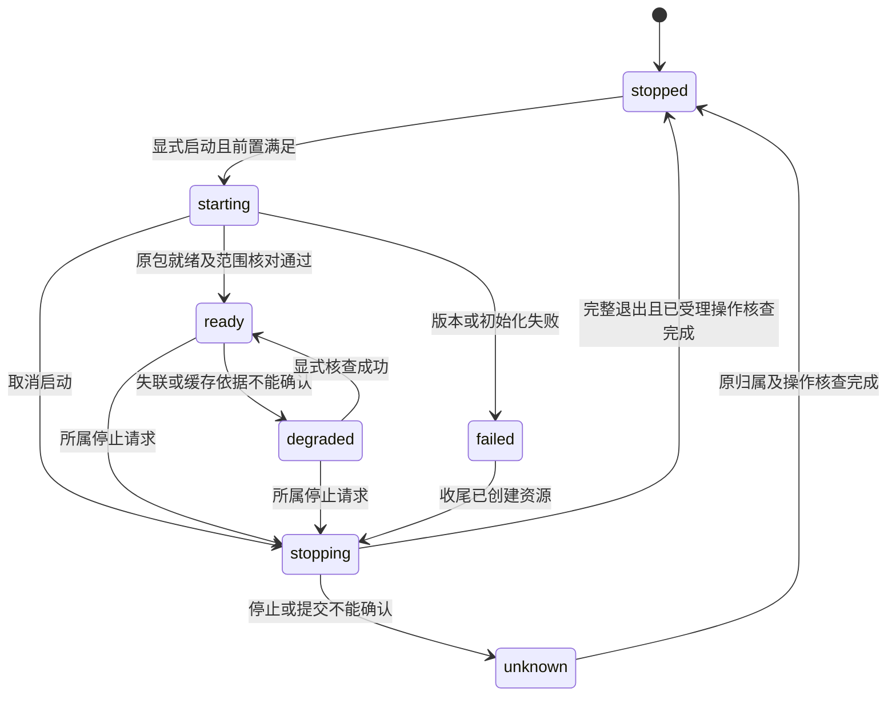

# Zotero host and Better BibTeX Spec Delta

## Purpose

使指定版本 Better BibTeX 原包在 Scholoom 自有兼容宿主中完成可核查的引用键和导出路径。人类与 Agent 消费同一共同文献事实，区分插件执行、领域提交、缓存可用与实际导出结果，并把未具备的生产保护和未验收功能明确保持不可用。

## ADDED Requirements

### Requirement: 有界核对共同CSL与唯一期刊原值

zotero.inspect SHALL 对最多100条选定sourceId／共同revision读取真实library.get及record，核对同一修订和唯一schema44 journalArticle原值identity。结果编码最多256KiB，题名比较明确equal或different，其余字段保持notComparable；不从相同revision或题名推出全条目一致，不扫描全库或无限重读。

#### Scenario: 核对CSL-only更正

- **WHEN** 用户更正CSL题名、日期或作者后读取所选修订
- **THEN** 返回真实CSL、完整所选原值／identity和正式键；题名准确比较，其余字段保持不可比较，原值不自动双写

#### Scenario: 读取期间竞争或原值不受支持

- **WHEN** get／record与请求revision不一致，或缺原title、缺原值、多个原值或不支持形态
- **THEN** 竞争返回contentChanged，缺值／不支持返回unavailable；不默认首个来源或从CSL猜原值

### Requirement: 原值表达的显式选择与题名更正

普通 CSL 更正 SHALL 保留未明确修改的 Zotero 原值。两种表达不一致或无法比较时，BBT 导出 SHALL 在明确选择采用所选原值后进行；Agent 可依用户明确指令选择，不能确定意图时 SHALL 询问并等待，不以默认选择代替授权。选择及结果依据 SHALL 绑定实际来源身份和共同 revision，竞争变化后重新核查。

原值更正 SHALL 通过独立动作表达，本片仅支持已有唯一 schema 44 journalArticle 原值的准确题名替换；复用共同提交、修订与稳定回执，不改变 CSL、来源身份、日期、作者、Extra 或正式键。日期、作者、多来源和其他表达不从本片推定支持。

#### Scenario: CSL 与原值题名不同且尚未选择表达

- **WHEN** 请求导出存在题名差异或不能比较的条目，且没有明确采用原值的意图
- **THEN** 不生成该次新导出，返回可核查的差异与选择需求，保留已有成果

#### Scenario: 用户明确要求 Agent 按原值导出

- **WHEN** 用户指令明确选择采用原值，实际来源身份和共同 revision 仍匹配
- **THEN** Agent 可提交该选择，导出采用所选原值并返回实际依据，无需再次人工点击

#### Scenario: 仅更正所选原值的题名

- **WHEN** 用户明确提交唯一受支持原值的题名更正
- **THEN** 共同提交只修改该原值题名，冲突保留原稿和已保存数据，不隐式同步 CSL 或其他原值字段

#### Scenario: 结构化表达选择及实际导出依据

- **WHEN** zotero.export请求所选sourceId／revision，其他字段仍不可比较
- **THEN** 缺expression返回selectionRequired及核对依据，不启动宿主或返回文本；明确选择expression.kind=zotero-original及准确identity后，实际两格式导出返回exported及format／text／revision／正式键／expression，交付前复核权限和依据。选择沿既有可信工具边界，不接受boolean替代或新增伪身份token；成功返回继续登记持续库外发依据

#### Scenario: 独立题名更正的竞争及未知回执

- **WHEN** zotero.replaceTitle提交稳定requestId、共同revision、identity及准确非空title，或按同requestId再次调用
- **THEN** 首次仅原title通过一次共同commitRecords更正；过期revision／identity拒绝，未知只查原requestId且不重放；已有回执返回queried，不声称新题名已执行，不另存题录／历史

### Requirement: 现有普通期刊的隔离共同接线

首个真实共同库切片 SHALL 仅对内核明确供应的隔离 libraryId 开放，默认不可用，产品参数不能选择原生执行路径或启用真实用户库。选择 SHALL 为1–100个不重复sourceId/revision；需要唯一schema 44 journalArticle原值及本片可映射的字段／作者／空关系，不从CSL反推。返回不可用时保留原值，来源副本使用新的共同来源实例，不按locator静默重绑定。

补缺键 SHALL 将原包全部Item.saveTx汇集为一次共同commitRecords；共同库检查全库大小写不敏感冲突，保留已有键和固定状态。确认回执后才更新派生SQL并发通知；回读及通知有界，不以100个并发回调突破公共容量。通知失败保留committed回执与诊断，新操作重建投影。导出 SHALL 返回格式、文本及所用sourceId/revision/正式键/固定状态，在宿主关闭后交付前复查有效read/send和选择依据。

#### Scenario: 未选中对象占用候选键

- **WHEN** 原包为选择中的缺键条目生成候选，而同库未选中对象持有大小写不同的同名正式键
- **THEN** 一次共同事务全部拒绝，全部所选修订及键保持原样，不自动改名或覆盖该固定键

#### Scenario: 保存已确认而结果观察失败

- **WHEN** 共同事务已经提交，但回调或结果观察失败
- **THEN** 调用保留unknown及原操作身份，查询共同commitResult核对；不得重放提交或清空原监督未决事实。已存在回执的fillKeys再次请求以queried返回该原操作回执，不执行新的选择，notRun只表示本次没有发通知，不推定原通知结果

#### Scenario: 生态工具历史参与后续模型请求

- **WHEN** 会话仅通过生态工具取得共同库结果，随后库外发授权被撤回，用户在当前内核或重启后继续该会话
- **THEN** 已使用的库身份随会话保留，后续模型请求仍复查该库的读取与外发授权，拒绝发送包含旧工具结果的历史；不要求先调用普通文献工具才生效

### Requirement: 独立认证及操作范围的公共监督

兼容宿主监督 SHALL 可脱离BBT、programs和文献业务独立校准，使用共同受管命令及原生退出确认，不以普通spawn或PID消失代替归属。一次性私有启动供应 SHALL 在准入和再次授权后通过有界stdin提供，不进入argv、环境、日志或renderer；认证绑定kernel、host、command实例及协议，拒绝旧或错误身份。command started、应用ready、插件正常关闭与原生scope停止 SHALL 分别确认。

双向调用 SHALL 保留原可信主体与操作／对象范围；读请求不能发起写回调。已受理回调 SHALL 纳入原操作及关闭等待，原结果到达后不再接收该handle的新回调。写操作的稳定关联 SHALL 在异步发送前保留，拒绝并发重复关联；未知效果不得自动重放。

监督记录 SHALL 有界且读写同限，恢复失败不覆盖原证据。未知原生scope SHALL 幂等计入共同准入，即使恢复时容量已满也不能随后漏计或经普通等待到期释放；原生已停但插件或领域结果未知时保留profile保护，不能借此声称仍有活动进程。真实共同提交的结果查询仍由文献提供。

#### Scenario: 原操作已返回而回调仍在执行

- **WHEN** 宿主已发回原操作结果，但该handle的已受理写回调尚未结束
- **THEN** 监督继续等待并保留未确认关联，拒绝该handle的迟到回调，不报告正常关闭或允许重复写入实例

#### Scenario: 满容量时恢复未知scope

- **WHEN** 共同准入已满，恢复记录仍不能确认旧host的原生scope停止
- **THEN** 该未知归属仍幂等计入占用，原有名额随后释放也不为超额新执行放行，不依据旧PID释放

#### Scenario: 监督记录不可解析

- **WHEN** 旧监督记录损坏或不可读取，随后调用方执行清理
- **THEN** 原记录及可能的未确认关联保持原样，新host不得启动，不能以默认新实例记录覆盖证据

### Requirement: 固定原包与限定能力声明

系统 SHALL 记录并核对 Zotero 10.0.5 基线及 BBT 9.0.68 原发布包、实际资源和执行环境的组合，保持原包及执行代码不修改；不要求安装或启动外部 Zotero。能力查询 SHALL 区分装载、初始化、可用功能和失败阶段。缺失或不支持的功能 SHALL 明确不可用，不能用占位成功或全局对象存在报告插件就绪。

首个闭环 SHALL 仅接入显式隔离的合成库，声明补齐缺失键、保留已有键、两个导出格式及缓存刷新实际验收范围。未验收的自动导出、对外 JSON-RPC、pull export、任意类型完整往返及真实用户库写入 SHALL 不被报告为已支持。

#### Scenario: 原包未能完成初始化

- **WHEN** 指定原包在模块装载或 Worker 初始化阶段失败
- **THEN** 查询返回所采用版本、失败阶段及有界原因，依赖该阶段的功能不可调用，共同人工题录能力继续可用

#### Scenario: 未安装 Zotero

- **WHEN** 在没有外部 Zotero 应用的环境运行隔离样本
- **THEN** 原包通过产品自有兼容宿主执行，验收证据不能来自外部 Zotero 代为读写或导出

### Requirement: 同一文献权威与受保护保存

兼容对象和 SQL 读取 SHALL 指向共同文献提供者确认的对象、修订及正式引用键，来源身份、条目身份、兼容本地整数标识、发表版本与修订号分别表达。插件缓存及兼容投影 SHALL 可从所属事实重建，不能成为另一份可独立修改的题录或正式键权威。未知字段、原类型及 Extra 等未能无损映射的信息 SHALL 保留明确差异，不能静默丢弃或覆盖。

人类和 Agent 的调用 SHALL 经过同源契约及所属领域的有效授权和修订核对；插件不得自报人工或执行身份扩大权限。异步处理保留原调用归属。生产接入所需来源身份、正式键、冲突、提交核查及删除恢复保护缺失时 SHALL 明确不可用，隔离替身通过不能解除该限制。

对象保存、SQL 事务、回滚、通知及缓存 SHALL 与所属领域实际提交结果一致；事务内失败不能伪报全部成功，未确认提交不能作为新正式事实导出。跨对象原子路径在缺少共同事务提供者时 SHALL 不启用，不能把多次独立 RPC 保存伪装成原子事务。

#### Scenario: 并发更正与撤权

- **WHEN** 插件基于旧修订保存，而人类已更正该条目或有效写入授权已撤回
- **THEN** 所属领域拒绝过期或未授权修改，保留已确认内容，插件投影失效并核对当前事实后才允许后续导出

#### Scenario: 提交结果不确定

- **WHEN** 写入请求已发送但回执丢失或结果校验失败
- **THEN** 返回效果未知及原操作核查线索，不自动重放；查询所属实际结果之前，不将插件内存中拟写值报告为已保存

#### Scenario: 缺少共同正式键提供者

- **WHEN** 宿主可以装载原包，但共同库尚无正式键及固定状态契约
- **THEN** 真实共同补键和依赖它的整合明确受阻，不把普通 metadata 扩展字段或插件缓存当作正式键替代

### Requirement: 已有引用键保护与提交后缓存一致

补键 SHALL 默认只处理缺失正式键，题录更正、插件缓存重建及宿主重启 SHALL 保持已采用键。共同固定状态和冲突规则 SHALL 在领域最终写入入口执行，包括插件偏好或后台事件触发的替换。首批不开放明确重生成；只读条目 shadow key SHALL 不被冒充共同正式键。

领域提交确认后 SHALL 更新兼容投影并使原包缓存响应已提交变化；回滚或保存拒绝后 SHALL 排除插件先行修改的内存值。通知失败 SHALL 不被解释为领域提交回滚，系统应保留实际结果并禁止使用无法核对的陈旧导出。

#### Scenario: 显式更正原值标题后再次导出

- **WHEN** 人或 Agent 经共同入口明确更正已有正式键条目的所选原值标题，再请求按该原值导出
- **THEN** 导出采用已提交的新标题和原正式键，不能返回缓存中的旧标题或因自动偏好更换已采用键

#### Scenario: 插件提前更新内存而保存被拒绝

- **WHEN** 插件已生成候选键，但共同领域因冲突或修订失效拒绝保存
- **THEN** 正式键保持原状，候选不作为成功结果导出，宿主先核对并重建受影响投影和缓存

### Requirement: CSL更正保留未明确修改的原值

生态适配 SHALL 消费共同领域已经确认的CSL／原值分离契约；只更正CSL不得触发未明确选择的原值、原类型、日期原文、创建者形态／角色／完整顺序、Extra或来源身份的自动改写。正式键及固定状态继续由共同权威保护，不随CSL更正或BBT缓存重算改变。共同revision SHALL 仅作为修订／读取依据，不被当作两个表达语义一致的证明。

本要求不确定新的导出默认选择／差异确认／CSL投影政策。相关备选及待用户决定项在design的D1–D3，本轮没有批准或实现新同步行为。

#### Scenario: 仅更正CSL题名

- **WHEN** 所选条目已有独立原值及正式键，调用方只提交CSL题名更正
- **THEN** 可分别读回更正后的CSL、未改变的原值与正式键；不得把共同revision已递增说成原值已更正或其导出已采用新CSL题名

#### Scenario: CSL日期或作者不能唯一还原原值

- **WHEN** CSL包含日期范围／literal、机构姓名或按角色分组的作者更正，但未明确给出原date字符串或目标creator完整位置
- **THEN** 原日期、姓名形态、跨角色顺序及Extra保留，不猜测逆映射；未获批准的原值同步或新表达导出分支保持未实施

### Requirement: 有界导出结果与真实入口验收

人工入口与 Agent SHALL 可按同一共同对象引用选择 BibTeX 或 BibLaTeX，结果包含格式、采用的条目及修订依据、实际文本或可核查失败。处理及返回 SHALL 有界，超限明确拒绝，不静默截断成成功导出。首批返回文本，不自动写入用户引用文件或启用导出任务；元数据／材料的实际外发仍按所属授权核对。导出 SHALL 不隐式写入缺失正式键，异步结果交付前重新核对有效授权及所选修订，变化时拒绝旧结果。

导出 SHALL 由指定原包的实际 translator／Worker 路径产生，不能以手写导出器或静态响应替代。若后续声明外部 JSON-RPC、pull export 或自动导出支持，SHALL 分别从真实外部入口及目标文件核对；内部兼容桥成功不能作为这些功能的验收。

#### Scenario: 两个调用方导出同一条目

- **WHEN** 人工入口和获授权 Agent 分别选择同一组条目和相同格式
- **THEN** 两者消费同一正式键与题录修订，原包实际结果可核对，任一方不会创建另一份题录权威

#### Scenario: 请求超限或未验收外部服务

- **WHEN** 调用超出声明样本范围／响应预算，或调用尚未启用的外部导出服务
- **THEN** 得到结构化限制或不可用原因，不返回截断成功，不改写用户文件

### Requirement: 可核查的宿主生命周期与独立失败

宿主 SHALL 提供当前阶段、实例、插件组合、可用能力、相关操作及失败线索。停止 SHALL 先停止受理新动作，核查已受理保存、关闭插件及其 Worker／缓存资源，并确认自身及所属后代退出；仅窗口关闭、IPC断开或根 PID 消失不能报告已停止。无法确认的停止和提交 SHALL 保留未知，不自动启动可能重复写入的实例或释放仍在使用的隔离目录。

重启 SHALL 从共同已提交事实重建投影并核查原未确认操作，不自动重放。平台无法提供必要归属保证时 SHALL 明确不可用，当前 macOS 不回退为无隔离执行。宿主局部失败 SHALL 不停用无关的人工文献管理。

#### Scenario: 关闭后重启

- **WHEN** 宿主正常停止并在同一隔离配置显式重启
- **THEN** 已提交题录和正式键保持，缓存从所属事实重建，未确认操作先查询而非重复执行

#### Scenario: 无法确认 Worker 退出

- **WHEN** 窗口已关闭但仍不能确认所属执行单元退出
- **THEN** 状态保留未知和归属线索，不报告停止成功，不删除仍可能被使用的配置或释放其占用

#### Scenario: 原包吞下关闭异常但局部资源已销毁

- **WHEN** 原包 shutdown 返回但其任务记录关闭失败，且宿主只确认窗口／本地资源已销毁
- **THEN** 监督状态区分本地资源释放、插件收尾和原生归属确认，插件收尾保持未确认，不能据局部 closed 报告完整正常停止
