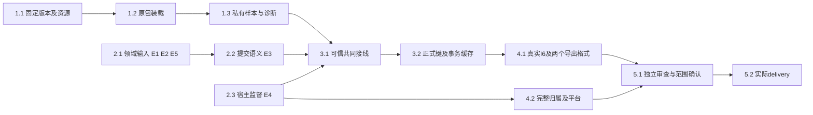

# 执行任务

用户已授权实施及锁文件依赖／Electron准备；独立H1及生产不可用限制已验证，当前4/13项完成。主线第二阶段已正式转交文献／阅读／计算快照，本轮已消费并形成精确需求、E4公共候选和原包失败样本；这不等于提供者已接入。2组的接口／架构前置未全部满足，3–5组不能据替身结果勾选。E1–E6定义及选项以[investigation](investigation.md#影响方案的未知项与实验)为准，实际结果见[delivery](delivery.md)。

## 1. 首批可独立实施：固定原包装载及样本诊断

写入范围：`apps/zotero-host`私有装载／兼容资源，`tests/fixtures/zotero-host`和宿主smoke；不写文献schema、不启用真实库。1.1–1.3顺序依赖，2组调查可并行。

- [x] 1.1 记录固定Zotero10.0.5发布及schema／utilities资源、BBT9.0.68原包的来源、许可和实际成员；复用既有运行时，不依赖已消失的临时路径。完成依据：精确资产可读取、原包成员未修改、支持清单准确；缺资产或需安装时先取得相应授权，不将准备缺失写成成功。
- [x] 1.2 在现隐藏Electron入口抽取最小ZoteroHost装载Module，复用Node＋Chromium原生Worker／IndexedDB及固定资源，以明确的私有空库Adapter满足装载所需对象接口；运行真实原bootstrap、主包与完整启动任务，提供status、shutdown和失败阶段。完成依据：原包真实ready及正常／初始化失败两条资源收尾路径可查；不得通过占位服务、裁剪启动图或外部Zotero达成。沿现entrypoints扩展独立宿主smoke。
- [x] 1.3 扩展私有合成Adapter，加入少量普通期刊样本，使原包实际补缺键并产生BibTeX和BibLaTeX，保留已有键／通知缺失的历史反例作为独立oracle。完成依据：原包实际文本、样本存储和status对应，明确标记领域Adapter为替身；断开／缓存失效有结构化诊断。这个成果只验H1，不称共同库或生产I6通过。

## 2. 真实接线前置：保持受阻的输入与决策

这些项目不授权本线替文献／阅读／平台维护者制定其事实源；外部结果未到时保留未完成，并可继续不依赖它们的1组。

- [ ] 2.1 【文献B批design／实际schema已消费；E1/E2提供者待交付；E5设计核对已完成】接收文献线来源命名空间、原类型／字段与Extra保留、正式键／固定状态和冲突schema及真实端口，核对复制库、重复接入、删除重入与恢复区分。本轮已分别读取主线快照中的材料与报告design及实际位置schema，sidecar／PDF新版本与报告边界见investigation第二阶段交接；不再等待重复设计输入，不合并两个change。完成依据：受影响的共同接口由提供者确认，生态不另存正式键、项目继续用共同指针；E5后续材料写回仍待提供者，不阻塞不读材料的BBT样本。
- [ ] 2.2 【原包多Item及失败样本已交；E3选择／提供者待确认】和文献提供者按investigation的A/B选项确定插件 `save/saveTx/executeTransaction` 的真实原子范围、revision、授权、稳定提交关联／查询及通知结果。本轮已实证显式fill部分提交、fillMissing原子回滚及两者缓存领先；A需共同批量原子提供者，B需确认仅开放显式逐条补键的范围。完成依据：明确同源字段与提供者、反例和限制；范围取舍必须已确认。未定之前不编写共同事务Adapter或假回执。
- [ ] 2.3 【计算观察已消费、E4公共候选已形成；确认／接入／实跑待完成】按design的P0→P1→P2核对原生归属、宿主私有启动供应、可信实例、双向WS、真正ready与正常shutdown。P0由计算先修C3并拆公共增量，经dev验证／用户同步；P1的listener／stdin供应／恢复记录只交候选，未确认不实施。原包吞shutdown错误的profiler反例已记录，P2须修并核对插件收尾，不能用localResourcesClosed当整体确认。完成依据：实际启动／正常关闭／失联／停止保证可验证，macOS保持不可用；不使用普通spawn或修改通用原生保证兜底。
- [x] 2.4 【E6保持生产阻塞】核对并在能力状态中准确表达题录／附件删除、操作者及恢复／重新入库提供者的实际可用性。完成依据：缺少保护时真实用户库仍不可启用，不把备份副本恢复替代对象恢复，不以未发现引用宣称可安全撤回。此任务验收的是限制确实生效，无需本change实现删除恢复；待E6实际能力齐备后，生产启用由后续变更承接。1组及隔离I6可继续，本change不实施迁入。

## 3. 共同权威接线与保存一致性

前置：1组、2.1中E1/E2、2.2、2.3实际满足并获得实施授权。公共文件由本线提出最小增量，按design列出的符号范围核对，不占用其他领域业务写集。

- [ ] 3.1 添加生态同源操作、派生导出及host角色受认证回环WS，复用broker／RpcPeer并允许等待期间的反向领域调用；实际绑定共同库范围、原调用身份、有效授权与实例。完成人工CLI及既有harness工具薄适配；schema与生成映射／architecture消费声明同步。完成依据：真实broker拒绝伪造身份、越界操作／库、旧实例与缺提供者，双向调用不死锁；不借connectProduct授予完整human权限。复用broker/rpc测试，新增仅测生态实际接线缺口。
- [ ] 3.2 按已确认领域接口实现Item／SQL派生视图和受保护保存，正式键只有文献一处权威；处理提交后通知、插件提前改内存、回滚／CAS拒绝／撤权及未知回执。完成依据：共同结果／revision／键、SQL读取及随后原包导出一致；保存成功通知失败能分别诊断；已采用键在元数据更正、resetKeyOnChange触发及重启后保持。按同类根因表驱动覆盖必要反例，不断言内部调用顺序。

## 4. 最小真实独立验收

- [ ] 4.1 在隔离真实kernel／library／broker／WS／宿主组合完成人工CLI和实际harness工具的I6：补缺键、同库已有键冲突、更正后缓存刷新、原包BibTeX／BibLaTeX、停止重启读回及未知提交核查。完成依据：持久共同结果与实际导出文件证据对应，内部提供者均真实，模型只在外部边界受控；明确H1替身结果不能算本项。复用literature integration的授权与读回入口，新增`tests/kernel/zotero-host.spec.ts`补生态路径。
- [ ] 4.2 完成真实Electron与Worker的正常关闭、初始化中断、忙执行及失联归属检查，按实例核对后代退出／unknown并保护隔离目录；Linux与Windows分别记录，当前macOS明确拒绝。运行现宿主smoke及受影响原生／lifecycle回归；对调查列出的CI失败核对发送、受理、执行、领域提交与刷新，不通过加timeout或删除保证获得通过。未获目标平台结果的部分保持未完成。

## 5. 整合与交付

- [ ] 5.1 主Agent核对proposal完成判据及spec场景，安排关键接口、权限、并发、缓存／事务与数据保护的独立审查并处理发现；按实际改动运行typecheck、架构守卫、构建和上述定向测试。更新开发说明实际入口及初设中已转正式部分的链接；不把自动导出、外部JSON-RPC／pull export、Reader、迁入或三平台分发写成已支持。无关全仓失败另记范围，不顺带修复。
- [ ] 5.2 仅实际执行后获取 `openspec instructions delivery --change connect-zotero-host-bbt --json`，按实测成果／替身／失败及未完成前置创建或更新同一delivery.md；核对真实I6与阶段成果，只有相应完成依据满足才勾选。没有实施结果时本项保持未完成、delivery保持不存在。

## 续做入口

实施授权持续有效，不重复确认。下一位先读[delivery](delivery.md)、[正式快照核对与反例](investigation.md#第二阶段正式交接与消费者核对)、[E4公共候选](design.md#第二阶段e4长驻监督公共候选)及本任务表。本轮已完成消费／需求交回，不新增实施完成项，仍4/13；停止于用户指定的第二阶段交接边界。继续需2.1／2.2实际文献提供者、E3范围选择，以及2.3的公共方案确认与dev接入／同步证据；不要再以“未收到阅读设计”受阻，也不要重做固定版本调查或H1。最终5.2仍需完整目标满足后收尾，中途delivery存在不代表change完成或可归档。
