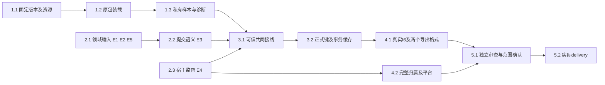

# 执行任务

## 共同领域接入后的期刊切片

当前基线 `1026796d854b8f568c3e819f13268a9638980bc1`，开始时工作区干净。共同 E1–E3 提供者已在本树，替代下文历史“待交付”条件；监督 E1 整改已由主线接收。完整 change 的材料、删除恢复、跨平台及 I6 条件仍开放。

- [x] R5.1 逐字段消费真实 record/source instance/key/commitRecords/result，落地最多100条现有普通期刊契约、隔离装配与同源操作；缺原值不可从CSL反推。
- [x] R5.2 实施真实 Item/SQL 派生投影与原包外层事务，一次共同原子提交；稳定未知查询、固定键/全库冲突、提交后读回及通知分别诊断。
- [x] R5.3 接真实 kernel/broker/认证受管Electron/原包与人工及harness薄入口，默认禁用真实用户库，不替换其他领域工具或根构造参数。
- [x] R5.4 先构建再运行隔离真实整合及最小相关回归，保留首次失败/模拟边界，更新同一delivery并交本轮增量补丁；不勾完整I6或全平台。

本轮实际13/22；六条新增整合、相关内核合计43/43及原包smoke10/10通过，证据见delivery当前节。2/3/4组原任务中更广映射、偏好事件、材料／删除恢复、跨平台和整项I6仍未勾选。历史的提供者等待条件由真实本树接入替代，不能再按未收到设计阻塞本片。

## 第四轮验收整改（历史）

- [x] R4.1 修复主线实跑E1：外层RPC超时／失联不再丢失已受理回调的生命周期及容量；关闭按原预算等待，未结束则unknown并保留未决事实，不能用scopeStopped代替callback完成。复用host-connection回归先红后绿，核对读／写回调、完成后收尾与容量；仅改本线监督、必要测试及design／delivery，复验受影响构建／类型／架构／生成与原包，不扩文献／生产。

本轮验收E1整改及自验完成，当前9/18；关闭保证仍以主线复核和本轮实际范围为准，不等于整个change或I6接收。增量补丁依赖本轮开始前已有第三轮监督源码，证据见delivery第四轮。

2026-10-26恢复：当前HEAD `eaf38be1ac2d350120805859175fc82cf9c36927`，`0519904`（含`b838402`）已为祖先，恢复时工作区干净；用户已撤销等待手动同步条件。直接消费本树正式公共源码，不再构造临时基线组合。本轮实施独立认证host listener、私有stdin供应、监督／重启保护及原包profiler／shutdown修复；来源副本默认新实例、同库键大小写不敏感且不改名／覆盖固定键、有界多对象原子提交和稳定查询均已定，等待的是文献实际提供者而非A/B选择。

## 第三轮独立实施切片（历史）

- [x] R3.1 为ManagedCommands.start增加仅宿主供应的一次性stdin封套；准入／再次授权后取值，不进argv/env/log；旧execute和命令观察不回退。
- [x] R3.2 实施不依赖programs／BBT／文献的公共HostConnection及同源生命周期／客户端：独立认证listener、实例与操作绑定、双向RPC、ready、正常shutdown、unknown、持久重启核查。真实受管固定host先校准正常／错身份／失联／超时／取消／保存失败与占用。
- [x] R3.3 修复原包profiler能力与吞shutdown错误的可观察性，保留原发布包；原样本实际正常关闭及错误收尾回归。
- [x] R3.4 连接公共监督与原包显式样本Adapter，真实Linux受管Electron／Worker验证ready、双向操作及正常／异常退出；输出独立公共／私有补丁、必要类型／架构／生成映射／OpenSpec验证。未跑平台及共同提供者继续开放，不称I6或整change完成。

独立H1的历史进度为4/13；加入并完成本轮四项独立切片后，当前为8/17。共同提供者和3–5组整合任务不能据替身结果勾选，E1–E6当前状态见[investigation](investigation.md#影响方案的未知项与实验)，实际成果与补丁见[delivery](delivery.md)。

## 1. 首批可独立实施：固定原包装载及样本诊断

写入范围：`apps/zotero-host`私有装载／兼容资源，`tests/fixtures/zotero-host`和宿主smoke；不写文献schema、不启用真实库。1.1–1.3顺序依赖，2组调查可并行。

- [x] 1.1 记录固定Zotero10.0.5发布及schema／utilities资源、BBT9.0.68原包的来源、许可和实际成员；复用既有运行时，不依赖已消失的临时路径。完成依据：精确资产可读取、原包成员未修改、支持清单准确；缺资产或需安装时先取得相应授权，不将准备缺失写成成功。
- [x] 1.2 在现隐藏Electron入口抽取最小ZoteroHost装载Module，复用Node＋Chromium原生Worker／IndexedDB及固定资源，以明确的私有空库Adapter满足装载所需对象接口；运行真实原bootstrap、主包与完整启动任务，提供status、shutdown和失败阶段。完成依据：原包真实ready及正常／初始化失败两条资源收尾路径可查；不得通过占位服务、裁剪启动图或外部Zotero达成。沿现entrypoints扩展独立宿主smoke。
- [x] 1.3 扩展私有合成Adapter，加入少量普通期刊样本，使原包实际补缺键并产生BibTeX和BibLaTeX，保留已有键／通知缺失的历史反例作为独立oracle。完成依据：原包实际文本、样本存储和status对应，明确标记领域Adapter为替身；断开／缓存失效有结构化诊断。这个成果只验H1，不称共同库或生产I6通过。

## 2. 真实接线前置及超出当前切片的部分

来源实例／原值／正式键及现有对象原子提交提供者已从1026796本树真实消费，普通期刊成果见R5；以下原任务保留更广的映射、材料和完整整合条件，不再等待相同公共源码或设计。

- [ ] 2.1 【普通期刊E1/E2真实提供者已消费；复杂映射及E5写回仍开放】接收文献线来源命名空间、原类型／字段与Extra保留、正式键／固定状态和冲突schema及真实端口，核对复制库、重复接入、删除重入与恢复区分。本轮已分别读取主线快照中的材料与报告design及实际位置schema，sidecar／PDF新版本与报告边界见investigation第二阶段交接；不再等待重复设计输入，不合并两个change。完成依据：受影响的共同接口由提供者确认，生态不另存正式键、项目继续用共同指针；E5后续材料写回仍待提供者，不阻塞不读材料的BBT样本。
- [ ] 2.2 【普通期刊一次共同原子提交及稳定查询已实跑；更广事务仍开放】消费文献所属schema／provider，核对`save/saveTx/executeTransaction`的原子范围、revision、授权、稳定结果及通知。原包逐条fill／原子fillMissing反例已交，不再待选逐条缩减方案。完成依据：实际同源提供者及失败／未知提交实跑，不编共同事务假Adapter或假回执。
- [ ] 2.3 【Linux隔离共同装配已实跑；生产装配及跨平台仍开放】P0已同步，R3.1–R3.4提供独立认证／stdin／实例／双向RPC／ready／正常shutdown／恢复及原包吞错修复。当前只有明确样本装配，共同文献及产品角色的实际接线继续随2.1／2.2和3组推进；Windows另验，macOS不可用。公共增量独立交回供主线接入，不用普通spawn或PID消失替代原生保证，不把局部closed当整体确认。
- [x] 2.4 【E6保持生产阻塞】核对并在能力状态中准确表达题录／附件删除、操作者及恢复／重新入库提供者的实际可用性。完成依据：缺少保护时真实用户库仍不可启用，不把备份副本恢复替代对象恢复，不以未发现引用宣称可安全撤回。此任务验收的是限制确实生效，无需本change实现删除恢复；待E6实际能力齐备后，生产启用由后续变更承接。1组及隔离I6可继续，本change不实施迁入。

## 3. 共同权威接线与保存一致性

前置：1组、2.1中E1/E2、2.2、2.3实际满足并获得实施授权。公共文件由本线提出最小增量，按design列出的符号范围核对，不占用其他领域业务写集。

- [ ] 3.1 添加生态同源操作、派生导出及host角色受认证回环WS，复用broker／RpcPeer并允许等待期间的反向领域调用；实际绑定共同库范围、原调用身份、有效授权与实例。完成人工CLI及既有harness工具薄适配；schema与生成映射／architecture消费声明同步。完成依据：真实broker拒绝伪造身份、越界操作／库、旧实例与缺提供者，双向调用不死锁；不借connectProduct授予完整human权限。复用broker/rpc测试，新增仅测生态实际接线缺口。
- [ ] 3.2 按已确认领域接口实现Item／SQL派生视图和受保护保存，正式键只有文献一处权威；处理提交后通知、插件提前改内存、回滚／CAS拒绝／撤权及未知回执。完成依据：共同结果／revision／键、SQL读取及随后原包导出一致；保存成功通知失败能分别诊断；已采用键在元数据更正、resetKeyOnChange触发及重启后保持。按同类根因表驱动覆盖必要反例，不断言内部调用顺序。

## 4. 最小真实独立验收

- [ ] 4.1 在隔离真实kernel／library／broker／WS／宿主组合完成人工CLI和实际harness工具的I6：补缺键、同库已有键冲突、更正后缓存刷新、原包BibTeX／BibLaTeX、停止重启读回及未知提交核查。完成依据：持久共同结果与实际导出文件证据对应，内部提供者均真实，模型只在外部边界受控；明确H1替身结果不能算本项。复用literature integration的授权与读回入口，新增`tests/kernel/zotero-host.spec.ts`补生态路径。
- [ ] 4.2 完成真实Electron与Worker的正常关闭、初始化中断、忙执行及失联归属检查，按实例核对后代退出／unknown并保护隔离目录；Linux与Windows分别记录，当前macOS明确拒绝。运行现宿主smoke及受影响原生／lifecycle回归；对调查列出的CI失败核对发送、受理、执行、领域提交与刷新，不通过加timeout或删除保证获得通过。未获目标平台结果的部分保持未完成。

## 5. 整合与交付

- [ ] 5.1 主Agent核对proposal完成判据及spec场景，安排关键接口、权限、并发、缓存／事务与数据保护的独立审查并处理发现；按实际改动运行typecheck、架构守卫、构建和上述定向测试。更新开发说明实际入口及初设中已转正式部分的链接；不把自动导出、外部JSON-RPC／pull export、Reader、迁入或三平台分发写成已支持。无关全仓失败另记范围，不顺带修复。
- [ ] 5.2 仅实际执行后获取 `openspec instructions delivery --change connect-zotero-host-bbt --json`，按实测成果／替身／失败及未完成前置创建或更新同一delivery.md；核对真实I6与阶段成果，只有相应完成依据满足才勾选。没有实施结果时本项保持未完成、delivery保持不存在。

## 续做入口

先读delivery当前“共同库期刊切片”及design对应节，直接从1026796及本轮增量续做，不应用历史累计补丁、不重做监督选型、H1或提供者调查。当前13/22，首个隔离共同库补缺键及两格式导出已实跑；更广的共同字段与原值同步映射、偏好事件、E5/E6、生产装配及完整I6仍开放。下一阶段须主线明确范围，不能自动展开或启用真实用户库。
